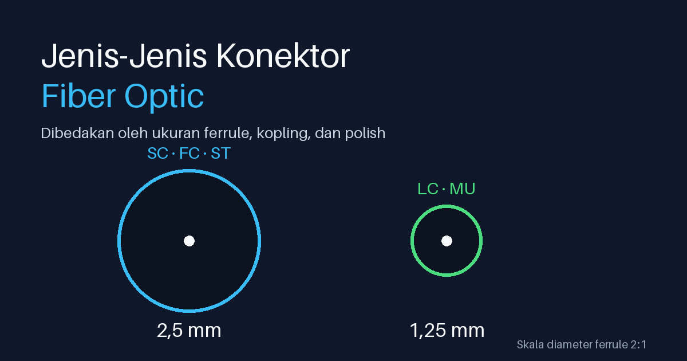

Pegang patch cord fiber dari laci, lalu lihat ujungnya. Bentuknya bisa persegi, bisa kecil berpasangan, bisa bulat berulir. Semuanya tugasnya sama: mempertemukan dua inti serat sehingga cahaya lewat dengan rugi sekecil mungkin. Yang beda adalah ukuran, cara kopling, dan tempat konektor itu cocok dipakai.

Tulisan ini merangkum jenis konektor fiber optic yang paling sering ketemu di lapangan, mulai dari SC dan LC sampai konektor VSFF untuk transceiver 400G/800G. Saya juga bahas perbedaan UPC dan APC yang sering bikin salah beli, arti kode warna, dan angka insertion loss yang boleh dijadikan pegangan.

> **Key Takeaways**
>
> - Dua hal yang membedakan konektor: ukuran ferrule (2,5 mm untuk SC, FC, ST; 1,25 mm untuk LC dan MU) dan cara koplingnya.
> - UPC (biru) dan APC (hijau) tidak boleh dikawinkan langsung. Kalau polish-nya harus ganti, pakai patch cord hibrida.
> - Warna konektor membantu, tapi tanda cetak di kabel lebih bisa dipercaya.
> - Untuk densitas tinggi, LC adalah titik awal. MPO/MTP dan VSFF (SN, MDC) masuk saat port-nya sudah 400G/800G.

## Apa yang membedakan satu konektor dari yang lain?

Sebuah konektor fiber memegang serat di dalam ferrule, yaitu tabung kecil dengan lubang tepat di tengah. Dua ferrule dipertemukan di dalam adapter, dan kualitas pertemuan itulah yang menentukan loss. Ada tiga hal yang membedakan konektor.

Pertama, diameter ferrule. SC, FC, dan ST memakai ferrule 2,5 mm, sedangkan LC dan MU memakai 1,25 mm sehingga bodinya bisa jauh lebih kecil ([FOA, Connector Identifier](https://thefoa.org/tech/connID.htm)). Kedua, mekanisme kopling: snap-in (SC), bayonet (ST), ulir (FC), atau push-on dengan pin pemandu (MPO). Ketiga, polish ujung ferrule, rata (PC/UPC) atau miring 8 derajat (APC), yang saya bahas tersendiri di bawah.

## Konektor satu ukuran 2,5 mm: SC, FC, ST

**SC** dipakai luas dan tersedia dalam bentuk duplex. Koplingnya snap-in dengan gerakan push-pull, dan menurut [FOA](https://thefoa.org/tech/connID.htm) konektor ini distandardisasi di TIA-568-A, edisi lama (nilai loss di bawah merujuk TIA-568.3-E).

**FC** memakai ulir. Dulu populer untuk singlemode, sekarang sebagian besar sudah digantikan SC dan LC. Kalau kamu ketemu FC, kemungkinan besar itu instalasi lama.

**ST** memakai kopling bayonet dengan ferrule 2,5 mm, biasanya keramik. FOA mencatat ST sebagai konektor multimode paling populer sampai sekitar tahun 2005. Nama ST juga merek dagang AT&T.
## Konektor kecil 1,25 mm: LC dan MU

**LC** (FOA menyebutnya "Lucent LC") memakai ferrule 1,25 mm, sehingga bisa dipasang jauh lebih rapat daripada SC. FOA mencatat konektor small form factor mulai naik pada akhir 1990-an, dan LC kini jadi pilihan utama untuk singlemode di telco serta LAN/SAN berkecepatan tinggi.

**MU** juga berferrule 1,25 mm, bentuknya mirip SC versi mini. Konektor ini populer di Jepang dan Asia Timur, jadi di Indonesia jarang ketemu.

## MPO/MTP: banyak serat dalam satu konektor

MPO memuat 12 atau 16 serat dalam satu ferrule plastik yang berbentuk baris. Kopling-nya push-on, dan keselarasan dijaga oleh pin di salah satu ferrule yang masuk ke lubang di ferrule lawannya ([FOA](https://thefoa.org/tech/connID.htm)). "MTP" adalah nama komersial untuk konektor jenis ini.

Konektor ini biasa dijual dalam bentuk kabel preterminated, dan dipakai untuk paralel optik seperti multimode 40G/100G.

Yang sering bikin bingung ada tiga. Pertama, gender: male punya dua pin pemandu dan female punya lubang untuk pin itu. Menurut [AMPCOM](https://www.ampcom.com/blogs/tech-lab/mpo-mtp-polarization-types-explained-type-a-b-c), male ke male bisa merusak kedua ferrule, jadi satu sisi harus male dan sisi lain female.

Kedua, polaritas. Ada tipe A (lurus, posisi 1 ke 1), tipe B (terbalik penuh, 1 ke 12), dan tipe C (pair-flipped). Ringkasan ini dari [AMPCOM Tech Lab](https://www.ampcom.com/blogs/tech-lab/mpo-mtp-polarization-types-explained-type-a-b-c), blog vendor, jadi anggap sebagai gambaran awal. Untuk desain sungguhan, rujuk TIA-568.3 atau panduan vendor kabel yang kamu pakai.

Ketiga, hubungan pin dan key. Sumber yang saya baca tidak sepakat soal aturannya, jadi cek dokumentasi produk yang kamu beli dan jangan menghafal satu aturan umum.

## Konektor VSFF untuk 400G dan 800G: SN dan MDC

Panel 19 inci makin padat, jadi muncul keluarga *very small form factor* (VSFF). Dua yang terdokumentasi paling jelas adalah SN dan MDC. Keduanya berisi dua ferrule keramik berpegas 1,25 mm berbasis teknologi LC. Menurut Rosenberger OSI, SN adalah Senko Nano dari SENKO, sedangkan MDC (Miniature Duplex Connector) dari US Conec.

Menurut [Rosenberger OSI](https://osi.rosenberger.com/us/news-media/blog-vlog/vsff-connector-in-400-and-800-gigabit-applications/), konektor VSFF muat hingga 128 port per rack unit di panel 19 inci, dibanding maksimum 96 port untuk LC duplex. Versi SN Quad dan MDC Quad dipakai untuk 400G DR4 dan 800G DR4 sampai sekitar 500 m.

Satu peringatan praktis: ferrule 1,25 mm yang sama bukan berarti housing dan adapternya cocok. Jangan asumsikan konektor VSFF yang berbeda bisa saling dikawinkan.

## UPC vs APC: jangan dicampur

Polish ujung ferrule menentukan seberapa banyak cahaya yang memantul balik ke sumber. Menurut [L-com](https://www.l-com.com/resources/blog/apc-vs-upc-fiber-connectors) (28 Oktober 2026):

- UPC punya return loss sekitar 50 dB atau lebih baik. Polish PC yang lebih lama sekitar 40 dB.
- APC dipoles dengan sudut 8 derajat, sehingga cahaya pantul diarahkan ke cladding dan tidak balik ke laser. Return loss-nya sekitar 60 dB atau lebih baik.
- Pada singlemode, UPC berwarna biru dan APC berwarna hijau.

Menurut L-com juga, APC jadi standar untuk PON/FTTx, terutama bila ada overlay video RF 1550 nm (biasanya SC APC), plus RF over fiber, CATV, dan DAS.

**Jangan pernah mengawinkan UPC dengan APC.** Menurut L-com, sudut ferrule-nya tidak pas, sehingga ada celah udara yang menambah beberapa dB loss, dan ferrule bisa rusak. Untuk berpindah antar-polish, pakai patch cord hibrida APC-ke-UPC. Adapter tidak menyelesaikan masalah ini.

## Kode warna: bantu, tapi jangan dijadikan satu-satunya pegangan

Berdasarkan [FOA, Fiber Optic Cable And Connector Color](https://www.thefoa.org/tech/ColCodes.htm):

| Jenis serat | Warna |
|---|---|
| Singlemode PC/UPC | Biru |
| Singlemode APC | Hijau |
| Multimode OM1 (62,5/125) | Beige |
| Multimode OM2 (50/125) | Konektor hitam, jaket oranye |
| Multimode OM3/OM4 | Aqua |
| Multimode OM5 | Lime |

Warna lime untuk jaket kabel OM5 diresmikan lewat ANSI/TIA-598-D-2 pada Januari 2018 ([CommScope](https://www.commscope.com/Blog/Call-me-a-limey)). Hati-hati: L-com mencatat lime OM5 bisa terlihat seperti hijau APC di cahaya redup. Warna violet untuk OM4 yang kadang ditemui adalah konvensi pabrikan, bukan warna standar TIA-598.

FOA sendiri mengingatkan bahwa pewarnaan konektor tidak seragam antarpabrikan. Cek tanda cetak di jaket kabel sebelum menyimpulkan jenis serat dari warna konektornya.

## Berapa loss yang wajar?

Fluke Networks menulis bahwa TIA menetapkan 0,75 dB sebagai batas maksimum worst-case untuk satu pasangan konektor, dan menyebut angka itu "cukup tinggi dan kurang realistis" ([Fluke, 18 April 2018](https://de.flukenetworks.com/blog/cabling-chronicles/cable-testing-101-standard-says-075-db)). Nilai tipikal yang disebut Fluke di artikel yang sama jauh lebih rendah:

| Kelas konektor | Insertion loss tipikal |
|---|---|
| Standar | 0,3 sampai 0,5 dB |
| Low loss | 0,15 sampai 0,2 dB |

Untuk pengukuran dengan kabel referensi, [Fluke KB](https://www.flukenetworks.com/knowledge-base/certifiber-pro/new-loss-budget-values-reference-grade-connectors-ansitia-5683-d) mencatat nilai yang selaras TIA-568.3-E untuk sambungan reference ke standard: singlemode 0,50 dB. Nilai multimode (0,30 dB dan 0,50 dB) tergantung versi dan konfigurasi pengukuran, jadi baca artikel Fluke-nya sebelum memakainya. Untuk pasangan konektor reference-grade, Fluke menyebut maksimum 0,10 dB untuk multimode dan 0,20 dB untuk singlemode.

Satu peringatan: jangan memetakan 0,75 dB TIA ke "Grade B" atau "Grade C" di IEC 61753-1. Grade IEC adalah statistik untuk sambungan acak, bukan batas lulus-gagal seperti TIA.

## Kebersihan ujung konektor

Loss atau return loss yang jelek tidak selalu salah jenis konektor. Bisa juga debu. Partikel di permukaan ferrule menghalangi cahaya atau menimbulkan pantulan.

Langkahnya sederhana: inspeksi dulu dengan scope sebelum mengawinkan konektor, bersihkan kalau kotor, dan pasang tutup debu saat konektor tidak dipakai.
## Cara memilih

| Kebutuhan | Konektor yang biasanya cocok |
|---|---|
| Jaringan akses FTTH/PON | SC APC (hijau) atau LC APC |
| Patch panel dan transceiver dengan port duplex kecil | LC duplex |
| Instalasi lama | FC atau ST |
| Backbone paralel optik 40G/100G | MPO/MTP |
| Port 400G/800G berdensitas tinggi | SN atau MDC (VSFF), sesuai transceiver |

Aturan praktisnya: pilih konektor mengikuti port perangkat, lalu pilih polish mengikuti jenis layanan, dan terakhir cocokkan warna dengan jenis serat. Kalau ragu, baca datasheet transceiver atau ODF yang akan dipakai sebelum memesan patch cord.

## Sumber

Hampir semua sumber di bawah adalah dokumentasi vendor atau asosiasi industri (FOA). Standar TIA dan IEC berbayar, jadi saya merujuknya lewat sumber-sumber ini dan bukan membaca dokumennya langsung. Untuk desain atau pengadaan, cek ke dokumen standar dan datasheet produknya.

- [FOA, Connector Identifier](https://thefoa.org/tech/connID.htm)
- [FOA, Fiber Optic Cable And Connector Color](https://www.thefoa.org/tech/ColCodes.htm)
- [L-com, APC vs UPC Fiber Connectors](https://www.l-com.com/resources/blog/apc-vs-upc-fiber-connectors) (28 Oktober 2026)
- [Fluke Networks, Cable Testing 101: But the Standard Says 0.75 dB!](https://de.flukenetworks.com/blog/cabling-chronicles/cable-testing-101-standard-says-075-db) (18 April 2018)
- [Fluke Networks, New Loss Budget Values for Reference Grade Connectors](https://www.flukenetworks.com/knowledge-base/certifiber-pro/new-loss-budget-values-reference-grade-connectors-ansitia-5683-d) (20 Februari 2019)
- [CommScope, Call me a limey](https://www.commscope.com/Blog/Call-me-a-limey) (9 Maret 2018)
- [Rosenberger OSI, VSFF connector in 400 and 800 Gigabit applications](https://osi.rosenberger.com/us/news-media/blog-vlog/vsff-connector-in-400-and-800-gigabit-applications/)
- [AMPCOM Tech Lab, MPO/MTP Polarization Types Explained](https://www.ampcom.com/blogs/tech-lab/mpo-mtp-polarization-types-explained-type-a-b-c) (10 Juli 2026, blog vendor)

Penulis: [Mahyuddin Susanto](https://www.udienz.web.id/about.html). Koreksi atau tambahan bisa dikirim lewat [halaman kontak](https://www.udienz.web.id/contact.html).
