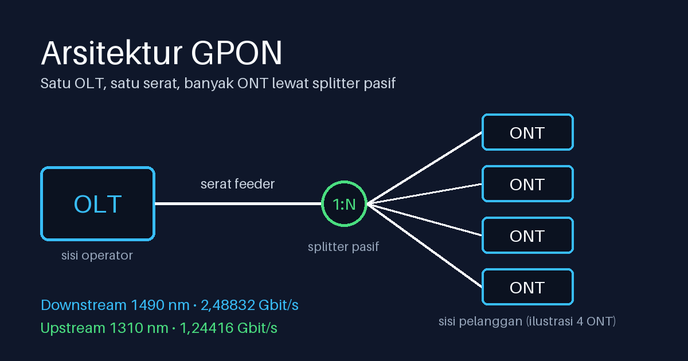

Kalau kamu pernah melihat kotak kecil berlampu di rumah pelanggan fiber, itu ujung dari sebuah jaringan GPON. Di seberangnya, entah beberapa kilometer jauhnya, ada satu perangkat yang melayani puluhan kotak seperti itu lewat satu serat. Di antaranya hanya ada kaca dan splitter, tanpa listrik.

Tulisan ini membahas apa itu GPON, standar yang mendasarinya, arsitektur dan cara kerjanya, serta apa gunanya dibanding jaringan fiber biasa. Untuk bagian konektor, saya tautkan ke [pembahasan jenis konektor fiber optic](/2026/11/03/jenis-jenis-konektor-fiber-optic) yang terbit sebelumnya.

*Ilustrasi. Jumlah ONT dan split ratio di gambar bukan nilai nyata.*

> **Key Takeaways**
>
> - GPON (Gigabit-capable Passive Optical Network) adalah teknologi akses fiber point-to-multipoint yang distandardisasi ITU-T lewat seri G.984.
> - Satu OLT (Optical Line Terminal) melayani banyak ONT (Optical Network Terminal) lewat serat bersama dan splitter pasif. Downstream 2,48832 Gbit/s, upstream 1,24416 Gbit/s (ITU juga mencantumkan varian upstream 2,48832 Gbit/s).
> - Satu serat membawa dua arah di panjang gelombang berbeda: sekitar 1490 nm ke bawah, sekitar 1310 nm ke atas.
> - Jangkauan fisik hingga 20 km, dan umumnya dipakai split 1:32. Batas sebenarnya ditentukan budget loss.

## Apa itu GPON?

**GPON** (Gigabit-capable Passive Optical Network) adalah jaringan akses fiber yang membagi satu jalur optik ke banyak pelanggan memakai komponen pasif, yaitu komponen pembagi yang tidak butuh catu daya. Arsitektur seperti ini disebut point-to-multipoint. GPON termasuk keluarga PON, yang kini juga mencakup standar yang lebih cepat.

GPON sendiri adalah keluarga standar ITU-T G.984. Cisco menjelaskan perangkat sisi operator (OLT) mengumpulkan sinyal dari banyak ONT dalam satu aliran terpadu, lalu memformatnya menjadi Ethernet ([Cisco, Understand GPON Technology](https://cisco.com/c/en/us/support/docs/switches/catalyst-pon-series/216230-understand-gpon-technology.html), Rev 3.0, 6 Desember 2023).

## Keluarga standar ITU-T G.984

G.984 bukan satu dokumen, melainkan beberapa rekomendasi yang membagi tugas per lapisan. Tanggal berikut diambil dari halaman ITU untuk masing-masing rekomendasi:

| Standar | Cakupan | Edisi yang berlaku |
|---|---|---|
| G.984.1 | Karakteristik umum | 03/2008 |
| G.984.2 | Lapisan fisik (PMD, Physical Media Dependent) | 08/2019 |
| G.984.3 | Lapisan transmission convergence (TC) | 01/2014, dengan amendemen sampai 2025 |
| G.984.4 | Antarmuka manajemen ONT (OMCI) | 02/2008 |
| G.984.5 | Enhancement band | 02/2022 |
| G.984.6 | Reach extension | 03/2008, dengan amendemen |

G.984.3 mencakup framing GTC (GPON Transmission Convergence), TDMA (time-division multiple access) upstream, DBA, aktivasi ONU, FEC (forward error correction), dan keamanan. G.984.5 menyediakan rentang panjang gelombang tambahan untuk layanan lain lewat WDM (wavelength-division multiplexing) overlay. G.984.6 mengatur perangkat penyambung (regenerator atau penguat) yang memperpanjang jangkauan sampai 60 km.

Satu catatan jujur: teks lengkap G.984.1 dan G.984.2 tidak bisa saya baca langsung karena berbayar atau tidak tersedia terbuka. Angka detail di bawah saya ambil dari dokumentasi Cisco dan Omada yang terbuka, bukan dari teks standarnya.

## Arsitektur: OLT, ODN, dan ONT

Menurut Cisco, jaringan GPON terdiri dari tiga bagian.

| Komponen | Peran |
|---|---|
| OLT | Perangkat di sisi operator. Menggabungkan sinyal dari banyak ONT dan memformatnya jadi Ethernet. |
| ODN | Optical Distribution Network, yaitu jaringan distribusi optik: serat dan komponen pasif, termasuk splitter. |
| ONT/ONU | Optical Network Terminal/Unit. Perangkat di sisi pelanggan. Mengubah sinyal optik jadi listrik untuk perangkat pelanggan. |

Alurnya: dari OLT, satu serat feeder menuju splitter, lalu serat distribusi dan drop menuju tiap ONT. Cisco memakai "ONT/ONU" sebagai satu istilah, jadi di artikel ini ONT dan ONU saya pakai bergantian.

## Kecepatan dan panjang gelombang

GPON bersifat asimetris. Menurut Cisco, downstream berjalan di 2,48832 Gbit/s dan upstream di 1,24416 Gbit/s. Halaman G.984.3 di ITU mencatat bahwa edisi 2008 menyebut angka yang sama, dengan upstream 1,24416 atau 2,48832 Gbit/s.

Dua arah itu berbagi satu serat dengan panjang gelombang berbeda (WDM dua arah). Menurut Cisco, rentangnya:

| Arah | Rentang | Nominal |
|---|---|---|
| Downstream | 1480 sampai 1500 nm | 1490 nm |
| Upstream | 1290 sampai 1330 nm | 1310 nm |

Cisco juga mencatat redaman serat sekitar 0,35 dB/km pada 1310 dan 1490 nm.

Ada panjang gelombang ketiga yang sering disebut, yaitu sekitar 1550 nm untuk overlay video RF. Standar G.984.5 memang menyediakan enhancement band untuk WDM overlay, tetapi nilai nanometernya tidak terlihat di ringkasan ITU yang bisa saya buka. Spesifikasi vendor menyebut sekitar 1550 nm, jadi anggap ini praktik umum, bukan angka dari standar yang saya verifikasi.

## Jarak, split ratio, dan budget loss

Menurut Cisco, GPON mendukung 16, 32, atau 64 cabang per port PON, dibatasi oleh path loss, dan 1:32 adalah yang umum. Menurut Cisco, batas jaraknya:

| Parameter | Nilai |
|---|---|
| Jarak serat maksimum | 20 km |
| Differential distance maksimum | 20 km |
| Logical reach maksimum | 60 km |

Ringkasan ITU G.984.6 menyebut perangkat penyambung (regenerator atau penguat) untuk jangkauan sampai 60 km. Dari dua sumber itu saya menyimpulkan bahwa jangkauan di atas 20 km butuh perangkat tambahan.

Yang menentukan sebenarnya adalah budget loss. Omada mencatat kelas optik B+ dengan anggaran maksimum 28 dB dan kelas C+ dengan 32 dB. Sensitivitas penerimanya masing-masing -28 dBm dan -32 dBm, dan itu nilai terpisah dari anggaran. Semakin besar split ratio, semakin besar redaman splitter, dan semakin sedikit sisa anggaran untuk panjang serat dan konektor. Artinya 1:64 pada 20 km tidak otomatis bisa jalan. Hitung budget lossnya.

## Cara kerja: downstream, upstream, dan ranging

Karena splitter pasif membagi cahaya yang sama ke semua cabang, tiap ONT menerima aliran downstream yang sama. Cisco mencatat downstream dienkripsi dengan AES-128 tanpa tambahan overhead bandwidth. Enkripsi ini relevan karena aliran downstream yang sama sampai ke semua ONT (ini penalaran saya, bukan kutipan Cisco).

Upstream lebih rumit, karena banyak ONT berbagi satu serat. Menurut Cisco (dan G.984.3 untuk cakupan TDMA dan DBA), solusinya TDMA: tiap ONT mengirim dalam burst pada slot yang ditentukan OLT. Rinciannya, menurut Cisco:

- OLT memantau kongesti dan membagi slot upstream lewat DBA (dynamic bandwidth assignment). Informasi slot dikirim lewat BWmap di tiap frame downstream. Alokasi statis juga bisa.
- Ranging: OLT mengukur round-trip delay tiap ONU dan menetapkan equalization delay, supaya frame upstream dari ONT yang dekat dan jauh tidak bertabrakan.
- Data pengguna dibungkus dalam GEM (GPON Encapsulation Method), yaitu bingkai berorientasi koneksi yang bisa difragmentasi. Di upstream, GEM port dipetakan ke T-CONT, wadah antrean yang dilayani sesuai DBA.

Frame downstream berdurasi 125 mikrodetik, menurut Cisco.

## Fungsi dan manfaat

Fungsi utama GPON adalah menghantarkan broadband lewat fiber sampai ke pelanggan (FTTH). Satu port OLT melayani banyak ONT, jadi satu jaringan distribusi dipakai bersama. Seberapa cepat internet rumah di Indonesia saat ini dibanding target pemerintah saya bahas di [target 100 Mbps fixed broadband](/2026/11/03/target-100-mbps-fixed-broadband-indonesia).

### GPON dibanding satu serat per pelanggan

Perbandingan ini penalaran teknis dari arsitektur di atas, bukan data biaya. Saya tidak menemukan sumber yang memberi angka penghematan, jadi tidak ada persentase di sini.

| Aspek | Satu serat per pelanggan (point-to-point) | GPON (point-to-multipoint) |
|---|---|---|
| Serat dari pusat | Satu serat per pelanggan | Satu serat feeder dibagi lewat splitter |
| Port di sisi operator | Satu port per pelanggan | Satu port OLT untuk banyak ONT |
| Jalur distribusi | Tanpa splitter | Splitter pasif, tanpa catu daya |
| Kapasitas link | Khusus per pelanggan | Dibagi antar-ONT di satu port |

Dari tabel itu, manfaatnya (sebagai penalaran): serat feeder dari pusat lebih sedikit, port OLT yang terpakai lebih sedikit, dan jalur distribusi pasif tidak butuh catu daya aktif di lapangan. Upstream dibagi antar-ONT lewat TDMA dan DBA, sedangkan downstream berupa satu aliran bersama, jadi kapasitas tidak dikunci per pelanggan.

Harga dari pembagian itu adalah kapasitas bersama. Sebagai gambaran kasar: satu port PON dengan 32 ONT yang semuanya aktif bersamaan dan dibagi rata memberi sekitar 77,76 Mbit/s downstream per ONT (2,48832 Gbit/s dibagi 32) dan sekitar 38,88 Mbit/s upstream (1,24416 Gbit/s dibagi 32). Angka itu belum dikurangi overhead. Di lapangan tidak semua ONT aktif bersamaan dan DBA membagi slot sesuai kebutuhan, jadi anggap ini hanya perkiraan kasus ramai.

## Konektor dan pengukuran di lapangan

Konektor di jaringan PON umumnya memakai polish APC (hijau). Alasannya dibahas di artikel konektor: [pembahasan UPC vs APC](/2026/11/03/jenis-jenis-konektor-fiber-optic) menjelaskan return loss APC sekitar 60 dB atau lebih dan kenapa APC lazim di PON/FTTx dengan overlay video. Tapi saya tidak menemukan standar yang mewajibkan APC, jadi ini praktik industri.

Untuk pengukuran, ada power meter khusus PON yang memeriksa panjang gelombang 1310, 1490, dan 1550 nm secara in-service. Saya hanya menemukan spesifikasi produk vendor untuk ini, jadi cek datasheet alat yang kamu pakai.

Untuk OTDR, menguji lewat splitter memerlukan perhatian khusus. Sebuah artikel Yokogawa tentang OTDR untuk PON (dimuat di EPDT, 13 Oktober 2009) menyebut pengujian in-service memakai panjang gelombang 1625 nm dengan filter.

## GPON dan penerusnya

GPON bukan ujung jalan. ITU-T punya standar penerus yang memakai prinsip PON yang sama:

| Standar | Nama |
|---|---|
| G.987.1 | XG-PON |
| G.9807.1 | 10-Gigabit-capable symmetric passive optical network (XGS-PON) |
| G.989.1 | 40-Gigabit-capable passive optical networks (NG-PON2) |

Untuk teknisi yang baru mulai, pahami dulu GPON. Prinsip PON yang sama (OLT, ODN, ONT, splitter pasif) dipakai oleh standar penerusnya, jadi pemahaman ini berguna lebih jauh.

## Sumber

Banyak angka detail di atas berasal dari dokumentasi vendor (Cisco, Omada) karena teks lengkap G.984.1 dan G.984.2 tidak bisa saya baca. Untuk desain atau pengadaan, cek ke rekomendasi ITU-T dan datasheet perangkat.

- [Cisco, Understand GPON Technology](https://cisco.com/c/en/us/support/docs/switches/catalyst-pon-series/216230-understand-gpon-technology.html) (Rev 3.0, 6 Desember 2023)
- [Omada, dokumentasi optical class PON](https://support.omadanetworks.com/baltic/document/112365/)
- [ITU-T G.984.1](https://www.itu.int/rec/T-REC-G.984.1-200803-I/en)
- [ITU-T G.984.2](https://www.itu.int/rec/T-REC-G.984.2-201908-I/en)
- [ITU-T G.984.3](https://www.itu.int/rec/T-REC-G.984.3-201401-I/en)
- [ITU-T G.984.4](https://www.itu.int/rec/T-REC-G.984.4)
- [ITU-T G.984.5](https://www.itu.int/rec/T-REC-G.984.5-202202-I/en)
- [ITU-T G.984.6](https://www.itu.int/dms_pubrec/itu-t/rec/g/T-REC-G.984.6-200803-I!!SUM-HTM-E.htm)
- [ITU-T G.987.1](https://www.itu.int/rec/T-REC-G.987.1)
- [ITU-T G.9807.1](https://www.itu.int/rec/T-REC-G.9807.1)
- [ITU-T G.989.1](https://www.itu.int/rec/T-REC-G.989.1)
- [Yokogawa, OTDR for PON testing](https://www.epdtonthenet.net/article/28695/OTDR-for-PON-testing.aspx) (dimuat di EPDT, 13 Oktober 2009)

Penulis: [Mahyuddin Susanto](/about). Koreksi atau tambahan bisa dikirim lewat [halaman kontak](/contact).
