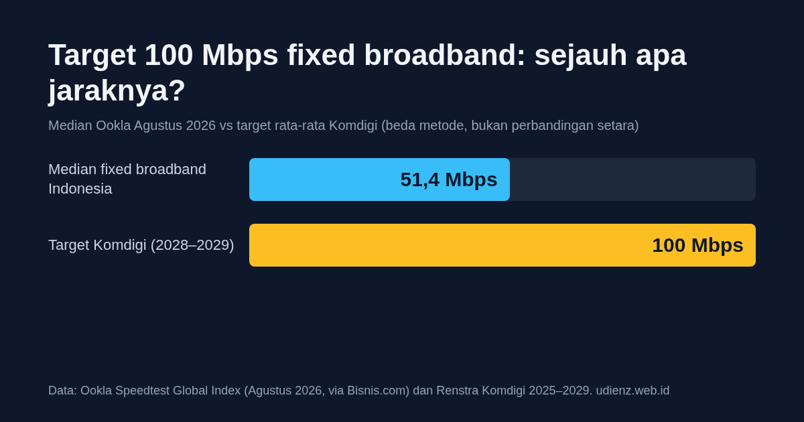

Target 100 Mbps untuk fixed broadband bisa terbaca seolah itu kecepatan yang dijanjikan ke setiap rumah. Faktanya itu target rata-rata nasional dengan tenggat 2028 atau 2029, jadi belum ada yang gagal. Jaraknya ke 100 Mbps memang masih lebar: median fixed broadband Indonesia pada Agustus 2026 ada di 51,4 Mbps menurut Ookla, peringkat ke-113 dunia dan ke-9 dari 10 negara ASEAN.

Tulisan ini menjelaskan apa yang sebenarnya ditargetkan, apa yang menghambatnya, dan apa artinya untuk paket internet di rumahmu. Fixed broadband di sini berarti internet rumah berkabel (di berita sering ditulis "internet tetap" atau "pita lebar tetap"). Beberapa angka dari berita saling bertentangan, jadi tiap angka saya sebut lengkap dengan sumbernya, apakah dokumen resmi atau pemberitaan.

*Median Ookla Agustus 2026 dan target rata-rata Komdigi tidak diukur dengan metode yang sama.*

> **Key Takeaways**
>
> - 100 Mbps adalah target rata-rata nasional di akhir periode Renstra Komdigi. Sebagian sumber menyebut tahun 2029, Wakil Menteri Komdigi menyebut 2028.
> - Median Ookla (51,4 Mbps, Agustus 2026) dan hasil ukur Komdigi (51,84 Mbps di 20 kota, 2025) memakai metode berbeda. Jangan dibandingkan langsung.
> - Hambatan yang disebut pelaku industri dan laporan Komdigi: jangkauan fiber yang belum merata, aturan dan retribusi daerah, harga bahan kabel yang naik, dan harga langganan yang masih tinggi untuk banyak rumah tangga.
> - Dua paket 100 Mbps berbayar penuh yang dibandingkan Bisnis.com berharga Rp233 ribu dan Rp279 ribu per bulan sebelum pajak pertambahan nilai (PPN), per Januari 2026.
> - Kecepatan di perangkatmu tetap ditentukan ONT (perangkat fiber di rumah; lihat [arsitektur GPON](/2026/11/03/mengenal-gpon-fungsi-manfaat-arsitektur.html)), WiFi, dan kabel.

## Apa sebenarnya yang ditargetkan?

Target kecepatan ada di Rencana Strategis (Renstra) Kementerian Komunikasi dan Digital 2025–2029. Laporan Kinerja Komdigi 2025 memuat indikator "Kecepatan Internet Jaringan Pita Lebar Tetap (Fixed Broadband)" dengan target 2025 sebesar 37 Mbps ([Kementerian Komdigi, Laporan Kinerja 2025](https://eppid.komdigi.go.id/attachments/cb1d2d05a0d09902a340a09882b2eae56e6462ed88f3e3f688372c5053ed086a/fa1898f3b7f2672c03afd8682a6187d1ece86d3114c6a1a52d8a51fe86a81ae0.pdf), tabel indikator program, hlm. 90). Target tahun-tahun berikutnya tidak terbaca jelas di dokumen itu, jadi untuk 2026 sampai 2029 rujukannya pemberitaan, dan dua media menulis jalur yang berbeda:

| Tahun | detikInet (7 Jan 2026) | Bisnis.com (5 Jan 2026) |
|---|---|---|
| 2026 | 45 Mbps | 45 Mbps |
| 2027 | 64 Mbps | 55 Mbps |
| 2028 | 83 Mbps | 70 Mbps |
| 2029 | 100 Mbps | 100 Mbps |

Sumber: [detikInet](https://inet.detik.com/law-and-policy/d-8295938/prabowo-target-kecepatan-internet-mobile-60-mbps-dan-fixed-45-mbps) dan [Bisnis.com](https://teknologi.bisnis.com/read/20260105/101/1941746/target-komdigi-2026-rerata-kecepatan-seluler-60-mbps-fixed-broadband-45-mbps). Keduanya sepakat di 45 Mbps untuk 2026 dan 100 Mbps untuk 2029, tapi jalur di tengahnya berbeda.

Tahun tercapainya 100 Mbps juga belum seragam. Sekretaris Jenderal Komdigi menyebut "secepatnya 2029" ([Bisnis.com, 10 Desember 2025](https://teknologi.bisnis.com/read/20251210/101/1935763/strategi-komdigi-kejar-target-rerata-kecepatan-internet-100-mbps-pada-2029)). Wakil Menteri Nezar Patria menyebut target nasional 100 Mbps dalam dua tahun, yaitu 2028, dalam berita Juli 2026 yang tidak membedakan fixed dan mobile ([Bisnis.com, 5 Juli 2026](https://teknologi.bisnis.com/read/20260705/101/1985643/komdigi-bidik-kecepatan-internet-nasional-100-mbps-pada-2028)).

Kalau kamu menemukan judul berita yang menulis "64 Mbps di 2026", baca isinya dulu. Judul Selular.ID pada Maret 2026 menulis 64 Mbps, sementara isi artikelnya menyebut minimum 60 Mbps ([Selular.ID](https://selular.id/2026/03/komdigi-targetkan-kecepatan-internet-fixed-broadband-64-mbps-2026-isp-katakan-ini/)).

## Seberapa jauh jaraknya sekarang?

Ookla Speedtest Global Index mencatat median download fixed broadband Indonesia 51,40 Mbps pada Agustus 2026, peringkat 113 dunia dan ke-9 dari 10 negara ASEAN ([Bisnis.com, 14 Oktober 2026](https://teknologi.bisnis.com/read/20261014/101/2012346/peringkat-kecepatan-internet-ri-merangkak-di-global-agustus-2026-berkat-5g), mengutip Ookla).

Komdigi punya angka sendiri. Laporan Kinerja 2025 menulis rata-rata kecepatan unduh fixed broadband nasional 51,84 Mbps, diukur di 20 kota, dan menyatakan angka itu melampaui target 2025 sebesar 37 Mbps (hlm. 106). Di bagian latar belakang laporan yang sama, rata-rata fixed broadband tertulis 28,37 Mbps dengan merujuk ke Renstra ([Laporan Kinerja Komdigi 2025](https://eppid.komdigi.go.id/attachments/cb1d2d05a0d09902a340a09882b2eae56e6462ed88f3e3f688372c5053ed086a/fa1898f3b7f2672c03afd8682a6187d1ece86d3114c6a1a52d8a51fe86a81ae0.pdf), hlm. 20).

Angka-angka itu kelihatannya sama padahal berbeda:

- **Median Ookla**: dari tes yang dijalankan pengguna aplikasi Speedtest.
- **Rata-rata Komdigi**: hasil pengukuran di 20 kota, tidak mencakup wilayah di luar kota-kota itu.
- **Rata-rata di Renstra**: angka latar belakang yang metodenya tidak dijelaskan di laporan.

Dengan 100 Mbps sebagai garis akhir, selisihnya tetap besar, tapi seberapa besar tergantung angka mana yang dipakai. Median Ookla Agustus 2026 (51,4 Mbps) memang sudah di atas target rata-rata 2026 sebesar 45 Mbps, tapi keduanya mengukur hal berbeda, jadi saya tidak menyimpulkan target 2026 sudah terlampaui. Karena itu saya menahan diri untuk menulis satu angka "kecepatan internet Indonesia".

Untuk gambaran regional, data Februari 2026 yang dikutip [Seasia.co](https://seasia.co/2026/04/20/asean-internet-speeds-index-february-2026-big-condolences-to-indonesian-users) dari Ookla menaruh Indonesia di posisi terakhir dari sembilan negara ASEAN yang datanya tersedia (Myanmar tidak termasuk), dengan 45,4 Mbps. Singapura ada di puncak dengan 420,92 Mbps.

<figure class="blog-chart">
<svg viewBox="0 0 400 350" style="width: 100%; max-width: 560px; height: auto;" role="img" aria-label="Diagram batang median kecepatan unduh fixed broadband ASEAN, Februari 2026, menurut Ookla via Seasia.co. Singapura 420,92 Mbps, Vietnam 288,76, Thailand 273,78, Malaysia 166,23, Filipina 106,5, Brunei 86,46, Laos 54,78, Kamboja 51,86, Indonesia 45,4. Myanmar tidak termasuk.">
  <text x="200" y="24" text-anchor="middle" font-size="16" fill="currentColor">Median fixed broadband ASEAN (Mbps)</text>
  <text x="200" y="44" text-anchor="middle" font-size="12" fill="currentColor">Februari 2026, data Ookla Speedtest Global Index</text>
  <line x1="96" y1="60" x2="96" y2="330" stroke="#9ca3af"></line>
<text x="88" y="81" text-anchor="end" font-size="14" fill="currentColor">Singapura</text>
<rect x="96" y="66" width="200.0" height="20" rx="4" fill="#38bdf8"></rect>
<text x="302.0" y="81" font-size="14" fill="currentColor">420,92</text>
<text x="88" y="111" text-anchor="end" font-size="14" fill="currentColor">Vietnam</text>
<rect x="96" y="96" width="137.2" height="20" rx="4" fill="#38bdf8"></rect>
<text x="239.2" y="111" font-size="14" fill="currentColor">288,76</text>
<text x="88" y="141" text-anchor="end" font-size="14" fill="currentColor">Thailand</text>
<rect x="96" y="126" width="130.1" height="20" rx="4" fill="#38bdf8"></rect>
<text x="232.1" y="141" font-size="14" fill="currentColor">273,78</text>
<text x="88" y="171" text-anchor="end" font-size="14" fill="currentColor">Malaysia</text>
<rect x="96" y="156" width="79.0" height="20" rx="4" fill="#38bdf8"></rect>
<text x="181.0" y="171" font-size="14" fill="currentColor">166,23</text>
<text x="88" y="201" text-anchor="end" font-size="14" fill="currentColor">Filipina</text>
<rect x="96" y="186" width="50.6" height="20" rx="4" fill="#38bdf8"></rect>
<text x="152.6" y="201" font-size="14" fill="currentColor">106,5</text>
<text x="88" y="231" text-anchor="end" font-size="14" fill="currentColor">Brunei</text>
<rect x="96" y="216" width="41.1" height="20" rx="4" fill="#38bdf8"></rect>
<text x="143.1" y="231" font-size="14" fill="currentColor">86,46</text>
<text x="88" y="261" text-anchor="end" font-size="14" fill="currentColor">Laos</text>
<rect x="96" y="246" width="26.0" height="20" rx="4" fill="#38bdf8"></rect>
<text x="128.0" y="261" font-size="14" fill="currentColor">54,78</text>
<text x="88" y="291" text-anchor="end" font-size="14" fill="currentColor">Kamboja</text>
<rect x="96" y="276" width="24.6" height="20" rx="4" fill="#38bdf8"></rect>
<text x="126.6" y="291" font-size="14" fill="currentColor">51,86</text>
<text x="88" y="321" text-anchor="end" font-size="14" fill="currentColor">Indonesia</text>
<rect x="96" y="306" width="21.6" height="20" rx="4" fill="#f97316" stroke="currentColor"></rect>
<text x="123.6" y="321" font-size="14" fill="currentColor">45,4</text>
</svg>
<figcaption>Sumber: <a href="https://seasia.co/2026/04/20/asean-internet-speeds-index-february-2026-big-condolences-to-indonesian-users">Seasia.co, mengutip Ookla</a>, 20 April 2026. Batang oranye: Indonesia.</figcaption>
</figure>

Grafik ini memakai median, bukan rata-rata. Seasia.co mengutip Ookla, jadi anggap ini gambaran kasar. Angka Indonesia di sini (Februari) berbeda dari 51,4 Mbps karena periodenya.

## Apa yang menghambat?

Tidak ada satu penyebab tunggal. Hambatannya berlapis.

### Banyak rumah belum terjangkau, dan banyak yang terjangkau belum berlangganan

[Laporan Kinerja Komdigi 2025](https://eppid.komdigi.go.id/attachments/cb1d2d05a0d09902a340a09882b2eae56e6462ed88f3e3f688372c5053ed086a/fa1898f3b7f2672c03afd8682a6187d1ece86d3114c6a1a52d8a51fe86a81ae0.pdf) mengutip data Bank Dunia 2024 (hlm. 19–20) tentang 75 juta rumah di Indonesia:

- 38 juta rumah sudah dilewati jaringan fiber optik.
- Dari jumlah itu, 24,5 juta belum terhubung ke layanan fixed broadband.
- Sisanya, 37 juta rumah, belum terjangkau fiber sama sekali.

Dengan hitungan sederhana, yang sudah terhubung sekitar 13,5 juta rumah. Angka itu tidak sebanding dengan 21% rumah tangga di bawah, karena tahun dan basis hitungnya berbeda.

Di tingkat kecamatan, jangkauan fiber mencapai 72,12% pada 2025 menurut laporan (5.253 dari 7.285 kecamatan, hlm. 106; hasil bagi langsungnya 72,11%), naik dari 70,88% di baseline Renstra (hlm. 19).

Targetnya 90% kecamatan ([Bisnis.com, 1 Oktober 2025](https://teknologi.bisnis.com/read/20251001/101/1916328/komdigi-targetkan-penetrasi-fixed-broadband-naik-dari-21-menjadi-50-pada-2029)). Dari angka itu saya menyimpulkan tidak semua kecamatan ditargetkan terlayani fiber.

Sekjen Komdigi menilai membangun fiber sampai ke semua kecamatan tidak efisien dan menyebut seluler dan satelit sebagai alternatif di wilayah yang sulit ([Bisnis.com, 10 Desember 2025](https://teknologi.bisnis.com/read/20251210/101/1935763/strategi-komdigi-kejar-target-rerata-kecepatan-internet-100-mbps-pada-2029)).

Soal berlangganan, Menteri Komdigi menyebut baru 21% rumah tangga yang punya akses broadband tetap, dengan target 50% pada 2029 ([Bisnis.com, 1 Oktober 2025](https://teknologi.bisnis.com/read/20251001/101/1916328/komdigi-targetkan-penetrasi-fixed-broadband-naik-dari-21-menjadi-50-pada-2029)).

Survei Asosiasi Penyelenggara Jasa Internet Indonesia (APJII) 2026 menghitung sekitar 99,51 juta orang berlangganan internet tetap, atau 42,3% dari pengguna internet ([Bisnis.com, 17 Juni 2026](https://teknologi.bisnis.com/read/20260617/101/1981302/penetrasi-internet-tetap-di-ri-baru-423-ruang-pertumbuhan-masih-lebar)). Angka 21% dan 42,3% tidak bisa dipertukarkan karena basis hitungnya beda: rumah tangga di satu sisi, pengguna internet di sisi lain.

### Biaya bangun dan aturan di daerah

Asosiasi Penyelenggara Jaringan Telekomunikasi Indonesia (APJATEL) menyoroti aturan yang tumpang tindih. Menurut Wakil Ketua APJATEL Fariz Azhar Harahap, tiap kota atau kabupaten punya dasar hukum sendiri. Pelaku usaha menanggung beberapa pungutan:

- BHP Pita dan BHP USO di tingkat pusat (pungutan atas pita frekuensi dan kontribusi pelayanan universal).
- Sewa aset negara atau daerah (BMN/BMD).
- Retribusi penempatan kabel.

Di sejumlah kota, sewa lahan bahkan disamakan dengan ruang komersial. Artikelnya tidak menyebut nominal rupiah ([investortrust.id, 13 Februari 2026](https://investortrust.id/business/94447/internet-lambat-dan-mahal-apjatel-soroti-tumpang-tindih-aturan-fiber-optik)).

Bahan baku ikut menekan. Menurut [Bisnis.com](https://teknologi.bisnis.com/read/20260415/101/1966687/harga-kabel-serat-optik-melesat-ekspansi-internet-nasional-berisiko-melambat), Ketua Umum APJATEL Jerry Mangasas Swandy menyebut harga HDPE, material pelindung kabel, naik 15–17%. Ketua Umum APJII Muhammad Arif menyebut kenaikan harga paling terasa di fiber core, tanpa angka persen. Artikel itu menjelaskan sebabnya sebagai pasokan serat optik global yang dialihkan ke industri militer, termasuk drone, ditambah keterbatasan produksi di China.

Artikel yang sama mengutip contoh sebuah perusahaan yang tadinya membangun 50 km per tahun dan kini mungkin hanya sekitar 10 km dengan anggaran yang sama. Perusahaannya tidak disebut dan hitungannya tidak dijelaskan, jadi anggap itu ilustrasi kasar ([Bisnis.com, 15 April 2026](https://teknologi.bisnis.com/read/20260415/101/1966687/harga-kabel-serat-optik-melesat-ekspansi-internet-nasional-berisiko-melambat)). Pengamat ICT Institute menambahkan hak jalan dan relokasi kabel ke bawah tanah sebagai beban yang menggerus margin operator ([Bisnis.com, 26 Agustus 2026](https://teknologi.bisnis.com/read/20260826/101/1999077/tantangan-bisnis-serat-optik-pengamat-utilisasi-aset-hingga-beban-relokasi)).

### Harga langganan dan permintaan

[Laporan Kinerja Komdigi](https://eppid.komdigi.go.id/attachments/cb1d2d05a0d09902a340a09882b2eae56e6462ed88f3e3f688372c5053ed086a/fa1898f3b7f2672c03afd8682a6187d1ece86d3114c6a1a52d8a51fe86a81ae0.pdf) mencatat harga layanan fixed broadband di Indonesia sekitar 4,86% dari pendapatan nasional bruto per kapita (hlm. 20). Rekomendasi ITU (badan telekomunikasi PBB) yang dikutip laporan itu adalah tidak lebih dari 2%. Untuk mobile broadband angkanya sekitar 0,24%. Laporan itu sendiri menyimpulkan itulah salah satu alasan penetrasi seluler jauh lebih tinggi.

Alasan dari sisi calon pelanggan sejalan. Dalam survei APJII 2026, 47,2% yang tidak berlangganan internet tetap merasa kualitas internet seluler sudah cukup, dan 32,9% menyebut harga terlalu mahal ([Bisnis.com, 17 Juni 2026](https://teknologi.bisnis.com/read/20260617/101/1981302/penetrasi-internet-tetap-di-ri-baru-423-ruang-pertumbuhan-masih-lebar)). Saya menduga, kalau permintaan akan paket kencang rendah, operator punya alasan lebih kecil untuk membangun cepat. Ini dugaan saya, tidak ada sumber di atas yang menyatakannya langsung.

### Standar minimum 100 Mbps yang pernah disiapkan

Pada Januari 2024, Kementerian Kominfo (sekarang Komdigi) pernah menyiapkan standar minimum 100 Mbps untuk fixed broadband. Direktur Jenderal Informasi dan Komunikasi Publik saat itu menyatakan penerapannya sangat tergantung kesiapan industri dan tidak akan dipaksakan kalau industri belum siap ([Bisnis.com, 25 Januari 2024](https://teknologi.bisnis.com/read/20240125/101/1735592/internet-fixed-broadband-100-mbps-kemenkominfo-tergantung-kesiapan-industri)).

Ada satu kewajiban yang mendekati, tapi bukan standar minimum untuk paket rumahan. Pada lelang pita frekuensi 1,4 GHz, Komdigi menyebut pemenang harus menyediakan akses pita lebar nirkabel dengan kecepatan "sampai dengan" 100 Mbps, dengan harga paling tinggi 10% di atas rata-rata konsumsi rumah tangga ([Bisnis.com, 3 Agustus 2025](https://teknologi.bisnis.com/read/20250803/101/1898837/komdigi-ungkap-sederet-kewajiban-pemenang-lelang-14-ghz)). Kewajiban itu berlaku selama masa izin pita frekuensi dan mengikat pemenang lelang, bukan semua penyedia internet.

## Apa artinya buat kamu di rumah?

Pertama, target rata-rata tidak menjamin apa pun untuk satu rumah. Kamu bisa berada di atas atau di bawah angkanya, tergantung jangkauan ISP di lokasimu, jenis paketnya, dan kondisi jaringan di dalam rumah.

Kedua, paket 100 Mbps sudah ada, dan harganya tidak seragam. Berikut perbandingan dari Bisnis.com per Januari 2026, yang diambil dari situs masing-masing penyedia:

| Paket | Kecepatan | Harga per bulan |
|---|---|---|
| Internet Rakyat | hingga 100 Mbps | Rp100.000 (bulan pertama gratis) |
| MyRepublic Neo | 100 Mbps | Rp233.100 (belum PPN) |
| IndiHome | 75 Mbps | Rp270.000 |
| XL Satu | 100 Mbps | Rp279.000 (belum PPN) |

Sumber: [Bisnis.com, 29 Januari 2026](https://teknologi.bisnis.com/read/20260129/101/1948332/harga-internet-rumah-2026-internet-rakyat-vs-myrepublic-vs-indihome-vs-xlsatu). Dua paket tercatat belum termasuk PPN, sedangkan basis harga dua lainnya tidak disebut, jadi jangan membandingkan angkanya mentah-mentah. IndiHome di tabel ini 75 Mbps. Internet Rakyat memakai kata "hingga", yaitu batas atas dan bukan kecepatan yang dijamin, makanya saya tidak memasukkannya ke kisaran Rp233 ribu dan Rp279 ribu yang saya sebut di Key Takeaways. Harga dan promo berubah cepat, jadi cek ulang di situs penyedia sebelum memutuskan.

Ketiga, kalau kamu sudah berlangganan 100 Mbps tapi hasilnya jauh lebih rendah, periksa dulu sisi rumah sebelum menyalahkan penyedia internet (ISP):

1. **Tes dengan kabel.** Colok laptop langsung ke port LAN ONT (perangkat fiber di rumahmu) atau router dan jalankan tes kecepatan. Kalau angkanya jauh lebih tinggi daripada lewat WiFi, masalahnya ada di WiFi.
2. **Cek port.** Port Fast Ethernet (100 Mbps) di salah satu perangkat pada jalur itu menjadi batas atas, dan hasil nyatanya biasanya di bawah 100 Mbps. Cari port Gigabit.
3. **Tes di jam berbeda.** Kalau angkanya turun terus di jam padat, catat waktunya sebagai bahan laporan.
4. **Lihat redaman optik** di ONT bila kamu bisa mengaksesnya. Konsep dasarnya ada di tulisan saya tentang [arsitektur GPON](/2026/11/03/mengenal-gpon-fungsi-manfaat-arsitektur.html), dan soal konektor ada di [jenis konektor fiber optic](/2026/11/03/jenis-jenis-konektor-fiber-optic.html).

Keempat, tidak semua rumah perlu 100 Mbps. Hampir separuh yang tidak berlangganan merasa seluler sudah cukup, dan itu masuk akal untuk penggunaan ringan. Paket yang lebih kencang baru terasa kalau ada beberapa perangkat yang dipakai bersamaan untuk streaming, unggah berkas besar, atau kerja jarak jauh.

## Yang belum bisa saya pastikan

- Jalur target 2026 sampai 2029 per tahun. Dokumen Renstra lengkapnya belum saya baca, jadi saya hanya tahu dua versi dari berita.
- Apakah 100 Mbps dicapai pada 2028 atau 2029.
- Angka Ookla langsung dari halaman resminya.
- Data resmi kecepatan nyata dibanding kecepatan di kontrak, yang memuat paket "hingga". Data terbarunya belum ada di sumber yang dipakai tulisan ini.

Kalau kamu punya dokumen atau data yang menutup salah satu celah itu, kirim lewat [halaman kontak](/contact.html) dan tulisan ini saya perbarui.

Saya [Mahyuddin Susanto](/about.html), insinyur jaringan dan infrastruktur dengan pengalaman lebih dari 15 tahun di lingkungan jaringan skala besar dan sistem Linux. Tulisan ini merangkum dokumen dan berita yang disebut di atas, tanpa pengukuran saya sendiri. Kalau ada yang keliru, kabari lewat halaman kontak, dan koreksinya saya cantumkan di tulisan ini lengkap dengan tanggalnya.

## Sumber

Semua tautan diakses 3 November 2026.

- Kementerian Komdigi, [Laporan Kinerja 2025](https://eppid.komdigi.go.id/attachments/cb1d2d05a0d09902a340a09882b2eae56e6462ed88f3e3f688372c5053ed086a/fa1898f3b7f2672c03afd8682a6187d1ece86d3114c6a1a52d8a51fe86a81ae0.pdf) (dokumen primer).
- detikInet, [Prabowo Target Kecepatan Internet Mobile 60 Mbps dan Fixed 45 Mbps](https://inet.detik.com/law-and-policy/d-8295938/prabowo-target-kecepatan-internet-mobile-60-mbps-dan-fixed-45-mbps), 7 Januari 2026.
- Bisnis.com, [Target Komdigi 2026](https://teknologi.bisnis.com/read/20260105/101/1941746/target-komdigi-2026-rerata-kecepatan-seluler-60-mbps-fixed-broadband-45-mbps), 5 Januari 2026.
- Bisnis.com, [Strategi Komdigi Kejar Target 100 Mbps pada 2029](https://teknologi.bisnis.com/read/20251210/101/1935763/strategi-komdigi-kejar-target-rerata-kecepatan-internet-100-mbps-pada-2029), 10 Desember 2025.
- Bisnis.com, [Komdigi Bidik Kecepatan Internet Nasional 100 Mbps pada 2028](https://teknologi.bisnis.com/read/20260705/101/1985643/komdigi-bidik-kecepatan-internet-nasional-100-mbps-pada-2028), 5 Juli 2026.
- Bisnis.com, [Peringkat Kecepatan Internet RI Agustus 2026](https://teknologi.bisnis.com/read/20261014/101/2012346/peringkat-kecepatan-internet-ri-merangkak-di-global-agustus-2026-berkat-5g), 14 Oktober 2026.
- Bisnis.com, [Penetrasi Fixed Broadband 21% menjadi 50% pada 2029](https://teknologi.bisnis.com/read/20251001/101/1916328/komdigi-targetkan-penetrasi-fixed-broadband-naik-dari-21-menjadi-50-pada-2029), 1 Oktober 2025.
- Bisnis.com, [Penetrasi Internet Tetap di RI Baru 42,3%](https://teknologi.bisnis.com/read/20260617/101/1981302/penetrasi-internet-tetap-di-ri-baru-423-ruang-pertumbuhan-masih-lebar), 17 Juni 2026.
- investortrust.id, [APJATEL Soroti Tumpang Tindih Aturan Fiber Optik](https://investortrust.id/business/94447/internet-lambat-dan-mahal-apjatel-soroti-tumpang-tindih-aturan-fiber-optik), 13 Februari 2026.
- Bisnis.com, [Harga Kabel Serat Optik Melesat](https://teknologi.bisnis.com/read/20260415/101/1966687/harga-kabel-serat-optik-melesat-ekspansi-internet-nasional-berisiko-melambat), 15 April 2026.
- Bisnis.com, [Tantangan Bisnis Serat Optik](https://teknologi.bisnis.com/read/20260826/101/1999077/tantangan-bisnis-serat-optik-pengamat-utilisasi-aset-hingga-beban-relokasi), 26 Agustus 2026.
- Bisnis.com, [Harga Internet Rumah 2026](https://teknologi.bisnis.com/read/20260129/101/1948332/harga-internet-rumah-2026-internet-rakyat-vs-myrepublic-vs-indihome-vs-xlsatu), 29 Januari 2026.
- Bisnis.com, [Internet Fixed Broadband 100 Mbps, Kemenkominfo: Tergantung Kesiapan Industri](https://teknologi.bisnis.com/read/20240125/101/1735592/internet-fixed-broadband-100-mbps-kemenkominfo-tergantung-kesiapan-industri), 25 Januari 2024.
- Selular.ID, [Komdigi Targetkan Kecepatan Internet Fixed Broadband 64 Mbps 2026](https://selular.id/2026/03/komdigi-targetkan-kecepatan-internet-fixed-broadband-64-mbps-2026-isp-katakan-ini/), 6 Maret 2026.
- Seasia.co, [ASEAN Internet Speeds Index February 2026](https://seasia.co/2026/04/20/asean-internet-speeds-index-february-2026-big-condolences-to-indonesian-users), 20 April 2026 (mengutip Ookla).
