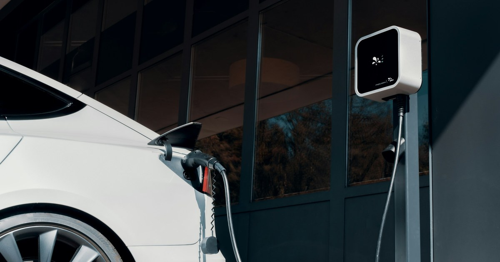

Pada September 2026, BYD Atto 1 tercatat 4.840 unit dalam data Gaikindo, peringkat kedua dalam daftar 20 model terlaris di seluruh pasar mobil Indonesia bulan itu dan yang tertinggi di antara mobil listrik ([Gaikindo, 25 Oktober 2026](https://www.gaikindo.or.id/20-model-mobil-terlaris-september-2026-atto-1-menempel-gran-max/)). Gaikindo sendiri menulis bahwa mobil listrik "mulai menembus jajaran model terlaris". Harga mobil listrik terlaris sekarang mulai dari sekitar Rp150 jutaan, yaitu VinFast VF 3 dengan sewa baterai. Data di tulisan ini diperiksa pada 4 November 2026, dan tanggal terbit tiap sumber ada di sampingnya.

Tulisan ini menjelaskan apa itu mobil listrik dan apa bedanya dengan hybrid, bagaimana mobil itu bekerja dari colokan sampai roda, dan mobil listrik mana yang paling banyak tercatat penjualannya di Indonesia sepanjang 2026, lengkap dengan harga, kapasitas baterai, dan klaim jarak tempuhnya. Setiap harga dan angka penjualan saya beri tanggal sumbernya, karena angkanya berubah cepat dan beberapa media menulis angka berbeda untuk model yang sama.

*Foto: [JUICE](https://unsplash.com/photos/a-white-car-plugged-in-to-a-charging-station-JkTjKEVcckg) di [Unsplash](https://unsplash.com).*

> **Poin Penting**
>
> - Mobil listrik murni (BEV) bergerak dengan motor listrik yang disuplai baterai besar dan diisi dari colokan. Hybrid biasa dan plug-in hybrid masih punya mesin bensin, jadi bukan mobil listrik murni.
> - Mobil listrik mengubah lebih dari 77% energi listrik menjadi tenaga di roda, sedangkan mobil bensin hanya 12% sampai 30% dari energi bensinnya (U.S. Department of Energy).
> - Pengisian di rumah dengan tarif listrik rumah tangga Rp1.444,70 per kWh menghabiskan sekitar Rp60 ribu sampai Rp67 ribu untuk mengisi baterai 38,88 kWh dari kosong sampai penuh, menurut hitungan di tulisan ini. Di SPKLU umum tarifnya sampai Rp2.475 per kWh.
> - Sepuluh mobil listrik dengan penjualan terbesar pada Januari sampai September 2026 berharga dari Rp152 juta (VinFast VF 3 dengan sewa baterai) sampai Rp950 juta (Denza D9). Tiga yang terlaris, yaitu Jaecoo J5 EV, BYD Atto 1, dan Geely EX2, berada di kisaran Rp200 jutaan sampai Rp300 jutaan.
> - Insentif PPN ditanggung pemerintah dan keringanan bea masuk untuk mobil listrik tidak berlanjut pada 2026. Penggantinya masih dikaji pada Juni 2026, jadi harga bisa berubah lagi.

## Apa itu mobil listrik?

Mobil listrik adalah mobil yang digerakkan oleh motor listrik, bukan mesin pembakaran. Departemen Energi Amerika Serikat menyebut jenis yang paling murni sebagai all-electric vehicle atau battery electric vehicle (BEV): mobilnya punya baterai yang diisi dengan mencolokkan kendaraan ke peralatan pengisian, dan selalu berjalan dalam mode listrik penuh ([U.S. DOE, Alternative Fuels Data Center](https://afdc.energy.gov/vehicles/electric)). Tidak ada tangki bensin, pompa bahan bakar, atau saluran bahan bakar. Kendaraan seperti ini juga tidak mengeluarkan gas buang dari knalpot ([U.S. DOE](https://afdc.energy.gov/vehicles/how-do-all-electric-cars-work)).

Dalam aturan Indonesia, istilah resminya Kendaraan Bermotor Listrik Berbasis Baterai atau KBLBB. Istilah itu dipakai dalam [Perpres 55 Tahun 2019](https://peraturan.bpk.go.id/Details/116973/perpres-no-55) tentang percepatan program KBLBB untuk transportasi jalan, yang kemudian diubah dengan [Perpres 79 Tahun 2023](https://peraturan.bpk.go.id/Details/273447). Di dealer dan di media otomotif, kamu akan lebih sering mendengar singkatan BEV atau sebutan "mobil listrik" saja.

### Kenapa orang beralih

Alasan pertama adalah efisiensi. Menurut U.S. Department of Energy, mobil listrik mengubah lebih dari 77% energi listrik dari jaringan menjadi tenaga di roda. Mobil bensin konvensional hanya mengubah sekitar 12% sampai 30% energi tersimpan dalam bensin menjadi tenaga di roda ([FuelEconomy.gov](https://www.fueleconomy.gov/feg/evtech.shtml)). Angka itu berasal dari konteks Amerika Serikat, tetapi prinsip fisikanya sama di mana pun: motor listrik membuang jauh lebih sedikit energi sebagai panas dibanding mesin bensin.

Alasan kedua adalah biaya energi per kilometer. Listrik rumah tangga di Indonesia dihargai Rp1.352 sampai Rp1.699,53 per kWh, tergantung golongan, untuk triwulan IV 2026 ([Metro TV, 29 Oktober 2026](https://www.metrotvnews.com/read/NA0CzpEz-daftar-lengkap-tarif-listrik-pln-akhir-oktober-2026-per-kwh)). Bagian hitung-hitungan ada di bawah, di bagian pengisian daya.

Alasan ketiga adalah pengalaman berkendara. Menurut pengetahuan umum, motor listrik memberikan torsi sejak putaran pertama dan tidak memakai perpindahan gigi bertahap, jadi akselerasinya halus. Sisi lemahnya juga ada: jarak tempuh nyata bisa jauh di bawah angka brosur, dan pengisian bergantung pada colokan yang tersedia. Dua hal itu saya hitung dengan angka di bawah.

### Skala globalnya

Mobil listrik bukan fenomena satu negara. Badan Energi Internasional (IEA) menulis dalam siaran pers Global EV Outlook 2026 bahwa hampir 30% mobil yang terjual pada 2026 diperkirakan berupa mobil listrik, seiring negara dan konsumen merespons krisis energi ([IEA, Global EV Outlook 2026](https://www.iea.org/reports/global-ev-outlook-2026)). Di Indonesia, sepuluh mobil listrik terlaris saja mencapai 89.502 unit pada sembilan bulan pertama 2026 menurut data Gaikindo, seperti yang dirinci di bagian daftar model.

## Jenis-jenis mobil listrik

Istilah "mobil listrik" dipakai longgar untuk beberapa teknologi yang berbeda. Perbedaannya menentukan apakah kamu perlu mencari colokan, apakah masih harus ke SPBU, dan seberapa besar biaya bulanannya. Tabel berikut membandingkan mobil konvensional dengan empat jenis yang sering disebut mobil listrik. Tiap jenis dijabarkan di bawahnya dengan diagram alur energi.

| Jenis | Singkatan | Sumber tenaga | Dicolok untuk diisi? | Masih pakai bensin? |
|---|---|---|---|---|
| Mobil konvensional | ICE | Mesin pembakaran | Tidak | Ya |
| Battery electric vehicle | BEV | Baterai besar dan motor listrik | Ya | Tidak |
| Plug-in hybrid electric vehicle | PHEV | Baterai sedang, motor listrik, dan mesin bensin | Ya | Ya |
| Hybrid electric vehicle | HEV | Mesin bensin dibantu motor listrik dan baterai kecil | Tidak | Ya |
| Fuel cell electric vehicle | FCEV | Hidrogen yang diubah menjadi listrik oleh sel bahan bakar | Tidak (isi hidrogen) | Tidak |

Di semua diagram, garis oranye adalah bensin, biru listrik, hijau hidrogen, ungu energi yang kembali ke baterai saat mobil melambat, dan abu-abu tenaga mekanik atau sisa.

### Pembanding: mobil konvensional (ICE)

Mobil konvensional memakai mesin pembakaran dalam (internal combustion engine, ICE) yang membakar bensin atau solar. Semua jenis lain di bawah menambahkan atau menggantikan sebagian dari rantai ini.

<figure class="blog-chart">
<svg viewBox="0 0 400 189" width="400" height="189" role="img" aria-label="Diagram mobil konvensional: bensin dari tangki masuk ke mesin pembakaran, tenaga mekanik diteruskan lewat transmisi ke roda, dan gas buang keluar lewat knalpot.">
<rect x="8.0" y="13.0" width="108" height="46" rx="6" fill="none" stroke="#f97316"></rect>
<text x="62" y="33" text-anchor="middle" font-size="14" fill="currentColor">Tangki</text>
<text x="62" y="49" text-anchor="middle" font-size="14" fill="currentColor">bensin</text>
<rect x="146.0" y="13.0" width="108" height="46" rx="6" fill="none" stroke="#9ca3af"></rect>
<text x="200" y="33" text-anchor="middle" font-size="14" fill="currentColor">Mesin</text>
<text x="200" y="49" text-anchor="middle" font-size="14" fill="currentColor">pembakaran</text>
<rect x="284.0" y="13.0" width="108" height="46" rx="6" fill="none" stroke="#9ca3af"></rect>
<text x="338" y="33" text-anchor="middle" font-size="14" fill="currentColor">Transmisi</text>
<text x="338" y="49" text-anchor="middle" font-size="14" fill="currentColor">(rasio gigi)</text>
<rect x="146.0" y="97.0" width="108" height="46" rx="6" fill="none" stroke="#9ca3af"></rect>
<text x="200" y="117" text-anchor="middle" font-size="14" fill="currentColor">Knalpot</text>
<text x="200" y="133" text-anchor="middle" font-size="14" fill="currentColor">gas buang</text>
<rect x="284.0" y="97.0" width="108" height="46" rx="6" fill="none" stroke="#9ca3af"></rect>
<text x="338" y="125" text-anchor="middle" font-size="14" fill="currentColor">Roda</text>
<line x1="116.0" y1="36.0" x2="140.0" y2="36.0" stroke="#f97316" stroke-width="2"></line>
<polygon points="146.0,36.0 139.0,40.0 139.0,32.0" fill="#f97316" stroke="#f97316"></polygon>
<line x1="254.0" y1="36.0" x2="278.0" y2="36.0" stroke="#9ca3af" stroke-width="2"></line>
<polygon points="284.0,36.0 277.0,40.0 277.0,32.0" fill="#9ca3af" stroke="#9ca3af"></polygon>
<line x1="338.0" y1="59.0" x2="338.0" y2="91.0" stroke="#9ca3af" stroke-width="2"></line>
<polygon points="338.0,97.0 334.0,90.0 342.0,90.0" fill="#9ca3af" stroke="#9ca3af"></polygon>
<line x1="200.0" y1="59.0" x2="200.0" y2="91.0" stroke="#9ca3af" stroke-width="2"></line>
<polygon points="200.0,97.0 196.0,90.0 204.0,90.0" fill="#9ca3af" stroke="#9ca3af"></polygon>
<line x1="8.0" y1="173.0" x2="26.0" y2="173.0" stroke="#f97316" stroke-width="2"></line>
<text x="32.0" y="177" font-size="12" fill="currentColor">Bensin</text>
<line x1="208.0" y1="173.0" x2="226.0" y2="173.0" stroke="#9ca3af" stroke-width="2"></line>
<text x="232.0" y="177" font-size="12" fill="currentColor">Mekanik</text>
</svg>
<figcaption>Alur energi mobil konvensional: bensin dibakar di mesin, tenaganya lewat transmisi ke roda, sisanya keluar sebagai gas buang dan panas.</figcaption>
</figure>

Alurnya begini, menurut pengetahuan umum tentang mesin bensin. Pompa mengalirkan bahan bakar dari tangki ke mesin. Di dalam silinder, bahan bakar bercampur dengan udara lalu dibakar, dan pembakaran itu mendorong piston. Piston memutar poros engkol, dan putaran itu diteruskan lewat transmisi ke roda. Transmisi diperlukan karena mesin hanya bekerja baik pada rentang putaran tertentu, jadi rasio gigi diubah menurut kecepatan. Sisa pembakaran keluar lewat knalpot. Aki 12 volt menyalakan starter dan menyuplai listrik aksesori, lalu diisi ulang oleh alternator yang diputar mesin.

Kelemahan utamanya ada pada efisiensi. Seperti sudah dikutip di atas, mobil bensin hanya mengubah sekitar 12% sampai 30% energi bensin menjadi tenaga di roda ([FuelEconomy.gov](https://www.fueleconomy.gov/feg/evtech.shtml)). Sisanya hilang sebagai panas. Kelebihannya sederhana: mengisi bahan bakar memakan beberapa menit, dan kebiasaan itu sudah dikenal semua orang. Itulah celah yang coba diisi oleh keempat jenis di bawah.

### BEV: mobil listrik murni

BEV hanya punya motor listrik. Seluruh sepuluh model di daftar tulisan ini adalah BEV.

<figure class="blog-chart">
<svg viewBox="0 0 400 189" width="400" height="189" role="img" aria-label="Diagram mobil listrik murni: listrik dari soket pengisian lewat pengisi daya onboard disimpan di baterai, lalu lewat elektronika daya ke motor listrik dan roda. Saat melambat, energi kembali dari motor ke baterai.">
<rect x="8.0" y="13.0" width="108" height="46" rx="6" fill="none" stroke="#9ca3af"></rect>
<text x="62" y="33" text-anchor="middle" font-size="14" fill="currentColor">Soket</text>
<text x="62" y="49" text-anchor="middle" font-size="14" fill="currentColor">pengisian</text>
<rect x="146.0" y="13.0" width="108" height="46" rx="6" fill="none" stroke="#9ca3af"></rect>
<text x="200" y="33" text-anchor="middle" font-size="14" fill="currentColor">Pengisi daya</text>
<text x="200" y="49" text-anchor="middle" font-size="14" fill="currentColor">onboard</text>
<rect x="284.0" y="13.0" width="108" height="46" rx="6" fill="none" stroke="#38bdf8"></rect>
<text x="338" y="33" text-anchor="middle" font-size="14" fill="currentColor">Baterai</text>
<text x="338" y="49" text-anchor="middle" font-size="14" fill="currentColor">traksi</text>
<rect x="284.0" y="97.0" width="108" height="46" rx="6" fill="none" stroke="#9ca3af"></rect>
<text x="338" y="117" text-anchor="middle" font-size="14" fill="currentColor">Elektronika</text>
<text x="338" y="133" text-anchor="middle" font-size="14" fill="currentColor">daya</text>
<rect x="146.0" y="97.0" width="108" height="46" rx="6" fill="none" stroke="#9ca3af"></rect>
<text x="200" y="117" text-anchor="middle" font-size="14" fill="currentColor">Motor</text>
<text x="200" y="133" text-anchor="middle" font-size="14" fill="currentColor">listrik</text>
<rect x="8.0" y="97.0" width="108" height="46" rx="6" fill="none" stroke="#9ca3af"></rect>
<text x="62" y="125" text-anchor="middle" font-size="14" fill="currentColor">Roda</text>
<line x1="116.0" y1="36.0" x2="140.0" y2="36.0" stroke="#38bdf8" stroke-width="2"></line>
<polygon points="146.0,36.0 139.0,40.0 139.0,32.0" fill="#38bdf8" stroke="#38bdf8"></polygon>
<line x1="254.0" y1="36.0" x2="278.0" y2="36.0" stroke="#38bdf8" stroke-width="2"></line>
<polygon points="284.0,36.0 277.0,40.0 277.0,32.0" fill="#38bdf8" stroke="#38bdf8"></polygon>
<line x1="333.0" y1="59.0" x2="333.0" y2="91.0" stroke="#38bdf8" stroke-width="2"></line>
<polygon points="333.0,97.0 329.0,90.0 337.0,90.0" fill="#38bdf8" stroke="#38bdf8"></polygon>
<line x1="343.0" y1="97.0" x2="343.0" y2="65.0" stroke="#a78bfa" stroke-width="2"></line>
<polygon points="343.0,59.0 347.0,66.0 339.0,66.0" fill="#a78bfa" stroke="#a78bfa"></polygon>
<line x1="284.0" y1="115.0" x2="260.0" y2="115.0" stroke="#38bdf8" stroke-width="2"></line>
<polygon points="254.0,115.0 261.0,111.0 261.0,119.0" fill="#38bdf8" stroke="#38bdf8"></polygon>
<line x1="254.0" y1="125.0" x2="278.0" y2="125.0" stroke="#a78bfa" stroke-width="2"></line>
<polygon points="284.0,125.0 277.0,129.0 277.0,121.0" fill="#a78bfa" stroke="#a78bfa"></polygon>
<line x1="146.0" y1="120.0" x2="122.0" y2="120.0" stroke="#9ca3af" stroke-width="2"></line>
<polygon points="116.0,120.0 123.0,116.0 123.0,124.0" fill="#9ca3af" stroke="#9ca3af"></polygon>
<line x1="8.0" y1="173.0" x2="26.0" y2="173.0" stroke="#38bdf8" stroke-width="2"></line>
<text x="32.0" y="177" font-size="12" fill="currentColor">Listrik</text>
<line x1="141.3" y1="173.0" x2="159.3" y2="173.0" stroke="#a78bfa" stroke-width="2"></line>
<text x="165.3" y="177" font-size="12" fill="currentColor">Regenerasi</text>
<line x1="274.7" y1="173.0" x2="292.7" y2="173.0" stroke="#9ca3af" stroke-width="2"></line>
<text x="298.7" y="177" font-size="12" fill="currentColor">Mekanik</text>
</svg>
<figcaption>Alur energi mobil listrik murni (BEV) saat diisi lewat colokan AC, tanpa tangki bensin dan mesin. Pengisian cepat DC mengalir langsung ke baterai tanpa melewati pengisi daya onboard. Garis ungu menunjukkan energi yang kembali ke baterai saat mobil melambat.</figcaption>
</figure>

#### Cara kerja BEV

Listrik masuk lewat soket pengisian. Pengisi daya onboard mengubah arus bolak-balik (AC) menjadi arus searah (DC) dan menyimpannya di baterai traksi. Saat kamu menginjak gas, elektronika daya mengatur seberapa banyak energi mengalir dari baterai ke motor, dan motor memutar roda. Saat kamu melepas gas atau mengerem, motor berbalik menjadi generator dan mengirim sebagian energi kembali ke baterai (garis ungu di diagram). Tidak ada tangki bensin, pompa bahan bakar, atau saluran bahan bakar ([U.S. DOE](https://afdc.energy.gov/vehicles/how-do-all-electric-cars-work)).

#### Kelebihan dan batas BEV

Departemen Energi AS menyebut jarak tempuh khas BEV antara 150 dan 400 mil ([U.S. DOE](https://afdc.energy.gov/vehicles/electric)), atau sekitar 240 sampai 640 km. Rentang itu terlihat juga di Indonesia: VinFast VF 3 mengklaim 210 km, sedangkan BYD Sealion 7 mengklaim lebih dari 540 km, keduanya berdasarkan siklus uji NEDC.

Kelebihan BEV adalah efisiensi yang tinggi (lebih dari 77% energi listrik sampai ke roda), tidak ada gas buang dari knalpot, dan, menurut pengetahuan umum, mekanis yang lebih sederhana karena tidak ada oli mesin, busi, atau knalpot yang perlu dirawat. Kelemahannya adalah ketergantungan penuh pada pengisian: kalau baterai habis, tidak ada mesin cadangan. Baterainya juga mahal dan penggantiannya bisa mahal kalau rusak ([FuelEconomy.gov](https://www.fueleconomy.gov/feg/evtech.shtml)), dan jarak tempuh nyata bisa jauh di bawah klaim, seperti hitungan dari dua uji jalan Geely di bagian model.

#### BEV cocok untuk siapa

BEV paling masuk akal untuk orang yang bisa mengisi di rumah atau kantor dan jarak hariannya jauh di bawah klaim jarak mobil. Di Indonesia pilihannya paling luas: dari Rp152 juta (VinFast VF 3 dengan sewa baterai) sampai Rp950 juta (Denza D9) di daftar sepuluh model terlaris pada September 2026.

### PHEV: hybrid yang bisa dicolok

PHEV punya baterai dan motor listrik, tetapi juga mesin bensin dan tangki bensin. Menurut Departemen Energi AS, sebagian besar PHEV bisa menempuh sekitar 20 sampai 40 mil dengan listrik saja ([U.S. DOE](https://afdc.energy.gov/vehicles/electric)), kira-kira 32 sampai 64 km, sebelum berjalan seperti hybrid biasa dengan bensin.

<figure class="blog-chart">
<svg viewBox="0 0 400 273" width="400" height="273" role="img" aria-label="Diagram plug-in hybrid: baterai diisi lewat soket pengisian dan menggerakkan motor listrik, sementara mesin bensin dari tangki bensin ikut menggerakkan roda lewat transmisi penggabung. Energi pengereman kembali ke baterai.">
<rect x="8.0" y="13.0" width="108" height="46" rx="6" fill="none" stroke="#9ca3af"></rect>
<text x="62" y="33" text-anchor="middle" font-size="14" fill="currentColor">Soket</text>
<text x="62" y="49" text-anchor="middle" font-size="14" fill="currentColor">pengisian</text>
<rect x="146.0" y="13.0" width="108" height="46" rx="6" fill="none" stroke="#38bdf8"></rect>
<text x="200" y="33" text-anchor="middle" font-size="14" fill="currentColor">Baterai</text>
<text x="200" y="49" text-anchor="middle" font-size="14" fill="currentColor">sedang</text>
<rect x="284.0" y="13.0" width="108" height="46" rx="6" fill="none" stroke="#f97316"></rect>
<text x="338" y="33" text-anchor="middle" font-size="14" fill="currentColor">Tangki</text>
<text x="338" y="49" text-anchor="middle" font-size="14" fill="currentColor">bensin</text>
<rect x="146.0" y="97.0" width="108" height="46" rx="6" fill="none" stroke="#9ca3af"></rect>
<text x="200" y="117" text-anchor="middle" font-size="14" fill="currentColor">Motor</text>
<text x="200" y="133" text-anchor="middle" font-size="14" fill="currentColor">listrik</text>
<rect x="284.0" y="97.0" width="108" height="46" rx="6" fill="none" stroke="#9ca3af"></rect>
<text x="338" y="117" text-anchor="middle" font-size="14" fill="currentColor">Mesin</text>
<text x="338" y="133" text-anchor="middle" font-size="14" fill="currentColor">bensin</text>
<rect x="146.0" y="181.0" width="108" height="46" rx="6" fill="none" stroke="#9ca3af"></rect>
<text x="200" y="201" text-anchor="middle" font-size="14" fill="currentColor">Transmisi /</text>
<text x="200" y="217" text-anchor="middle" font-size="14" fill="currentColor">penggabung</text>
<rect x="8.0" y="181.0" width="108" height="46" rx="6" fill="none" stroke="#9ca3af"></rect>
<text x="62" y="209" text-anchor="middle" font-size="14" fill="currentColor">Roda</text>
<line x1="116.0" y1="36.0" x2="140.0" y2="36.0" stroke="#38bdf8" stroke-width="2"></line>
<polygon points="146.0,36.0 139.0,40.0 139.0,32.0" fill="#38bdf8" stroke="#38bdf8"></polygon>
<line x1="195.0" y1="59.0" x2="195.0" y2="91.0" stroke="#38bdf8" stroke-width="2"></line>
<polygon points="195.0,97.0 191.0,90.0 199.0,90.0" fill="#38bdf8" stroke="#38bdf8"></polygon>
<line x1="205.0" y1="97.0" x2="205.0" y2="65.0" stroke="#a78bfa" stroke-width="2"></line>
<polygon points="205.0,59.0 209.0,66.0 201.0,66.0" fill="#a78bfa" stroke="#a78bfa"></polygon>
<line x1="338.0" y1="59.0" x2="338.0" y2="91.0" stroke="#f97316" stroke-width="2"></line>
<polygon points="338.0,97.0 334.0,90.0 342.0,90.0" fill="#f97316" stroke="#f97316"></polygon>
<line x1="200.0" y1="143.0" x2="200.0" y2="175.0" stroke="#9ca3af" stroke-width="2"></line>
<polygon points="200.0,181.0 196.0,174.0 204.0,174.0" fill="#9ca3af" stroke="#9ca3af"></polygon>
<line x1="338.0" y1="143.0" x2="338.0" y2="204.0" stroke="#9ca3af" stroke-width="2"></line>
<line x1="338.0" y1="204.0" x2="260.0" y2="204.0" stroke="#9ca3af" stroke-width="2"></line>
<polygon points="254.0,204.0 261.0,200.0 261.0,208.0" fill="#9ca3af" stroke="#9ca3af"></polygon>
<line x1="146.0" y1="204.0" x2="122.0" y2="204.0" stroke="#9ca3af" stroke-width="2"></line>
<polygon points="116.0,204.0 123.0,200.0 123.0,208.0" fill="#9ca3af" stroke="#9ca3af"></polygon>
<line x1="8.0" y1="257.0" x2="26.0" y2="257.0" stroke="#f97316" stroke-width="2"></line>
<text x="32.0" y="261" font-size="12" fill="currentColor">Bensin</text>
<line x1="108.0" y1="257.0" x2="126.0" y2="257.0" stroke="#38bdf8" stroke-width="2"></line>
<text x="132.0" y="261" font-size="12" fill="currentColor">Listrik</text>
<line x1="208.0" y1="257.0" x2="226.0" y2="257.0" stroke="#a78bfa" stroke-width="2"></line>
<text x="232.0" y="261" font-size="12" fill="currentColor">Regenerasi</text>
<line x1="308.0" y1="257.0" x2="326.0" y2="257.0" stroke="#9ca3af" stroke-width="2"></line>
<text x="332.0" y="261" font-size="12" fill="currentColor">Mekanik</text>
</svg>
<figcaption>Alur energi plug-in hybrid (PHEV): dua sumber tenaga, listrik dari colokan dan bensin dari tangki, bertemu di transmisi sebelum ke roda.</figcaption>
</figure>

#### Cara kerja PHEV

Baterai PHEV diisi lewat colokan, lebih besar dari baterai hybrid biasa tetapi lebih kecil dari baterai BEV. Selama baterai terisi, mobil bisa berjalan hanya dengan motor listrik. Setelah baterai turun, mesin bensin ikut bekerja, dan dua sumber tenaga itu bertemu di transmisi atau penggabung tenaga sebelum ke roda. Pengereman regeneratif tetap mengisi sebagian baterai.

#### Kelebihan dan batas PHEV

Kelebihannya adalah fleksibilitas. Untuk pemakaian harian dalam kota, PHEV bisa berjalan hampir sepenuhnya dengan listrik kalau dicolok tiap malam, dan untuk perjalanan jauh mesin bensinnya menjadi cadangan sehingga kamu tidak perlu mencari SPKLU. Batasnya ada dua. Mobil ini membawa dua sistem penggerak sekaligus, jadi lebih kompleks, dan pada contoh Darion di bawah harganya lebih tinggi dari versi listrik murninya. Dan manfaatnya hilang kalau jarang dicolok: tanpa listrik dari colokan, mobil bergantung pada mesin bensin dan membawa baterai yang jarang terpakai.

Contoh di Indonesia adalah Wuling Darion, yang dijual dalam varian EV dan PHEV. Menurut daftar harga Otodriver edisi September 2026, Darion PHEV CE dan EX masing-masing dijual Rp449 juta dan Rp499 juta, sedangkan Darion EV CE dan EX Rp399 juta dan Rp459 juta ([Otodriver](https://otodriver.com/daftar-harga/2026/daftar-harga-wuling-terbaru-september-2026-dafefcff026)). Selisih Rp40 juta sampai Rp50 juta itu membeli mesin bensin sebagai cadangan.

#### PHEV cocok untuk siapa

PHEV masuk akal untuk orang yang bisa mencolok di rumah tetapi sering menempuh perjalanan jauh tanpa jaminan ada SPKLU di rute. Kalau kamu hampir tidak pernah mencolok, PHEV kehilangan alasannya.

### HEV: hybrid biasa

Pada HEV, baterai diisi lewat pengereman regeneratif dan mesin, bukan lewat colokan. Departemen Energi AS menegaskan hal itu: baterai hybrid diisi "through regenerative braking, not by plugging in" ([U.S. DOE](https://afdc.energy.gov/vehicles/electric)). Karena itu HEV tidak butuh SPKLU sama sekali.

<figure class="blog-chart">
<svg viewBox="0 0 400 273" width="400" height="273" role="img" aria-label="Diagram hybrid biasa: bensin dari tangki masuk ke mesin. Mesin dan motor-generator bersama menggerakkan roda lewat transmisi penggabung. Baterai kecil diisi oleh mesin dan pengereman, tanpa soket pengisian.">
<rect x="8.0" y="13.0" width="108" height="46" rx="6" fill="none" stroke="#f97316"></rect>
<text x="62" y="33" text-anchor="middle" font-size="14" fill="currentColor">Tangki</text>
<text x="62" y="49" text-anchor="middle" font-size="14" fill="currentColor">bensin</text>
<rect x="146.0" y="13.0" width="108" height="46" rx="6" fill="none" stroke="#9ca3af"></rect>
<text x="200" y="33" text-anchor="middle" font-size="14" fill="currentColor">Mesin</text>
<text x="200" y="49" text-anchor="middle" font-size="14" fill="currentColor">bensin</text>
<rect x="8.0" y="97.0" width="108" height="46" rx="6" fill="none" stroke="#38bdf8"></rect>
<text x="62" y="117" text-anchor="middle" font-size="14" fill="currentColor">Baterai</text>
<text x="62" y="133" text-anchor="middle" font-size="14" fill="currentColor">kecil</text>
<rect x="146.0" y="97.0" width="108" height="46" rx="6" fill="none" stroke="#9ca3af"></rect>
<text x="200" y="117" text-anchor="middle" font-size="14" fill="currentColor">Motor-</text>
<text x="200" y="133" text-anchor="middle" font-size="14" fill="currentColor">generator</text>
<rect x="284.0" y="97.0" width="108" height="46" rx="6" fill="none" stroke="#9ca3af"></rect>
<text x="338" y="117" text-anchor="middle" font-size="14" fill="currentColor">Transmisi /</text>
<text x="338" y="133" text-anchor="middle" font-size="14" fill="currentColor">penggabung</text>
<rect x="284.0" y="181.0" width="108" height="46" rx="6" fill="none" stroke="#9ca3af"></rect>
<text x="338" y="209" text-anchor="middle" font-size="14" fill="currentColor">Roda</text>
<line x1="116.0" y1="36.0" x2="140.0" y2="36.0" stroke="#f97316" stroke-width="2"></line>
<polygon points="146.0,36.0 139.0,40.0 139.0,32.0" fill="#f97316" stroke="#f97316"></polygon>
<line x1="195.0" y1="59.0" x2="195.0" y2="91.0" stroke="#9ca3af" stroke-width="2"></line>
<polygon points="195.0,97.0 191.0,90.0 199.0,90.0" fill="#9ca3af" stroke="#9ca3af"></polygon>
<line x1="254.0" y1="36.0" x2="338.0" y2="36.0" stroke="#9ca3af" stroke-width="2"></line>
<line x1="338.0" y1="36.0" x2="338.0" y2="91.0" stroke="#9ca3af" stroke-width="2"></line>
<polygon points="338.0,97.0 334.0,90.0 342.0,90.0" fill="#9ca3af" stroke="#9ca3af"></polygon>
<line x1="116.0" y1="115.0" x2="140.0" y2="115.0" stroke="#38bdf8" stroke-width="2"></line>
<polygon points="146.0,115.0 139.0,119.0 139.0,111.0" fill="#38bdf8" stroke="#38bdf8"></polygon>
<line x1="146.0" y1="125.0" x2="122.0" y2="125.0" stroke="#a78bfa" stroke-width="2"></line>
<polygon points="116.0,125.0 123.0,121.0 123.0,129.0" fill="#a78bfa" stroke="#a78bfa"></polygon>
<line x1="254.0" y1="120.0" x2="278.0" y2="120.0" stroke="#9ca3af" stroke-width="2"></line>
<polygon points="284.0,120.0 277.0,124.0 277.0,116.0" fill="#9ca3af" stroke="#9ca3af"></polygon>
<line x1="338.0" y1="143.0" x2="338.0" y2="175.0" stroke="#9ca3af" stroke-width="2"></line>
<polygon points="338.0,181.0 334.0,174.0 342.0,174.0" fill="#9ca3af" stroke="#9ca3af"></polygon>
<line x1="8.0" y1="257.0" x2="26.0" y2="257.0" stroke="#f97316" stroke-width="2"></line>
<text x="32.0" y="261" font-size="12" fill="currentColor">Bensin</text>
<line x1="108.0" y1="257.0" x2="126.0" y2="257.0" stroke="#38bdf8" stroke-width="2"></line>
<text x="132.0" y="261" font-size="12" fill="currentColor">Listrik</text>
<line x1="208.0" y1="257.0" x2="226.0" y2="257.0" stroke="#a78bfa" stroke-width="2"></line>
<text x="232.0" y="261" font-size="12" fill="currentColor">Regenerasi</text>
<line x1="308.0" y1="257.0" x2="326.0" y2="257.0" stroke="#9ca3af" stroke-width="2"></line>
<text x="332.0" y="261" font-size="12" fill="currentColor">Mekanik</text>
</svg>
<figcaption>Alur energi hybrid biasa (HEV): bensin tetap sumber utama, motor-generator membantu, dan baterai kecil diisi dari mesin dan pengereman, bukan dari colokan.</figcaption>
</figure>

#### Cara kerja HEV

Mesin bensin tetap sumber tenaga utama. Motor-generator membantu menggerakkan roda, terutama saat mobil mulai bergerak atau berjalan pelan, dan baterai kecilnya menyimpan energi dari pengereman regeneratif serta dari mesin yang memutar generator. Tidak ada soket pengisian, jadi kamu mengisi bensin seperti mobil biasa.

#### Kelebihan dan batas HEV

Kelebihan HEV adalah kebiasaannya tidak berubah: tidak ada colokan, tidak ada kecemasan jarak, dan tidak bergantung pada infrastruktur pengisian. Bagi orang yang belum siap mengubah kebiasaan, HEV paling mudah diadopsi. Batasnya: mesin bensin tetap menjadi sumber tenaga utama, jadi mobil ini tidak menghilangkan gas buang, dan halaman Departemen Energi AS tentang kendaraan listrik tidak menyebut angka jarak listrik murni untuk HEV ([U.S. DOE](https://afdc.energy.gov/vehicles/electric)). Karena baterainya kecil, kemampuannya berjalan hanya dengan listrik terbatas, menurut gambaran umum.

#### HEV cocok untuk siapa

HEV cocok untuk pemilik yang tidak punya tempat mengisi daya dan ingin pemakaian bensin lebih hemat tanpa mengubah rutinitas. Tulisan ini fokus ke mobil listrik murni, jadi model HEV tidak dibahas satu per satu.

### FCEV: mobil listrik berbahan bakar hidrogen

FCEV memakai hidrogen yang disimpan di tangki. Di dalam sel bahan bakar jenis polymer electrolyte membrane (PEM), hidrogen dipecah menjadi proton dan elektron. Elektron mengalir lewat rangkaian luar dan menggerakkan motor listrik, sementara di sisi katoda proton, elektron, dan oksigen dari udara bergabung menjadi air ([U.S. DOE](https://afdc.energy.gov/vehicles/fuel-cell)).

<figure class="blog-chart">
<svg viewBox="0 0 400 303" width="400" height="303" role="img" aria-label="Diagram mobil sel bahan bakar hidrogen: hidrogen dari tangki dan oksigen dari udara bereaksi di sel bahan bakar menghasilkan listrik dan uap air. Listrik lewat elektronika daya ke motor dan roda, dengan baterai kecil sebagai penyangga.">
<rect x="8.0" y="43.0" width="108" height="46" rx="6" fill="none" stroke="#22c55e"></rect>
<text x="62" y="63" text-anchor="middle" font-size="14" fill="currentColor">Tangki</text>
<text x="62" y="79" text-anchor="middle" font-size="14" fill="currentColor">hidrogen</text>
<rect x="146.0" y="43.0" width="108" height="46" rx="6" fill="none" stroke="#9ca3af"></rect>
<text x="200" y="63" text-anchor="middle" font-size="14" fill="currentColor">Sel bahan</text>
<text x="200" y="79" text-anchor="middle" font-size="14" fill="currentColor">bakar (PEM)</text>
<rect x="284.0" y="43.0" width="108" height="46" rx="6" fill="none" stroke="#9ca3af"></rect>
<text x="338" y="63" text-anchor="middle" font-size="14" fill="currentColor">Uap air</text>
<text x="338" y="79" text-anchor="middle" font-size="14" fill="currentColor">keluar</text>
<rect x="8.0" y="127.0" width="108" height="46" rx="6" fill="none" stroke="#9ca3af"></rect>
<text x="62" y="147" text-anchor="middle" font-size="14" fill="currentColor">Motor</text>
<text x="62" y="163" text-anchor="middle" font-size="14" fill="currentColor">listrik</text>
<rect x="146.0" y="127.0" width="108" height="46" rx="6" fill="none" stroke="#9ca3af"></rect>
<text x="200" y="147" text-anchor="middle" font-size="14" fill="currentColor">Elektronika</text>
<text x="200" y="163" text-anchor="middle" font-size="14" fill="currentColor">daya</text>
<rect x="284.0" y="127.0" width="108" height="46" rx="6" fill="none" stroke="#38bdf8"></rect>
<text x="338" y="147" text-anchor="middle" font-size="14" fill="currentColor">Baterai</text>
<text x="338" y="163" text-anchor="middle" font-size="14" fill="currentColor">kecil</text>
<rect x="8.0" y="211.0" width="108" height="46" rx="6" fill="none" stroke="#9ca3af"></rect>
<text x="62" y="239" text-anchor="middle" font-size="14" fill="currentColor">Roda</text>
<line x1="116.0" y1="66.0" x2="140.0" y2="66.0" stroke="#22c55e" stroke-width="2"></line>
<polygon points="146.0,66.0 139.0,70.0 139.0,62.0" fill="#22c55e" stroke="#22c55e"></polygon>
<text x="131.0" y="61.0" text-anchor="middle" font-size="12" fill="currentColor">H2</text>
<line x1="254.0" y1="66.0" x2="278.0" y2="66.0" stroke="#9ca3af" stroke-width="2"></line>
<polygon points="284.0,66.0 277.0,70.0 277.0,62.0" fill="#9ca3af" stroke="#9ca3af"></polygon>
<line x1="200.0" y1="89.0" x2="200.0" y2="121.0" stroke="#38bdf8" stroke-width="2"></line>
<polygon points="200.0,127.0 196.0,120.0 204.0,120.0" fill="#38bdf8" stroke="#38bdf8"></polygon>
<line x1="146.0" y1="145.0" x2="122.0" y2="145.0" stroke="#38bdf8" stroke-width="2"></line>
<polygon points="116.0,145.0 123.0,141.0 123.0,149.0" fill="#38bdf8" stroke="#38bdf8"></polygon>
<line x1="116.0" y1="155.0" x2="140.0" y2="155.0" stroke="#a78bfa" stroke-width="2"></line>
<polygon points="146.0,155.0 139.0,159.0 139.0,151.0" fill="#a78bfa" stroke="#a78bfa"></polygon>
<line x1="284.0" y1="145.0" x2="260.0" y2="145.0" stroke="#38bdf8" stroke-width="2"></line>
<polygon points="254.0,145.0 261.0,141.0 261.0,149.0" fill="#38bdf8" stroke="#38bdf8"></polygon>
<line x1="254.0" y1="155.0" x2="278.0" y2="155.0" stroke="#a78bfa" stroke-width="2"></line>
<polygon points="284.0,155.0 277.0,159.0 277.0,151.0" fill="#a78bfa" stroke="#a78bfa"></polygon>
<line x1="62.0" y1="173.0" x2="62.0" y2="205.0" stroke="#9ca3af" stroke-width="2"></line>
<polygon points="62.0,211.0 58.0,204.0 66.0,204.0" fill="#9ca3af" stroke="#9ca3af"></polygon>
<line x1="200.0" y1="13.0" x2="200.0" y2="37.0" stroke="#9ca3af" stroke-width="2"></line>
<polygon points="200.0,43.0 196.0,36.0 204.0,36.0" fill="#9ca3af" stroke="#9ca3af"></polygon>
<text x="208.0" y="29.0" font-size="12" fill="currentColor">O2 dari udara</text>
<line x1="8.0" y1="287.0" x2="26.0" y2="287.0" stroke="#22c55e" stroke-width="2"></line>
<text x="32.0" y="291" font-size="12" fill="currentColor">Hidrogen</text>
<line x1="108.0" y1="287.0" x2="126.0" y2="287.0" stroke="#38bdf8" stroke-width="2"></line>
<text x="132.0" y="291" font-size="12" fill="currentColor">Listrik</text>
<line x1="208.0" y1="287.0" x2="226.0" y2="287.0" stroke="#a78bfa" stroke-width="2"></line>
<text x="232.0" y="291" font-size="12" fill="currentColor">Regenerasi</text>
<line x1="308.0" y1="287.0" x2="326.0" y2="287.0" stroke="#9ca3af" stroke-width="2"></line>
<text x="332.0" y="291" font-size="12" fill="currentColor">Mekanik</text>
</svg>
<figcaption>Alur energi mobil hidrogen (FCEV): sel bahan bakar mengubah hidrogen dan oksigen udara menjadi listrik, dengan uap air dan udara hangat sebagai satu-satunya yang keluar dari knalpot.</figcaption>
</figure>

#### Cara kerja FCEV

Dari motor ke roda, rantai FCEV mirip BEV: elektronika daya mengatur listrik ke motor, dan pengereman regeneratif menangkap energi yang tadinya hilang lalu menyimpannya di baterai ([U.S. DOE](https://afdc.energy.gov/vehicles/fuel-cell)). Bedanya ada di hulu. Listrik tidak berasal dari colokan, tetapi dibuat di dalam mobil dari hidrogen dan oksigen udara.

#### Kelebihan dan batas FCEV

Departemen Energi AS menyebut pengisian hidrogen memakan sekitar lima menit dengan jarak tempuh lebih dari 300 mil, atau sekitar 480 km ([U.S. DOE](https://afdc.energy.gov/vehicles/fuel-cell)). Mobilnya hanya mengeluarkan uap air dan udara hangat dari knalpot, dan lebih efisien dari mobil pembakaran, meski halaman itu tidak memberi angka efisiensinya. Halaman itu juga hanya membahas emisi dari knalpot, bukan emisi dari pembuatan hidrogen.

Batas terbesarnya infrastruktur: Departemen Energi AS menggambarkan kendaraan dan fasilitas pengisiannya masih di tahap awal ([U.S. DOE](https://afdc.energy.gov/vehicles/fuel-cell)).

#### FCEV cocok untuk siapa

Di daftar sepuluh mobil listrik terlaris tulisan ini tidak ada FCEV, dan saya tidak menempatkannya sebagai pilihan pembelian umum. Kalau kamu tertarik, tanyakan ke agen pemegang merek soal ketersediaan unit dan stasiun pengisian hidrogen di kotamu sebelum mempertimbangkannya.

## Cara kerja mobil listrik

Alur energinya mudah diikuti kalau dilihat dari colokan sampai roda. Listrik masuk lewat soket pengisian, disimpan di baterai, dikendalikan oleh elektronika daya, lalu diubah menjadi putaran oleh motor. Departemen Energi AS mendaftar komponen utama mobil listrik murni seperti berikut ([U.S. DOE](https://afdc.energy.gov/vehicles/how-do-all-electric-cars-work)):

| Komponen | Fungsi |
|---|---|
| Baterai traksi (traction battery pack) | Menyimpan listrik untuk motor penggerak |
| Motor traksi listrik | Memakai tenaga baterai untuk memutar roda |
| Pengendali elektronika daya | Mengatur aliran energi dari baterai serta kecepatan dan torsi motor |
| Pengisi daya onboard (onboard charger) | Mengubah listrik AC dari soket menjadi DC untuk baterai, dan memantau kondisi baterai |
| Konverter DC/DC | Menurunkan tegangan tinggi baterai untuk aksesori dan aki bantu |
| Sistem termal | Menjaga motor, elektronika daya, dan komponen lain pada suhu kerja yang tepat |
| Soket pengisian | Menghubungkan mobil ke sumber listrik luar |

### Satu perjalanan dari colokan sampai roda

Ikuti satu siklus penuh dengan komponen di atas. Malam hari kamu mencolokkan mobil ke charger rumah. Listrik AC masuk lewat soket pengisian, dan pengisi daya onboard mengubahnya menjadi DC sambil memantau kondisi baterai. Baterai traksi menyimpan energi itu sampai penuh atau sampai batas yang kamu atur.

Paginya, saat kamu menekan pedal gas, pengendali elektronika daya mengambil energi dari baterai dan menyalurkannya ke motor dalam jumlah yang sesuai posisi pedal. Motor memutar roda lewat transmisi listrik. Pada saat yang sama, konverter DC/DC menurunkan tegangan sebagian energi untuk lampu, layar, dan aksesori. Sistem termal menjaga semua bagian itu tetap dalam suhu kerjanya, karena baterai dan elektronika daya sama-sama tidak nyaman bekerja terlalu panas.

Saat kamu melepas pedal dan mobil melambat, arahnya berbalik sebagian: motor menjadi generator dan mengirim sedikit energi kembali ke baterai.

### Baterai: kWh adalah "tangki"-nya

Kapasitas baterai diukur dalam kilowatt-jam (kWh). Anggap itu ukuran tangki. Baterai 38,88 kWh pada BYD Atto 1 Premium menyimpan energi lebih sedikit dari baterai 103,36 kWh pada Denza D9, dan itu salah satu sebab klaim jaraknya 380 km berbanding 600 km.

Satuan kilowatt (kW) mengukur daya, bukan kapasitas. Motor Geely EX2 berdaya 85 kW ([Carmudi, 21 Januari 2026](https://www.carmudi.co.id/journal/harga-geely-ex2-setelah-resmi-meluncur-di-indonesia-mulai-segini/)), sedangkan motor Wuling Darion EV berdaya 150 kW ([detikOto, 6 November 2025](https://oto.detik.com/mobil-listrik/d-8197085/spesifikasi-wuling-darion-ada-varian-ev-dan-phev-harga-mulai-rp-356-juta)). Kapasitas baterai menentukan seberapa jauh mobil bisa berjalan, sedangkan daya motor menentukan seberapa kuat tarikannya.

### Dua kimia baterai yang paling sering kamu dengar

Menurut pengetahuan umum, mobil listrik penumpang memakai baterai lithium-ion. Dua kimianya yang paling sering muncul di brosur adalah LFP (lithium iron phosphate) dan NMC (nikel-mangan-kobalt). Geely EX2 dan Wuling Darion EV, misalnya, memakai baterai LFP menurut sumber di bagian model di bawah.

Secara umum, LFP dikenal lebih murah dan tahan banyak siklus pengisian, sedangkan NMC dikenal lebih padat energi, sehingga untuk kapasitas yang sama paketnya lebih ringan. Itu gambaran umum, bukan angka dari sumber yang dikutip di sini. Perbedaan kimia ini juga masuk ke kebijakan: rencana PPN DTP pemerintah yang dibahas di bagian harga memberi tarif berbeda untuk baterai berbasis nikel dan non-nikel.

### Pengereman regeneratif

Saat kamu melepas pedal gas atau menginjak rem, motor listrik bisa berbalik fungsi menjadi generator. Energi gerak mobil diubah kembali menjadi listrik dan dimasukkan ke baterai. Halaman Departemen Energi AS tentang mobil hidrogen menjelaskan prinsipnya sebagai penangkapan energi yang tadinya hilang saat pengereman, lalu menyimpannya di baterai ([U.S. DOE](https://afdc.energy.gov/vehicles/fuel-cell)). Menurut pengetahuan umum, efeknya paling terasa di lalu lintas macet, tempat kamu sering berhenti dan jalan. Di jalan tol dengan kecepatan konstan, manfaatnya jauh lebih kecil.

### Kenapa pengisian AC dan DC berbeda

Listrik dari jaringan PLN berupa arus bolak-balik (AC), sedangkan baterai hanya menyimpan arus searah (DC). Pada pengisian AC, pengisi daya onboard di dalam mobil yang mengubahnya. Kemampuan alat itu terbatas, sehingga pengisian AC memakan waktu lama: FuelEconomy.gov menyebut 3 sampai 12 jam untuk mengisi penuh, seperti dikutip di bawah.

Pengisian cepat DC melewati bagian itu. Charger di luar mobil sudah menyalurkan arus searah langsung ke baterai, sehingga dayanya bisa jauh lebih besar. Itu sebabnya waktu pengisian cepat dihitung dalam menit, bukan jam. Jaecoo J5 EV, misalnya, mendukung pengisian DC sampai 130 kW menurut [detikOto](https://oto.detik.com/mobil-listrik/d-8182231/harga-resmi-jaecoo-j5-ev-diumumkan-3-november-ini-bocoran-spesifikasinya).

### Berapa lama mengisi penuh

FuelEconomy.gov menyebut pengisian baterai penuh bisa memakan 3 sampai 12 jam, sedangkan pengisian cepat sampai 80% kapasitas bisa selesai dalam sekitar 30 menit ([FuelEconomy.gov](https://www.fueleconomy.gov/feg/evtech.shtml)). Angka dari produsen di Indonesia sejalan dengan itu: Geely EX5 mengklaim pengisian 30% ke 80% dalam 20 menit ([IDX Channel, 22 Februari 2025](https://www.idxchannel.com/technology/hadir-kembali-di-pasar-otomotif-ri-geely-hadirkan-mobil-listrik-dengan-segudang-teknologi)), dan Jaecoo J5 EV mengklaim 28 menit untuk rentang yang sama ([detikOto, 28 Oktober 2025](https://oto.detik.com/mobil-listrik/d-8182231/harga-resmi-jaecoo-j5-ev-diumumkan-3-november-ini-bocoran-spesifikasinya)).

### Istilah yang akan kamu temui di brosur

Beberapa singkatan muncul berulang di artikel dan brosur mobil listrik. Memahaminya mencegah salah bandingkan.

NEDC adalah New European Driving Cycle, siklus uji laboratorium yang dipakai banyak pabrikan untuk mengklaim jarak tempuh. CLTC adalah siklus uji dari Tiongkok. Kedua siklus memakai kecepatan dan pola berhenti yang berbeda, jadi klaim 540 km (CLTC) pada Wuling Darion EV tidak bisa dibandingkan langsung dengan klaim 461 km (NEDC) pada Jaecoo J5 EV. Keduanya juga hasil uji standar, bukan hasil di jalan raya Indonesia.

OTR berarti on the road, harga yang sudah memasukkan biaya yang diperlukan agar mobil bisa dipakai di jalan, seperti pajak dan pengurusan surat. Harga OTR berbeda antar kota, dan sebagian besar harga di tulisan ini berlaku untuk Jakarta.

Wholesales adalah jumlah kendaraan yang dikirim dari pabrikan ke dealer, sedangkan penjualan eceran (retail) adalah yang diserahkan ke pembeli akhir. Data Gaikindo yang dikutip media biasanya wholesales. SPK adalah surat pemesanan kendaraan. Harga promo sering berlaku untuk konsumen yang membuat SPK sebelum tanggal tertentu, seperti pada Geely EX2.

## Pengisian daya di Indonesia

Dua hal menentukan apakah mobil listrik cocok untukmu: kamu bisa mengisi di mana, dan berapa biayanya.

### Di rumah

Pengisian di rumah semalaman adalah cara termurah, seperti terlihat di hitungan di bawah. Tarif listrik PLN untuk triwulan IV 2026 adalah Rp1.352 per kWh untuk golongan R-1 900 VA nonsubsidi, Rp1.444,70 per kWh untuk R-1 1.300 VA dan 2.200 VA, serta Rp1.699,53 per kWh untuk R-2 dan R-3 ([Metro TV, 29 Oktober 2026](https://www.metrotvnews.com/read/NA0CzpEz-daftar-lengkap-tarif-listrik-pln-akhir-oktober-2026-per-kwh)). Tarif bersubsidi untuk 900 VA, yaitu Rp605 per kWh, tidak saya pakai dalam hitungan.

Contoh hitungan dengan BYD Atto 1 Premium, baterai 38,88 kWh ([Listrik Indonesia, 2 Agustus 2025](https://listrikindonesia.com/detail/17430/mengupas-kapasitas-baterai-dan-jarak-tempuh-byd-atto-1)), pelanggan R-1 1.300 VA:

- Mengisi 38,88 kWh dari kosong sampai penuh: 38,88 × Rp1.444,70 = sekitar Rp56 ribu.
- FuelEconomy.gov menyebut efisiensi pengisian baterai sering berada di 84% sampai 93% ([FuelEconomy.gov](https://www.fueleconomy.gov/feg/evtech.shtml)). Dengan rugi itu, listrik yang ditarik dari dinding menjadi sekitar 41,8 sampai 46,3 kWh, sehingga biayanya sekitar Rp60 ribu sampai Rp67 ribu.
- Dengan klaim jarak 380 km, itu berarti sekitar Rp160 sampai Rp176 per kilometer. Jarak nyata biasanya lebih pendek, jadi biaya per kilometer nyata lebih tinggi.

Ini hitungan kasar. Tarif berubah per triwulan, dan rugi pengisian bergantung pada suhu, charger, dan kondisi baterai.

Satu syarat praktis: mengisi di rumah butuh daya terpasang yang cukup dan titik colok yang aman. Tanyakan ke dealer atau PLN soal instalasinya sebelum memutuskan.

### Di SPKLU umum

SPKLU adalah singkatan stasiun pengisian kendaraan listrik umum. Kontan melaporkan PLN bersama mitra mengoperasikan 4.655 unit SPKLU di 3.007 lokasi sepanjang 2025, naik sekitar 44% dari 3.223 unit pada 2024 ([Kontan, 8 Februari 2026](https://industri.kontan.co.id/news/meningkat-44-pln-operasikan-4655-spklu-sepanjang-2025)). Kenaikannya cepat, dan titik pengisian di rute antarkota tetap perlu kamu cek sebelum berangkat.

Okezone menyebut tarif dasar di SPKLU berada di kisaran Rp1.650 sampai Rp2.475 per kWh menurut aturan terbaru yang berlaku, tanpa menyebut nomor aturannya, dan SPKLU di jalan tol umumnya memasang tarif sekitar Rp2.466 sampai Rp2.475 per kWh ([Okezone lewat RCTI+, 18 Maret 2026](https://www.rctiplus.com/news/detail/okezone/5343306/segini-tarif-cas-mobil-listrik-di-spklu-tol-untuk-mudik-lebaran-2026)).

Pengisian cepat DC dikenai biaya tambahan per sesi: maksimal Rp25.000 untuk charger 25 sampai 50 kW, dan maksimal Rp57.000 untuk charger di atas 50 kW. Artikel itu merujuk Keputusan Menteri ESDM Nomor 182.K/TL.04/MEM.S/2023 untuk batas biaya tambahan tersebut.

Kembali ke contoh Atto 1 Premium: mengisi 38,88 kWh pada tarif Rp2.475 per kWh menghabiskan sekitar Rp96 ribu, belum termasuk rugi pengisian dan biaya tambahan sesi. Selisihnya terhadap pengisian rumah sekitar Rp29 ribu sampai Rp40 ribu per pengisian penuh. Karena itu pola yang paling hemat adalah rumah untuk pemakaian harian dan SPKLU untuk perjalanan jauh. Sebelum membeli, tanyakan juga ke dealer jenis konektor AC dan DC yang dipakai mobilnya, karena tidak semua mobil dan SPKLU memakai colokan yang sama.

### Biaya mengisi penuh untuk tiap model

Dengan kapasitas baterai tiap model dan dua tarif di atas, kita bisa menghitung biaya mengisi dari kosong sampai penuh. Tabel ini memakai tarif rumah Rp1.444,70 per kWh (R-1 1.300 VA) dan tarif SPKLU Rp2.475 per kWh, tanpa rugi pengisian dan tanpa biaya tambahan sesi.

| Model | Baterai (kWh) | Isi penuh di rumah | Isi penuh di SPKLU |
|---|---|---|---|
| VinFast VF 3 | 18,64 | sekitar Rp27 ribu | sekitar Rp46 ribu |
| BYD Atto 1 Dynamic | 30,08 | sekitar Rp43 ribu | sekitar Rp74 ribu |
| BYD Atto 1 Premium | 38,88 | sekitar Rp56 ribu | sekitar Rp96 ribu |
| Geely EX2 | 40,8 | sekitar Rp59 ribu | sekitar Rp101 ribu |
| BYD M6 Standard | 58 | sekitar Rp84 ribu | sekitar Rp144 ribu |
| Geely EX5 | 60,22 | sekitar Rp87 ribu | sekitar Rp149 ribu |
| Jaecoo J5 EV | 60,9 | sekitar Rp88 ribu | sekitar Rp151 ribu |
| MG S5 EV Magnify Max | 62 | sekitar Rp90 ribu | sekitar Rp153 ribu |
| Wuling Darion EV | 69,2 | sekitar Rp100 ribu | sekitar Rp171 ribu |
| BYD Sealion 7 | sekitar 82,6 | sekitar Rp119 ribu | sekitar Rp204 ribu |
| Denza D9 | 103,36 | sekitar Rp149 ribu | sekitar Rp256 ribu |

Kapasitas baterai tiap model berasal dari sumber di bagian masing-masing mobil di bawah. Dua hal perlu dicatat. Pertama, kamu jarang perlu mengisi dari 0% sampai 100% setiap hari, jadi biaya per pengisian biasanya lebih kecil dari angka tabel.

Kedua, biaya per kilometer lebih berguna dari biaya per pengisian. Dengan klaim jarak pabrikan, baterai penuh di rumah menghabiskan sekitar Rp145 sampai Rp150 per kilometer untuk BYD Atto 1 dan Geely EX2, sekitar Rp190 untuk Jaecoo J5 EV dan BYD M6 Standard, dan sekitar Rp250 untuk Denza D9.

Di SPKLU, angkanya sekitar 1,7 kali lipat. Karena jarak nyata biasanya lebih pendek dari klaim, biaya nyata per kilometer lebih tinggi dari angka ini.

## Berapa harga mobil listrik dan kenapa angkanya berubah-ubah

Harga mobil listrik di Indonesia berubah cepat, dan satu model bisa muncul dengan angka berbeda di dua artikel yang terbit pada bulan yang sama. Ada tiga penyebab.

Pertama, insentif pajak. Insentif PPN ditanggung pemerintah (PPN DTP) untuk mobil listrik dan keringanan bea masuk untuk mobil impor utuh (CBU) tidak berlanjut pada 2026. Listrik Indonesia memperkirakan kenaikan harga sekitar 5% sampai 15% setelah insentif dicabut ([Listrik Indonesia, 1 Mei 2026](https://listrikindonesia.com/detail/19930/insentif-pajak-dihapus-kapan-waktu-yang-tepat-beli-mobil-listrik)). Perkiraan itu pendapat media, bukan angka resmi.

Kedua, rencana pengganti yang berkali-kali tertunda. Pemerintah merencanakan PPN DTP dengan tarif 100% untuk mobil listrik berbaterai berbasis nikel (NMC) dan 40% untuk baterai non-nikel seperti LFP ([DDTCNews, 23 Juni 2026](https://news.ddtc.co.id/berita/nasional/1820265/ppn-dtp-kendaraan-listrik-belum-dirilis-airlangga-masih-dikaji-ulang)).

| Waktu | Peristiwa |
|---|---|
| Rencana awal | Mulai pertengahan 2026 |
| 26 Mei 2026 | Menteri Keuangan Purbaya menyatakan pelaksanaan ditunda untuk menunggu perhitungan |
| 23 Juni 2026 | Menko Perekonomian Airlangga Hartarto menyebut insentif masih dikaji |

Sumber kronologi: [DDTCNews, 23 Juni 2026](https://news.ddtc.co.id/berita/nasional/1820265/ppn-dtp-kendaraan-listrik-belum-dirilis-airlangga-masih-dikaji-ulang). Status setelah tanggal itu perlu kamu cek sendiri ke Kementerian Keuangan atau dealer sebelum membeli.

Ketiga, promo dan harga peluncuran. Beberapa model dijual dengan harga khusus untuk pembeli pertama, lalu naik:

- Jaecoo J5 EV naik dari Rp249,9 juta menjadi Rp279,9 juta untuk varian terendahnya ([detikOto, 28 September 2026](https://oto.detik.com/mobil/d-8682899/harga-jaecoo-j5-naik-tak-ada-lagi-yang-di-bawah-rp-250-juta)).
- Wuling Darion EV dijual Rp356 juta (CE) untuk 1.500 pembeli pertama, lalu Rp399 juta pada September 2026 ([detikOto](https://oto.detik.com/mobil-listrik/d-8197085/spesifikasi-wuling-darion-ada-varian-ev-dan-phev-harga-mulai-rp-356-juta); [Otodriver](https://otodriver.com/daftar-harga/2026/daftar-harga-wuling-terbaru-september-2026-dafefcff026)).
- Geely EX2 mulai dari Rp229,9 juta (Pro) pada masa peluncuran, lalu Rp239,9 juta ([Carmudi](https://www.carmudi.co.id/journal/harga-geely-ex2-setelah-resmi-meluncur-di-indonesia-mulai-segini/); [Moladin](https://moladin.com/news/harga-otr-geely-terbaru-september-2026/)).

Karena itu, setiap harga di tulisan ini saya tandai dengan sumber dan tanggal. Sumbernya media dan agregator otomotif, bukan daftar harga resmi merek, jadi anggap semua harga sebagai acuan awal, bukan penawaran.

## 10 mobil listrik terlaris di Indonesia

### Cara saya memilih sepuluh model ini

"Populer" bisa diartikan banyak hal. Saya memakai ukuran yang bisa diperiksa: jumlah unit yang tercatat menurut Gaikindo pada periode Januari sampai September 2026, sebagaimana dilaporkan Kontan pada 12 Oktober 2026 ([Kontan](https://industri.kontan.co.id/news/10-mobil-listrik-terlaris-di-indonesia-hingga-september-2026)).

Angka Gaikindo adalah angka distribusi dari pabrik ke dealer (wholesales), bukan penjualan eceran ke konsumen akhir. GoodStats menjelaskan istilah itu sebagai "jumlah kendaraan yang dikirim dari pabrikan ke dealer" ([GoodStats, 23 Juli 2026](https://data.goodstats.id/statistic/10-mobil-listrik-terlaris-semester-i-2026-jaecoo-j5-di-puncak-dRODE)).

Jadi urutan di bawah mencerminkan pengiriman ke dealer, yang biasanya sejalan dengan pembelian tetapi tidak persis sama.

Total sepuluh model ini 89.502 unit pada sembilan bulan pertama 2026. Grafik di bawah menunjukkan sebaran per model.

<figure class="blog-chart">
<svg viewBox="0 0 400 396" width="400" height="396" role="img" aria-label="Diagram batang penjualan wholesales sepuluh mobil listrik terlaris di Indonesia, Januari sampai September 2026, data Gaikindo via Kontan. Jaecoo J5 EV 26.635 unit, BYD Atto 1 24.749 unit, Geely EX2 11.659 unit, BYD M6 7.043 unit, BYD Sealion 7 4.266 unit, Wuling Darion EV 4.020 unit, Denza D9 3.009 unit, MG S5 EV 2.914 unit, Geely EX5 2.760 unit, VinFast VF 3 2.447 unit.">
<text x="200" y="24" text-anchor="middle" font-size="16" fill="currentColor">Penjualan 10 mobil listrik terlaris (unit)</text>
<text x="200" y="45" text-anchor="middle" font-size="13" fill="currentColor">Januari sampai September 2026, wholesales Gaikindo</text>
<line x1="130" y1="58" x2="130" y2="378" stroke="#9ca3af"></line>
<text x="122" y="80" text-anchor="end" font-size="13" fill="currentColor">Jaecoo J5 EV</text>
<rect x="130" y="64" width="190.0" height="22" rx="4" fill="#f97316"></rect>
<text x="326.0" y="80" font-size="13" fill="currentColor">26.635</text>
<text x="122" y="112" text-anchor="end" font-size="13" fill="currentColor">BYD Atto 1</text>
<rect x="130" y="96" width="176.5" height="22" rx="4" fill="#38bdf8"></rect>
<text x="312.5" y="112" font-size="13" fill="currentColor">24.749</text>
<text x="122" y="144" text-anchor="end" font-size="13" fill="currentColor">Geely EX2</text>
<rect x="130" y="128" width="83.2" height="22" rx="4" fill="#38bdf8"></rect>
<text x="219.2" y="144" font-size="13" fill="currentColor">11.659</text>
<text x="122" y="176" text-anchor="end" font-size="13" fill="currentColor">BYD M6</text>
<rect x="130" y="160" width="50.2" height="22" rx="4" fill="#38bdf8"></rect>
<text x="186.2" y="176" font-size="13" fill="currentColor">7.043</text>
<text x="122" y="208" text-anchor="end" font-size="13" fill="currentColor">BYD Sealion 7</text>
<rect x="130" y="192" width="30.4" height="22" rx="4" fill="#38bdf8"></rect>
<text x="166.4" y="208" font-size="13" fill="currentColor">4.266</text>
<text x="122" y="240" text-anchor="end" font-size="13" fill="currentColor">Wuling Darion EV</text>
<rect x="130" y="224" width="28.7" height="22" rx="4" fill="#38bdf8"></rect>
<text x="164.7" y="240" font-size="13" fill="currentColor">4.020</text>
<text x="122" y="272" text-anchor="end" font-size="13" fill="currentColor">Denza D9</text>
<rect x="130" y="256" width="21.5" height="22" rx="4" fill="#38bdf8"></rect>
<text x="157.5" y="272" font-size="13" fill="currentColor">3.009</text>
<text x="122" y="304" text-anchor="end" font-size="13" fill="currentColor">MG S5 EV</text>
<rect x="130" y="288" width="20.8" height="22" rx="4" fill="#38bdf8"></rect>
<text x="156.8" y="304" font-size="13" fill="currentColor">2.914</text>
<text x="122" y="336" text-anchor="end" font-size="13" fill="currentColor">Geely EX5</text>
<rect x="130" y="320" width="19.7" height="22" rx="4" fill="#38bdf8"></rect>
<text x="155.7" y="336" font-size="13" fill="currentColor">2.760</text>
<text x="122" y="368" text-anchor="end" font-size="13" fill="currentColor">VinFast VF 3</text>
<rect x="130" y="352" width="17.5" height="22" rx="4" fill="#38bdf8"></rect>
<text x="153.5" y="368" font-size="13" fill="currentColor">2.447</text>
</svg>
<figcaption>Sumber: <a href="https://industri.kontan.co.id/news/10-mobil-listrik-terlaris-di-indonesia-hingga-september-2026">Kontan</a>, 12 Oktober 2026, mengutip data Gaikindo. Angka wholesales, yaitu pengiriman pabrikan ke dealer. Batang oranye: peringkat pertama.</figcaption>
</figure>

Daftar ini bisa berubah menurut periode. Pada data semester I 2026 (Januari sampai Juni), GAC Aion V dan Wuling Eksion masuk sepuluh besar, sedangkan MG S5 EV dan VinFast VF 3 belum ([GoodStats](https://data.goodstats.id/statistic/10-mobil-listrik-terlaris-semester-i-2026-jaecoo-j5-di-puncak-dRODE)). Mobil di peringkat 1 sampai 7 sama di kedua periode ([GoodStats](https://data.goodstats.id/statistic/10-mobil-listrik-terlaris-semester-i-2026-jaecoo-j5-di-puncak-dRODE); [Kontan](https://industri.kontan.co.id/news/10-mobil-listrik-terlaris-di-indonesia-hingga-september-2026)), dengan urutan yang konsisten.

### Ringkasan: harga, baterai, dan klaim jarak

Harga di tabel berikut dalam rupiah, umumnya OTR Jakarta, dan sumber tiap angka ada di bagian masing-masing model. Klaim jarak tempuh berasal dari pabrikan berdasarkan siklus uji NEDC, kecuali ada keterangan lain.

| # | Model | Harga (jutaan Rp) | Baterai | Klaim jarak |
|---|---|---|---|---|
| 1 | Jaecoo J5 EV | 279,9 (Standard) sampai 324,9 (Premium) | 60,9 kWh | 461 km |
| 2 | BYD Atto 1 | 199 sampai 245 | 30,08 sampai 38,88 kWh | 300 sampai 380 km |
| 3 | Geely EX2 | 239,9 (Pro) sampai 269,9 (Max) | 40,8 kWh LFP | 395 km |
| 4 | BYD M6 | 395 sampai 445 | 58 kWh (Standard) | hingga 450 km (Standard) |
| 5 | BYD Sealion 7 | 629 sampai 719 (harga tercantum, ketersediaan perlu dicek) | sekitar 82,6 kWh | 542 sampai 567 km |
| 6 | Wuling Darion EV | 399 (CE) sampai 459 (EX) | 69,2 kWh LFP | 540 km (CLTC) |
| 7 | Denza D9 | 950 | 103,36 kWh | 600 km |
| 8 | MG S5 EV | 333,9 (harga khusus awal) sampai 410,9 | 62 kWh (Magnify Max) | 410 sampai 545 km |
| 9 | Geely EX5 | 465 sampai 515 | 60,22 kWh | 490 sampai 495 km |
| 10 | VinFast VF 3 | 152 (sewa baterai) sampai 215 | 18,64 kWh | 210 km |

Berikut penjelasan tiap model.

### 1. Jaecoo J5 EV

Jaecoo J5 EV memimpin penjualan kumulatif dengan 26.635 unit pada Januari sampai September 2026, dan tercatat 3.276 unit pada September saja ([Kontan](https://industri.kontan.co.id/news/10-mobil-listrik-terlaris-di-indonesia-hingga-september-2026); [Gaikindo](https://www.gaikindo.or.id/20-model-mobil-terlaris-september-2026-atto-1-menempel-gran-max/)). J5 EV unggul secara kumulatif, sedangkan pada September BYD Atto 1 tercatat lebih banyak dalam sebulan, yaitu 4.840 berbanding 3.276 unit.

Harga per akhir September 2026 adalah Rp279,9 juta untuk Standard dan Rp324,9 juta untuk Premium, tercantum di situs resmi Jaecoo Indonesia ([detikOto, 28 September 2026](https://oto.detik.com/mobil/d-8682899/harga-jaecoo-j5-naik-tak-ada-lagi-yang-di-bawah-rp-250-juta)). Sebelumnya harganya Rp249,9 juta dan Rp299,9 juta. Menurut detikOto, per September 2026 tidak ada lagi J5 yang dijual di bawah Rp250 juta.

Spesifikasinya: baterai 60,9 kWh, klaim 461 km (NEDC), motor 155 kW, dan pengisian DC sampai 130 kW dengan 30% ke 80% dalam 28 menit ([detikOto, 28 Oktober 2025](https://oto.detik.com/mobil-listrik/d-8182231/harga-resmi-jaecoo-j5-ev-diumumkan-3-november-ini-bocoran-spesifikasinya)). Standard dan Premium memakai motor dan baterai yang sama, dan selisihnya ada di fitur ([Listrik Indonesia, 10 Agustus 2025](https://listrikindonesia.com/detail/17505/membedah-perbedaan-fitur-jaecoo-j5-ev-standard-vs-premium)).

Dari tiga model terlaris, J5 EV punya klaim jarak terpanjang, dengan harga yang juga paling tinggi.

### 2. BYD Atto 1

BYD Atto 1 mencatat 24.749 unit pada sembilan bulan pertama 2026 dan 4.840 unit pada September, angka bulanan tertinggi di antara semua mobil listrik pada bulan itu.

Daftar harga BYD edisi September 2026 mencantumkan tiga varian: Standard Rp199 juta, Dynamic Rp210 juta, dan Premium Rp245 juta ([Otodriver, 15 September 2026](https://otodriver.com/daftar-harga/2026/daftar-harga-byd-terbaru-september-2026-dafefdaa026)). Moladin pada 8 September 2026 mencatat angka yang sama ([Moladin](https://moladin.com/news/daftar-mobil-listrik-termurah-september-2026/?show_all=1)).

Varian Dynamic memakai baterai 30,08 kWh dengan klaim 300 km (NEDC), dan Premium memakai 38,88 kWh dengan klaim 380 km ([Listrik Indonesia, 2 Agustus 2025](https://listrikindonesia.com/detail/17430/mengupas-kapasitas-baterai-dan-jarak-tempuh-byd-atto-1)). Selisih harga Dynamic ke Premium Rp35 juta membeli baterai lebih besar dan fitur tambahan.

### 3. Geely EX2

Geely EX2 tercatat 11.659 unit pada Januari sampai September 2026 dan 1.890 unit pada September, peringkat ke-15 dalam daftar semua model Gaikindo bulan itu ([Gaikindo](https://www.gaikindo.or.id/20-model-mobil-terlaris-september-2026-atto-1-menempel-gran-max/)).

Menurut Moladin edisi 2 September 2026, EX2 Pro Rp239,9 juta dan EX2 Max Rp269,9 juta OTR Jakarta ([Moladin](https://moladin.com/news/harga-otr-geely-terbaru-september-2026/)). Pada masa peluncuran, Geely menawarkan harga khusus Rp229,9 juta untuk Pro dan Rp259,9 juta untuk Max bagi pemesan sampai 15 Februari 2026 atau 2.000 konsumen pertama, dengan harga normal Rp255 juta dan Rp285 juta OTR Jakarta ([Carmudi](https://www.carmudi.co.id/journal/harga-geely-ex2-setelah-resmi-meluncur-di-indonesia-mulai-segini/)).

Baterainya 40,8 kWh LFP, klaim 395 km (NEDC), dan motornya 85 kW ([Carmudi, 21 Januari 2026](https://www.carmudi.co.id/journal/harga-geely-ex2-setelah-resmi-meluncur-di-indonesia-mulai-segini/)).

Dalam uji Carmudi sejauh sekitar 100 km dari Jakarta ke kawasan Cibodas dan Puncak, konsumsinya rata-rata 18,1 kWh per 100 km dengan mode Sport dan Comfort, dan baterai berkurang 49% ([Carmudi, 3 Februari 2026](https://www.carmudi.co.id/journal/test-drive-jakarta-cianjur-berapa-konsumsi-listrik-dan-daya-geely-ex2/)).

Baterai yang berkurang 49% untuk sekitar 100 km setara jarak sekitar 205 km per pengisian penuh, dan konsumsi 18,1 kWh per 100 km dengan baterai 40,8 kWh setara sekitar 225 km, jadi hasilnya sekitar 205 sampai 225 km. Ini hitungan saya dari satu uji jalan, bukan angka resmi, tetapi memberi gambaran bahwa jarak nyata di rute itu jauh dari klaim 395 km. Untuk mobil kota yang jarang melewati rute seperti itu, selisihnya lebih kecil.

### 4. BYD M6

BYD M6 adalah MPV listrik BYD dan tercatat 7.043 unit pada Januari sampai September 2026.

Daftar harga BYD September 2026: Standard Rp395 juta, Superior Rp435 juta, dan Superior Captain Seat Rp445 juta ([Otodriver, 15 September 2026](https://otodriver.com/daftar-harga/2026/daftar-harga-byd-terbaru-september-2026-dafefdaa026)). Varian Standard pada 2026 mendapat baterai Blade 58 kWh dengan klaim sampai 450 km, dan tersedia dengan susunan enam atau tujuh kursi ([Carmudi, 31 Juli 2026](https://www.carmudi.co.id/journal/harga-rp395-juta-ini-pembaruan-byd-m6-ev-2026-varian-standard-di-giias-2026/)).

### 5. BYD Sealion 7

BYD Sealion 7 tercatat 4.266 unit pada Januari sampai September 2026. Harga yang tercantum untuk Sealion 7 adalah Rp629 juta untuk Premium dan Rp719 juta untuk Performance ([Zigwheels, dibuka 4 November 2026](https://www.zigwheels.co.id/en/mobil-baru/byd/sealion-7/harga/)).

Ada catatan penting soal ketersediaan. Otodriver pada September 2026 mencatat bahwa Sealion 7 tidak lagi tampil di situs resmi BYD Indonesia ([Otodriver, 15 September 2026](https://otodriver.com/daftar-harga/2026/daftar-harga-byd-terbaru-september-2026-dafefdaa026)). Per 4 November 2026, halaman model BYD Indonesia memang hanya menampilkan Seal, Atto 3, M6 DM, M6, dan Atto 1 ([BYD Indonesia](https://www.byd.com/id)). Alasannya tidak dijelaskan di sumber mana pun yang dikutip di sini. Kalau kamu mengincar Sealion 7, tanyakan stok dan harga terkini langsung ke dealer.

Spesifikasinya: baterai Blade sekitar 82,6 kWh, klaim 567 km untuk Premium dan 542 km untuk Performance (NEDC), dan Performance berpenggerak semua roda dengan tenaga 523 hp ([Carmudi, 16 Februari 2025](https://www.carmudi.co.id/journal/spesifikasi-byd-sealion-7-sanggup-tempuh-567-km-sekali-cas/)).

### 6. Wuling Darion EV

Wuling Darion EV tercatat 4.020 unit pada sembilan bulan pertama 2026. Daftar harga Wuling edisi September 2026 mencantumkan CE Rp399 juta dan EX Rp459 juta OTR Jakarta ([Otodriver](https://otodriver.com/daftar-harga/2026/daftar-harga-wuling-terbaru-september-2026-dafefcff026)). Harga peluncurannya Rp356 juta untuk CE dan Rp416 juta untuk EX bagi 1.500 pembeli pertama.

Baterainya LFP 69,2 kWh, klaim 540 km berdasarkan siklus CLTC, motor 150 kW penggerak roda depan, dan susunan tujuh kursi ([detikOto, 6 November 2025](https://oto.detik.com/mobil-listrik/d-8197085/spesifikasi-wuling-darion-ada-varian-ev-dan-phev-harga-mulai-rp-356-juta)). CLTC dan NEDC memakai pola uji yang berbeda, jadi jangan bandingkan 540 km ini langsung dengan angka NEDC mobil lain di daftar.

### 7. Denza D9

Denza D9 tercatat 3.009 unit pada Januari sampai September 2026, dan merupakan satu-satunya model berharga di atas Rp900 juta di daftar ini. Harganya Rp950 juta untuk varian FWD ([Otodriver, 15 September 2026](https://otodriver.com/daftar-harga/2026/daftar-harga-byd-terbaru-september-2026-dafefdaa026)), sama dengan harga peluncurannya, Rp950 juta OTR Jakarta ([Listrik Indonesia, 24 Januari 2025](https://listrikindonesia.com/detail/15468/harganya-bikin-alphard-ketar-ketir-ini-spesifikasi-byd-denza-d9)).

Baterainya 103,36 kWh dengan klaim 600 km dan motor tunggal 308 dk, dalam susunan kursi 2+2+3 atau 2+3+3, menurut artikel peluncuran Listrik Indonesia yang sama. Artikel itu menyebut siklus ujinya "NDC", jadi bandingkan klaim ini dengan hati-hati. Media otomotif sering menempatkannya sebagai alternatif listrik untuk MPV mewah seperti Toyota Alphard.

### 8. MG S5 EV

MG S5 EV tercatat 2.914 unit pada sembilan bulan pertama 2026. Harganya berubah beberapa kali sepanjang tahun, jadi saya susun jejaknya dalam satu tabel (OTR Jakarta).

| Waktu | Ignite | Magnify | Magnify Max |
|---|---|---|---|
| Peluncuran, Februari 2026 | Rp357,9 juta | Rp374,9 juta | Rp455,9 juta |
| Harga khusus 1.500 pembeli pertama | Rp333,9 juta | Rp355,9 juta | tidak disebut |
| Juli 2026 | Rp333,9 juta | Rp355,9 juta | Rp399,9 juta sampai akhir September 2026, dari Rp410,9 juta |

Sumber: [Kabarbursa, 6 Februari 2026](https://www.kabarbursa.com/otomotif/mg-s5-ev-resmi-meluncur-di-iims-2026-harga-mulai-rp3339-juta.md) dan [Kabarbursa, 17 Juli 2026](https://www.kabarbursa.com/otomotif/mg-potong-harga-s5-ev-jadi-rp3999-juta-sekaligus-pamer-suv-hybrid-baru.md).

Promo Magnify Max sudah berakhir pada akhir September, jadi Rp410,9 juta lebih aman dipakai. Angka itu lebih rendah dari Rp455,9 juta saat peluncuran, dan artikelnya tidak menjelaskan alasannya. Ignite dan Magnify masih tertulis Rp333,9 juta dan Rp355,9 juta pada Juli, padahal itu harga khusus 1.500 pembeli pertama, jadi tanyakan apakah harga itu masih berlaku.

Klaim jarak Ignite sampai 415 km dan Magnify sampai 410 km. Magnify Max memakai baterai 62 kWh dengan motor 201,2 HP dan klaim 545 km (NEDC), menurut artikel Juli yang sama. Artikel peluncuran mencatat garansi baterai 8 tahun atau 160.000 km.

### 9. Geely EX5

Geely EX5 tercatat 2.760 unit pada Januari sampai September 2026. Harga OTR Jakarta menurut Moladin edisi 2 September 2026: Pro Rp465 juta sampai Rp475 juta dan Max Rp505 juta sampai Rp515 juta, tergantung apakah harga khusus masih berlaku ([Moladin](https://moladin.com/news/harga-otr-geely-terbaru-september-2026/)).

Baterainya 60,22 kWh (short blade), klaim 495 km untuk Pro dan 490 km untuk Max (NEDC), dengan pengisian cepat 30% ke 80% dalam 20 menit dan daya tahan lebih dari 3.500 siklus pengisian menurut klaim ([IDX Channel, 22 Februari 2025](https://www.idxchannel.com/technology/hadir-kembali-di-pasar-otomotif-ri-geely-hadirkan-mobil-listrik-dengan-segudang-teknologi)).

Uji jalan Carmudi pada Mei 2025 dari Jakarta ke Bandung sejauh sekitar 154 km dengan tiga penumpang dan bagasi, kecepatan rata-rata sekitar 80 km/jam di tol, menghasilkan konsumsi 19,4 kWh per 100 km ([Carmudi, 20 Mei 2025](https://www.carmudi.co.id/journal/test-drive-jakarta-bandung-segini-konsumsi-daya-geely-ex5/)). Dengan baterai 60,22 kWh, itu setara sekitar 310 km per pengisian penuh, jauh di bawah klaim 490 sampai 495 km. Hitungan itu dari saya dan hanya berlaku untuk kondisi uji tersebut.

### 10. VinFast VF 3

VinFast VF 3 tercatat 2.447 unit pada Januari sampai September 2026. Moladin pada 8 September 2026 mencatat dua harga: Rp152 juta dengan skema sewa baterai dan Rp215 juta di luar skema sewa ([Moladin](https://moladin.com/news/daftar-mobil-listrik-termurah-september-2026/?show_all=1)). Halaman yang sama menampilkan kisaran Rp156 juta sampai Rp230,1 juta pada widget harga, jadi cek ulang angkanya ke dealer.

Dengan sewa baterai, kamu membayar harga mobil yang lebih rendah, tetapi ada biaya sewa baterai berkala dan baterai tidak otomatis menjadi milikmu. Hitung total biaya selama tiga sampai lima tahun sebelum memilih skema.

Spesifikasinya: baterai 18,64 kWh, klaim 210 km (NEDC), dan motor 32 kW ([Listrik Indonesia, 31 Januari 2025](https://listrikindonesia.com/detail/15531/siap-ramaikan-pasar-ev-indonesia-ini-spesifikasi-vf-3)).

## Cara memilih mobil listrik yang tepat

Daftar di atas mengurutkan model berdasarkan penjualan, bukan kecocokan. Tabel berikut mengelompokkannya menurut kebutuhan, memakai harga dan klaim yang sudah dibahas di atas. Angkanya tetap angka klaim dan harga September 2026, jadi cek ulang sebelum memutuskan.

| Kebutuhan | Model yang layak dilihat | Dasar pertimbangan |
|---|---|---|
| Harga masuk termurah | VinFast VF 3, BYD Atto 1 | VF 3 mulai Rp152 juta dengan sewa baterai (klaim 210 km); Atto 1 Dynamic Rp210 juta (klaim 300 km) |
| Mobil kota dengan jarak menengah | Geely EX2, BYD Atto 1 Premium | EX2 Pro Rp239,9 juta (klaim 395 km); Atto 1 Premium Rp245 juta (klaim 380 km) |
| Klaim jarak terpanjang di bawah Rp350 juta | Jaecoo J5 EV | Standard Rp279,9 juta dengan klaim 461 km; MG S5 EV Ignite Rp333,9 juta (harga khusus awal, cek) dengan klaim 415 km |
| Keluarga enam atau tujuh kursi | BYD M6, Wuling Darion EV | M6 Standard Rp395 juta (klaim 450 km); Darion EV CE Rp399 juta (klaim 540 km, siklus CLTC) |
| Pengisian cepat yang diklaim singkat | Geely EX5, Jaecoo J5 EV | EX5 mengklaim 20 menit untuk 30% ke 80%, J5 EV 28 menit |
| Segmen premium | BYD Sealion 7, Denza D9 | Sealion 7 Rp629 juta sampai Rp719 juta (ketersediaan perlu dicek); D9 Rp950 juta dengan klaim 600 km |

Lima pertanyaan berikut lebih menentukan daripada peringkat penjualan.

### Berapa jarak harianmu?

Hitung dulu jarak rata-rata hariannya. Kalau kamu menempuh sekitar 50 km pulang pergi, klaim 300 km BYD Atto 1 Dynamic sudah jauh di atas kebutuhan, dan kamu tidak perlu membayar mahal untuk baterai yang jauh lebih besar. Kalau kamu sering ke luar kota, jarak tempuh nyata dan kecepatan pengisian cepat jadi lebih penting dari harga.

### Bisakah kamu mengisi di rumah?

Ini pertanyaan yang paling menentukan. Mengisi di rumah semalaman membuat jarak tempuh hampir tidak jadi masalah untuk pemakaian harian. Tanpa titik pengisian di rumah atau kantor, kamu bergantung penuh pada SPKLU, dan tarifnya lebih tinggi seperti dihitung di atas.

### Seberapa jauh kamu percaya angka klaim?

Klaim jarak tempuh pabrikan adalah angka uji di bawah kondisi standar. Dua uji jalan di atas, yaitu Geely EX2 dan Geely EX5, menghasilkan jarak hitungan sekitar 205 sampai 225 km dan 310 km, atau sekitar 52% sampai 57% dan 63% dari klaim 395 km dan 490 sampai 495 km. Dua contoh itu bukan bukti untuk semua mobil. Konsumsi dipengaruhi kecepatan, medan, jumlah penumpang, penyejuk udara, dan mode berkendara. Perlakukan klaim sebagai batas atas, lalu sesuaikan perencanaanmu setelah tahu konsumsi nyata mobilmu.

### Kapan mobil listrik belum cocok?

Ada situasi yang membuat mobil listrik kurang praktis, dan lebih jujur membahasnya sebelum membeli.

Kalau kamu tinggal di apartemen atau rumah tanpa titik pengisian dan tempat parkirmu tidak punya colokan, kamu bergantung pada SPKLU. Hitungan di atas menunjukkan SPKLU sekitar 1,7 kali lebih mahal dari rumah dan butuh waktu khusus untuk singgah. PLN dan mitranya mengoperasikan 3.007 lokasi SPKLU pada 2025.

Rute yang panjang tanpa cadangan menambah risiko: misalnya sering melewati daerah tanpa SPKLU, klaim jarak yang tampak cukup di brosur bisa menjadi tipis. Dua uji jalan Geely di atas menunjukkan jarak hitungan 52% sampai 63% dari klaim. Pada rute seperti itu, PHEV atau hybrid bisa lebih masuk akal, karena mesin bensin menutup kekurangan jarak.

Untuk anggaran yang ketat dan nilai jual kembali, ingat bahwa harga mobil listrik di Indonesia berubah cepat, seperti yang terlihat dari kenaikan harga Jaecoo J5 EV dan perubahan harga Wuling Darion EV dalam beberapa bulan.

Mobil listrik paling masuk akal ketika kamu bisa mengisi di rumah, rutemu rata-rata pendek, dan kamu menghitung biaya per tahun termasuk listrik, tidak berhenti di harga beli.

### Bagaimana dengan umur baterai?

Studi Departemen Energi AS menyebut baterai bisa bertahan 12 sampai 15 tahun di iklim sedang dan 8 sampai 12 tahun di iklim berat, dan penggantiannya bisa mahal kalau baterai rusak ([FuelEconomy.gov](https://www.fueleconomy.gov/feg/evtech.shtml)). Sumber itu tidak merinci iklim tropis, jadi pakai rentang bawah sebagai acuan hati-hati. Cek masa garansi baterai: MG, misalnya, menyebut 8 tahun atau 160.000 km untuk S5 EV.

## Pertanyaan yang sering muncul

### Berapa lama mengisi mobil listrik sampai penuh?

Pengisian penuh lewat AC bisa memakan 3 sampai 12 jam, tergantung kapasitas baterai dan daya charger. Pengisian cepat DC sampai 80% biasanya sekitar 20 sampai 30 menit untuk mobil yang mendukungnya.

### Berapa biaya mengisi mobil listrik?

Untuk BYD Atto 1 Premium dengan baterai 38,88 kWh, mengisi penuh di rumah dengan tarif Rp1.444,70 per kWh menghabiskan sekitar Rp60 ribu sampai Rp67 ribu setelah memperhitungkan rugi pengisian. Di SPKLU dengan tarif Rp2.475 per kWh, biayanya sekitar Rp96 ribu atau lebih.

### Apakah hybrid termasuk mobil listrik?

Tidak, kalau yang dimaksud mobil listrik murni. HEV dan PHEV masih memakai mesin bensin. PHEV bisa dicolok dan menempuh sekitar 32 sampai 64 km dengan listrik saja, sedangkan HEV tidak bisa dicolok sama sekali.

### Apakah insentif pajak mobil listrik masih ada?

Insentif lama berakhir. Rencana PPN DTP baru (100% untuk baterai nikel, 40% untuk non-nikel) masih dikaji pada 23 Juni 2026. Cek status terbarunya ke Kementerian Keuangan atau dealer.

### Apakah mobil listrik bisa dipakai mudik?

Bisa, dengan perencanaan. Pastikan baterai penuh sebelum berangkat, rencanakan titik SPKLU di sepanjang rute, dan jangan mengandalkan klaim jarak penuh. Pengisian cepat 30% ke 80% yang diklaim 20 sampai 28 menit pada Geely EX5 dan Jaecoo J5 EV membuat singgah di SPKLU relatif singkat, tetapi antrean dan SPKLU yang sedang rusak tetap mungkin terjadi.

## Penutup

Mobil listrik sudah masuk jajaran model terlaris di Indonesia pada 2026, tetapi memilihnya tidak cukup dengan membandingkan harga. Untuk pemakaian dalam kota dengan titik pengisian di rumah, BYD Atto 1, Geely EX2, dan Jaecoo J5 EV memberi jarak tempuh klaim yang cukup di kisaran Rp200 jutaan sampai Rp300 jutaan. Untuk keluarga besar, BYD M6 dan Wuling Darion EV menawarkan kursi lebih banyak. Untuk perjalanan antarkota, kecepatan pengisian cepat dan ketersediaan SPKLU lebih menentukan daripada angka kapasitas baterai.

Sebelum membeli, tanyakan tiga hal ke dealer: harga OTR terbaru dengan semua biaya, konektor pengisian yang dipakai mobilnya, dan masa garansi baterai. Ketiganya menentukan biaya sebenarnya, dan tidak bisa dibaca dari brosur saja.

## Tentang tulisan ini

Saya Mahyuddin Susanto, penulis blog ini. Latar belakang saya di jaringan dan infrastruktur TI, bukan otomotif (profil lengkap ada di halaman [About](/about)), jadi artikel ini adalah rangkuman dari sumber publik yang dikutip di dalam teks, ditambah hitungan dari data sumber itu. Saya tidak menguji mobilnya sendiri. Kalau kamu menemukan angka yang sudah berubah atau keliru, kirim lewat halaman [Contact](/contact). Angka yang terbukti berubah akan saya perbarui di artikel ini dan tanggalnya saya catat.

## Sumber utama

- Gaikindo, [20 model mobil terlaris September 2026](https://www.gaikindo.or.id/20-model-mobil-terlaris-september-2026-atto-1-menempel-gran-max/), 25 Oktober 2026
- Kontan, [10 mobil listrik terlaris hingga September 2026](https://industri.kontan.co.id/news/10-mobil-listrik-terlaris-di-indonesia-hingga-september-2026), 12 Oktober 2026
- GoodStats Data, [10 mobil listrik terlaris semester I 2026](https://data.goodstats.id/statistic/10-mobil-listrik-terlaris-semester-i-2026-jaecoo-j5-di-puncak-dRODE), 23 Juli 2026
- U.S. Department of Energy, [Alternative Fuels Data Center](https://afdc.energy.gov/vehicles/electric) dan [FuelEconomy.gov](https://www.fueleconomy.gov/feg/evtech.shtml)
- Metro TV, [tarif listrik PLN akhir Oktober 2026](https://www.metrotvnews.com/read/NA0CzpEz-daftar-lengkap-tarif-listrik-pln-akhir-oktober-2026-per-kwh), 29 Oktober 2026
- Okezone, [tarif cas mobil listrik di SPKLU tol](https://www.rctiplus.com/news/detail/okezone/5343306/segini-tarif-cas-mobil-listrik-di-spklu-tol-untuk-mudik-lebaran-2026), 18 Maret 2026
- Kontan, [PLN operasikan 4.655 SPKLU sepanjang 2025](https://industri.kontan.co.id/news/meningkat-44-pln-operasikan-4655-spklu-sepanjang-2025), 8 Februari 2026
- DDTCNews, [PPN DTP kendaraan listrik belum dirilis](https://news.ddtc.co.id/berita/nasional/1820265/ppn-dtp-kendaraan-listrik-belum-dirilis-airlangga-masih-dikaji-ulang), 23 Juni 2026
- Otodriver, daftar harga [BYD](https://otodriver.com/daftar-harga/2026/daftar-harga-byd-terbaru-september-2026-dafefdaa026) dan [Wuling](https://otodriver.com/daftar-harga/2026/daftar-harga-wuling-terbaru-september-2026-dafefcff026), September 2026
- Moladin, [harga OTR Geely](https://moladin.com/news/harga-otr-geely-terbaru-september-2026/) dan [mobil listrik termurah](https://moladin.com/news/daftar-mobil-listrik-termurah-september-2026/?show_all=1), September 2026
- Kabarbursa, [MG S5 EV](https://www.kabarbursa.com/otomotif/mg-s5-ev-resmi-meluncur-di-iims-2026-harga-mulai-rp3339-juta.md), 6 Februari dan 17 Juli 2026
- detikOto, [harga Jaecoo J5 naik](https://oto.detik.com/mobil/d-8682899/harga-jaecoo-j5-naik-tak-ada-lagi-yang-di-bawah-rp-250-juta), 28 September 2026, [spesifikasi J5 EV](https://oto.detik.com/mobil-listrik/d-8182231/harga-resmi-jaecoo-j5-ev-diumumkan-3-november-ini-bocoran-spesifikasinya), 28 Oktober 2025, dan [spesifikasi Wuling Darion](https://oto.detik.com/mobil-listrik/d-8197085/spesifikasi-wuling-darion-ada-varian-ev-dan-phev-harga-mulai-rp-356-juta), 6 November 2025
- Listrik Indonesia, [Atto 1](https://listrikindonesia.com/detail/17430/mengupas-kapasitas-baterai-dan-jarak-tempuh-byd-atto-1) (2 Agustus 2025), [Jaecoo J5 EV](https://listrikindonesia.com/detail/17505/membedah-perbedaan-fitur-jaecoo-j5-ev-standard-vs-premium) (10 Agustus 2025), [Denza D9](https://listrikindonesia.com/detail/15468/harganya-bikin-alphard-ketar-ketir-ini-spesifikasi-byd-denza-d9) (24 Januari 2025), [VinFast VF 3](https://listrikindonesia.com/detail/15531/siap-ramaikan-pasar-ev-indonesia-ini-spesifikasi-vf-3) (31 Januari 2025), dan [insentif pajak](https://listrikindonesia.com/detail/19930/insentif-pajak-dihapus-kapan-waktu-yang-tepat-beli-mobil-listrik) (1 Mei 2026)
- Carmudi, [Geely EX2](https://www.carmudi.co.id/journal/harga-geely-ex2-setelah-resmi-meluncur-di-indonesia-mulai-segini/) (21 Januari 2026), [uji EX2](https://www.carmudi.co.id/journal/test-drive-jakarta-cianjur-berapa-konsumsi-listrik-dan-daya-geely-ex2/) (3 Februari 2026), [uji EX5](https://www.carmudi.co.id/journal/test-drive-jakarta-bandung-segini-konsumsi-daya-geely-ex5/) (20 Mei 2025), [BYD M6](https://www.carmudi.co.id/journal/harga-rp395-juta-ini-pembaruan-byd-m6-ev-2026-varian-standard-di-giias-2026/) (31 Juli 2026), dan [BYD Sealion 7](https://www.carmudi.co.id/journal/spesifikasi-byd-sealion-7-sanggup-tempuh-567-km-sekali-cas/) (16 Februari 2025)
- IDX Channel, [spesifikasi Geely EX5](https://www.idxchannel.com/technology/hadir-kembali-di-pasar-otomotif-ri-geely-hadirkan-mobil-listrik-dengan-segudang-teknologi), 22 Februari 2025
- Foto hero: [JUICE](https://unsplash.com/photos/a-white-car-plugged-in-to-a-charging-station-JkTjKEVcckg) di [Unsplash](https://unsplash.com), dipotong ke 1200 x 630
- IEA, [Global EV Outlook 2026](https://www.iea.org/reports/global-ev-outlook-2026); BPK, [Perpres 55/2019](https://peraturan.bpk.go.id/Details/116973/perpres-no-55) dan [Perpres 79/2023](https://peraturan.bpk.go.id/Details/273447)
- Zigwheels, [harga BYD Sealion 7](https://www.zigwheels.co.id/en/mobil-baru/byd/sealion-7/harga/), dan [BYD Indonesia](https://www.byd.com/id), keduanya dibuka 4 November 2026
