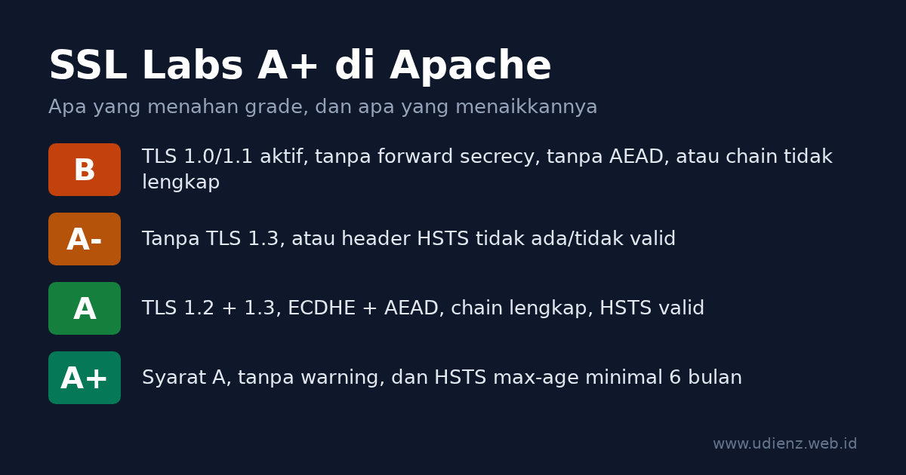

Untuk dapat A+ di [SSL Labs Server Test](https://www.ssllabs.com/ssltest/) dari Qualys dengan Apache httpd, syaratnya sama dengan web server lain: hanya TLS 1.2 dan TLS 1.3, cipher ECDHE dengan AEAD (GCM atau ChaCha20-Poly1305), sertifikat dikirim bersama chain lengkapnya, header HSTS dengan `max-age` minimal enam bulan, dan konfigurasi yang sama di semua alamat IP hostname tersebut. Di Apache, ada dua hal yang menentukan berhasil atau tidaknya: header HSTS harus memakai `Header always set`, bukan `Header set`, dan virtual host yang punya `SSLProtocol` atau `SSLCipherSuite` sendiri akan diam-diam mengalahkan pengaturan global.

Tulisan ini memberi konfigurasi yang bisa langsung dipasang di Apache Debian atau Ubuntu, menjelaskan tiap barisnya, dan menunjukkan cara mengecek hasilnya sebelum menjalankan SSL Labs.

Konfigurasi di bawah sudah diuji di Apache 2.4.69 dengan OpenSSL 3.5.7, memakai layout `/etc/apache2` bawaan Debian 13 dengan modul, `tls.conf`, dan file site dari tulisan ini diaktifkan, lalu dicek dengan `openssl s_client` dan `curl`.

<!--more-->

**Read in English:** [How to Get an A+ on SSL Labs with Apache httpd](). Pakai nginx? Lihat [Cara Mendapat A+ di SSL Labs dengan nginx]().



<details class="toc" markdown="1">
<summary>Daftar isi</summary>

* TOC
{:toc}
</details>

## Cara SSL Labs memberi nilai

SSL Labs menilai dukungan protokol (30%), key exchange (30%), dan kekuatan cipher (40%), lalu memberlakukan batas atas (cap) untuk masalah tertentu. A+ adalah bonus untuk server ber-grade A tanpa warning. Aturan yang berlaku sekarang adalah versi 2009r dari [SSL Server Rating Guide](https://github.com/ssllabs/research/wiki/SSL-Server-Rating-Guide), tertanggal 16 Mei 2025. Batas-batas yang relevan untuk server Apache pada umumnya:

| Masalah | Grade maksimal |
|---|---|
| SSLv2, SSLv3 sebagai protokol terbaik, cipher export, bug sekelas Heartbleed | F |
| Tidak mendukung TLS 1.2 | C |
| TLS 1.0 atau TLS 1.1 aktif | B |
| Tanpa forward secrecy (tanpa ECDHE/DHE) | B |
| Tanpa cipher AEAD (GCM atau ChaCha20-Poly1305) | B |
| Chain sertifikat tidak lengkap | B |
| Key atau parameter DH di bawah 2048 bit | B |
| Tidak mendukung TLS 1.3 | A- |
| HSTS tidak ada atau tidak valid | A- |

Untuk A+, panduan itu mensyaratkan konfigurasi tanpa warning dan HSTS dengan `max-age` minimal enam bulan (15768000 detik). Sejak revisi Mei 2025, sekadar dapat A pun butuh TLS 1.3 sekaligus header HSTS yang valid, dan `TLS_FALLBACK_SCSV` tidak dihitung lagi.

Sertifikat ECDSA P-256 atau RSA 2048 sudah cukup. Nilai key exchange-nya 90 dan tetap dapat A+.

## Cek versi Apache dan OpenSSL dulu

```bash
apache2 -v
apache2ctl -M | grep -e ssl -e headers -e rewrite -e http2
```

Versi OpenSSL yang dipakai Apache tercetak di error log saat start, di baris seperti `Apache/2.4.69 (Debian) OpenSSL/3.5.7 configured -- resuming normal operations`.

| Fitur | Butuh |
|---|---|
| TLS 1.3 (dan baris `SSLCipherSuite TLSv1.3 ...`) | Apache 2.4.37+ dengan OpenSSL 1.1.1+ (dukungan TLS 1.3 tercatat di 2.4.36, versi yang tidak pernah dirilis) |
| Intermediate di `SSLCertificateFile` (tanpa `SSLCertificateChainFile`) | Apache 2.4.8+ |
| `SSLOpenSSLConfCmd` (dipakai di sini untuk mengatur kurva) | Apache 2.4.8+ dengan OpenSSL 1.0.2+ |
| `Protocols h2 http/1.1` (HTTP/2) | Apache 2.4.17+ |
| `SSLProtocol` per virtual host dihormati saat ada SNI | Apache 2.4.42+ dengan OpenSSL 1.1.1+ |
| Grup hybrid post-quantum `X25519MLKEM768` | OpenSSL 3.5+ |

## Langkah 1: Sertifikat dan full chain

Dengan Let's Encrypt dan Certbot, ambil sertifikatnya saja, lalu tulis konfigurasi TLS sendiri:

```bash
sudo certbot certonly --apache -d example.com -d www.example.com
```

Certbot 2.0 ke atas membuat key ECDSA secara default.

Arahkan Apache ke `fullchain.pem`:

```apache
SSLCertificateFile    /etc/letsencrypt/live/example.com/fullchain.pem
SSLCertificateKeyFile /etc/letsencrypt/live/example.com/privkey.pem
```

Sejak Apache 2.4.8, `SSLCertificateFile` boleh berisi sertifikat intermediate setelah sertifikat utama, dan [dokumentasi mod_ssl](https://httpd.apache.org/docs/2.4/mod/mod_ssl.html#sslcertificatefile) menyebut `SSLCertificateChainFile` sudah usang. Kalau `SSLCertificateFile` diarahkan ke `cert.pem` dan chain file dibuang, intermediate-nya hilang. Browser sering melengkapinya sendiri, tapi SSL Labs akan menulis "Chain issues: Incomplete" dan membatasi grade di B.

Kalau memakai installer Certbot (`certbot --apache` tanpa `certonly`), ia menambahkan `Include /etc/letsencrypt/options-ssl-apache.conf` di dalam virtual host. File itu mengatur protokol dan cipher sendiri, dan karena letaknya di virtual host, ia mengalahkan file global dari Langkah 2. Hapus baris include itu, tapi lihat dulu apa lagi yang diatur file tersebut: [`options-ssl-apache.conf`](https://github.com/certbot/certbot/blob/main/certbot/src/certbot/_internal/plugins/apache/tls_configs/current-options-ssl-apache.conf) versi sekarang diawali `SSLEngine on`. Cek dengan `grep -n SSLEngine /etc/letsencrypt/options-ssl-apache.conf` dan, kalau ada, tambahkan `SSLEngine on` ke virtual host itu sendiri. Tanpa baris itu, Apache melayani HTTP biasa di port 443 tanpa pesan error.

## Langkah 2: Aktifkan modul dan atur TLS secara global

Aktifkan modul yang dipakai di tulisan ini:

```bash
sudo a2enmod ssl headers rewrite http2
```

`a2enmod ssl` sekaligus mengaktifkan `socache_shmcb` untuk session cache. Di Debian 13, `/etc/apache2/mods-available/ssl.conf` bawaan lalu berisi baris-baris ini (komentar dibuang):

```apache
SSLSessionCache     shmcb:${APACHE_RUN_DIR}/ssl_scache(512000)
SSLSessionCacheTimeout  300
SSLCipherSuite HIGH:!aNULL
SSLProtocol all -SSLv2 -SSLv3 -TLSv1 -TLSv1.1
SSLSessionTickets off
```

Protokolnya sudah benar. Daftar cipher-nya yang terlalu longgar. Dengan pengaturan bawaan saja, server tes masih menerima suite CBC, key exchange RSA biasa tanpa forward secrecy, dan DHE:

```text
-cipher 'ECDHE-ECDSA-AES128-SHA:ECDHE-RSA-AES128-SHA'  ->  Cipher is ECDHE-ECDSA-AES128-SHA
-cipher 'AES256-GCM-SHA384'                            ->  Cipher is AES256-GCM-SHA384
-cipher 'DHE-RSA-AES256-GCM-SHA384'                    ->  Cipher is DHE-RSA-AES256-GCM-SHA384
```

SSL Labs menandai suite CBC dan RSA biasa dengan label WEAK di daftar cipher-nya, dan TLSRef tidak memasukkan DHE sama sekali. Tidak ada alasan untuk tetap menawarkan semuanya. Rilis lain bisa punya nilai bawaan berbeda, jadi cek punya Anda dengan `grep -v '^\s*#' /etc/apache2/mods-available/ssl.conf`.

Biarkan `ssl.conf` apa adanya, lalu taruh pengaturan di `/etc/apache2/conf-available/tls.conf`:

```apache
# Pengaturan TLS untuk semua virtual host HTTPS (konteks server config)
SSLProtocol             -all +TLSv1.2 +TLSv1.3

# OpenSSL 3.5+: grup hybrid post-quantum di depan.
# Di OpenSSL 3.0-3.4, hapus X25519MLKEM768 dari daftar ini.
SSLOpenSSLConfCmd       Curves X25519MLKEM768:X25519:prime256v1:secp384r1

# TLS 1.2: hanya key exchange ECDHE + AEAD. TLS 1.3: tiga suite standar.
SSLCipherSuite          ECDHE-ECDSA-AES128-GCM-SHA256:ECDHE-RSA-AES128-GCM-SHA256:ECDHE-ECDSA-AES256-GCM-SHA384:ECDHE-RSA-AES256-GCM-SHA384:ECDHE-ECDSA-CHACHA20-POLY1305:ECDHE-RSA-CHACHA20-POLY1305
SSLCipherSuite          TLSv1.3 TLS_AES_128_GCM_SHA256:TLS_AES_256_GCM_SHA384:TLS_CHACHA20_POLY1305_SHA256
SSLHonorCipherOrder     off
SSLSessionTickets       off
```

Aktifkan:

```bash
sudo a2enconf tls
```

`apache2.conf` di Debian membaca `mods-enabled/*.conf` lebih dulu dan `conf-enabled/*.conf` belakangan. Untuk directive-directive ini, nilai global yang datang belakangan menggantikan yang sebelumnya, jadi `tls.conf` menang atas `ssl.conf` tanpa perlu mengedit file itu. Di server tes, ketiga suite lemah di atas ditolak begitu `tls.conf` aktif.

Penjelasan per baris:

- **`SSLProtocol -all +TLSv1.2 +TLSv1.3`** mulai dari kosong dan hanya mengizinkan TLS 1.2 dan 1.3. TLS 1.0 atau 1.1 membuat grade mentok di B; tanpa TLS 1.3 mentok di A-.
- **`SSLOpenSSLConfCmd Curves`** meneruskan daftar grup key exchange ke OpenSSL. Daftarnya diambil dari [TLSRef guideline 6.0](https://data.tlsref.org/guidelines/6.0.json), penerus Server Side TLS guidelines dari Mozilla, dan sama dengan yang dihasilkan [TLSRef Configurator](https://configurator.tlsref.org/) untuk Apache. `X25519MLKEM768` menggabungkan X25519 dengan algoritma post-quantum ML-KEM; klien yang belum mendukungnya turun ke X25519.
- **`SSLCipherSuite` pertama** hanya berisi suite ECDHE dengan GCM atau ChaCha20-Poly1305: forward secrecy dan AEAD, tidak ada yang lain. Menurut TLSRef, klien tertua yang masih bisa tersambung adalah Firefox 31, Chrome 49, Safari 9, Android 4.4.2, IE 11 di Windows 10, dan Java 8u161.
- **`SSLCipherSuite TLSv1.3 ...`** mengatur suite TLS 1.3. Ketiganya memang default OpenSSL; baris ini membuatnya eksplisit.
- **`SSLHonorCipherOrder off`** membiarkan klien memilih dari daftar. Semua pilihan sudah kuat, dan ponsel tanpa akselerasi AES di hardware akan memilih ChaCha20.
- **`SSLSessionTickets off`**. Dokumentasi mod_ssl memperingatkan bahwa ticket yang dipakai tanpa me-restart web server secara berkala (misalnya harian) merusak forward secrecy. Apache tidak merotasi key ticket sendiri, jadi TLSRef mematikannya. Session resumption tetap jalan lewat session cache `shmcb` dari `ssl.conf`.
- **Tanpa parameter DH.** Daftar cipher tidak berisi suite DHE, jadi parameter DH tidak perlu ditambahkan ke file sertifikat.

## Langkah 3: Virtual host, HSTS, dan redirect HTTP

Buat `/etc/apache2/sites-available/example.com.conf`:

```apache
<VirtualHost *:80>
    ServerName example.com
    ServerAlias www.example.com

    RewriteEngine On
    RewriteCond %{REQUEST_URI} !^/\.well-known/acme-challenge/
    RewriteRule ^.*$ https://%{HTTP_HOST}%{REQUEST_URI} [R=308,QSA,L]
</VirtualHost>

<VirtualHost *:443>
    ServerName example.com
    ServerAlias www.example.com
    DocumentRoot /var/www/example.com

    SSLEngine on
    SSLCertificateFile    /etc/letsencrypt/live/example.com/fullchain.pem
    SSLCertificateKeyFile /etc/letsencrypt/live/example.com/privkey.pem

    Protocols h2 http/1.1

    # HSTS: 2 tahun. "always" juga mengirimnya di redirect dan halaman error.
    Header always set Strict-Transport-Security "max-age=63072000; includeSubDomains"
</VirtualHost>
```

Lalu aktifkan site-nya dan reload:

```bash
sudo a2ensite example.com
sudo apache2ctl configtest && sudo systemctl reload apache2
```

Baris `RewriteCond` membiarkan `/.well-known/acme-challenge/` tetap di HTTP biasa, supaya validasi HTTP-01 Let's Encrypt dijawab langsung di port 80, tanpa bergantung pada redirect dan konfigurasi HTTPS. Redirect-nya 308, sama dengan config TLSRef.

### Kenapa harus `Header always set`

`mod_headers` menyimpan dua daftar header respons. Daftar default (`onsuccess`) dipakai untuk respons normal; [dokumentasi mod_headers](https://httpd.apache.org/docs/2.4/mod/mod_headers.html#header) menyebut bahwa untuk respons non-2xx yang dibuat server sendiri, seperti redirect, hanya daftar `always` yang dipakai.

Di server tes, dengan `Header set` alih-alih `Header always set` dan baris `Redirect 302 /old /` di virtual host `*:443`:

```text
GET /      ->  HTTP/2 200   strict-transport-security: max-age=63072000; includeSubDomains
GET /old   ->  HTTP/2 302   (tanpa header HSTS)
GET /nope  ->  HTTP/2 404   (tanpa header HSTS)
```

Dengan `Header always set`, ketiga respons membawa header itu. Ini paling terasa kalau halaman utama Anda me-redirect, misalnya `/` ke `/en/` atau ke halaman login: respons HTTPS pertama yang diterima pengunjung adalah redirect itu, dan tanpa `always` ia tidak membawa HSTS.

Catatan HSTS lainnya:

- **`max-age=63072000`** sama dengan dua tahun, nilai dari TLSRef. SSL Labs butuh minimal 15768000 (enam bulan) untuk A+.
- **`includeSubDomains`** membuat semua subdomain wajib HTTPS di browser yang pernah menerima header ini. Jangan dipasang sebelum itu benar untuk semua subdomain.
- Header ini hanya di virtual host `*:443`. Browser mengabaikan HSTS lewat HTTP biasa, dan [RFC 6797 bagian 7.2](https://www.rfc-editor.org/rfc/rfc6797#section-7.2) melarang server mengirimnya di sana.

Apache tidak punya masalah pewarisan `add_header` seperti nginx. `Header set Cache-Control ...` di dalam blok `<Location>` ditambahkan ke header dari virtual host; di server tes, header HSTS tetap ada di respons tersebut.

## Langkah 4: Waspadai virtual host yang menimpa pengaturan global

`tls.conf` mengatur nilai default untuk seluruh server. Virtual host yang punya `SSLProtocol`, `SSLCipherSuite` sendiri, atau meng-`Include` file yang mengaturnya, akan memakai nilai itu. Sejak Apache 2.4.42 dengan OpenSSL 1.1.1 ke atas, [dokumentasi SSLProtocol](https://httpd.apache.org/docs/2.4/mod/mod_ssl.html#sslprotocol) menyebut `SSLProtocol` milik tiap virtual host name-based dihormati kalau klien mengirim SNI. Sebelum itu, protokol dari virtual host pertama di IP dan port tersebut berlaku untuk semuanya.

Cari semua tempat yang mengatur opsi TLS:

```bash
grep -rn -e SSLProtocol -e SSLCipherSuite -e SSLHonorCipherOrder -e options-ssl-apache /etc/apache2/
apache2ctl -S
```

Perintah pertama seharusnya hanya menampilkan `mods-available/ssl.conf` dan `tls.conf` Anda. Perintah kedua menunjukkan virtual host mana yang menjawab di alamat mana, berguna kalau SSL Labs memberi nilai berbeda untuk IP yang berbeda.

## Langkah 5: OCSP stapling dan Let's Encrypt

`SSLUseStapling` mati secara default di Apache, dan untuk sertifikat Let's Encrypt sebaiknya tetap begitu. Let's Encrypt [menghentikan dukungan OCSP](https://letsencrypt.org/2024/12/05/ending-ocsp/): sejak 7 Mei 2025 sertifikatnya tidak lagi memuat URL OCSP, dan responder-nya dimatikan pada 6 Agustus 2025. Tidak ada yang bisa di-staple. (Tulisan saya tahun 2015, [OCSP Stapling di nginx](), ditulis sebelum perubahan ini.) OCSP stapling juga tidak memengaruhi grade SSL Labs.

Untuk sertifikat dari CA yang masih menjalankan OCSP, aktifkan di server config (di luar `<VirtualHost>`), misalnya di akhir `tls.conf`:

```apache
SSLUseStapling          on
SSLStaplingCache        "shmcb:${APACHE_RUN_DIR}/ssl_stapling(32768)"
```

## Langkah 6: Jebakan configtest

`apache2ctl configtest` hanya mengecek sintaks, bukan apakah OpenSSL menerima nilai yang Anda tulis. Di server tes, nama kurva yang tidak dikenal OpenSSL lolos cek sintaks lalu menghentikan Apache:

```text
$ apache2ctl configtest
Syntax OK
$ apache2ctl graceful
# error log:
[ssl:emerg] AH02407: "SSLOpenSSLConfCmd Curves FakeGroup999:X25519:prime256v1:secp384r1" failed for example.test:443
[ssl:emerg] AH02312: Fatal error initialising mod_ssl, exiting.
[:emerg] AH00020: Configuration Failed, exiting
```

Graceful reload tidak menyelamatkan Anda di sini. Setelah reload itu, tidak ada satu pun proses Apache yang tersisa, jadi HTTP biasa ikut mati. OpenSSL sebelum 3.5 tidak mengenal `X25519MLKEM768`, jadi nama itu bisa memicu kegagalan yang sama.

Karena itu, cek nama grup ke OpenSSL sebelum reload. Di server tes (OpenSSL 3.5.7):

```bash
openssl list -tls-groups | tr ':' '\n' | grep -x X25519MLKEM768
```

Kalau tidak ada output, atau `openssl` Anda tidak mengenal opsi `-tls-groups`, hapus `X25519MLKEM768` dari `tls.conf`. Debian dan Ubuntu membangun Apache dengan OpenSSL sistem, jadi perintah `openssl` mengecek library yang sama; untuk build sendiri, bandingkan dengan versi di baris log saat Apache start. Setiap kali mengubah TLS, reload lalu pastikan situs masih menjawab (`curl -sI https://example.com/`) sebelum logout.

## Langkah 7: Uji di lokal, lalu jalankan SSL Labs

Ganti `example.com` dengan host Anda:

```bash
# TLS 1.1 harus ditolak. SECLEVEL=0 supaya klien modern mau mencobanya.
openssl s_client -connect example.com:443 -servername example.com \
  -tls1_1 -cipher 'DEFAULT@SECLEVEL=0' </dev/null 2>&1 | grep -E 'alert|Cipher is'

# TLS 1.3 harus jalan. Dengan OpenSSL 3.5+ di kedua sisi, grupnya X25519MLKEM768.
openssl s_client -connect example.com:443 -servername example.com \
  -tls1_3 </dev/null 2>&1 | grep -E 'Negotiated TLS1.3 group|Cipher is'

# Suite CBC, RSA biasa, dan DHE harus ditolak.
for c in 'ECDHE-ECDSA-AES128-SHA:ECDHE-RSA-AES128-SHA' AES256-GCM-SHA384 DHE-RSA-AES256-GCM-SHA384; do
  openssl s_client -connect example.com:443 -servername example.com -tls1_2 \
    -cipher "$c" </dev/null 2>&1 | grep -E 'alert|Cipher is' | head -1
done

# Full chain: server harus mengirim minimal 2 sertifikat (milik Anda + intermediate).
openssl s_client -connect example.com:443 -servername example.com -showcerts </dev/null 2>/dev/null | grep -c 'BEGIN CERTIFICATE'

# HSTS di halaman normal dan halaman error, plus redirect HTTP.
curl -sI https://example.com/ | grep -i strict-transport-security
curl -sI https://example.com/does-not-exist | grep -i -e '^HTTP' -e strict-transport-security
curl -sI http://example.com/ | grep -i -e '^HTTP' -e '^location'
```

Di server tes, hasilnya seperti ini (diringkas):

```text
tls1_1 :  tlsv1 alert protocol version ... Cipher is (NONE)
tls1_3 :  Negotiated TLS1.3 group: X25519MLKEM768
          New, TLSv1.3, Cipher is TLS_AES_256_GCM_SHA384
CBC    :  ssl/tls alert handshake failure
RSA    :  ssl/tls alert handshake failure
DHE    :  ssl/tls alert handshake failure
404    :  HTTP/2 404 + strict-transport-security: max-age=63072000; includeSubDomains
HTTP   :  HTTP/1.1 308 Permanent Redirect
```

Setelah itu buka [ssllabs.com/ssltest](https://www.ssllabs.com/ssltest/), masukkan hostname, dan centang "Do not show the results on the boards" kalau tidak ingin hasilnya tampil di daftar publik. Setelah mengubah konfigurasi, klik "Clear cache" di halaman hasil supaya scan diulang.

## Troubleshooting: arti pesan di laporan dan cara memperbaikinya

| Yang muncul | Penyebab | Perbaikan |
|---|---|---|
| Grade B, "This server supports TLS 1.0 and TLS 1.1" | Ada virtual host atau include yang mengatur `SSLProtocol` sendiri | Jalankan `grep` dari Langkah 4; hapus pengaturan itu |
| Suite WEAK (CBC, `TLS_RSA_*`) di daftar cipher | `SSLCipherSuite` bawaan distro, atau pengaturan di virtual host | Aktifkan `tls.conf`; cek dengan `grep` dari Langkah 4 |
| Grade B, "Chain issues: Incomplete" | `SSLCertificateFile` mengarah ke `cert.pem` | Pakai `fullchain.pem` |
| Grade A-, "This server does not support TLS 1.3" | Apache sebelum 2.4.37, OpenSSL sebelum 1.1.1, atau `SSLProtocol` tanpa `+TLSv1.3` | Upgrade; cek kedua versi di baris log saat Apache start |
| Grade A-, HSTS tidak terdeteksi padahal sudah dipasang | `mod_headers` belum aktif, header dipasang di virtual host yang salah, atau `Header set` tanpa `always` di halaman yang me-redirect | `a2enmod headers`; pasang `Header always set` di virtual host `*:443` |
| `Invalid command 'Header'` atau `'RewriteEngine'` | Modul belum aktif | `a2enmod headers rewrite` |
| Apache berhenti setelah reload padahal `configtest` bilang Syntax OK (`AH02407`, `AH02312`) | OpenSSL menolak suatu nilai, sering `X25519MLKEM768` di OpenSSL sebelum 3.5 | Hapus grup itu, start Apache lagi; lihat Langkah 6 |
| A+ di satu IP, A- di IP lain | IPv6 dilayani virtual host atau mesin lain | Cek `apache2ctl -S` dan record AAAA |
| Grade tidak berubah walau Apache sudah diubah | Yang diuji CDN, bukan server Anda | Lihat di bawah |

**Pakai Cloudflare atau CDN lain?** Kalau proxy aktif, SSL Labs menguji edge CDN, bukan Apache Anda. Grade-nya bergantung pada pengaturan CDN (versi TLS minimum, TLS 1.3, HSTS). Tetap pasang konfigurasi di atas di server origin dan pakai mode "Full (strict)" di Cloudflare supaya koneksi ke server Anda juga diverifikasi.

## Opsional: HSTS preload

HSTS preload memasukkan domain Anda ke daftar yang ditanam di dalam browser. SSL Labs tidak mensyaratkannya untuk A+. [hstspreload.org](https://hstspreload.org/) mensyaratkan `max-age` minimal satu tahun, `includeSubDomains`, `preload`, HTTPS di semua subdomain, dan redirect HTTP ke HTTPS di host yang sama. Keluar dari daftar itu butuh berbulan-bulan sampai ke pengguna, jadi daftarkan hanya domain yang pasti tetap HTTPS-only di semua subdomain.

```apache
Header always set Strict-Transport-Security "max-age=63072000; includeSubDomains; preload"
```

## Konfigurasi lengkap

```apache
# /etc/apache2/conf-available/tls.conf   (a2enconf tls)
SSLProtocol             -all +TLSv1.2 +TLSv1.3
SSLOpenSSLConfCmd       Curves X25519MLKEM768:X25519:prime256v1:secp384r1
SSLCipherSuite          ECDHE-ECDSA-AES128-GCM-SHA256:ECDHE-RSA-AES128-GCM-SHA256:ECDHE-ECDSA-AES256-GCM-SHA384:ECDHE-RSA-AES256-GCM-SHA384:ECDHE-ECDSA-CHACHA20-POLY1305:ECDHE-RSA-CHACHA20-POLY1305
SSLCipherSuite          TLSv1.3 TLS_AES_128_GCM_SHA256:TLS_AES_256_GCM_SHA384:TLS_CHACHA20_POLY1305_SHA256
SSLHonorCipherOrder     off
SSLSessionTickets       off
```

```apache
# /etc/apache2/sites-available/example.com.conf   (a2ensite example.com)
<VirtualHost *:80>
    ServerName example.com
    ServerAlias www.example.com
    RewriteEngine On
    RewriteCond %{REQUEST_URI} !^/\.well-known/acme-challenge/
    RewriteRule ^.*$ https://%{HTTP_HOST}%{REQUEST_URI} [R=308,QSA,L]
</VirtualHost>

<VirtualHost *:443>
    ServerName example.com
    ServerAlias www.example.com
    DocumentRoot /var/www/example.com
    SSLEngine on
    SSLCertificateFile    /etc/letsencrypt/live/example.com/fullchain.pem
    SSLCertificateKeyFile /etc/letsencrypt/live/example.com/privkey.pem
    Protocols h2 http/1.1
    Header always set Strict-Transport-Security "max-age=63072000; includeSubDomains"
</VirtualHost>
```

Modul: `a2enmod ssl headers rewrite http2`.

Untuk melayani sertifikat ECDSA dan RSA sekaligus, ulangi pasangan sertifikat di virtual host yang sama; mod_ssl memilih yang cocok untuk tiap klien:

```apache
# Pasangan ECDSA, dari Langkah 1
SSLCertificateFile    /etc/letsencrypt/live/example.com/fullchain.pem
SSLCertificateKeyFile /etc/letsencrypt/live/example.com/privkey.pem
# Pasangan RSA
SSLCertificateFile    /etc/letsencrypt/live/example.com-rsa/fullchain.pem
SSLCertificateKeyFile /etc/letsencrypt/live/example.com-rsa/privkey.pem
```

Di server tes, klien TLS 1.2 yang hanya menawarkan `ECDHE-RSA-AES128-GCM-SHA256` menerima sertifikat RSA 2048 bit, sementara klien lain mendapat ECDSA. Dengan Certbot, jalankan sekali lagi dengan `--key-type rsa --cert-name example.com-rsa` untuk mendapat pasangan RSA.

*Mahyuddin Susanto adalah sysadmin Linux dan jaringan yang mengelola server sendiri dan menulis soal Apache di blog ini sejak 2007, dimulai dari [Apache server dengan module OpenSSL](). [Tentang penulis](/about) · [Kontak](/contact)*

## Sumber

- Qualys SSL Labs, [SSL Server Rating Guide](https://github.com/ssllabs/research/wiki/SSL-Server-Rating-Guide), versi 2009r, 16 Mei 2025
- TLSRef, [Server Side TLS guideline 6.0](https://data.tlsref.org/guidelines/6.0.json) dan [TLS Configurator](https://configurator.tlsref.org/)
- Apache HTTP Server 2.4, [mod_ssl](https://httpd.apache.org/docs/2.4/mod/mod_ssl.html) dan [mod_headers](https://httpd.apache.org/docs/2.4/mod/mod_headers.html)
- Let's Encrypt, [Ending OCSP Support in 2025](https://letsencrypt.org/2024/12/05/ending-ocsp/)
- [HSTS Preload List Submission](https://hstspreload.org/)
- IETF, [RFC 6797: HTTP Strict Transport Security](https://www.rfc-editor.org/rfc/rfc6797)
