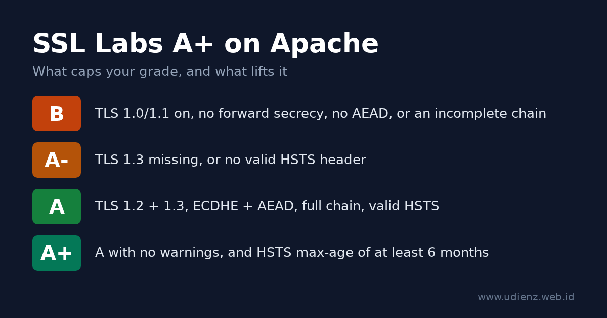

To get an A+ on the [Qualys SSL Labs server test](https://www.ssllabs.com/ssltest/) with Apache httpd, you need the same five things as on any web server: TLS 1.2 and TLS 1.3 only, ECDHE key exchange with AEAD ciphers (GCM or ChaCha20-Poly1305), a certificate served with its full chain, an HSTS header with a `max-age` of at least six months, and the same setup on every IP address your hostname resolves to. On Apache, two details decide whether you get there: the HSTS header needs `Header always set`, not `Header set`, and a virtual host with its own `SSLProtocol` or `SSLCipherSuite` silently overrides your global settings.

This guide gives you a config you can paste into a Debian or Ubuntu Apache, explains each line, and shows how to check the result before you run SSL Labs.

The configuration below was tested on Apache 2.4.69 with OpenSSL 3.5.7, using the stock Debian 13 `/etc/apache2` layout with the modules, `tls.conf` and site file from this guide enabled, and checked with `openssl s_client` and `curl`.

**Baca dalam Bahasa Indonesia:** [Cara Mendapat A+ di SSL Labs dengan Apache](). Running nginx? See [How to Get an A+ on SSL Labs with nginx]().



<details class="toc" markdown="1">
<summary>Contents</summary>

* TOC
{:toc}
</details>

## How SSL Labs grades your server

SSL Labs scores protocol support (30%), key exchange (30%) and cipher strength (40%), then applies caps for specific problems. The A+ is a bonus on top of an A with no warnings. The current rules are version 2009r of the [SSL Server Rating Guide](https://github.com/ssllabs/research/wiki/SSL-Server-Rating-Guide), dated 16 May 2025. The caps that matter for a typical Apache server:

| Problem | Grade limit |
|---|---|
| SSLv2, SSLv3 as the best protocol, export ciphers, Heartbleed-class bugs | F |
| TLS 1.2 not supported | C |
| TLS 1.0 or TLS 1.1 enabled | B |
| No forward secrecy (no ECDHE/DHE) | B |
| No AEAD cipher (GCM or ChaCha20-Poly1305) | B |
| Incomplete certificate chain | B |
| Key or DH parameters under 2048 bits | B |
| TLS 1.3 not supported | A- |
| HSTS missing or invalid | A- |

For the A+, the guide asks for a configuration with no warnings and HSTS with a `max-age` of at least six months (15768000 seconds). Since the May 2025 revision, a plain A needs both TLS 1.3 and a valid HSTS header, and `TLS_FALLBACK_SCSV` no longer counts.

An ECDSA P-256 or RSA 2048 certificate is enough. It scores 90 on key exchange and still gets an A+.

## Check your Apache and OpenSSL versions first

```bash
apache2 -v
apache2ctl -M | grep -e ssl -e headers -e rewrite -e http2
```

The OpenSSL version that Apache uses is printed in the error log at startup, in a line like `Apache/2.4.69 (Debian) OpenSSL/3.5.7 configured -- resuming normal operations`.

| Feature | Needs |
|---|---|
| TLS 1.3 (and the `SSLCipherSuite TLSv1.3 ...` line) | Apache 2.4.37+ with OpenSSL 1.1.1+ (TLS 1.3 support is listed under 2.4.36, which was never released) |
| Intermediates in `SSLCertificateFile` (no `SSLCertificateChainFile`) | Apache 2.4.8+ |
| `SSLOpenSSLConfCmd` (used here to set curves) | Apache 2.4.8+ with OpenSSL 1.0.2+ |
| `Protocols h2 http/1.1` (HTTP/2) | Apache 2.4.17+ |
| Per-virtual-host `SSLProtocol` honored with SNI | Apache 2.4.42+ with OpenSSL 1.1.1+ |
| Hybrid post-quantum group `X25519MLKEM768` | OpenSSL 3.5+ |

## Step 1: Get a certificate and serve the full chain

With Let's Encrypt and Certbot, get the certificate only and write the TLS config yourself:

```bash
sudo certbot certonly --apache -d example.com -d www.example.com
```

Certbot 2.0 and newer create an ECDSA key by default.

Point Apache at `fullchain.pem`:

```apache
SSLCertificateFile    /etc/letsencrypt/live/example.com/fullchain.pem
SSLCertificateKeyFile /etc/letsencrypt/live/example.com/privkey.pem
```

Since Apache 2.4.8, `SSLCertificateFile` can hold the intermediate certificates after your own certificate, and the [mod_ssl documentation](https://httpd.apache.org/docs/2.4/mod/mod_ssl.html#sslcertificatefile) marks `SSLCertificateChainFile` as obsolete. If you point `SSLCertificateFile` at `cert.pem` and drop the chain file, the intermediate is missing. Browsers often fill it in themselves, but SSL Labs reports "Chain issues: Incomplete" and caps the grade at B.

If you use Certbot's installer (`certbot --apache` without `certonly`), it adds `Include /etc/letsencrypt/options-ssl-apache.conf` inside your virtual host. That file sets its own protocols and ciphers, and because it sits in the virtual host, it wins over the global file from Step 2. Remove the include, but first look at what else the file sets: the current [`options-ssl-apache.conf`](https://github.com/certbot/certbot/blob/main/certbot/src/certbot/_internal/plugins/apache/tls_configs/current-options-ssl-apache.conf) starts with `SSLEngine on`. Check with `grep -n SSLEngine /etc/letsencrypt/options-ssl-apache.conf` and, if it is there, add `SSLEngine on` to the virtual host itself. Without it, Apache serves plain HTTP on port 443 and reports no error.

## Step 2: Enable the modules and set TLS globally

Enable the modules this guide uses:

```bash
sudo a2enmod ssl headers rewrite http2
```

`a2enmod ssl` also enables `socache_shmcb` for the session cache. On Debian 13, the stock `/etc/apache2/mods-available/ssl.conf` then contains these lines (comments removed):

```apache
SSLSessionCache     shmcb:${APACHE_RUN_DIR}/ssl_scache(512000)
SSLSessionCacheTimeout  300
SSLCipherSuite HIGH:!aNULL
SSLProtocol all -SSLv2 -SSLv3 -TLSv1 -TLSv1.1
SSLSessionTickets off
```

The protocols are already fine. The cipher list is wider than it needs to be. With only these defaults, the test server accepted CBC suites, plain RSA key exchange without forward secrecy, and DHE:

```text
-cipher 'ECDHE-ECDSA-AES128-SHA:ECDHE-RSA-AES128-SHA'  ->  Cipher is ECDHE-ECDSA-AES128-SHA
-cipher 'AES256-GCM-SHA384'                            ->  Cipher is AES256-GCM-SHA384
-cipher 'DHE-RSA-AES256-GCM-SHA384'                    ->  Cipher is DHE-RSA-AES256-GCM-SHA384
```

SSL Labs marks CBC and plain RSA suites as WEAK in its cipher list, and TLSRef leaves DHE out entirely. There is no reason to keep offering any of them. Other releases may ship different defaults, so check yours with `grep -v '^\s*#' /etc/apache2/mods-available/ssl.conf`.

Leave `ssl.conf` as it is and put your settings in `/etc/apache2/conf-available/tls.conf`:

```apache
# TLS settings for every HTTPS virtual host (server config context)
SSLProtocol             -all +TLSv1.2 +TLSv1.3

# OpenSSL 3.5+: hybrid post-quantum group first.
# On OpenSSL 3.0-3.4, remove X25519MLKEM768 from this list.
SSLOpenSSLConfCmd       Curves X25519MLKEM768:X25519:prime256v1:secp384r1

# TLS 1.2: ECDHE key exchange + AEAD only. TLS 1.3: the three standard suites.
SSLCipherSuite          ECDHE-ECDSA-AES128-GCM-SHA256:ECDHE-RSA-AES128-GCM-SHA256:ECDHE-ECDSA-AES256-GCM-SHA384:ECDHE-RSA-AES256-GCM-SHA384:ECDHE-ECDSA-CHACHA20-POLY1305:ECDHE-RSA-CHACHA20-POLY1305
SSLCipherSuite          TLSv1.3 TLS_AES_128_GCM_SHA256:TLS_AES_256_GCM_SHA384:TLS_CHACHA20_POLY1305_SHA256
SSLHonorCipherOrder     off
SSLSessionTickets       off
```

Enable it:

```bash
sudo a2enconf tls
```

Debian's `apache2.conf` reads `mods-enabled/*.conf` first and `conf-enabled/*.conf` later. For these directives, the later global value replaces the earlier one, so `tls.conf` wins over `ssl.conf` without any edits there. On the test server, the three weak suites above were refused once `tls.conf` was enabled.

Line by line:

- **`SSLProtocol -all +TLSv1.2 +TLSv1.3`** starts from nothing and allows only TLS 1.2 and 1.3. TLS 1.0 or 1.1 would cap you at B; missing TLS 1.3 caps you at A-.
- **`SSLOpenSSLConfCmd Curves`** passes the key exchange groups to OpenSSL. The list comes from the [TLSRef guideline 6.0](https://data.tlsref.org/guidelines/6.0.json), the successor of Mozilla's Server Side TLS guidelines, and matches what the [TLSRef Configurator](https://configurator.tlsref.org/) generates for Apache. `X25519MLKEM768` combines X25519 with the ML-KEM post-quantum algorithm; clients without it fall back to X25519.
- **The first `SSLCipherSuite`** lists only ECDHE suites with GCM or ChaCha20-Poly1305: forward secrecy and AEAD, nothing else. TLSRef lists the oldest clients this still serves as Firefox 31, Chrome 49, Safari 9, Android 4.4.2, IE 11 on Windows 10 and Java 8u161.
- **`SSLCipherSuite TLSv1.3 ...`** sets the TLS 1.3 suites. These three are OpenSSL's defaults anyway; the line makes them explicit.
- **`SSLHonorCipherOrder off`** lets the client choose from the list. Every option is strong, and phones without AES hardware pick ChaCha20.
- **`SSLSessionTickets off`**. The mod_ssl documentation warns that tickets used "without restarting the web server with an appropriate frequency (e.g. daily)" compromise forward secrecy. Apache does not rotate the ticket key on its own, so TLSRef turns tickets off. Session resumption still works through the `shmcb` session cache from `ssl.conf`.
- **No DH parameters.** The list has no DHE suites, so you do not need to append DH parameters to the certificate file.

## Step 3: The virtual hosts, HSTS and the HTTP redirect

Create `/etc/apache2/sites-available/example.com.conf`:

```apache
<VirtualHost *:80>
    ServerName example.com
    ServerAlias www.example.com

    RewriteEngine On
    RewriteCond %{REQUEST_URI} !^/\.well-known/acme-challenge/
    RewriteRule ^.*$ https://%{HTTP_HOST}%{REQUEST_URI} [R=308,QSA,L]
</VirtualHost>

<VirtualHost *:443>
    ServerName example.com
    ServerAlias www.example.com
    DocumentRoot /var/www/example.com

    SSLEngine on
    SSLCertificateFile    /etc/letsencrypt/live/example.com/fullchain.pem
    SSLCertificateKeyFile /etc/letsencrypt/live/example.com/privkey.pem

    Protocols h2 http/1.1

    # HSTS: 2 years. "always" also sends it on redirects and error pages.
    Header always set Strict-Transport-Security "max-age=63072000; includeSubDomains"
</VirtualHost>
```

Then enable the site and reload:

```bash
sudo a2ensite example.com
sudo apache2ctl configtest && sudo systemctl reload apache2
```

The `RewriteCond` line keeps `/.well-known/acme-challenge/` on plain HTTP, so Let's Encrypt HTTP-01 validation is answered directly on port 80 and does not depend on the redirect or the HTTPS setup. The redirect is a 308, as in the TLSRef config.

### Why `Header always set` matters

`mod_headers` keeps two lists of response headers. The default one (`onsuccess`) is used for normal responses; the [mod_headers documentation](https://httpd.apache.org/docs/2.4/mod/mod_headers.html#header) says that for a locally generated non-2xx response, "such as a redirect", only the `always` list is used.

On the test server, with `Header set` instead of `Header always set` and a `Redirect 302 /old /` line in the `*:443` virtual host:

```text
GET /      ->  HTTP/2 200   strict-transport-security: max-age=63072000; includeSubDomains
GET /old   ->  HTTP/2 302   (no HSTS header)
GET /nope  ->  HTTP/2 404   (no HSTS header)
```

With `Header always set`, all three responses carried the header. This matters most when your home page redirects, for example `/` to `/en/` or to a login page: the first HTTPS response a visitor gets is that redirect, and without `always` it has no HSTS header.

Other HSTS notes:

- **`max-age=63072000`** is two years, the TLSRef value. SSL Labs needs at least 15768000 (six months) for the A+.
- **`includeSubDomains`** makes every subdomain HTTPS-only in browsers that have seen the header. Leave it out until that is true for all of them.
- The header belongs only in the `*:443` virtual host. Browsers ignore HSTS on plain HTTP, and [RFC 6797, section 7.2](https://www.rfc-editor.org/rfc/rfc6797#section-7.2) says servers must not send it there.

Apache does not have nginx's `add_header` inheritance problem. A `Header set Cache-Control ...` inside a `<Location>` block is added to the headers from the virtual host; on the test server the HSTS header stayed on those responses.

## Step 4: Watch for virtual hosts that override the global settings

`tls.conf` sets the server-wide default. Any virtual host that has its own `SSLProtocol`, `SSLCipherSuite` or an `Include` of a file that sets them uses those values instead. Since Apache 2.4.42 with OpenSSL 1.1.1 or newer, the [SSLProtocol documentation](https://httpd.apache.org/docs/2.4/mod/mod_ssl.html#sslprotocol) says each name-based virtual host's own `SSLProtocol` is honored when the client sends SNI. Before that, the protocol of the first virtual host on the IP and port applied to all of them.

Find every place that sets TLS options:

```bash
grep -rn -e SSLProtocol -e SSLCipherSuite -e SSLHonorCipherOrder -e options-ssl-apache /etc/apache2/
apache2ctl -S
```

The first command should show only `mods-available/ssl.conf` and your `tls.conf`. The second lists which virtual host answers on which address, which helps when SSL Labs grades one IP differently from another.

## Step 5: OCSP stapling and Let's Encrypt

`SSLUseStapling` is off by default in Apache, and for Let's Encrypt certificates it should stay off. Let's Encrypt [ended OCSP support](https://letsencrypt.org/2024/12/05/ending-ocsp/): from 7 May 2025 its certificates no longer contain an OCSP URL, and the responders were switched off on 6 August 2025. There is nothing to staple. (My 2015 post on [OCSP stapling in nginx]() predates this change.) OCSP stapling has no effect on the SSL Labs grade.

For a certificate from a CA that still runs OCSP, enable it in the server config (outside any `<VirtualHost>`), for example at the end of `tls.conf`:

```apache
SSLUseStapling          on
SSLStaplingCache        "shmcb:${APACHE_RUN_DIR}/ssl_stapling(32768)"
```

## Step 6: The configtest trap

`apache2ctl configtest` checks the syntax, not whether OpenSSL accepts your values. On the test server, a curve name that OpenSSL does not know passed the syntax check and then stopped Apache:

```text
$ apache2ctl configtest
Syntax OK
$ apache2ctl graceful
# error log:
[ssl:emerg] AH02407: "SSLOpenSSLConfCmd Curves FakeGroup999:X25519:prime256v1:secp384r1" failed for example.test:443
[ssl:emerg] AH02312: Fatal error initialising mod_ssl, exiting.
[:emerg] AH00020: Configuration Failed, exiting
```

A graceful reload does not protect you here. After that reload, no Apache process was left running, so plain HTTP was down too. OpenSSL older than 3.5 does not know `X25519MLKEM768`, so that name can cause the same failure there.

So check the group names against OpenSSL before you reload. On the test server (OpenSSL 3.5.7):

```bash
openssl list -tls-groups | tr ':' '\n' | grep -x X25519MLKEM768
```

If that prints nothing, or your `openssl` does not know the `-tls-groups` option, remove `X25519MLKEM768` from `tls.conf`. Debian and Ubuntu build Apache against the system OpenSSL, so the `openssl` command checks the same library; on a custom build, compare with the version in Apache's startup log line. After any TLS change, reload and then confirm the site still answers (`curl -sI https://example.com/`) before you log out.

## Step 7: Test locally, then run SSL Labs

Replace `example.com` with your host:

```bash
# TLS 1.1 must be refused. SECLEVEL=0 lets a modern client even try it.
openssl s_client -connect example.com:443 -servername example.com \
  -tls1_1 -cipher 'DEFAULT@SECLEVEL=0' </dev/null 2>&1 | grep -E 'alert|Cipher is'

# TLS 1.3 must work. With OpenSSL 3.5+ on both sides the group is X25519MLKEM768.
openssl s_client -connect example.com:443 -servername example.com \
  -tls1_3 </dev/null 2>&1 | grep -E 'Negotiated TLS1.3 group|Cipher is'

# CBC, plain RSA and DHE suites must be refused.
for c in 'ECDHE-ECDSA-AES128-SHA:ECDHE-RSA-AES128-SHA' AES256-GCM-SHA384 DHE-RSA-AES256-GCM-SHA384; do
  openssl s_client -connect example.com:443 -servername example.com -tls1_2 \
    -cipher "$c" </dev/null 2>&1 | grep -E 'alert|Cipher is' | head -1
done

# Full chain: the server must send at least 2 certificates (yours + intermediate).
openssl s_client -connect example.com:443 -servername example.com -showcerts </dev/null 2>/dev/null | grep -c 'BEGIN CERTIFICATE'

# HSTS on a normal page and on an error page, plus the HTTP redirect.
curl -sI https://example.com/ | grep -i strict-transport-security
curl -sI https://example.com/does-not-exist | grep -i -e '^HTTP' -e strict-transport-security
curl -sI http://example.com/ | grep -i -e '^HTTP' -e '^location'
```

On the test setup, the output looked like this (condensed):

```text
tls1_1 :  tlsv1 alert protocol version ... Cipher is (NONE)
tls1_3 :  Negotiated TLS1.3 group: X25519MLKEM768
          New, TLSv1.3, Cipher is TLS_AES_256_GCM_SHA384
CBC    :  ssl/tls alert handshake failure
RSA    :  ssl/tls alert handshake failure
DHE    :  ssl/tls alert handshake failure
404    :  HTTP/2 404 + strict-transport-security: max-age=63072000; includeSubDomains
HTTP   :  HTTP/1.1 308 Permanent Redirect
```

Then open [ssllabs.com/ssltest](https://www.ssllabs.com/ssltest/), enter your hostname, and tick "Do not show the results on the boards" if you do not want the result listed. After a config change, use "Clear cache" on the results page to force a new scan.

## Troubleshooting: what the report says and how to fix it

| What you see | Cause | Fix |
|---|---|---|
| Grade B, "This server supports TLS 1.0 and TLS 1.1" | A virtual host or include sets its own `SSLProtocol` | Run the `grep` from Step 4; remove the override |
| WEAK suites (CBC, `TLS_RSA_*`) in the cipher list | Distribution default `SSLCipherSuite`, or an override in a virtual host | Enable `tls.conf`; check with the `grep` from Step 4 |
| Grade B, "Chain issues: Incomplete" | `SSLCertificateFile` points to `cert.pem` | Use `fullchain.pem` |
| Grade A-, "This server does not support TLS 1.3" | Apache older than 2.4.37, OpenSSL older than 1.1.1, or `SSLProtocol` without `+TLSv1.3` | Upgrade; check both versions in the startup line of the error log |
| Grade A-, HSTS missing although it is configured | `mod_headers` not enabled, the header set in the wrong virtual host, or `Header set` without `always` on a redirecting page | `a2enmod headers`; put `Header always set` in the `*:443` virtual host |
| `Invalid command 'Header'` or `'RewriteEngine'` | Module not enabled | `a2enmod headers rewrite` |
| Apache stops after a reload although `configtest` said Syntax OK (`AH02407`, `AH02312`) | OpenSSL rejects a value, often `X25519MLKEM768` on OpenSSL older than 3.5 | Remove that group, start Apache again; see Step 6 |
| A+ on one IP, A- on another | IPv6 served by another virtual host or machine | Check `apache2ctl -S` and the AAAA record |
| Grade does not change after you edit Apache | You are testing a CDN, not your server | See below |

**Behind Cloudflare or another CDN?** With the proxy on, SSL Labs tests the CDN's edge, not your Apache. The grade then depends on the CDN settings (minimum TLS version, TLS 1.3, HSTS). Keep the setup above on the origin and use Cloudflare's "Full (strict)" mode so the connection to your server is checked too.

## Optional: HSTS preload

HSTS preload puts your domain on a list built into browsers. SSL Labs does not need it for an A+. [hstspreload.org](https://hstspreload.org/) requires a `max-age` of at least one year, `includeSubDomains`, `preload`, HTTPS on every subdomain, and an HTTP to HTTPS redirect on the same host. Removal takes months to reach users, so only submit a domain that will stay HTTPS-only everywhere.

```apache
Header always set Strict-Transport-Security "max-age=63072000; includeSubDomains; preload"
```

## The complete config

```apache
# /etc/apache2/conf-available/tls.conf   (a2enconf tls)
SSLProtocol             -all +TLSv1.2 +TLSv1.3
SSLOpenSSLConfCmd       Curves X25519MLKEM768:X25519:prime256v1:secp384r1
SSLCipherSuite          ECDHE-ECDSA-AES128-GCM-SHA256:ECDHE-RSA-AES128-GCM-SHA256:ECDHE-ECDSA-AES256-GCM-SHA384:ECDHE-RSA-AES256-GCM-SHA384:ECDHE-ECDSA-CHACHA20-POLY1305:ECDHE-RSA-CHACHA20-POLY1305
SSLCipherSuite          TLSv1.3 TLS_AES_128_GCM_SHA256:TLS_AES_256_GCM_SHA384:TLS_CHACHA20_POLY1305_SHA256
SSLHonorCipherOrder     off
SSLSessionTickets       off
```

```apache
# /etc/apache2/sites-available/example.com.conf   (a2ensite example.com)
<VirtualHost *:80>
    ServerName example.com
    ServerAlias www.example.com
    RewriteEngine On
    RewriteCond %{REQUEST_URI} !^/\.well-known/acme-challenge/
    RewriteRule ^.*$ https://%{HTTP_HOST}%{REQUEST_URI} [R=308,QSA,L]
</VirtualHost>

<VirtualHost *:443>
    ServerName example.com
    ServerAlias www.example.com
    DocumentRoot /var/www/example.com
    SSLEngine on
    SSLCertificateFile    /etc/letsencrypt/live/example.com/fullchain.pem
    SSLCertificateKeyFile /etc/letsencrypt/live/example.com/privkey.pem
    Protocols h2 http/1.1
    Header always set Strict-Transport-Security "max-age=63072000; includeSubDomains"
</VirtualHost>
```

Modules: `a2enmod ssl headers rewrite http2`.

To serve both ECDSA and RSA certificates, repeat the certificate pair in the same virtual host; mod_ssl picks the right one per client:

```apache
# ECDSA pair, from Step 1
SSLCertificateFile    /etc/letsencrypt/live/example.com/fullchain.pem
SSLCertificateKeyFile /etc/letsencrypt/live/example.com/privkey.pem
# RSA pair
SSLCertificateFile    /etc/letsencrypt/live/example.com-rsa/fullchain.pem
SSLCertificateKeyFile /etc/letsencrypt/live/example.com-rsa/privkey.pem
```

On the test server, a TLS 1.2 client that only offered `ECDHE-RSA-AES128-GCM-SHA256` received the 2048-bit RSA certificate, and other clients got ECDSA. With Certbot, run it again with `--key-type rsa --cert-name example.com-rsa` for the RSA pair.

*Mahyuddin Susanto is a Linux and networking sysadmin who runs his own servers and has written about Apache on this blog since 2007, starting with [Apache server dengan module OpenSSL](). [About](/about) · [Contact](/contact)*

## Sources

- Qualys SSL Labs, [SSL Server Rating Guide](https://github.com/ssllabs/research/wiki/SSL-Server-Rating-Guide), version 2009r, 16 May 2025
- TLSRef, [Server Side TLS guideline 6.0](https://data.tlsref.org/guidelines/6.0.json) and [TLS Configurator](https://configurator.tlsref.org/)
- Apache HTTP Server 2.4, [mod_ssl](https://httpd.apache.org/docs/2.4/mod/mod_ssl.html) and [mod_headers](https://httpd.apache.org/docs/2.4/mod/mod_headers.html)
- Let's Encrypt, [Ending OCSP Support in 2025](https://letsencrypt.org/2024/12/05/ending-ocsp/)
- [HSTS Preload List Submission](https://hstspreload.org/)
- IETF, [RFC 6797: HTTP Strict Transport Security](https://www.rfc-editor.org/rfc/rfc6797)
