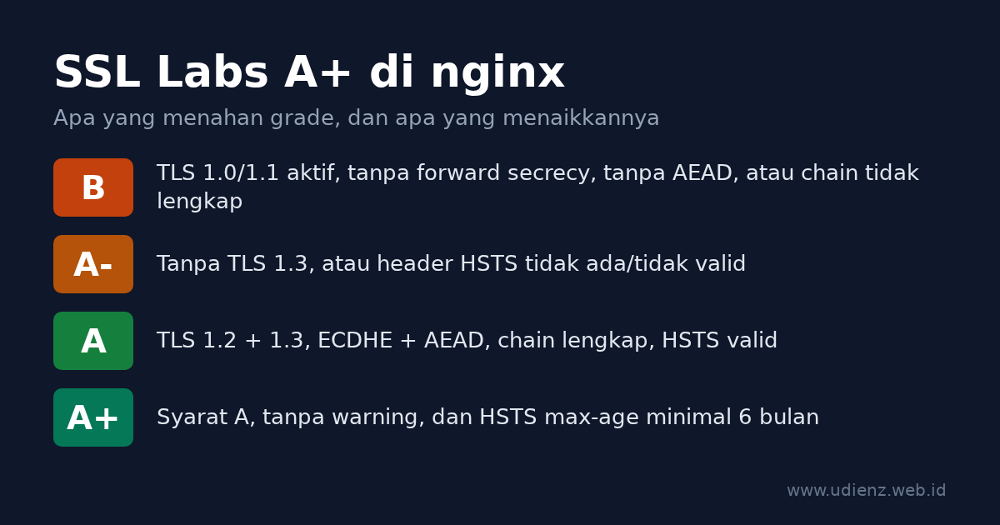

Untuk dapat A+ di [SSL Labs Server Test](https://www.ssllabs.com/ssltest/) dari Qualys dengan nginx, ada lima syarat: hanya TLS 1.2 dan TLS 1.3, cipher ECDHE dengan AEAD (GCM atau ChaCha20-Poly1305), sertifikat dikirim bersama chain lengkapnya, header HSTS dengan `max-age` minimal enam bulan, dan konfigurasi yang sama di semua alamat IP hostname tersebut. Tanpa TLS 1.3 atau tanpa HSTS, nilainya mentok di A-. Kalau TLS 1.0 atau 1.1 masih aktif, nilainya mentok di B.

Tulisan ini membahas tiap syarat itu satu per satu, lengkap dengan konfigurasi yang bisa langsung dipakai. Ada juga dua perubahan yang bikin banyak tutorial lama jadi usang: Let's Encrypt mematikan OCSP di 2025, dan SSL Labs mengubah aturan penilaiannya di Mei 2025.

Konfigurasi di bawah sudah diuji di nginx 1.26.3 dengan OpenSSL 3.5.7, memakai `nginx.conf` bawaan Debian 13 (dua baris SSL-nya diberi `#`) ditambah file-file dari tulisan ini, lalu dicek dengan `openssl s_client` dan `curl`.

<!--more-->

**Read in English:** [How to Get an A+ on SSL Labs with nginx](). Pakai Apache? Lihat [Cara Mendapat A+ di SSL Labs dengan Apache]().



<details class="toc" markdown="1">
<summary>Daftar isi</summary>

* TOC
{:toc}
</details>

## Cara SSL Labs memberi nilai

SSL Labs menilai tiga kategori: dukungan protokol (30%), key exchange (30%), dan kekuatan cipher (40%). Skor 80 ke atas berarti A. Setelah itu berlaku batas atas (cap): masalah tertentu membatasi grade setinggi apa pun skornya. A+ adalah bonus untuk server ber-grade A yang tidak punya warning.

Aturan yang berlaku sekarang adalah versi 2009r dari [SSL Server Rating Guide](https://github.com/ssllabs/research/wiki/SSL-Server-Rating-Guide), tertanggal 16 Mei 2025. Ini batas-batas yang relevan untuk server nginx pada umumnya:

| Masalah | Grade maksimal |
|---|---|
| SSLv2, SSLv3 sebagai protokol terbaik, cipher export, bug sekelas Heartbleed | F |
| Tidak mendukung TLS 1.2 | C |
| TLS 1.0 atau TLS 1.1 aktif | B |
| Tanpa forward secrecy (tanpa ECDHE/DHE) | B |
| Tanpa cipher AEAD (GCM atau ChaCha20-Poly1305) | B |
| RC4 aktif | B |
| Chain sertifikat tidak lengkap | B |
| Key atau parameter DH di bawah 2048 bit | B |
| Tidak mendukung TLS 1.3 | A- |
| HSTS tidak ada atau tidak valid | A- |

Untuk A+, panduan itu mensyaratkan konfigurasi tanpa warning dan HSTS dengan `max-age` minimal enam bulan (15768000 detik).

Ada dua perubahan di 2025: sekadar dapat A sekarang butuh TLS 1.3 sekaligus header HSTS yang valid, dan `TLS_FALLBACK_SCSV` tidak dihitung lagi. Kalau ada artikel lama yang menyuruh mengurus fallback SCSV, bagian itu bisa dilewati.

Nilai 100 di semua kategori tidak diperlukan. Sertifikat ECDSA P-256 atau RSA 2048 dapat 90 di key exchange, dan selama AES-128 masih ditawarkan, kekuatan cipher juga 90. Keduanya tetap dapat A+. Pindah ke RSA 4096 cuma bikin handshake lebih lambat.

## Cek versi nginx dan OpenSSL dulu

Beberapa directive bergantung pada versi yang terpasang:

```bash
nginx -V 2>&1 | head -3
openssl version
```

| Fitur | Butuh |
|---|---|
| TLS 1.3 (`TLSv1.3` di `ssl_protocols`) | OpenSSL 1.1.1+; jadi default sejak nginx 1.23.4 |
| `http2 on;` sebagai directive terpisah | nginx 1.25.1+ (versi lama: `listen 443 ssl http2;`) |
| Rotasi otomatis key session ticket | nginx 1.23.2+ dengan `ssl_session_cache` shared |
| Grup hybrid post-quantum `X25519MLKEM768` | OpenSSL 3.5+ |
| `add_header_inherit merge;` | nginx 1.29.3+ |

Yang penting di output `nginx -V` adalah baris `built with OpenSSL ...`. Itu library yang benar-benar dipakai nginx, dan bisa berbeda dengan perintah `openssl` di server yang sama.

## Langkah 1: Sertifikat dan full chain

Sertifikat apa pun yang dipercaya publik bisa dipakai. Dengan Let's Encrypt dan Certbot, ambil sertifikatnya saja, lalu tulis konfigurasi TLS sendiri:

```bash
sudo certbot certonly --nginx -d example.com -d www.example.com
```

Certbot versi baru sudah memakai key ECDSA secara default, dan itu yang dibutuhkan. Arahkan nginx ke `fullchain.pem`, bukan `cert.pem`:

```nginx
ssl_certificate     /etc/letsencrypt/live/example.com/fullchain.pem;
ssl_certificate_key /etc/letsencrypt/live/example.com/privkey.pem;
```

`cert.pem` hanya berisi sertifikat leaf. Browser sering melengkapi intermediate yang hilang sendiri, jadi situs terlihat normal, tapi SSL Labs akan menulis "Chain issues: Incomplete" dan membatasi grade di B. [Dokumentasi nginx](https://nginx.org/en/docs/http/ngx_http_ssl_module.html#ssl_certificate) juga bilang begitu: sertifikat server ditaruh paling atas di file, diikuti sertifikat intermediate.

Kalau memakai installer Certbot (`certbot --nginx` tanpa `certonly`), ia menambahkan `include /etc/letsencrypt/options-ssl-nginx.conf;` ke server block. File itu juga mengatur protokol dan cipher. Hapus baris include tersebut supaya hanya pengaturan dari tulisan ini yang berlaku.

## Langkah 2: Taruh pengaturan TLS di satu file bersama

Debian dan Ubuntu memuat semua file di `/etc/nginx/conf.d/` di dalam blok `http`, jadi satu file di sana berlaku untuk semua situs HTTPS.

Pertama, bereskan dulu baris SSL yang sudah dipasang paket di `/etc/nginx/nginx.conf`. File bawaan Debian 13 punya blok ini di dalam `http { }`:

```nginx
##
# SSL Settings
##

ssl_protocols TLSv1.2 TLSv1.3; # Dropping SSLv3 (POODLE), TLS 1.0, 1.1
ssl_prefer_server_ciphers off; # Don't force server cipher order.
```

File di `conf.d/` masuk ke blok `http` yang sama, jadi baris-baris ini akan bentrok. nginx menolak `ssl_prefer_server_ciphers` kedua di level yang sama:

```text
nginx: [emerg] "ssl_prefer_server_ciphers" directive is duplicate in /etc/nginx/conf.d/tls.conf
```

`ssl_protocols` kedua juga tidak menimpa yang pertama. nginx menggabungkan kedua daftar dan hanya memberi peringatan seperti `[warn] duplicate value "TLSv1.2"`, bukan error. Beri tanda `#` pada kedua baris itu (isinya bisa berbeda di rilis lain), lalu pastikan tidak ada file lain yang mengaturnya:

```bash
grep -rn -e ssl_protocols -e ssl_prefer_server_ciphers -e ssl_ciphers /etc/nginx/
```

Sekarang buat `/etc/nginx/conf.d/tls.conf`:

```nginx
# Pengaturan TLS untuk semua server block (konteks http)
ssl_protocols TLSv1.2 TLSv1.3;

# OpenSSL 3.5+: grup hybrid post-quantum di depan.
# Di OpenSSL 3.0-3.4, hapus X25519MLKEM768 dari daftar ini.
ssl_ecdh_curve X25519MLKEM768:X25519:prime256v1:secp384r1;

# Cipher TLS 1.2: hanya key exchange ECDHE + AEAD.
# Suite TLS 1.3 diatur OpenSSL dan semuanya AEAD.
ssl_ciphers ECDHE-ECDSA-AES128-GCM-SHA256:ECDHE-RSA-AES128-GCM-SHA256:ECDHE-ECDSA-AES256-GCM-SHA384:ECDHE-RSA-AES256-GCM-SHA384:ECDHE-ECDSA-CHACHA20-POLY1305:ECDHE-RSA-CHACHA20-POLY1305;
ssl_prefer_server_ciphers off;

ssl_session_timeout 1d;
ssl_session_cache shared:TLS:10m;   # sekitar 40000 sesi
```

Penjelasan per baris:

- **`ssl_protocols TLSv1.2 TLSv1.3`** mematikan TLS 1.0 dan 1.1 (penyebab cap B) dan mengaktifkan TLS 1.3 (tanpanya grade mentok di A-). Ini sudah default sejak nginx 1.23.4, tapi ditulis eksplisit supaya jelas. Baris ini tidak menimpa `ssl_protocols` lain di blok yang sama, karena itu baris lama tadi harus dimatikan.
- **`ssl_ecdh_curve`** menentukan grup key exchange. Daftarnya diambil dari [TLSRef guideline 6.0](https://data.tlsref.org/guidelines/6.0.json), penerus Server Side TLS guidelines dari Mozilla. `X25519MLKEM768` menggabungkan X25519 klasik dengan algoritma post-quantum ML-KEM. Klien yang belum mendukungnya otomatis turun ke X25519.
- **`ssl_ciphers`** hanya berisi suite ECDHE, yang memberi forward secrecy, dan hanya GCM atau ChaCha20-Poly1305, yang termasuk AEAD. Tidak ada CBC, tidak ada key exchange RSA, tidak ada 3DES. Menurut TLSRef, klien tertua yang masih bisa tersambung dengan profil ini adalah Firefox 31, Chrome 49, Safari 9, Android 4.4.2, IE 11 di Windows 10, dan Java 8u161. Daftar ini sekaligus menggantikan daftar cipher di tulisan saya tahun 2015, [ssl_cipher di nginx](), yang sudah usang.
- **`ssl_prefer_server_ciphers off`** membiarkan klien yang memilih. Karena semua pilihan di daftar sudah kuat, klien paling tahu mana yang cocok: ponsel tanpa akselerasi AES di hardware akan memilih ChaCha20.
- **Tanpa `ssl_dhparam`.** Daftar cipher tidak berisi suite DHE, jadi file parameter DH tidak diperlukan. Risiko lama "parameter DH di bawah 2048 bit" ikut hilang.
- **Session ticket** dibiarkan default (`on`). Sejak nginx 1.23.2, key ticket dirotasi otomatis selama `ssl_session_cache` memakai shared memory, seperti di file di atas. Karena itu TLSRef hanya menambahkan `ssl_session_tickets off;` untuk versi yang lebih lama.

Mozilla SSL Configuration Generator sekarang dialihkan ke [TLSRef Configurator](https://configurator.tlsref.org/). File di atas sama dengan profil "Intermediate" di sana, pilihan yang tepat untuk website publik. Profil "Modern" (hanya TLS 1.3) juga dapat A+, tapi memutus klien lama seperti Android 4.4 dan IE 11.

## Langkah 3: Server block, HSTS, dan redirect HTTP

Sekarang konfigurasi situsnya, misalnya `/etc/nginx/sites-available/example.com` yang di-link ke `sites-enabled/`:

```nginx
# Port 80: semua dialihkan ke HTTPS
server {
    listen 80;
    listen [::]:80;
    server_name example.com www.example.com;

    return 308 https://$host$request_uri;
}

server {
    listen 443 ssl;
    listen [::]:443 ssl;
    http2 on;                       # nginx < 1.25.1: "listen 443 ssl http2;"
    server_name example.com www.example.com;

    ssl_certificate     /etc/letsencrypt/live/example.com/fullchain.pem;
    ssl_certificate_key /etc/letsencrypt/live/example.com/privkey.pem;

    # HSTS: 2 tahun. "always" juga mengirimnya di respons 3xx/4xx/5xx.
    add_header Strict-Transport-Security "max-age=63072000; includeSubDomains" always;

    root /var/www/example.com;
    index index.html;
}
```

Catatan soal baris HSTS:

- **`max-age=63072000`** sama dengan dua tahun, nilai dari TLSRef. SSL Labs butuh minimal 15768000 (enam bulan) untuk A+. Nilai yang lebih pendek atau salah ketik membuat grade turun ke A-.
- **`always`** penting. Tanpa itu, nginx hanya menambahkan header di respons 200, 201, 204, 206, 301, 302, 303, 304, 307, dan 308. Dengan `always`, halaman error juga membawa header ini.
- **`includeSubDomains`** memberi tahu browser bahwa semua subdomain juga wajib HTTPS. Jangan dipasang sebelum yakin itu benar. Kalau `intranet.example.com` masih HTTP biasa, browser yang pernah menerima header ini akan menolak membukanya.
- Header hanya dipasang di server HTTPS. Browser mengabaikan HSTS yang dikirim lewat HTTP biasa, dan spesifikasi HSTS ([RFC 6797 bagian 7.2](https://www.rfc-editor.org/rfc/rfc6797#section-7.2)) melarang server mengirimnya di sana.

Dua baris `listen` di tiap blok memang disengaja. Kalau domain punya record AAAA tapi nginx hanya listen di IPv4, SSL Labs akan menguji alamat IPv6 dan mendapat jawaban berbeda. Penjelasannya ada di tabel troubleshooting.

## Langkah 4: OCSP stapling dan Let's Encrypt

Banyak panduan A+ masih menyuruh menambahkan `ssl_stapling on;`, termasuk tulisan saya sendiri tahun 2015, [OCSP Stapling di nginx](). Untuk sertifikat Let's Encrypt, baris itu sebaiknya dibuang.

Let's Encrypt [menghentikan dukungan OCSP](https://letsencrypt.org/2024/12/05/ending-ocsp/): sejak 7 Mei 2025 sertifikatnya tidak lagi memuat URL OCSP, dan responder OCSP dimatikan pada 6 Agustus 2025. Pengecekan revokasi sekarang lewat CRL. Dengan stapling aktif dan sertifikat Let's Encrypt yang baru, nginx menulis peringatan seperti ini setiap kali reload:

```text
[warn] "ssl_stapling" ignored, no OCSP responder URL in the certificate
```

Situs tetap jalan, tapi log jadi kotor. Hapus `ssl_stapling` dan `ssl_stapling_verify`. OCSP stapling tidak memengaruhi grade SSL Labs.

Kalau sertifikat berasal dari CA yang masih menjalankan OCSP, stapling tetap berguna. Yang dibutuhkan adalah resolver dan chain penerbit:

```nginx
ssl_stapling on;
ssl_stapling_verify on;
ssl_trusted_certificate /etc/ssl/certs/ca-chain.pem;   # root + intermediate
resolver 127.0.0.53 valid=300s;   # contoh: systemd-resolved; ganti dengan resolver server Anda
```

## Langkah 5: Hindari jebakan add_header

Di nginx, `add_header` hanya diwarisi dari blok luar kalau blok saat ini tidak punya `add_header` sendiri. Begitu satu header ditambahkan di sebuah `location`, semua header dari blok `server` hilang di location itu, termasuk HSTS. Kalau location itu `/`, grade turun ke A-. Kalau di path lain, laporan tetap A+ padahal sebagian situs jalan tanpa header itu.

Ini hasil uji di server tes (port 8443) dengan konfigurasi di atas ditambah satu location:

```nginx
location /assets/ {
    add_header Cache-Control "public, max-age=3600";
}
```

```text
$ curl -sk -D- -o /dev/null https://127.0.0.1:8443/ | grep -i strict
strict-transport-security: max-age=63072000; includeSubDomains

$ curl -sk -D- -o /dev/null https://127.0.0.1:8443/assets/x | grep -i -e strict -e cache
cache-control: public, max-age=3600
```

Respons kedua tidak punya HSTS.

Ada tiga cara memperbaikinya, urut dari yang paling disarankan:

1. **nginx 1.29.3 ke atas:** pasang `add_header_inherit merge;` di blok `http`. Header dari level luar akan ditambahkan ke header yang diset di blok dalam ([dokumentasi](https://nginx.org/en/docs/http/ngx_http_headers_module.html#add_header_inherit)).
2. **nginx lama:** pindahkan header keamanan ke snippet, lalu include di setiap tempat yang memakai `add_header` (contoh di bawah).
3. **Kalau hanya untuk cache:** pakai `expires 1h;`, bukan `add_header Cache-Control`. Directive ini mengirim `Cache-Control` dan `Expires` sendiri, dan berbeda dengan `add_header`, tidak memutus header warisan dari blok `server`.

Cara snippet kira-kira seperti ini:

```nginx
# /etc/nginx/snippets/security-headers.conf
add_header Strict-Transport-Security "max-age=63072000; includeSubDomains" always;
```

```nginx
location /assets/ {
    include snippets/security-headers.conf;
    add_header Cache-Control "public, max-age=3600";
}
```

Dan hasil `location /assets/ { expires 1h; }` di server tes yang sama:

```text
$ curl -sk -D- -o /dev/null https://127.0.0.1:8443/assets/x.css
HTTP/2 200
expires: Thu, 05 Nov 2026 01:41:51 GMT
cache-control: max-age=3600
strict-transport-security: max-age=63072000; includeSubDomains
```

Aturan pewarisan yang sama berlaku untuk blok `if` dan location bertingkat.

## Langkah 6: Uji di lokal, lalu jalankan SSL Labs

Cek sintaks lalu reload:

```bash
sudo nginx -t && sudo systemctl reload nginx
```

Sebelum ke SSL Labs, cek poin-poin penting dari terminal sendiri. Ganti `example.com` dengan host Anda:

```bash
# TLS 1.1 harus ditolak. SECLEVEL=0 supaya klien modern mau mencobanya.
openssl s_client -connect example.com:443 -servername example.com \
  -tls1_1 -cipher 'DEFAULT@SECLEVEL=0' </dev/null 2>&1 | grep -E 'alert|Cipher is'

# TLS 1.3 harus jalan. Dengan OpenSSL 3.5+ di kedua sisi, grupnya X25519MLKEM768.
openssl s_client -connect example.com:443 -servername example.com \
  -tls1_3 </dev/null 2>&1 | grep -E 'Negotiated TLS1.3 group|Cipher is'

# Suite CBC harus ditolak (berlaku untuk sertifikat ECDSA maupun RSA).
openssl s_client -connect example.com:443 -servername example.com -tls1_2 \
  -cipher 'ECDHE-ECDSA-AES128-SHA:ECDHE-RSA-AES128-SHA' </dev/null 2>&1 | grep -E 'alert|Cipher is'

# Full chain: harus ada baris "depth=1" (intermediate yang dikirim server).
openssl s_client -connect example.com:443 -servername example.com </dev/null 2>&1 | grep depth

# Header HSTS dan redirect.
curl -sI https://example.com/ | grep -i strict-transport-security
curl -sI http://example.com/  | grep -i -e '^HTTP' -e '^location'
```

Di server tes, hasilnya seperti ini (diringkas):

```text
tls1_1 :  tlsv1 alert protocol version ... Cipher is (NONE)
tls1_3 :  Negotiated TLS1.3 group: X25519MLKEM768
          New, TLSv1.3, Cipher is TLS_AES_256_GCM_SHA384
CBC    :  ssl/tls alert handshake failure ... Cipher is (NONE)
HSTS   :  strict-transport-security: max-age=63072000; includeSubDomains
HTTP   :  HTTP/1.1 308 Permanent Redirect
```

Kalau semuanya sudah sesuai, buka [ssllabs.com/ssltest](https://www.ssllabs.com/ssltest/), masukkan hostname, dan centang "Do not show the results on the boards" kalau tidak ingin hasilnya tampil di daftar publik. SSL Labs menyimpan hasil scan untuk beberapa waktu. Setelah mengubah konfigurasi, klik tautan "Clear cache" di halaman hasil supaya scan diulang. Satu scan penuh butuh beberapa menit, lebih lama kalau hostname punya beberapa alamat IP.

## Troubleshooting: arti pesan di laporan dan cara memperbaikinya

| Yang muncul | Penyebab | Perbaikan |
|---|---|---|
| Grade B, "This server supports TLS 1.0 and TLS 1.1" | Ada baris `ssl_protocols` lama, sering di `nginx.conf` atau include dari Certbot | Jalankan `grep` dari Langkah 2 dan sisakan hanya `tls.conf` |
| `nginx -t`: `"ssl_prefer_server_ciphers" directive is duplicate` | `nginx.conf` bawaan masih mengaturnya di blok `http` yang sama | Beri tanda `#` di `nginx.conf` (Langkah 2) |
| Grade B, "Chain issues: Incomplete" | `ssl_certificate` mengarah ke `cert.pem` | Pakai `fullchain.pem` |
| Grade B, warning cipher soal forward secrecy atau CBC | Daftar `ssl_ciphers` lama | Pakai daftar dari Langkah 2 |
| Grade A-, "This server does not support TLS 1.3" | OpenSSL lebih lama dari 1.1.1, atau `ssl_protocols` tanpa `TLSv1.3` | Upgrade OS atau build nginx; cek `nginx -V` |
| Grade A-, warning HSTS atau "HSTS not set" | Header tidak ada di halaman yang diuji, `max-age` terlalu pendek, atau kena jebakan add_header | Cek dengan `curl -sI`; lihat Langkah 5 |
| A+ di satu IP, A- di IP lain | IPv6 dilayani server block lain atau mesin lain | Tambahkan `listen [::]:443 ssl;` di semua blok, atau perbaiki record AAAA |
| Grade tidak berubah walau nginx sudah diubah | Yang diuji CDN, bukan server Anda | Lihat di bawah |
| `nginx -t` menulis `SSL_CTX_set1_curves_list(...) failed` | OpenSSL di balik nginx tidak mengenal salah satu grup di `ssl_ecdh_curve`, biasanya `X25519MLKEM768` di OpenSSL sebelum 3.5 | Hapus grup itu dari daftar |

**Pakai Cloudflare atau CDN lain?** Kalau proxy Cloudflare (awan oranye) aktif, SSL Labs menguji edge Cloudflare, bukan nginx Anda. Grade-nya bergantung pada pengaturan di Cloudflare: versi TLS minimum, TLS 1.3, dan HSTS di menu SSL/TLS > Edge Certificates. Konfigurasi nginx tetap penting untuk koneksi antara Cloudflare dan server origin, jadi pakai mode "Full (strict)" dan tetap pasang konfigurasi di atas di origin. (Blog ini juga ada di belakang Cloudflare; ceritanya ada di [Migrasi ke Cloudflare]().)

## Opsional: HSTS preload

Dengan HSTS preload, domain Anda masuk ke daftar HTTPS-only yang ditanam di dalam browser, jadi kunjungan pertama pun tidak pernah lewat HTTP. SSL Labs tidak mensyaratkannya untuk A+. Syarat di [hstspreload.org](https://hstspreload.org/) lebih ketat daripada syarat A+:

- `max-age` minimal 31536000 (satu tahun), `includeSubDomains`, dan `preload` di header
- semua subdomain dilayani lewat HTTPS, termasuk subdomain internal
- HTTP dialihkan ke HTTPS di host yang sama terlebih dulu

```nginx
add_header Strict-Transport-Security "max-age=63072000; includeSubDomains; preload" always;
```

Keluar dari daftar itu butuh waktu berbulan-bulan sampai ke pengguna lewat update browser, dan browser lain belum tentu ikut menghapus. Daftarkan hanya domain yang pasti tetap HTTPS-only di semua subdomain.

## Konfigurasi lengkap

Sebagai rujukan, ini dua file yang dipakai saat pengujian di atas (sesuaikan path dan nama). Ditambah dua baris yang diberi `#` di `nginx.conf` pada Langkah 2, itulah seluruh perubahannya:

```nginx
# /etc/nginx/conf.d/tls.conf
ssl_protocols TLSv1.2 TLSv1.3;
ssl_ecdh_curve X25519MLKEM768:X25519:prime256v1:secp384r1;
ssl_ciphers ECDHE-ECDSA-AES128-GCM-SHA256:ECDHE-RSA-AES128-GCM-SHA256:ECDHE-ECDSA-AES256-GCM-SHA384:ECDHE-RSA-AES256-GCM-SHA384:ECDHE-ECDSA-CHACHA20-POLY1305:ECDHE-RSA-CHACHA20-POLY1305;
ssl_prefer_server_ciphers off;
ssl_session_timeout 1d;
ssl_session_cache shared:TLS:10m;
# add_header_inherit merge;   # nginx 1.29.3+
```

```nginx
# /etc/nginx/sites-available/example.com
server {
    listen 80;
    listen [::]:80;
    server_name example.com www.example.com;
    return 308 https://$host$request_uri;
}

server {
    listen 443 ssl;
    listen [::]:443 ssl;
    http2 on;
    server_name example.com www.example.com;

    ssl_certificate     /etc/letsencrypt/live/example.com/fullchain.pem;
    ssl_certificate_key /etc/letsencrypt/live/example.com/privkey.pem;

    add_header Strict-Transport-Security "max-age=63072000; includeSubDomains" always;

    root /var/www/example.com;
    index index.html;
}
```

Kalau perlu melayani klien ECDSA dan RSA sekaligus, nginx bisa memuat dua sertifikat di server block yang sama dan memilih yang cocok untuk tiap klien:

```nginx
ssl_certificate     /etc/letsencrypt/live/example.com/fullchain.pem;       # ECDSA, dari Langkah 1
ssl_certificate_key /etc/letsencrypt/live/example.com/privkey.pem;
ssl_certificate     /etc/letsencrypt/live/example.com-rsa/fullchain.pem;
ssl_certificate_key /etc/letsencrypt/live/example.com-rsa/privkey.pem;
```

Di server tes, klien TLS 1.2 yang hanya menawarkan `ECDHE-RSA-AES128-GCM-SHA256` menerima sertifikat RSA 2048 bit, sementara klien lain mendapat ECDSA. Dengan Certbot, jalankan sekali lagi dengan `--key-type rsa --cert-name example.com-rsa` untuk mendapat pasangan RSA.

*Mahyuddin Susanto adalah sysadmin Linux dan jaringan yang mengelola server sendiri dan menulis soal nginx di blog ini sejak 2009, dimulai dari [nginx, dari nol](). [Tentang penulis](/about) · [Kontak](/contact)*

## Sumber

- Qualys SSL Labs, [SSL Server Rating Guide](https://github.com/ssllabs/research/wiki/SSL-Server-Rating-Guide), versi 2009r, 16 Mei 2025
- TLSRef, [Server Side TLS guideline 6.0](https://data.tlsref.org/guidelines/6.0.json) dan [TLS Configurator](https://configurator.tlsref.org/)
- nginx, [ngx_http_ssl_module](https://nginx.org/en/docs/http/ngx_http_ssl_module.html), [ngx_http_headers_module](https://nginx.org/en/docs/http/ngx_http_headers_module.html), dan [CHANGES](https://nginx.org/en/CHANGES)
- Let's Encrypt, [Ending OCSP Support in 2025](https://letsencrypt.org/2024/12/05/ending-ocsp/)
- [HSTS Preload List Submission](https://hstspreload.org/)
- IETF, [RFC 6797: HTTP Strict Transport Security](https://www.rfc-editor.org/rfc/rfc6797)
