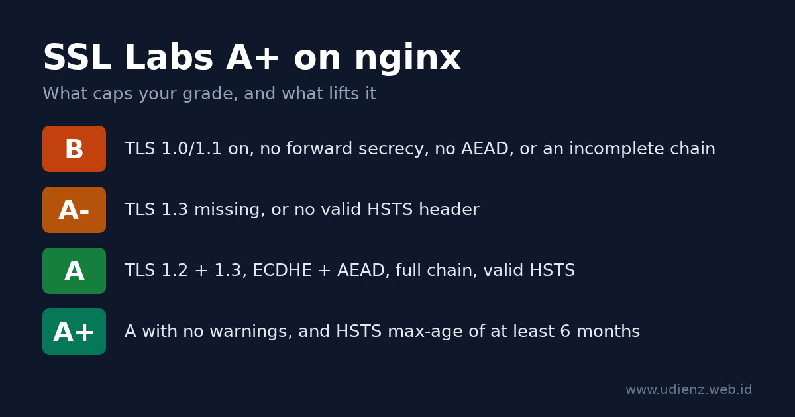

To get an A+ on the [Qualys SSL Labs server test](https://www.ssllabs.com/ssltest/) with nginx, you need five things: TLS 1.2 and TLS 1.3 only, ECDHE key exchange with AEAD ciphers (GCM or ChaCha20-Poly1305), a certificate served with its full chain, an HSTS header with a `max-age` of at least six months, and the same setup on every IP address your hostname resolves to. Miss TLS 1.3 or HSTS and you land on A-. Leave TLS 1.0 or 1.1 on and you are stuck at B.

This guide walks through each piece, gives you a config you can paste, and covers the two changes that break older tutorials: Let's Encrypt shutting down OCSP in 2025, and the grading update SSL Labs shipped in May 2025.

The configuration below was tested on nginx 1.26.3 with OpenSSL 3.5.7, using the stock Debian 13 `nginx.conf` with its two SSL lines commented out and the files from this guide added, and checked with `openssl s_client` and `curl`.

<!--more-->

**Baca dalam Bahasa Indonesia:** [Cara Mendapat A+ di SSL Labs dengan nginx](). Running Apache? See [How to Get an A+ on SSL Labs with Apache httpd]().



<details class="toc" markdown="1">
<summary>Contents</summary>

* TOC
{:toc}
</details>

## How SSL Labs grades your server

SSL Labs scores three categories: protocol support (30%), key exchange (30%) and cipher strength (40%). A score of 80 or more is an A. Then it applies caps: specific problems limit the grade no matter how high the score is. The A+ is a bonus on top of an A with no warnings.

The current rules are version 2009r of the [SSL Server Rating Guide](https://github.com/ssllabs/research/wiki/SSL-Server-Rating-Guide), dated 16 May 2025. These are the caps that matter for a typical nginx server:

| Problem | Grade limit |
|---|---|
| SSLv2, SSLv3 as the best protocol, export ciphers, Heartbleed-class bugs | F |
| TLS 1.2 not supported | C |
| TLS 1.0 or TLS 1.1 enabled | B |
| No forward secrecy (no ECDHE/DHE) | B |
| No AEAD cipher (GCM or ChaCha20-Poly1305) | B |
| RC4 enabled | B |
| Incomplete certificate chain | B |
| Key or DH parameters under 2048 bits | B |
| TLS 1.3 not supported | A- |
| HSTS missing or invalid | A- |

For the A+, the guide asks for a configuration with no warnings and HSTS with a `max-age` of at least six months (15768000 seconds).

Two things changed in 2025: a plain A now needs both TLS 1.3 and a valid HSTS header, and `TLS_FALLBACK_SCSV` no longer counts. If an older article tells you to chase fallback SCSV, skip that part.

You do not need 100 in every category. An ECDSA P-256 or RSA 2048 certificate scores 90 on key exchange, and offering AES-128 keeps cipher strength at 90. Both still get an A+. Switching to RSA 4096 only makes handshakes slower.

## Check your nginx and OpenSSL versions first

A few directives depend on the version you run:

```bash
nginx -V 2>&1 | head -3
openssl version
```

| Feature | Needs |
|---|---|
| TLS 1.3 (`TLSv1.3` in `ssl_protocols`) | OpenSSL 1.1.1+; default since nginx 1.23.4 |
| `http2 on;` as a separate directive | nginx 1.25.1+ (older: `listen 443 ssl http2;`) |
| Automatic session ticket key rotation | nginx 1.23.2+ with a shared `ssl_session_cache` |
| Hybrid post-quantum group `X25519MLKEM768` | OpenSSL 3.5+ |
| `add_header_inherit merge;` | nginx 1.29.3+ |

The `nginx -V` line that matters is `built with OpenSSL ...`. That is the library nginx actually uses, and it can differ from the `openssl` command on the same box.

## Step 1: Get a certificate and serve the full chain

Any publicly trusted certificate works. With Let's Encrypt and Certbot, get the certificate only and write the TLS config yourself:

```bash
sudo certbot certonly --nginx -d example.com -d www.example.com
```

Recent Certbot releases issue ECDSA keys by default, which is what you want. Point nginx at `fullchain.pem`, not `cert.pem`:

```nginx
ssl_certificate     /etc/letsencrypt/live/example.com/fullchain.pem;
ssl_certificate_key /etc/letsencrypt/live/example.com/privkey.pem;
```

`cert.pem` holds only your leaf certificate. Browsers often fill in the missing intermediate on their own, so the site looks fine, but SSL Labs reports "Chain issues: Incomplete" and caps the grade at B. The [nginx docs](https://nginx.org/en/docs/http/ngx_http_ssl_module.html#ssl_certificate) say the same: the server certificate comes first in the file, followed by the intermediates.

If you use Certbot's own installer (`certbot --nginx` without `certonly`), it adds `include /etc/letsencrypt/options-ssl-nginx.conf;` to your server block. That file sets protocols and ciphers too. Remove the include so your own settings are the only ones in play.

## Step 2: Put the TLS settings in one shared file

Debian and Ubuntu load every file in `/etc/nginx/conf.d/` inside the `http` block, so a single file there applies to all your HTTPS sites.

First, clear the SSL lines that the package already put in `/etc/nginx/nginx.conf`. The stock Debian 13 file has this block inside `http { }`:

```nginx
##
# SSL Settings
##

ssl_protocols TLSv1.2 TLSv1.3; # Dropping SSLv3 (POODLE), TLS 1.0, 1.1
ssl_prefer_server_ciphers off; # Don't force server cipher order.
```

Your `conf.d/` file lands in the same `http` block, so these lines would collide with it. nginx refuses a second `ssl_prefer_server_ciphers` at the same level:

```text
nginx: [emerg] "ssl_prefer_server_ciphers" directive is duplicate in /etc/nginx/conf.d/tls.conf
```

A second `ssl_protocols` does not replace the first one either. nginx merges the two lists and only prints warnings such as `[warn] duplicate value "TLSv1.2"`, not an error. Comment out both lines with `#` (your release may have different values there), then check that nothing else sets them:

```bash
grep -rn -e ssl_protocols -e ssl_prefer_server_ciphers -e ssl_ciphers /etc/nginx/
```

Now create `/etc/nginx/conf.d/tls.conf`:

```nginx
# TLS settings for every server block (http context)
ssl_protocols TLSv1.2 TLSv1.3;

# OpenSSL 3.5+: hybrid post-quantum group first.
# On OpenSSL 3.0-3.4, remove X25519MLKEM768 from this list.
ssl_ecdh_curve X25519MLKEM768:X25519:prime256v1:secp384r1;

# TLS 1.2 ciphers: ECDHE key exchange + AEAD only.
# TLS 1.3 suites are managed by OpenSSL and are all AEAD.
ssl_ciphers ECDHE-ECDSA-AES128-GCM-SHA256:ECDHE-RSA-AES128-GCM-SHA256:ECDHE-ECDSA-AES256-GCM-SHA384:ECDHE-RSA-AES256-GCM-SHA384:ECDHE-ECDSA-CHACHA20-POLY1305:ECDHE-RSA-CHACHA20-POLY1305;
ssl_prefer_server_ciphers off;

ssl_session_timeout 1d;
ssl_session_cache shared:TLS:10m;   # about 40000 sessions
```

Line by line:

- **`ssl_protocols TLSv1.2 TLSv1.3`** turns off TLS 1.0 and 1.1 (the B cap) and turns on TLS 1.3 (without it you stop at A-). It is the default since nginx 1.23.4, but writing it here makes the intent clear. It does not override other `ssl_protocols` lines in the same block, which is why you removed them above.
- **`ssl_ecdh_curve`** sets the key exchange groups. The list comes from the [TLSRef guideline 6.0](https://data.tlsref.org/guidelines/6.0.json), the successor of Mozilla's Server Side TLS guidelines. `X25519MLKEM768` combines classic X25519 with the ML-KEM post-quantum algorithm. Clients that do not support it fall back to X25519.
- **`ssl_ciphers`** lists only ECDHE suites, which gives forward secrecy, and only GCM or ChaCha20-Poly1305, which are AEAD. No CBC, no RSA key exchange, no 3DES. TLSRef lists the oldest clients this profile still serves as Firefox 31, Chrome 49, Safari 9, Android 4.4.2, IE 11 on Windows 10 and Java 8u161. It also replaces the cipher list from my [2015 post on ssl_cipher in nginx]() (in Indonesian), which is out of date now.
- **`ssl_prefer_server_ciphers off`** lets the client pick. With an all-strong list, the client knows best: phones without AES hardware choose ChaCha20.
- **No `ssl_dhparam`.** The list has no DHE suites, so you do not need a DH parameters file. That also removes the old "DH parameters under 2048 bits" risk.
- **Session tickets** stay at the default (`on`). Since nginx 1.23.2 the ticket keys rotate automatically when `ssl_session_cache` uses shared memory, as it does here. That is why TLSRef only adds `ssl_session_tickets off;` for older versions.

The Mozilla SSL Configuration Generator now redirects to the [TLSRef Configurator](https://configurator.tlsref.org/). This file matches its "Intermediate" profile, which is the right choice for public websites. The "Modern" profile (TLS 1.3 only) also gets an A+, but cuts off older clients such as Android 4.4 and IE 11.

## Step 3: The server blocks, HSTS and the HTTP redirect

Now the site itself, for example `/etc/nginx/sites-available/example.com`, linked into `sites-enabled/`:

```nginx
# Port 80: redirect everything to HTTPS
server {
    listen 80;
    listen [::]:80;
    server_name example.com www.example.com;

    return 308 https://$host$request_uri;
}

server {
    listen 443 ssl;
    listen [::]:443 ssl;
    http2 on;                       # nginx < 1.25.1: "listen 443 ssl http2;"
    server_name example.com www.example.com;

    ssl_certificate     /etc/letsencrypt/live/example.com/fullchain.pem;
    ssl_certificate_key /etc/letsencrypt/live/example.com/privkey.pem;

    # HSTS: 2 years. "always" also sends it on 3xx/4xx/5xx responses.
    add_header Strict-Transport-Security "max-age=63072000; includeSubDomains" always;

    root /var/www/example.com;
    index index.html;
}
```

Notes on the HSTS line:

- **`max-age=63072000`** is two years, the TLSRef value. SSL Labs needs at least 15768000 (six months) for the A+. A shorter value or a typo drops you to A-.
- **`always`** matters. Without it, nginx adds the header only to 200, 201, 204, 206, 301, 302, 303, 304, 307 and 308 responses. With `always`, error pages carry it too.
- **`includeSubDomains`** tells browsers that every subdomain is HTTPS-only as well. Leave it out until you are sure that is true. If `intranet.example.com` still serves plain HTTP, browsers that have seen the header will refuse to load it.
- The header goes only on the HTTPS server. Browsers ignore HSTS on plain HTTP, and the HSTS spec ([RFC 6797, section 7.2](https://www.rfc-editor.org/rfc/rfc6797#section-7.2)) says servers must not send it there.

Both `listen` lines in each block are deliberate. If your domain has an AAAA record and nginx listens only on IPv4, SSL Labs tests the IPv6 address and gets a different answer. More on that in the troubleshooting table.

## Step 4: OCSP stapling and Let's Encrypt

Many A+ guides still tell you to add `ssl_stapling on;`, including my own [OCSP stapling post from 2015](). For Let's Encrypt certificates, drop it.

Let's Encrypt [ended OCSP support](https://letsencrypt.org/2024/12/05/ending-ocsp/): from 7 May 2025 its certificates no longer contain an OCSP URL, and the OCSP responders were switched off on 6 August 2025. Revocation now goes through CRLs. With stapling on and a current Let's Encrypt certificate, nginx logs a warning like this on every reload:

```text
[warn] "ssl_stapling" ignored, no OCSP responder URL in the certificate
```

The site keeps working, but the line is noise. Remove `ssl_stapling` and `ssl_stapling_verify`. OCSP stapling has no effect on the SSL Labs grade.

If your certificate comes from a CA that still runs OCSP, stapling is still useful. You need a resolver and the issuer chain:

```nginx
ssl_stapling on;
ssl_stapling_verify on;
ssl_trusted_certificate /etc/ssl/certs/ca-chain.pem;   # root + intermediates
resolver 127.0.0.53 valid=300s;   # e.g. systemd-resolved; use your server's resolver
```

## Step 5: Avoid the add_header trap

In nginx, `add_header` is inherited from the outer block only if the current block has no `add_header` of its own. Add one header in a `location` and every header from the `server` block disappears in that location, HSTS included. If that location is `/`, the grade drops to A-. If it is another path, the report stays A+ while part of the site runs without the header.

Here is the result on the test server (port 8443) with the config above plus one extra location:

```nginx
location /assets/ {
    add_header Cache-Control "public, max-age=3600";
}
```

```text
$ curl -sk -D- -o /dev/null https://127.0.0.1:8443/ | grep -i strict
strict-transport-security: max-age=63072000; includeSubDomains

$ curl -sk -D- -o /dev/null https://127.0.0.1:8443/assets/x | grep -i -e strict -e cache
cache-control: public, max-age=3600
```

The second response has no HSTS.

Three fixes, in order of preference:

1. **nginx 1.29.3 or newer:** put `add_header_inherit merge;` in the `http` block. Headers from outer levels are then added to the ones you set in the inner block ([docs](https://nginx.org/en/docs/http/ngx_http_headers_module.html#add_header_inherit)).
2. **Older nginx:** move the security headers into a snippet and include it wherever you use `add_header` (example below).
3. **For caching only:** use `expires 1h;` instead of `add_header Cache-Control`. It sets `Cache-Control` and `Expires` itself and, unlike `add_header`, does not cancel the headers inherited from the `server` block.

The snippet approach looks like this:

```nginx
# /etc/nginx/snippets/security-headers.conf
add_header Strict-Transport-Security "max-age=63072000; includeSubDomains" always;
```

```nginx
location /assets/ {
    include snippets/security-headers.conf;
    add_header Cache-Control "public, max-age=3600";
}
```

And `location /assets/ { expires 1h; }` on the same test server:

```text
$ curl -sk -D- -o /dev/null https://127.0.0.1:8443/assets/x.css
HTTP/2 200
expires: Thu, 05 Nov 2026 01:41:51 GMT
cache-control: max-age=3600
strict-transport-security: max-age=63072000; includeSubDomains
```

The same inheritance rule applies to `if` blocks and nested locations.

## Step 6: Test locally, then run SSL Labs

Check the syntax and reload:

```bash
sudo nginx -t && sudo systemctl reload nginx
```

Before you go to SSL Labs, check the important points from your own terminal. Replace `example.com` with your host:

```bash
# TLS 1.1 must be refused. SECLEVEL=0 lets a modern client even try it.
openssl s_client -connect example.com:443 -servername example.com \
  -tls1_1 -cipher 'DEFAULT@SECLEVEL=0' </dev/null 2>&1 | grep -E 'alert|Cipher is'

# TLS 1.3 must work. With OpenSSL 3.5+ on both sides the group is X25519MLKEM768.
openssl s_client -connect example.com:443 -servername example.com \
  -tls1_3 </dev/null 2>&1 | grep -E 'Negotiated TLS1.3 group|Cipher is'

# CBC suites must be refused (covers both ECDSA and RSA certificates).
openssl s_client -connect example.com:443 -servername example.com -tls1_2 \
  -cipher 'ECDHE-ECDSA-AES128-SHA:ECDHE-RSA-AES128-SHA' </dev/null 2>&1 | grep -E 'alert|Cipher is'

# Full chain: there must be a "depth=1" line (the intermediate sent by the server).
openssl s_client -connect example.com:443 -servername example.com </dev/null 2>&1 | grep depth

# HSTS header and redirect.
curl -sI https://example.com/ | grep -i strict-transport-security
curl -sI http://example.com/  | grep -i -e '^HTTP' -e '^location'
```

On the test setup, the output looked like this (condensed):

```text
tls1_1 :  tlsv1 alert protocol version ... Cipher is (NONE)
tls1_3 :  Negotiated TLS1.3 group: X25519MLKEM768
          New, TLSv1.3, Cipher is TLS_AES_256_GCM_SHA384
CBC    :  ssl/tls alert handshake failure ... Cipher is (NONE)
HSTS   :  strict-transport-security: max-age=63072000; includeSubDomains
HTTP   :  HTTP/1.1 308 Permanent Redirect
```

When all of that looks right, open [ssllabs.com/ssltest](https://www.ssllabs.com/ssltest/), enter your hostname, and tick "Do not show the results on the boards" if you do not want the result listed publicly. SSL Labs caches results for a while. After a config change, use the "Clear cache" link on the results page to force a new scan. A full scan takes a few minutes, longer when the hostname has several IP addresses.

## Troubleshooting: what the report says and how to fix it

| What you see | Cause | Fix |
|---|---|---|
| Grade B, "This server supports TLS 1.0 and TLS 1.1" | Old `ssl_protocols` line somewhere, often in `nginx.conf` or a Certbot include | Run the `grep` from Step 2 and keep only `tls.conf` |
| `nginx -t`: `"ssl_prefer_server_ciphers" directive is duplicate` | The stock `nginx.conf` still sets it in the same `http` block | Comment it out in `nginx.conf` (Step 2) |
| Grade B, "Chain issues: Incomplete" | `ssl_certificate` points to `cert.pem` | Use `fullchain.pem` |
| Grade B, cipher warnings about forward secrecy or CBC | Old `ssl_ciphers` list | Use the list from Step 2 |
| Grade A-, "This server does not support TLS 1.3" | OpenSSL older than 1.1.1, or `ssl_protocols` without `TLSv1.3` | Upgrade the OS or nginx build; check `nginx -V` |
| Grade A-, HSTS warning or "HSTS not set" | Header missing on the tested page, `max-age` too short, or the add_header trap | Check with `curl -sI`; see Step 5 |
| A+ on one IP, A- on another | IPv6 handled by a different server block or a different machine | Add `listen [::]:443 ssl;` everywhere, or fix the AAAA record |
| Grade does not change after you edit nginx | You are testing a CDN, not your server | See below |
| `nginx -t` says `SSL_CTX_set1_curves_list(...) failed` | The OpenSSL behind nginx does not know a group in `ssl_ecdh_curve`, usually `X25519MLKEM768` on OpenSSL older than 3.5 | Remove that group from the list |

**Behind Cloudflare or another CDN?** If the orange cloud is on, SSL Labs tests Cloudflare's edge, not your nginx. The grade then depends on your Cloudflare settings: minimum TLS version, TLS 1.3, and HSTS under SSL/TLS > Edge Certificates. Your nginx config still matters for the connection between Cloudflare and your origin, so use "Full (strict)" mode and keep the setup above on the origin. (This blog sits behind Cloudflare too; the move is described in [Migrasi ke Cloudflare](), in Indonesian.)

## Optional: HSTS preload

With HSTS preload, browsers ship with your domain on a built-in HTTPS-only list, so even the very first visit never uses HTTP. SSL Labs does not need it for an A+. The requirements on [hstspreload.org](https://hstspreload.org/) are stricter than the A+ ones:

- `max-age` of at least 31536000 (one year), `includeSubDomains`, and `preload` in the header
- every subdomain served over HTTPS, including internal ones
- HTTP redirected to HTTPS on the same host first

```nginx
add_header Strict-Transport-Security "max-age=63072000; includeSubDomains; preload" always;
```

Getting off the list takes months to reach users through browser updates, and other browsers are not guaranteed to follow. Only submit a domain you know will stay HTTPS-only on every subdomain.

## The complete config

For reference, here are the two files used in the test above (adjust paths and names). Together with the two commented lines in `nginx.conf` from Step 2, that is the whole change:

```nginx
# /etc/nginx/conf.d/tls.conf
ssl_protocols TLSv1.2 TLSv1.3;
ssl_ecdh_curve X25519MLKEM768:X25519:prime256v1:secp384r1;
ssl_ciphers ECDHE-ECDSA-AES128-GCM-SHA256:ECDHE-RSA-AES128-GCM-SHA256:ECDHE-ECDSA-AES256-GCM-SHA384:ECDHE-RSA-AES256-GCM-SHA384:ECDHE-ECDSA-CHACHA20-POLY1305:ECDHE-RSA-CHACHA20-POLY1305;
ssl_prefer_server_ciphers off;
ssl_session_timeout 1d;
ssl_session_cache shared:TLS:10m;
# add_header_inherit merge;   # nginx 1.29.3+
```

```nginx
# /etc/nginx/sites-available/example.com
server {
    listen 80;
    listen [::]:80;
    server_name example.com www.example.com;
    return 308 https://$host$request_uri;
}

server {
    listen 443 ssl;
    listen [::]:443 ssl;
    http2 on;
    server_name example.com www.example.com;

    ssl_certificate     /etc/letsencrypt/live/example.com/fullchain.pem;
    ssl_certificate_key /etc/letsencrypt/live/example.com/privkey.pem;

    add_header Strict-Transport-Security "max-age=63072000; includeSubDomains" always;

    root /var/www/example.com;
    index index.html;
}
```

If you need to support both ECDSA and RSA clients, nginx can load two certificates in the same server block, and it picks the right one per client:

```nginx
ssl_certificate     /etc/letsencrypt/live/example.com/fullchain.pem;       # ECDSA, from Step 1
ssl_certificate_key /etc/letsencrypt/live/example.com/privkey.pem;
ssl_certificate     /etc/letsencrypt/live/example.com-rsa/fullchain.pem;
ssl_certificate_key /etc/letsencrypt/live/example.com-rsa/privkey.pem;
```

On the test server, a TLS 1.2 client that only offered `ECDHE-RSA-AES128-GCM-SHA256` received the 2048-bit RSA certificate, and everyone else got ECDSA. With Certbot, run it a second time with `--key-type rsa --cert-name example.com-rsa` to get the RSA pair.

*Mahyuddin Susanto is a Linux and networking sysadmin who runs his own servers and has written about nginx on this blog since 2009, starting with [nginx, dari nol](). [About](/about) · [Contact](/contact)*

## Sources

- Qualys SSL Labs, [SSL Server Rating Guide](https://github.com/ssllabs/research/wiki/SSL-Server-Rating-Guide), version 2009r, 16 May 2025
- TLSRef, [Server Side TLS guideline 6.0](https://data.tlsref.org/guidelines/6.0.json) and [TLS Configurator](https://configurator.tlsref.org/)
- nginx, [ngx_http_ssl_module](https://nginx.org/en/docs/http/ngx_http_ssl_module.html), [ngx_http_headers_module](https://nginx.org/en/docs/http/ngx_http_headers_module.html) and [CHANGES](https://nginx.org/en/CHANGES)
- Let's Encrypt, [Ending OCSP Support in 2025](https://letsencrypt.org/2024/12/05/ending-ocsp/)
- [HSTS Preload List Submission](https://hstspreload.org/)
- IETF, [RFC 6797: HTTP Strict Transport Security](https://www.rfc-editor.org/rfc/rfc6797)
