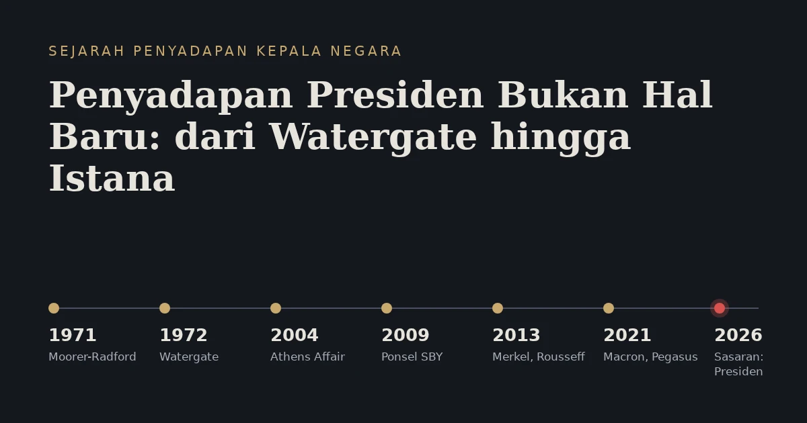

Pada 3 November 2026, Bareskrim Polri menetapkan mantan Kapolri Jenderal Listyo Sigit Prabowo dan dua perwira tinggi, Irjen Ahrie Sonta dan Irjen Eko Hadi Santoso, sebagai tersangka penyadapan ilegal. Menurut Kabareskrim Komjen Asep Safrudin, sasarannya adalah "Presiden RI, pejabat negara, tokoh politik, media, tokoh ormas, LSM" ([Kompas, 3 November 2026](https://nasional.kompas.com/read/2026/11/03/20133141/polri-tetapkan-jenderal-listyo-sigit-sebagai-tersangka-penyadapan-ilegal)). Sehari kemudian Mensesneg Prasetyo Hadi menyebut perbuatan itu "mengarah ke perbuatan makar" ([Kompas, 4 November 2026](https://nasional.kompas.com/read/2026/11/04/12423931/istana-penyadapan-listyo-sigit-terhadap-presiden-prabowo-masuk-kategori)).

Penyadapan kepala negara sudah berkali-kali terjadi. Presiden Indonesia sendiri pernah menjadi sasaran pada 2009, waktu itu oleh intelijen Australia, dan Perdana Menteri Yunani disadap lewat sistem penyadapan sah operator seluler pada 2004. Kanselir Jerman dan Presiden Brasil menjadi sasaran NSA yang terungkap pada 2013, dan nomor Presiden Prancis masuk daftar calon sasaran spyware Pegasus pada 2021. Di Amerika Serikat, skandal penyadapan paling terkenal dalam sejarah menjatuhkan seorang presiden. Tulisan ini menjajarkan kasus-kasus itu dengan kasus 2026 untuk melihat apa yang berulang dan apa yang berbeda.

> **Poin Penting**
>
> - Kasus 2026 berbeda dari kasus SBY, Merkel, dan Macron karena pelakunya diduga orang dalam negeri sendiri yang memegang akses sah ke sistem penyadapan, bukan dinas intelijen negara lain.
> - Penyadapan kepala negara oleh negara sekutu atau mitra lazimnya berakhir tanpa pengadilan. Kasus Merkel ditutup jaksa Jerman pada 2015 karena kurang bukti, dan krisis SBY diselesaikan dengan kode etik intelijen pada 2014.
> - Kasus yang terjadi di dalam negeri sendiri bisa dibawa ke pengadilan, seperti Watergate yang berujung pada pengunduran diri Nixon pada 1974. Bisa juga dikubur, seperti kasus Moorer-Radford pada 1971.
> - Status Listyo Sigit dan dua perwira lain masih tersangka. Tuduhan makar baru disebut pejabat pemerintah dan belum diuji di pengadilan.

## Delapan kasus dalam satu tabel

| Kasus | Terungkap | Sasaran | Pelaku yang dituduh | Hubungan pelaku dan sasaran | Ujungnya |
|---|---|---|---|---|---|
| Moorer-Radford (pencurian dokumen, bukan penyadapan) | 1971 | Dewan Keamanan Nasional AS di bawah Nixon | Staf militer yang melapor ke Ketua Gabungan Kepala Staf | Bawahan dari lembaga sendiri | Tak seorang pun dipenjara |
| Watergate | 1972 | Markas Partai Demokrat | Orang-orang suruhan tim kampanye Nixon | Kubu presiden terhadap lawan politik | Nixon mundur, 1974 |
| SBY dan lingkarannya | 2013 (kejadian 2009) | Presiden, Ibu Negara, Wapres, menteri | Intelijen sinyal Australia (DSD) | Negara tetangga dan mitra | Dubes ditarik, kode etik 2014 |
| Merkel | 2013 | Ponsel Kanselir Jerman | NSA Amerika Serikat | Sekutu NATO | Penyidikan ditutup, 2015 |
| Rousseff | 2013 | Komunikasi Presiden Brasil | NSA Amerika Serikat | Mitra diplomatik | Kunjungan kenegaraan ditunda |
| Macron | 2021 | Nomor ponsel Presiden Prancis | Dinas intelijen Maroko (dibantah) | Mitra diplomatik | Tidak terbukti ada infeksi |
| Athens Affair | 2005 (kejadian 2004) | PM Yunani, menteri, sekitar 100 nomor | Tidak dipastikan dalam penyidikan resmi | Tidak diketahui | Vodafone Yunani didenda |
| Kasus 2026 | 2026 | Presiden Prabowo, pejabat, tokoh, media | Mantan Kapolri dan dua jenderal polisi (tersangka) | Pejabat dalam negeri | Proses hukum berjalan |

Kasus yang pelakunya negara lain hampir semuanya selesai lewat jalur politik dan diplomasi, karena pelakunya berada di luar jangkauan hukum negara korban. Kasus yang terjadi di dalam negeri punya pilihan jalur pidana, meski pilihan itu tidak selalu diambil. Bagian-bagian berikut menelusuri kasus-kasus itu satu per satu. Kasus Yunani sengaja ditaruh terakhir sebelum kasus 2026 karena modusnya paling dekat.

## Watergate dan Moorer-Radford: ketika Gedung Putih jadi medan pengintaian

Dini hari 17 Juni 1972, lima orang ditangkap di dalam kantor Komite Nasional Partai Demokrat di kompleks Watergate, Washington. Mereka datang untuk membetulkan alat sadap yang sudah dipasang sebelumnya dan memotret dokumen. Penyelidikan kemudian menelusuri uang dan perintahnya sampai ke tim kampanye pemilihan ulang Presiden Richard Nixon ([National Archives](https://www.archives.gov/research/investigations/watergate)).

Arah penyadapan Watergate berlawanan dengan kasus-kasus lain di tulisan ini, karena kubu presiden yang menyadap lawan politiknya. Ironinya, bukti yang akhirnya menjatuhkan Nixon justru berasal dari sistem perekam yang ia pasang sendiri di Gedung Putih. Pada 24 Juli 1974, Mahkamah Agung AS dalam perkara *United States v. Nixon* memutuskan 8-0 bahwa presiden wajib menyerahkan rekaman itu, karena klaim umum hak istimewa eksekutif tidak bisa mengalahkan kebutuhan akan bukti dalam perkara pidana ([Oyez](https://www.oyez.org/cases/1973/73-1766)). Sejumlah rekaman tersebut kini dibuka untuk publik oleh [Perpustakaan Kepresidenan Nixon](https://www.nixonlibrary.gov/white-house-tapes). Nixon mengundurkan diri pada 9 Agustus 1974.

Kasus yang lebih mirip dengan situasi 2026 dari sisi hubungan pelaku dan sasaran terjadi sekitar setengah tahun sebelum Watergate dan jauh kurang dikenal. Pada Desember 1971, penyelidik Gedung Putih yang memburu sumber bocoran untuk kolumnis Jack Anderson menemukan bahwa Yeoman Charles Radford, juru steno Angkatan Laut yang bertugas di Dewan Keamanan Nasional, selama berbulan-bulan menyalin dokumen rahasia dan meneruskannya ke Ketua Gabungan Kepala Staf, Laksamana Thomas Moorer. Militer AS, dengan kata lain, memata-matai presidennya sendiri ([Federation of American Scientists](https://fas.org/blogs/secrecy/2007/03/a_memorable_leak_case/)).

Cara kasus ini diselesaikan menunjukkan dilema yang muncul setiap kali pelakunya orang dalam. Pada akhirnya tidak seorang pun dipenjara ([Federation of American Scientists](https://fas.org/blogs/secrecy/2007/03/a_memorable_leak_case/)). Rincian lengkapnya baru bisa dipelajari puluhan tahun kemudian, setelah rekaman Gedung Putih dan dokumen terkait dideklasifikasi ([History News Network](https://historynewsnetwork.org/article/36240)). Membuka kasus orang dalam berarti mengakui bahwa lingkaran terdekat kekuasaan bisa ditembus, dan pertimbangan semacam itu bisa ikut menentukan apakah sebuah kasus dibawa ke pengadilan.

## SBY 2009: ponsel presiden dalam daftar intelijen tetangga

Pada 18 November 2013, ABC dan Guardian Australia menerbitkan dokumen dari arsip Edward Snowden yang menunjukkan bahwa Defence Signals Directorate (DSD), badan intelijen sinyal Australia, melacak aktivitas ponsel Presiden Susilo Bambang Yudhoyono selama 15 hari pada Agustus 2009. Daftar sasarannya juga memuat Ibu Negara Ani Yudhoyono, Wakil Presiden Boediono, mantan Wakil Presiden Jusuf Kalla, dan sejumlah menteri (jabatan per 2013; pada Agustus 2009 Kalla masih menjabat wapres). Satu slide berjudul "Indonesian President voice events" berisi catatan data panggilan, yaitu siapa menelepon siapa dan berapa lama, tanpa isi percakapan ([ABC, 18 November 2013](https://www.abc.net.au/news/2013-11-18/australia-spied-on-indonesian-president,-leaked-papers-reveal/5098860); [The Guardian, 18 November 2013](https://www.theguardian.com/world/2013/nov/18/australia-tried-to-monitor-indonesian-presidents-phone)).

Jakarta bereaksi keras. Indonesia menarik duta besarnya dari Canberra dan menghentikan sementara kerja sama latihan militer, pertukaran intelijen, dan penanganan penyelundupan manusia ([Al Jazeera, 21 November 2013](https://www.aljazeera.com/news/2013/11/21/indonesia-freezes-ties-with-australia)). Perdana Menteri Tony Abbott menolak mengomentari urusan intelijen. Krisis baru reda setelah kedua menteri luar negeri, Marty Natalegawa dan Julie Bishop, menandatangani kode etik di Nusa Dua, Bali, pada 28 Agustus 2014. Isinya janji bahwa kedua negara tidak akan memakai sumber daya intelijennya untuk merugikan kepentingan pihak lain ([The Jakarta Post, 29 Agustus 2014](https://www.thejakartapost.com/news/2014/08/29/ri-repairs-ties-signs-pact-intelligence-with-australia)).

Kasus SBY memperlihatkan pola yang juga muncul di kasus-kasus internasional lain. Pelakunya negara mitra, buktinya datang dari kebocoran, dan tidak ada seorang pun yang diadili. Krisis 2013 itu sendiri diselesaikan dengan dokumen diplomatik.

## Merkel dan Rousseff 2013: "memata-matai teman itu tidak bisa diterima"

Sebulan sebelum dokumen SBY terbit, majalah Der Spiegel bertanya kepada kantor Kanselir Jerman soal nomor ponsel Angela Merkel yang muncul dalam daftar sasaran NSA. Merkel menelepon Presiden Barack Obama pada 23 Oktober 2013. Gedung Putih menjawab bahwa Amerika Serikat "tidak sedang dan tidak akan" memantau komunikasi Kanselir, jawaban yang tidak menyinggung masa lalu ([NPR, 23 Oktober 2013](https://www.npr.org/sections/thetwo-way/2013/10/23/240340232/obama-tells-merkel-the-u-s-is-not-wiretapping-her-phone)). Esoknya di Brussel, Merkel mengucapkan kalimat yang paling sering dikutip dari skandal itu: "Ausspähen unter Freunden, das geht gar nicht", memata-matai teman itu sama sekali tidak bisa diterima ([The Local, 24 Oktober 2013](https://www.thelocal.de/20131024/52547)).

Jaksa Agung Federal Jerman membuka penyidikan pada 2014, lalu menutupnya pada 12 Juni 2015 karena tidak menemukan bukti yang bisa bertahan di pengadilan ([APR/AP, 12 Juni 2015](https://www.apr.org/2015-06-12/germany-closes-probe-into-alleged-u-s-hacking-of-merkels-phone)). Enam tahun kemudian kasus ini muncul lagi dari arah yang tak terduga. Penyiar publik Denmark DR melaporkan bahwa dinas intelijen pertahanan Denmark membantu NSA menyadap lewat kabel bawah laut Denmark pada 2012 sampai 2014, dengan sasaran antara lain Merkel, Menteri Luar Negeri Frank-Walter Steinmeier, dan tokoh oposisi Peer Steinbrück ([Al Jazeera, 31 Mei 2021](https://www.aljazeera.com/news/2021/5/31/us-spied-on-merkel-top-eu-officials-through-danish-cables)). Dalam versi ini, ada dua negara sekutu Jerman yang terlibat.

Brasil mengalami hal serupa pada tahun yang sama. Setelah muncul laporan bahwa NSA menyadap komunikasi Presiden Dilma Rousseff, ia menunda kunjungan kenegaraan ke Washington yang dijadwalkan 23 Oktober 2013, sebuah penolakan diplomatik yang jarang terjadi terhadap Gedung Putih ([Foreign Policy, 17 September 2013](https://foreignpolicy.com/2013/09/17/brazilian-president-snubs-white-house/)).

## Macron 2021: dari kabel ke spyware

Juli 2021, konsorsium media Pegasus Project memberitakan daftar sekitar 50.000 nomor telepon yang diduga dipilih sebagai calon sasaran spyware Pegasus buatan NSO Group dari Israel. Le Monde melaporkan bahwa salah satu nomor Presiden Emmanuel Macron, yang dipakai rutin sejak 2017, masuk daftar yang dipilih dinas intelijen Maroko. Maroko membantah dan menyebut tuduhan itu "tidak berdasar dan palsu", NSO menyebut laporan itu penuh asumsi keliru, dan Istana Élysée menyatakan bahwa jika benar, fakta itu "sangat serius" ([Al Jazeera, 20 Juli 2021](https://www.aljazeera.com/news/2021/7/20/frances-macron-among-potential-pegasus-spyware-targets-le-monde)).

Laporan itu hanya menyebut nomor Macron sebagai calon sasaran dan tidak memuat bukti bahwa ponselnya benar-benar terinfeksi. Meski begitu, kasus ini menandai pergeseran teknologi. Pada 1972 penyadap harus masuk ke sebuah gedung. Pada 2009 dan 2013 penyadapan berlangsung di jaringan operator dan kabel. Pada 2021, alatnya cukup sebuah pesan atau tautan yang mendarat di ponsel sasaran.

## Yunani 2004-2005: fitur penyadapan sah yang dibajak

Dari sisi modus, kasus yang paling dekat dengan 2026 justru terjadi di Eropa dan tidak berkaitan dengan bocoran Snowden. Menjelang Olimpiade Athena Agustus 2004, seseorang memasang perangkat lunak gelap di sentral telepon Ericsson milik Vodafone Yunani. Perangkat lunak itu menumpang pada fungsi *lawful interception*, fitur yang memang disediakan agar aparat bisa menyadap secara sah, lalu menyembunyikan jejaknya dari sistem audit. Sekitar 100 ponsel disadap, termasuk milik Perdana Menteri Kostas Karamanlis dan istrinya, menteri pertahanan, menteri luar negeri, dan menteri kehakiman. Penyadapan itu baru ketahuan pada awal 2005, dan penyidikan resmi saat itu tidak berhasil memastikan pelakunya ([IEEE Spectrum, 29 Juni 2007](https://spectrum.ieee.org/the-athens-affair)). Vodafone Yunani kemudian dijatuhi denda.

Athens Affair, begitu kasus ini dikenal, menunjukkan risiko yang melekat pada setiap sistem penyadapan sah: pintu yang dibuat untuk penegak hukum bisa dipakai oleh siapa pun yang menguasai kuncinya. Bedanya dengan kasus 2026, di Yunani pembajaknya masuk lewat jalur gelap tanpa identitas yang dipastikan secara resmi, sedangkan di Indonesia yang diduga menyalahgunakan sistem adalah pejabat yang memegang akses resminya.

## Kasus 2026: alat sah dan akses dari dalam

Kasus 2026 menggabungkan dua unsur dari kasus-kasus di atas: alat penyadapan modern dan terduga pelaku dari dalam lingkar kekuasaan. Menurut keterangan Bareskrim yang dikutip Kompas, sejumlah nomor ponsel dimasukkan ke *Lawful Interception Management System* tanpa verifikasi, lalu disadap padahal tidak ada proses penegakan hukum yang berjalan. Sekitar Oktober 2026 tersangka diduga memerintahkan penghapusan file hasil sadapan dari komputer sistem itu. Petugas yang mengetahuinya membuat laporan polisi pada 30 Oktober 2026, dan penyidik kemudian memeriksa 10 saksi serta 3 ahli dan menyita 11 ponsel, 1 iPad, dan 4 flashdisk ([Kompas, 4 November 2026](https://nasional.kompas.com/read/2026/11/04/12423931/istana-penyadapan-listyo-sigit-terhadap-presiden-prabowo-masuk-kategori)).

Detik mencatat penyadapan diduga berlangsung sejak 2025 sampai Oktober 2026. Sangkaan awalnya adalah Pasal 258 dan Pasal 332 KUHP nasional (UU 1/2023, berlaku sejak Januari 2026) serta Pasal 32 ayat 1 UU ITE, dengan ancaman maksimal antara 6 dan 10 tahun penjara. Ketiga tersangka ditahan ([Detik, 4 November 2026](https://news.detik.com/berita/d-8737324/10-hal-tentang-eks-kapolri-jenderal-listyo-sigit-tersangka-penyadapan-presiden)). Listyo, yang sejak 1 Oktober 2026 menjabat Kepala Staf Kepresidenan ([Kompas, 4 November 2026](https://nasional.kompas.com/read/2026/11/04/12423931/istana-penyadapan-listyo-sigit-terhadap-presiden-prabowo-masuk-kategori)), diberhentikan Presiden dari jabatan itu pada 4 November ([Detik, 5 November 2026](https://news.detik.com/berita/d-8739945/listyo-sigit-dkk-tersangka-sadap-prabowo-jokowi-ajak-semua-hormati-hukum)).

### Dari penyadapan ilegal ke dugaan makar

Pernyataan pejabat pemerintah menggeser perbincangan dari pasal penyadapan ke pasal makar. Menko Kumham Imipas Yusril Ihza Mahendra menyebut ada "indikasi-indikasi yang mengarah kepada tindakan makar" sebagaimana diatur dalam Pasal 191 dan 193 KUHP ([Detik, 4 November 2026](https://news.detik.com/berita/d-8738406/listyo-sigit-dkk-sadap-prabowo-menko-yusril-indikasi-makar)). Ia juga menyebut penyidik mendalami kemungkinan adanya keinginan "untuk melumpuhkan" presiden, sambil menegaskan bahwa hal itu "masih dalam proses pendalaman" ([Kompas, 4 November 2026](https://regional.kompas.com/read/2026/11/04/153638978/yusril-ungkap-motif-listyo-sigit-sadap-prabowo-ada-keinginan-melumpuhkan)).

Rumusan pasalnya menjelaskan kenapa kata "melumpuhkan" penting. Pasal 191 UU 1/2023 mengancam makar yang dilakukan dengan maksud membunuh atau merampas kemerdekaan presiden dan/atau wakil presiden, atau menjadikan mereka tidak mampu menjalankan pemerintahan, dengan pidana mati, penjara seumur hidup, atau penjara paling lama 20 tahun. Pasal 193 mengatur makar untuk menggulingkan pemerintah yang sah ([UU 1/2023, JDIH BPK](https://peraturan.bpk.go.id/Details/234935/uu-no-1-tahun-2023)). Penyadapan ilegal sendiri sudah merupakan tindak pidana. Agar bisa dijerat sebagai makar, penyidik perlu membuktikan maksud yang lebih jauh dari sekadar mengumpulkan informasi. Per 6 November 2026, maksud itu belum diuji di pengadilan, media yang dikutip di sini belum memuat tanggapan Listyo Sigit atas sangkaan itu, dan seluruh tersangka berhak atas asas praduga tak bersalah.

Perbandingan dengan kasus asing memperlihatkan satu perbedaan penting. Merkel, SBY, dan Macron tidak punya jalur pidana yang realistis terhadap NSA, DSD, atau dinas intelijen Maroko, karena pelakunya badan negara lain yang berada di luar jangkauan hukum domestik. Kasus 2026 terjadi sepenuhnya di dalam yurisdiksi Indonesia, dengan sistem, komputer, dan saksi yang bisa diperiksa penyidik. Dalam hal ini, kasus 2026 lebih dekat ke Watergate dan Moorer-Radford daripada ke kasus Merkel.

## Pelakunya sekutu, mitra, atau orang dalam

Daftar di atas juga menunjukkan bahwa pelaku penyadapan kepala negara sering kali bukan musuh. Australia adalah tetangga dan mitra keamanan Indonesia. Amerika Serikat adalah sekutu NATO Jerman, dan Denmark adalah anggota NATO sekaligus Uni Eropa. Maroko adalah mitra dekat Prancis di Afrika Utara. Dalam kasus Moorer-Radford, pelakunya bagian dari aparat negara yang dipimpin sang presiden sendiri, dan dalam kasus 2026 terduga pelakunya juga demikian. Sebagian kasus asing ini diketahui publik lewat bocoran, misalnya dokumen Snowden dan daftar Pegasus, sehingga yang tercatat terbuka cenderung operasi yang kebetulan bocor, belum tentu gambaran lengkapnya.

Ada logika sederhana di balik pola ini. Badan intelijen bertugas mengurangi ketidakpastian bagi pemerintahnya, dan sekutu tetap punya kepentingan yang tidak selalu sama, misalnya soal perdagangan, perundingan iklim, atau posisi di forum internasional. Bagi orang dalam, insentifnya lain: informasi tentang apa yang dipikirkan dan direncanakan atasan adalah modal kekuasaan. Kesempatan juga lebih besar bagi pihak yang dekat. Mitra intelijen berbagi jaringan dan kabel, dan pejabat keamanan dalam negeri memegang kunci sistem penyadapan yang sah.

## Kenapa terus berulang

Lebih dari lima puluh tahun memisahkan Watergate dari kasus 2026, dan dalam rentang itu ada tiga pola yang terus berulang.

Pertama, nilai informasinya. Percakapan seorang kepala negara memuat keputusan yang belum diumumkan, sikap dalam perundingan, dan hubungan personal yang tidak tercatat di dokumen resmi. Selama keputusan besar masih dibuat lewat telepon dan pesan singkat, perangkat kepala negara akan tetap menjadi sasaran bernilai tinggi.

Kedua, biaya teknisnya terus turun. Tim Watergate harus menyusup ke sebuah gedung dan tertangkap basah. DSD cukup mengambil data panggilan dari jaringan. Pegasus hanya butuh nomor telepon. Dalam kasus 2026, menurut penyidik, caranya adalah memasukkan nomor ke sistem yang memang dibangun untuk menyadap.

Ketiga, akibatnya jarang setimpal, terutama bila pelakunya negara lain. Dari kasus SBY, Merkel, Rousseff, dan Macron, tidak ada satu pun pejabat intelijen yang diadili. Yang terjadi adalah penarikan duta besar, kunjungan yang ditunda, dan penyidikan yang ditutup karena kurang bukti. Hukuman nyata hanya mungkin bila pelakunya berada dalam jangkauan hukum negara sendiri, seperti di Watergate. Itu pun bukan jaminan, seperti terlihat dari kasus Moorer-Radford yang diselesaikan diam-diam.

Kasus 2026 akan menguji poin ketiga itu di Indonesia. Pertanyaannya adalah apakah pengadilan bisa membuktikan siapa memerintahkan apa, dengan maksud apa, berdasarkan sistem yang sebagian file hasil sadapannya diduga sudah dihapus. Sejarah Watergate menunjukkan bahwa jawabannya sering ditentukan oleh rekaman dan catatan yang tersisa, dan oleh lembaga yang bersedia memintanya dibuka.

---

*Tulisan ini disusun berdasarkan pemberitaan per 6 November 2026. Kasus ini masih dalam penyidikan; koreksi dan pembaruan akan dicatat di bagian ini. Penulis: Mahyuddin Susanto ([tentang penulis](https://www.udienz.web.id/about/), [kontak](https://www.udienz.web.id/contact.html)). Tulisan ini dibantu oleh AI.*
