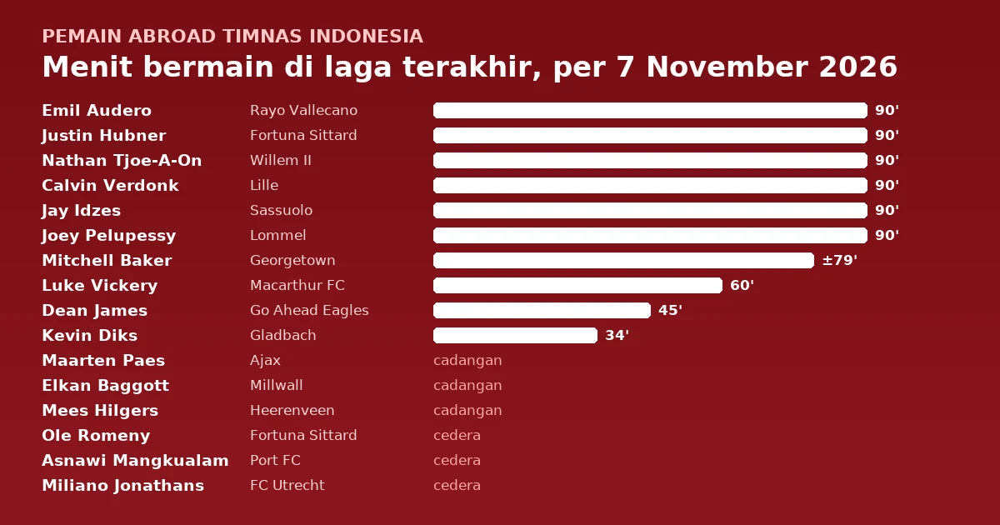

Laga terakhir 16 pemain abroad Timnas Indonesia dimainkan antara 31 Oktober dan 7 November 2026 waktu Indonesia. Sepuluh di antaranya turun ke lapangan, enam bermain penuh 90 menit, tetapi tidak satu pun mencetak gol atau assist di laga terakhirnya. Rating tertinggi dibagi dua: Calvin Verdonk di FotMob (7,9) saat Lille menahan Bodø/Glimt 0-0 di Liga Champions, dan Nathan Tjoe-A-On di Sofascore (8,1) saat Willem II bermain 1-1 melawan PEC Zwolle. Tiga pemain absen karena cedera: Ole Romeny (engkel), Miliano Jonathans (lutut), dan Asnawi Mangkualam (ACL). Tiga lainnya duduk di bangku cadangan tanpa dimainkan.

<!--more-->

> **Poin Penting**
>
> - Rating tertinggi: Calvin Verdonk di FotMob (7,9) dan Nathan Tjoe-A-On di Sofascore (8,1). Keduanya bermain 90 menit.
> - Enam pemain bermain penuh: Emil Audero, Justin Hubner, Nathan Tjoe-A-On, Calvin Verdonk (di Liga Champions), Jay Idzes, dan Joey Pelupessy. Audero mencatat clean sheet saat Rayo Vallecano menang 3-0.
> - Maarten Paes, Elkan Baggott, dan Mees Hilgers tidak dimainkan klubnya. Ole Romeny, Miliano Jonathans, dan Asnawi Mangkualam absen karena cedera.
> - Timnas Indonesia tidak bertanding di FIFA Matchday November karena laga melawan Yordania dibatalkan; PSSI hanya menggelar pemusatan latihan di Bali ([detikSport](https://sport.detik.com/sepakbola/liga-indonesia/d-8741976/timnas-indonesia-absen-di-fifa-matchday-november-tapi-gelar-tc-di-bali)).

Pantauan ini mencakup dua kelompok. Pertama, pemain abroad di skuad final FIFA ASEAN Cup 2026, pemanggilan resmi terakhir yang berakhir dengan gelar juara setelah Indonesia mengalahkan Thailand lewat adu penalti di final ([Databoks](https://databoks.katadata.co.id/en/sport/statistics/6ac447d1336cb/indonesia-wins-2026-fifa-asean-cup-mitchell-baker-named-top-scorer)). Kedua, pemain abroad yang populer tetapi tidak masuk pemanggilan itu, yang diberi tanda bintang (\*).

## Ringkasan laga terakhir

Hasil ditulis dari sudut pandang klub si pemain: M (menang), S (seri), K (kalah). Tanda (K) atau (T) setelah nama lawan berarti kandang atau tandang. Tanggal ditulis dalam WIB.

| Pemain | Klub (Liga) | Laga terakhir | Hasil | Menit | Kontribusi |
|---|---|---|:---:|:---:|---|
| Emil Audero | Rayo Vallecano (La Liga) | vs Celta Vigo (K), 31 Okt | M 3-0 | 90' | clean sheet |
| Maarten Paes | Ajax (Eredivisie) | vs FC Midtjylland (T), 6 Nov, Conference League | M 6-1 | – | cadangan, tidak dimainkan |
| Elkan Baggott | Millwall (Championship) | vs Birmingham City (T), 4 Nov | K 0-3 | – | cadangan, tidak dimainkan |
| Justin Hubner | Fortuna Sittard (Eredivisie) | vs Feyenoord (T), 31 Okt | S 1-1 | 90' | |
| Kevin Diks | Borussia Mönchengladbach (Bundesliga) | vs Hamburger SV (T), 7 Nov | K 1-3 | 34' | masuk menit ke-56 |
| Nathan Tjoe-A-On | Willem II (Eredivisie) | vs PEC Zwolle (K), 7 Nov | S 1-1 | 90' | rating Sofascore tertinggi |
| Dean James | Go Ahead Eagles (Eredivisie) | vs Cambuur (T), 1 Nov | K 0-4 | 45' | ditarik saat jeda |
| Calvin Verdonk | Lille (Ligue 1) | vs Bodø/Glimt (T), 4 Nov, Liga Champions | S 0-0 | 90' | clean sheet, rating FotMob tertinggi |
| Jay Idzes\* | Sassuolo (Serie A) | vs Fiorentina (K), 3 Nov | K 2-4 | 90' | |
| Mees Hilgers\* | SC Heerenveen (Eredivisie) | vs NEC Nijmegen (K), 1 Nov | M 1-0 | – | cadangan, tidak dimainkan |
| Asnawi Mangkualam\* | Port FC (Thai League 1) | vs Beijing Guoan (K), 3 Nov, Liga Champions Asia Elite | M 7-4 | – | cedera ACL |
| Joey Pelupessy | Lommel SK (Pro League) | vs Gent (K), 2 Nov | M 2-0 | 90' | |
| Ole Romeny | Fortuna Sittard (Eredivisie) | vs Feyenoord (T), 31 Okt | S 1-1 | – | cedera engkel |
| Luke Vickery | Macarthur FC (A-League) | vs Western Sydney Wanderers (K), 31 Okt | S 0-0 | 60' | |
| Mitchell Baker | Georgetown (liga kampus NCAA, AS) | vs UConn (T), 7 Nov | S 2-2 | ±79' | starter |
| Miliano Jonathans\* | FC Utrecht (Eredivisie) | vs Telstar (T), 1 Nov | K 2-4 | – | cedera lutut |

## Detail per pemain

Jam ditulis dalam WIB dengan waktu setempat di dalam kurung. Menit, rating FotMob, dan laga berikutnya diambil dari halaman pemain di FotMob, sedangkan rating Sofascore dari halaman pemain di Sofascore. Angka rating ditautkan ke halaman sumbernya. Kedua penyedia menghitung rating dengan cara berbeda, jadi angkanya jarang sama.

### Kiper

#### Emil Audero (kiper) · Rayo Vallecano

**Rayo Vallecano 3-0 Celta Vigo** · La Liga · Sabtu, 31 Oktober 2026, 22:15 WIB (16:15 CET) · Estadio de Vallecas, Madrid

| Menit | Kontribusi | Rating FotMob | Rating Sofascore |
|---|---|---|---|
| 90' (starter) | clean sheet | [7,0](https://www.fotmob.com/players/602845/emil-audero) | [6,9](https://www.sofascore.com/football/player/emil-audero/318603) |

Audero bermain di Rayo dengan status pinjaman dari Como hingga akhir musim. Dua gol Jorge de Frutos dan satu gol Unai López memastikan kemenangan tuan rumah.

**Laga berikutnya**: vs Real Sociedad (T), La Liga, Minggu, 8 November 2026, 22:15 WIB.

#### Maarten Paes (kiper) · Ajax

**FC Midtjylland 1-6 Ajax** · Conference League · Jumat, 6 November 2026, 00:45 WIB (Kamis, 18:45 CET) · MCH Arena, Herning

Cadangan, tidak dimainkan. Menurut [FotMob](https://www.fotmob.com/players/805463/maarten-paes), Paes tidak dimainkan dalam lima laga terakhir Ajax sejak 18 Oktober. Penampilan terakhirnya adalah laga FIFA ASEAN Cup melawan Malaysia pada 28 September.

**Laga berikutnya**: vs FC Twente (T), Eredivisie, Minggu, 8 November 2026, 20:30 WIB.

### Bek

#### Elkan Baggott (bek) · Millwall

**Birmingham City 3-0 Millwall** · Championship · Rabu, 4 November 2026, 03:00 WIB (Selasa, 20:00 GMT) · St. Andrew's, Birmingham

Cadangan, tidak dimainkan. Baggott, yang dipinjam Millwall dari Ipswich Town, tidak dimainkan dalam lima laga liga terakhir klubnya sejak 13 Oktober. Penampilan terakhirnya untuk Millwall adalah 20 menit melawan West Ham United pada 19 September ([FotMob](https://www.fotmob.com/players/1193997/elkan-baggott)).

**Laga berikutnya**: vs West Bromwich Albion (T), Championship, Sabtu, 7 November 2026, 22:00 WIB.

#### Justin Hubner (bek) · Fortuna Sittard

**Feyenoord 1-1 Fortuna Sittard** · Eredivisie · Sabtu, 31 Oktober 2026, 22:30 WIB (16:30 CET) · Stadion Feijenoord, Rotterdam

| Menit | Kontribusi | Rating FotMob | Rating Sofascore |
|---|---|---|---|
| 90' (starter, bek tengah) | – | [7,2](https://www.fotmob.com/players/1213683/justin-hubner) | [6,9](https://www.sofascore.com/football/player/justin-hubner/1112604) |

Fortuna menyamakan skor lewat Shiloh Zand pada menit ke-86 setelah Luciano Valente membawa Feyenoord unggul.

**Laga berikutnya**: vs Telstar (K), Eredivisie, Sabtu, 7 November 2026, 22:30 WIB.

#### Kevin Diks (bek) · Borussia Mönchengladbach

**Hamburger SV 3-1 Borussia Mönchengladbach** · Bundesliga · Sabtu, 7 November 2026, 02:30 WIB (Jumat, 20:30 CET) · Volksparkstadion, Hamburg

| Menit | Kontribusi | Rating FotMob | Rating Sofascore |
|---|---|---|---|
| 34' (masuk menit ke-56) | – | [6,1](https://www.fotmob.com/players/566158/kevin-diks) | [6,2](https://www.sofascore.com/football/player/kevin-diks/583806) |

Diks memulai laga dari bangku cadangan dan masuk menggantikan Robin Hack pada menit ke-56 saat skor masih 1-1. Hamburg kemudian mencetak dua gol lewat Shafiq Nandja dan Albert Grønbæk.

**Laga berikutnya**: vs Borussia Dortmund (K), Bundesliga, pekan 20-22 November 2026 (jadwal pasti belum ditetapkan).

#### Nathan Tjoe-A-On (bek kiri) · Willem II

**Willem II 1-1 PEC Zwolle** · Eredivisie · Sabtu, 7 November 2026, 02:00 WIB (Jumat, 20:00 CET) · Koning Willem II Stadion, Tilburg

| Menit | Kontribusi | Rating FotMob | Rating Sofascore |
|---|---|---|---|
| 90' (starter) | – | [7,8](https://www.fotmob.com/players/1075242/nathan-tjoe) | [8,1](https://www.sofascore.com/football/player/nathan-tjoe-a-on/992651) |

Kedua gol lahir dalam tiga menit pertama: Sydney van Hooijdonk untuk PEC Zwolle dan Hidde ter Avest untuk Willem II.

**Laga berikutnya**: setelah jeda internasional November.

#### Dean James (bek kiri) · Go Ahead Eagles

**Cambuur 4-0 Go Ahead Eagles** · Eredivisie · Minggu, 1 November 2026, 03:00 WIB (Sabtu, 21:00 CET) · Kooi Stadion, Leeuwarden

| Menit | Kontribusi | Rating FotMob | Rating Sofascore |
|---|---|---|---|
| 45' (starter, ditarik saat jeda) | – | [5,3](https://www.fotmob.com/players/1180694/dean-james) | [6,0](https://www.sofascore.com/football/player/dean-james/1046722) |

Go Ahead Eagles sudah tertinggal 0-3 di babak pertama. James digantikan Tomas Galvez di awal babak kedua.

**Laga berikutnya**: vs Excelsior (T), Eredivisie, Minggu, 8 November 2026, 03:00 WIB.

#### Calvin Verdonk (bek kiri) · Lille

**Bodø/Glimt 0-0 Lille** · Liga Champions · Rabu, 4 November 2026, 03:00 WIB (Selasa, 21:00 CET) · Aspmyra Stadion, Bodø

| Menit | Kontribusi | Rating FotMob | Rating Sofascore |
|---|---|---|---|
| 90' (starter, bek kiri) | clean sheet | [7,9](https://www.fotmob.com/players/622137/calvin-verdonk) | [7,5](https://www.sofascore.com/football/player/calvin-verdonk/361780) |

Rating FotMob 7,9 ini yang tertinggi di antara 16 pemain di tulisan ini. Hasil imbang ini memberi Lille poin pertama di fase liga setelah tiga kekalahan beruntun ([Bola.com](https://bola.com/dunia/read/8327943/rapor-calving-verdonk-di-liga-champions-dini-hari-tadi-starter-lagi-dan-jadi-man-of-the-match)); hasil dan klasemen lengkapnya ada di [rekap Liga Champions matchday 4]().

**Laga berikutnya**: vs Rennes (T), Ligue 1, Minggu, 8 November 2026, 21:00 WIB.

#### Jay Idzes\* (bek) · Sassuolo

**Sassuolo 2-4 Fiorentina** · Serie A · Selasa, 3 November 2026, 00:30 WIB (Senin, 18:30 CET) · MAPEI Stadium, Reggio Emilia

| Menit | Kontribusi | Rating FotMob | Rating Sofascore |
|---|---|---|---|
| 90' (starter) | – | [5,0](https://www.fotmob.com/players/937412/jay-idzes) | [6,0](https://www.sofascore.com/football/player/jay-idzes/933641) |

Idzes tidak masuk pemanggilan FIFA ASEAN Cup. Armand Laurienté mencetak dua gol untuk Sassuolo (menit 25 dan 65), tetapi Fiorentina menang lewat gol pada menit ke-79 dan 90+3. Laga ini juga dibahas di [rekap Serie A giornata 10]().

**Laga berikutnya**: vs Roma (T), Serie A, Minggu, 8 November 2026, 02:45 WIB.

#### Mees Hilgers\* (bek) · SC Heerenveen

**SC Heerenveen 1-0 NEC Nijmegen** · Eredivisie · Minggu, 1 November 2026, 00:45 WIB (Sabtu, 18:45 CET) · Abe Lenstra Stadion, Heerenveen

Cadangan, tidak dimainkan. Hilgers terakhir bermain 14 menit di Piala KNVB melawan Excelsior Maassluis pada 28 Oktober dan menerima kartu kuning ([FotMob](https://www.fotmob.com/players/1192130/mees-hilgers)).

**Laga berikutnya**: vs Feyenoord (K), Eredivisie, Minggu, 8 November 2026, 18:15 WIB.

#### Asnawi Mangkualam\* (bek kanan) · Port FC

**Port FC 7-4 Beijing Guoan** · AFC Champions League Elite · Selasa, 3 November 2026, 19:15 WIB (19:15 waktu Bangkok) · Pathum Thani

Tidak masuk skuad: masih dalam pemulihan cedera ACL. Asnawi menjalani operasi pada 28 Januari 2026 ([detikHealth](https://health.detik.com/kebugaran/d-8333320/menyoal-cedera-acl-dialami-asnawi-sampai-harus-naik-meja-operasi/amp)) dan sempat kembali berlatih pada Mei ([Suara](https://www.suara.com/bola/2026/05/08/095947/asnawi-mangkualam-pulih-lebih-cepat-dari-cedera-acl-dipanggil-john-herdman-untuk-piala-aff)). Pada Oktober ia masih absen saat Port FC kalah dari Persib dan Kashiwa Reysol, dan tidak didaftarkan di skuad Thai League 2026/27 ([Chatnews](https://chatnews.id/port-fc-kalah-dari-persib-dan-kashiwa-reysol-tanpa-asnawi)). Penampilan terakhirnya tercatat pada 18 Januari ([FotMob](https://www.fotmob.com/players/799669/asnawi-bahar)).

**Laga berikutnya**: vs Chonburi FC (K), Thai League 1, Sabtu, 7 November 2026, 19:00 WIB.

### Gelandang

#### Joey Pelupessy (gelandang) · Lommel SK

**Lommel SK 2-0 Gent** · Pro League Belgia · Senin, 2 November 2026, 00:30 WIB (Minggu, 18:30 CET) · Soeverein Stadion, Lommel

| Menit | Kontribusi | Rating FotMob | Rating Sofascore |
|---|---|---|---|
| 90' (starter) | – | [7,3](https://www.fotmob.com/players/248151/joey-pelupessy) | [6,9](https://www.sofascore.com/football/player/joey-pelupessy/235404) |

Lommel memastikan kemenangan lewat dua gol di paruh akhir babak kedua, dicetak Juho Talvitie dan Djordje Gordić.

**Laga berikutnya**: vs Royal Antwerp (T), Pro League Belgia, Minggu, 8 November 2026, 02:45 WIB.

### Penyerang

#### Ole Romeny (penyerang) · Fortuna Sittard

**Feyenoord 1-1 Fortuna Sittard** · Eredivisie · Sabtu, 31 Oktober 2026, 22:30 WIB (16:30 CET) · Stadion Feijenoord, Rotterdam

Tidak masuk skuad: cedera engkel kambuh setelah ia bermain 45 menit melawan Excelsior pada 25 Oktober ([Bola.com](https://www.bola.com/dunia/read/8323621/cedera-engkel-ole-romeny-menepi-lagi-dari-skuad-fortuna-sittard)). Romeny bermain di Fortuna dengan status pinjaman dari Oxford United.

**Laga berikutnya**: vs Telstar (K), Eredivisie, Sabtu, 7 November 2026, 22:30 WIB.

#### Luke Vickery (sayap) · Macarthur FC

**Macarthur FC 0-0 Western Sydney Wanderers** · A-League · Sabtu, 31 Oktober 2026, 15:40 WIB (19:40 AEDT) · Campbelltown Sports Stadium, Sydney

| Menit | Kontribusi | Rating FotMob | Rating Sofascore |
|---|---|---|---|
| 60' (starter, diganti Musa Touré) | – | [6,5](https://www.fotmob.com/players/1612270/luke-vickery) | [6,7](https://www.sofascore.com/football/player/luke-vickery/1519962) |

**Laga berikutnya**: vs Brisbane Roar (K), A-League, Minggu, 8 November 2026, 11:00 WIB.

#### Mitchell Baker (penyerang) · Georgetown

**UConn 2-2 Georgetown** · NCAA Divisi I (Big East) · Sabtu, 7 November 2026, 07:00 WIB (Jumat, 19:00 EST) · Joseph J. Morrone Stadium, Storrs

| Menit | Kontribusi | Rating FotMob | Rating Sofascore |
|---|---|---|---|
| ±79' (starter) | 1 tembakan | - | - |

Top skor FIFA ASEAN Cup 2026 ini bermain untuk tim universitas Georgetown di liga kampus Amerika Serikat. Aturan liga kampus membolehkan pemain masuk kembali setelah diganti: Baker ditarik pada menit ke-34, lalu turun lagi di babak kedua ([Georgetown Athletics](https://guhoyas.com/sports/mens-soccer/stats/2026/uconn/boxscore/22017)). FotMob dan Sofascore tidak memberi rating untuk liga kampus.

**Laga berikutnya**: vs Seton Hall, turnamen Big East (tempat netral, Boyds, Maryland), Jumat, 13 November 2026, 07:30 WIB.

#### Miliano Jonathans\* (sayap) · FC Utrecht

**Telstar 4-2 FC Utrecht** · Eredivisie · Minggu, 1 November 2026, 20:30 WIB (14:30 CET) · BUKO Stadion, Velsen-Zuid

Tidak masuk skuad: pemulihan cedera ligamen lutut (ACL) yang dialaminya pada Maret 2026 saat dipinjamkan ke Excelsior, cedera serupa kedua dalam sekitar dua tahun ([Bola.com](https://www.bola.com/dunia/read/6295372/miliano-jonathans-kena-cedera-acl-lagi-musim-berakhir-dan-gagal-tampil-di-fifa-series-bersama-timnas-indonesia)). FotMob mencatat penampilan terakhirnya pada 7 Maret 2026 dan masih mendaftarnya sebagai cedera lutut menjelang laga Utrecht berikutnya ([FotMob](https://www.fotmob.com/matches/nec-nijmegen-vs-fc-utrecht/2shmse)).

**Laga berikutnya**: vs NEC Nijmegen (K), Eredivisie, Senin, 9 November 2026, 02:00 WIB.

## Jadwal laga berikutnya

Laga berikutnya semua pemain, diurutkan menurut waktu WIB. Pemain yang sedang cedera tetap dicantumkan.

| Waktu (WIB) | Laga | Kompetisi | Pemain |
|---|---|---|---|
| Sabtu, 7 Nov, 19:00 | Port FC vs Chonburi FC | Thai League 1 | Asnawi (cedera, tidak terdaftar di liga) |
| Sabtu, 7 Nov, 22:00 | West Bromwich Albion vs Millwall | Championship | Baggott |
| Sabtu, 7 Nov, 22:30 | Fortuna Sittard vs Telstar | Eredivisie | Hubner, Romeny (cedera) |
| Minggu, 8 Nov, 02:45 | Royal Antwerp vs Lommel SK | Pro League Belgia | Pelupessy |
| Minggu, 8 Nov, 02:45 | Roma vs Sassuolo | Serie A | Idzes |
| Minggu, 8 Nov, 03:00 | Excelsior vs Go Ahead Eagles | Eredivisie | James |
| Minggu, 8 Nov, 11:00 | Macarthur FC vs Brisbane Roar | A-League | Vickery |
| Minggu, 8 Nov, 18:15 | SC Heerenveen vs Feyenoord | Eredivisie | Hilgers |
| Minggu, 8 Nov, 20:30 | FC Twente vs Ajax | Eredivisie | Paes |
| Minggu, 8 Nov, 21:00 | Rennes vs Lille | Ligue 1 | Verdonk |
| Minggu, 8 Nov, 22:15 | Real Sociedad vs Rayo Vallecano | La Liga | Audero |
| Senin, 9 Nov, 02:00 | FC Utrecht vs NEC Nijmegen | Eredivisie | Jonathans (cedera) |
| Jumat, 13 Nov, 07:30 | Georgetown vs Seton Hall | Turnamen Big East | Baker |
| 20-22 Nov, jadwal pasti belum ditetapkan | Borussia Mönchengladbach vs Borussia Dortmund | Bundesliga | Diks |

Laga berikutnya Nathan Tjoe-A-On jatuh setelah jeda internasional, karena Willem II sudah memainkan laga pekan ini pada Jumat malam.

## Sumber

- FotMob, halaman pemain (menit, rating FotMob, laga terakhir dan berikutnya) dan halaman laga (skor, pencetak gol, jam kick-off, stadion), diakses 7 November 2026. Tautan per pemain ada di kolom rating.
- Sofascore, halaman pemain (rating Sofascore), diakses 7 November 2026.
- Bola.com, [Rapor Calvin Verdonk di Liga Champions](https://bola.com/dunia/read/8327943/rapor-calving-verdonk-di-liga-champions-dini-hari-tadi-starter-lagi-dan-jadi-man-of-the-match), November 2026.
- Bola.com, [Cedera Engkel, Ole Romeny Menepi Lagi dari Skuad Fortuna Sittard](https://www.bola.com/dunia/read/8323621/cedera-engkel-ole-romeny-menepi-lagi-dari-skuad-fortuna-sittard), November 2026.
- Bola.com, [Miliano Jonathans Kena Cedera ACL Lagi](https://www.bola.com/dunia/read/6295372/miliano-jonathans-kena-cedera-acl-lagi-musim-berakhir-dan-gagal-tampil-di-fifa-series-bersama-timnas-indonesia), Maret 2026.
- detikHealth, [Menyoal Cedera ACL, Dialami Asnawi Sampai Harus Naik Meja Operasi](https://health.detik.com/kebugaran/d-8333320/menyoal-cedera-acl-dialami-asnawi-sampai-harus-naik-meja-operasi/amp), Januari 2026.
- Chatnews, [Port FC Kalah dari Persib dan Kashiwa Reysol Tanpa Asnawi](https://chatnews.id/port-fc-kalah-dari-persib-dan-kashiwa-reysol-tanpa-asnawi), Oktober 2026.
- Suara, [Asnawi Mangkualam Pulih Lebih Cepat dari Cedera ACL](https://www.suara.com/bola/2026/05/08/095947/asnawi-mangkualam-pulih-lebih-cepat-dari-cedera-acl-dipanggil-john-herdman-untuk-piala-aff), 8 Mei 2026.
- Georgetown Athletics, [box score Georgetown vs UConn](https://guhoyas.com/sports/mens-soccer/stats/2026/uconn/boxscore/22017) dan [jadwal](https://guhoyas.com/sports/mens-soccer/schedule), November 2026.
- Databoks, [Indonesia Wins 2026 FIFA ASEAN Cup, Mitchell Baker Named Top Scorer](https://databoks.katadata.co.id/en/sport/statistics/6ac447d1336cb/indonesia-wins-2026-fifa-asean-cup-mitchell-baker-named-top-scorer), Oktober 2026.
- detikSport, [Timnas Indonesia Absen di FIFA Matchday November, tapi Gelar TC di Bali](https://sport.detik.com/sepakbola/liga-indonesia/d-8741976/timnas-indonesia-absen-di-fifa-matchday-november-tapi-gelar-tc-di-bali), November 2026.

---

*Data per 7 November 2026, mencakup laga yang selesai hingga Sabtu pagi, 7 November (WIB). Penulis: Mahyuddin Susanto ([tentang penulis](https://www.udienz.web.id/about/), [kontak](https://www.udienz.web.id/contact.html)). Tulisan ini dibantu oleh AI.*
