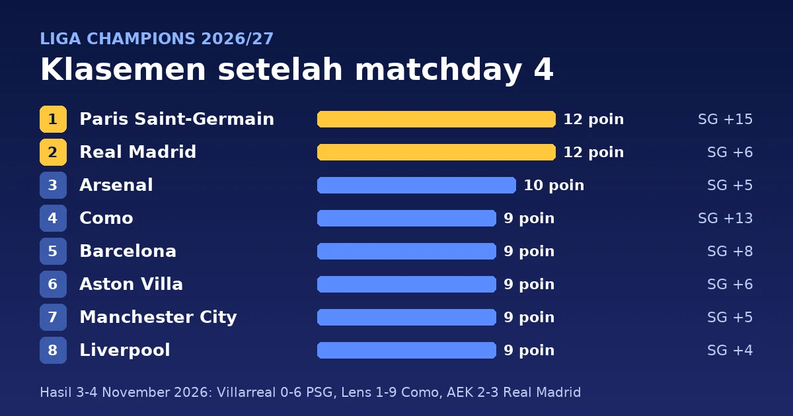

Matchday 4 fase liga Liga Champions 2026/27 dimainkan pada Selasa dan Rabu, 3-4 November 2026. Paris Saint-Germain dan Real Madrid menjadi dua tim yang masih memenangi semua laganya: PSG menang 6-0 di Villarreal, sedangkan Real Madrid baru memastikan kemenangan 3-2 di Athena lewat gol Federico Valverde di masa tambahan waktu. Hasil paling mencolok datang dari Prancis, tempat Como mengalahkan Lens 9-1. Liverpool menelan kekalahan pertama di Liga Champions musim ini di Istanbul, 2-3 dari Fenerbahçe.

> **Poin Penting**
>
> - PSG (12 poin, selisih gol +15) dan Real Madrid (12 poin, +6) memimpin klasemen dengan empat kemenangan dari empat laga. Arsenal ketiga dengan 10 poin.
> - Sembilan tim mengumpulkan 9 poin, dari Como di peringkat 4 sampai Borussia Dortmund di peringkat 12. Mereka diurutkan menurut selisih gol, lalu jumlah gol: Liverpool, Club Brugge, dan Sporting CP sama-sama +4 dan dipisahkan oleh gol yang dicetak.
> - Como menang 9-1 di markas Lens dengan hat-trick Anastasios Douvikas dan naik ke peringkat 4.
> - Slovan Bratislava satu-satunya tim tanpa poin (selisih gol -16). Atlético Madrid, Napoli, dan Porto berada di sekitar garis eliminasi peringkat 24.

## Hasil lengkap matchday 4

Delapan belas laga dimainkan dalam dua malam. Skor di bawah mengikuti daftar resmi [UEFA](https://www.uefa.com/uefachampionsleague/news/02a8-2174c9e9019d-f909a77bd77a-1000--2026-27-champions-league-all-the-league-phase-fixtures-a/), dengan tim tuan rumah di kolom kiri.

| Tanggal | Tuan rumah | Skor | Tamu |
|---|---|:---:|---|
| Selasa, 3 Nov | Shakhtar Donetsk | 0-1 | Sporting CP |
| Selasa, 3 Nov | Galatasaray | 2-0 | Stuttgart |
| Selasa, 3 Nov | Atlético Madrid | 0-2 | Bayern München |
| Selasa, 3 Nov | Barcelona | 3-0 | Aston Villa |
| Selasa, 3 Nov | Feyenoord | 0-3 | Inter |
| Selasa, 3 Nov | Bodø/Glimt | 0-0 | Lille |
| Selasa, 3 Nov | LASK | 4-0 | Slovan Bratislava |
| Selasa, 3 Nov | Manchester United | 3-2 | Roma |
| Selasa, 3 Nov | Villarreal | 0-6 | Paris Saint-Germain |
| Rabu, 4 Nov | AEK Athens | 2-3 | Real Madrid |
| Rabu, 4 Nov | Fenerbahçe | 3-2 | Liverpool |
| Rabu, 4 Nov | Borussia Dortmund | 2-1 | Real Betis |
| Rabu, 4 Nov | Porto | 4-1 | Napoli |
| Rabu, 4 Nov | PSV Eindhoven | 1-2 | Club Brugge |
| Rabu, 4 Nov | RB Leipzig | 2-3 | Manchester City |
| Rabu, 4 Nov | Lens | 1-9 | Como |
| Rabu, 4 Nov | Slavia Praha | 1-2 | Arsenal |
| Rabu, 4 Nov | Viking | 4-1 | Sabah |

Tim tamu memenangi sembilan dari delapan belas laga, tuan rumah delapan. Hanya satu pertandingan yang berakhir seri, yaitu Bodø/Glimt melawan Lille.

<!--more-->

## Detail pertandingan

Jam ditulis dalam WIB dengan waktu Eropa Tengah (CET) di dalam kurung, sehingga laga Selasa malam di Eropa jatuh pada Rabu dini hari di Indonesia. Pencetak gol, menit, dan kartu merah mengikuti papan skor [ESPN untuk 3 November](https://www.espn.com/soccer/scoreboard/_/date/20261103/league/uefa.champions) dan [4 November](https://www.espn.com/soccer/scoreboard/_/date/20261104/league/uefa.champions), sedangkan kartu kuning mengikuti halaman susunan pemain Sky Sports untuk tiap laga. Tanda ⚽ menandai gol, 🟨 kartu kuning, dan 🟥 kartu merah.

### Selasa, 3 November 2026

#### Galatasaray 2-0 Stuttgart

**Rabu, 4 November 2026, 00:45 WIB (Selasa, 18:45 CET)** · RAMS Park, Istanbul

| Galatasaray | Stuttgart |
|---|---|
| ⚽ Aleksey Batrakov 12', 15' 🟨 Barış Alper Yılmaz 39' 🟨 Roland Sallai 62' 🟨 Lucas Torreira 85' | 🟨 Atakan Karazor 2' 🟨 Deniz Undav 38' 🟨 Y. Spalt 45+3' 🟨 Grischa Prömel 61' 🟨 Ramon Hendriks 79' |

#### Shakhtar Donetsk 0-1 Sporting CP

**Rabu, 4 November 2026, 00:45 WIB (Selasa, 18:45 CET)** · Stamford Bridge, London (kandang netral Shakhtar)

| Shakhtar Donetsk | Sporting CP |
|---|---|
| 🟨 I. Severino Silva 74' | ⚽ Issa Doumbia 59' 🟨 Maximiliano Araújo 66' |

#### Atlético Madrid 0-2 Bayern München

**Rabu, 4 November 2026, 03:00 WIB (Selasa, 21:00 CET)** · Riyadh Air Metropolitano, Madrid

| Atlético Madrid | Bayern München |
|---|---|
| 🟨 Giuliano Simeone 79' | ⚽ Lennart Karl 54' ⚽ Konrad Laimer 74' 🟨 Joshua Kimmich 56' 🟨 Josip Stanišić 90+1' |

Bayern menjadi salah satu dari empat tim yang belum terkalahkan, bersama PSG, Real Madrid, dan Arsenal.

#### Barcelona 3-0 Aston Villa

**Rabu, 4 November 2026, 03:00 WIB (Selasa, 21:00 CET)** · Camp Nou, Barcelona

| Barcelona | Aston Villa |
|---|---|
| ⚽ Lamine Yamal 7' ⚽ Raphinha 52', 64' 🟨 Raphinha 45' | 🟨 Ian Maatsen 11' 🟨 Emiliano Buendía 31' 🟨 Nicolas Jackson 45' |

Ini kekalahan pertama Aston Villa di Liga Champions musim ini.

#### Bodø/Glimt 0-0 Lille

**Rabu, 4 November 2026, 03:00 WIB (Selasa, 21:00 CET)** · Aspmyra Stadion, Bodø

| Bodø/Glimt | Lille |
|---|---|
| – | 🟨 Nathan Ngoy 83' |

Satu-satunya laga tanpa gol pekan ini.

#### Feyenoord 0-3 Inter

**Rabu, 4 November 2026, 03:00 WIB (Selasa, 21:00 CET)** · De Kuip, Rotterdam

| Feyenoord | Inter |
|---|---|
| 🟨 Gjivai Zechiël 39' | ⚽ Yann Bisseck 8' ⚽ Pio Esposito 34' ⚽ Piotr Zieliński 54' 🟨 Hakan Çalhanoğlu 3' 🟨 Manuel Akanji 39' |

#### LASK 4-0 Slovan Bratislava

**Rabu, 4 November 2026, 03:00 WIB (Selasa, 21:00 CET)** · Raiffeisen Arena, Linz

| LASK | Slovan Bratislava |
|---|---|
| ⚽ K. Jørgensen 19', 37' ⚽ Robert Ljubičić 44' ⚽ Samuel Adeniran 48' | 🟨 C. Martinez 25' 🟨 Kevin Wimmer 36' |

#### Manchester United 3-2 Roma

**Rabu, 4 November 2026, 03:00 WIB (Selasa, 21:00 CET)** · Old Trafford, Manchester

| Manchester United | Roma |
|---|---|
| ⚽ Bruno Fernandes 58' (pen.) ⚽ Matheus Cunha 83', 86' 🟨 Bruno Fernandes 20' 🟨 Ayden Heaven 70' 🟨 Harry Maguire 78' 🟨 Matheus Cunha 87' 🟥 Matheus Cunha 90+1' (kuning kedua) | ⚽ Matías Soulé 11' ⚽ Donyell Malen 17' (pen.) 🟨 Matías Soulé 20' 🟨 E. Lulli 35' 🟨 Donyell Malen 42' |

United tertinggal 0-2 sebelum menit 20. Cunha mencetak dua gol dalam tiga menit, lalu diusir keluar dengan kartu kuning kedua di masa tambahan waktu ([Yahoo Sports](https://sports.yahoo.com/articles/uefa-confirm-matheus-cunha-fate-080000709.html)).

#### Villarreal 0-6 Paris Saint-Germain

**Rabu, 4 November 2026, 03:00 WIB (Selasa, 21:00 CET)** · Estadio de la Cerámica, Vila-real

| Villarreal | Paris Saint-Germain |
|---|---|
| 🟨 Santi Comesaña 45' 🟨 Santiago Mouriño 50' 🟨 Sergi Cardona 66' 🟨 Alberto Moleiro 78' | ⚽ João Neves 9' ⚽ Désiré Doué 12' ⚽ Senny Mayulu 13' ⚽ Fabián Ruiz 17', 50' ⚽ D. Boly 78' 🟨 Quentin Ndjantou 74' |

PSG unggul 4-0 dalam 17 menit pertama. Ini kemenangan tandang terbesar kedua pekan ini setelah Como, dan PSG kini mencetak 20 gol dan kebobolan 5 dalam empat laga.

### Rabu, 4 November 2026

#### AEK Athens 2-3 Real Madrid

**Kamis, 5 November 2026, 00:45 WIB (Rabu, 18:45 CET)** · Allwyn Arena, Athena

| AEK Athens | Real Madrid |
|---|---|
| ⚽ Aboubakary Koita 12' ⚽ Stavros Pilios 75' 🟨 Kervin Arriaga 34' 🟥 Aboubakary Koita 90+5' | ⚽ Jude Bellingham 32' ⚽ Kylian Mbappé 78' ⚽ Federico Valverde 90+2' 🟨 Marc Cucurella 65' |

Real Madrid dua kali tertinggal sebelum Valverde mencetak gol penentu di masa tambahan waktu. Madrid tetap sempurna, tetapi selisih golnya (+6) jauh di bawah PSG (+15) karena tiga dari empat kemenangannya hanya berjarak satu gol.

#### Fenerbahçe 3-2 Liverpool

**Kamis, 5 November 2026, 00:45 WIB (Rabu, 18:45 CET)** · Chobani Stadium, Istanbul

| Fenerbahçe | Liverpool |
|---|---|
| ⚽ Mason Greenwood 29' ⚽ Archie Brown 73' ⚽ Vedat Muriqi 79' 🟨 Archie Brown 36' | ⚽ Trey Nyoni 25' ⚽ Alexander Isak 69' 🟨 Alexis Mac Allister 85' |

Liverpool dua kali memimpin. Kekalahan ini menghentikan tiga kemenangan beruntun mereka dan membuat Liverpool turun ke peringkat 8, posisi terakhir yang lolos langsung ke babak 16 besar.

#### Borussia Dortmund 2-1 Real Betis

**Kamis, 5 November 2026, 03:00 WIB (Rabu, 21:00 CET)** · Signal Iduna Park, Dortmund

| Borussia Dortmund | Real Betis |
|---|---|
| ⚽ Fábio Silva 49' ⚽ Konstantinos Karetsas 72' 🟨 Julian Ryerson 38' 🟨 Ramy Bensebaini 45+4' 🟨 Joey Veerman 78' 🟨 Jobe Bellingham 79' | ⚽ Aitor Ruibal 67' 🟨 Natan 44' 🟨 Valentín Gómez 64' 🟨 Ángel Ortiz 88' 🟨 Isco 90+3' |

#### Porto 4-1 Napoli

**Kamis, 5 November 2026, 03:00 WIB (Rabu, 21:00 CET)** · Estádio do Dragão, Porto

| Porto | Napoli |
|---|---|
| ⚽ Jan Bednarek 11' ⚽ Gabri Veiga 71' ⚽ Jakub Kiwior 80' ⚽ Samu Aghehowa 90' (pen.) 🟨 Gabri Veiga 45+2' | ⚽ Scott McTominay 43' 🟨 Antonio Vergara 1' 🟨 André-Frank Zambo Anguissa 21' 🟨 Amir Rrahmani 35' 🟨 Scott McTominay 36' 🟥 Rafa Marín 88' |

Kartu merah Rafa Marín berasal dari pelanggaran terhadap Samu, yang kemudian dieksekusi sendiri oleh Samu menjadi gol keempat Porto ([LiveScore](https://www.livescore.com/en/news/football/serie-a/ucl-fc-porto-4-1-napoli-error-prone-partenopei-collapse-in-porto-football-italia/)).

#### PSV Eindhoven 1-2 Club Brugge

**Kamis, 5 November 2026, 03:00 WIB (Rabu, 21:00 CET)** · Philips Stadion, Eindhoven

| PSV Eindhoven | Club Brugge |
|---|---|
| ⚽ Kodai Sano 54' | ⚽ Nicolò Tresoldi 25' ⚽ Carlos Forbs 65' 🟨 C. Borges 28' 🟨 Hugo Vetlesen 73' 🟨 Jorne Spileers 81' |

#### RB Leipzig 2-3 Manchester City

**Kamis, 5 November 2026, 03:00 WIB (Rabu, 21:00 CET)** · Red Bull Arena, Leipzig

| RB Leipzig | Manchester City |
|---|---|
| ⚽ Ridle Baku 49' ⚽ Antonio Nusa 61' 🟨 Christoph Baumgartner 17' 🟨 Ridle Baku 33' 🟨 Neil El Aynaoui 48' 🟨 David Raum 77' | ⚽ Castello Lukeba 37' (bunuh diri) ⚽ Enzo Fernández 58' ⚽ Erling Haaland 78' 🟨 Jérémy Doku 88' 🟨 Abdukodir Khusanov 90+4' |

#### Lens 1-9 Como

**Kamis, 5 November 2026, 03:00 WIB (Rabu, 21:00 CET)** · Stade Bollaert-Delelis, Lens

| Lens | Como |
|---|---|
| ⚽ Ruben Aguilar 65' 🟨 Samson Baidoo 34' 🟨 Mickaël Cuisance 75' | ⚽ Anastasios Douvikas 7', 32', 57' ⚽ Nico Paz 40' ⚽ Lucas Da Cunha 47' ⚽ Marc-Oliver Kempf 53' ⚽ Mattia Liberali 62' ⚽ Martin Baturina 69' ⚽ Matteo Papaccioli 90+1' |

Selisih delapan gol ini menyamai rekor kemenangan terbesar sejak kompetisi ini bernama Liga Champions pada 1992 ([Flashscore](https://www.flashscore.nl/news/soccer-champions-league-lens-como-report-04-11-2026/lvjDmted/)). Como kini mengoleksi 19 gol dari empat laga, terbanyak kedua setelah PSG. Satu-satunya kekalahan mereka terjadi di Rotterdam, 2-3 dari Feyenoord pada matchday 2.

#### Slavia Praha 1-2 Arsenal

**Kamis, 5 November 2026, 03:00 WIB (Rabu, 21:00 CET)** · Fortuna Arena, Praha

| Slavia Praha | Arsenal |
|---|---|
| ⚽ Wiktor Nowak 90' 🟨 David Moses 20' | ⚽ Noni Madueke 9' ⚽ Viktor Gyökeres 38' 🟨 Ezri Konsa 53' 🟨 Declan Rice 68' |

#### Viking 4-1 Sabah

**Kamis, 5 November 2026, 03:00 WIB (Rabu, 21:00 CET)** · Viking Stadion, Stavanger

| Viking | Sabah |
|---|---|
| ⚽ Erik Botheim 27', 90+4' ⚽ Zlatko Tripić 69' ⚽ Henrik Falchener 81' 🟨 Kristoffer Haugen 2' 🟨 Gianni Stensness 18' | ⚽ Orphé Mbina 11' 🟨 U. Rahmonaliyev 36' 🟨 J. Mickels 87' 🟥 Aden McCarthy 77' |

## Klasemen fase liga setelah matchday 4

Klasemen di bawah dihitung dari hasil resmi UEFA matchday 1 sampai 4. Format fase liga sejak musim 2024/25 tetap dipakai: peringkat 1-8 lolos langsung ke babak 16 besar, peringkat 9-24 masuk babak play-off gugur, dan peringkat 25-36 tersingkir dari kompetisi Eropa.

| # | Tim | M | Me | S | K | Gol | SG | Poin |
|---:|---|:---:|:---:|:---:|:---:|:---:|:---:|:---:|
| 1 | Paris Saint-Germain | 4 | 4 | 0 | 0 | 20-5 | +15 | **12** |
| 2 | Real Madrid | 4 | 4 | 0 | 0 | 13-7 | +6 | **12** |
| 3 | Arsenal | 4 | 3 | 1 | 0 | 8-3 | +5 | **10** |
| 4 | Como | 4 | 3 | 0 | 1 | 19-6 | +13 | **9** |
| 5 | Barcelona | 4 | 3 | 0 | 1 | 14-6 | +8 | **9** |
| 6 | Aston Villa | 4 | 3 | 0 | 1 | 12-6 | +6 | **9** |
| 7 | Manchester City | 4 | 3 | 0 | 1 | 12-7 | +5 | **9** |
| 8 | Liverpool | 4 | 3 | 0 | 1 | 14-10 | +4 | **9** |
| 9 | Club Brugge | 4 | 3 | 0 | 1 | 11-7 | +4 | 9 |
| 10 | Sporting CP | 4 | 3 | 0 | 1 | 8-4 | +4 | 9 |
| 11 | Real Betis | 4 | 3 | 0 | 1 | 8-6 | +2 | 9 |
| 12 | Borussia Dortmund | 4 | 3 | 0 | 1 | 7-5 | +2 | 9 |
| 13 | Bayern München | 4 | 2 | 2 | 0 | 12-5 | +7 | 8 |
| 14 | Stuttgart | 4 | 2 | 1 | 1 | 7-4 | +3 | 7 |
| 15 | Inter | 4 | 2 | 0 | 2 | 8-6 | +2 | 6 |
| 16 | LASK | 4 | 2 | 0 | 2 | 10-9 | +1 | 6 |
| 17 | Manchester United | 4 | 2 | 0 | 2 | 8-8 | 0 | 6 |
| 18 | Galatasaray | 4 | 2 | 0 | 2 | 8-9 | -1 | 6 |
| 19 | Fenerbahçe | 4 | 1 | 2 | 1 | 6-11 | -5 | 5 |
| 20 | Roma | 4 | 1 | 1 | 2 | 10-8 | +2 | 4 |
| 21 | Shakhtar Donetsk | 4 | 1 | 1 | 2 | 4-4 | 0 | 4 |
| 22 | Viking | 4 | 1 | 1 | 2 | 9-10 | -1 | 4 |
| 23 | Atlético Madrid | 4 | 1 | 1 | 2 | 4-5 | -1 | 4 |
| 24 | PSV Eindhoven | 4 | 1 | 1 | 2 | 3-4 | -1 | 4 |
| 25 | Bodø/Glimt | 4 | 1 | 1 | 2 | 4-9 | -5 | 4 |
| 26 | Porto | 4 | 1 | 0 | 3 | 6-7 | -1 | 3 |
| 27 | Napoli | 4 | 1 | 0 | 3 | 6-11 | -5 | 3 |
| 28 | Villarreal | 4 | 1 | 0 | 3 | 8-14 | -6 | 3 |
| 29 | RB Leipzig | 4 | 1 | 0 | 3 | 5-11 | -6 | 3 |
| 30 | AEK Athens | 4 | 1 | 0 | 3 | 5-11 | -6 | 3 |
| 31 | Sabah | 4 | 1 | 0 | 3 | 4-10 | -6 | 3 |
| 32 | Feyenoord | 4 | 1 | 0 | 3 | 4-11 | -7 | 3 |
| 33 | Lens | 4 | 1 | 0 | 3 | 4-16 | -12 | 3 |
| 34 | Slavia Praha | 4 | 0 | 1 | 3 | 5-9 | -4 | 1 |
| 35 | Lille | 4 | 0 | 1 | 3 | 4-10 | -6 | 1 |
| 36 | Slovan Bratislava | 4 | 0 | 0 | 4 | 1-17 | -16 | 0 |

Keterangan: M = main, Me = menang, S = seri, K = kalah, SG = selisih gol. Poin tebal menandai zona lolos langsung (peringkat 1-8).

## Apa artinya klasemen ini

Persaingan di zona delapan besar sangat rapat. Liverpool di peringkat 8 dan Dortmund di peringkat 12 sama-sama punya 9 poin, jadi satu kekalahan di matchday 5 bisa membuat tim mana pun dari Como sampai Liverpool keluar dari delapan besar, sementara Brugge, Sporting, Betis, dan Dortmund bisa menyalip bila menang. Bayern München (8 poin) berada di peringkat 13 meski belum kalah, karena dua hasil imbangnya melawan Viking (3-3) dan Arsenal (2-2).

Di bawah, garis peringkat 24 juga padat. Enam tim mengumpulkan 4 poin, dari Roma di peringkat 20 sampai Bodø/Glimt di peringkat 25, dan delapan tim lagi tertinggal satu poin dengan 3 poin. Atlético Madrid (peringkat 23) baru sekali menang dan dua kali kalah. Napoli (27) dan Porto (26) berada di luar zona play-off, begitu juga RB Leipzig (29). Masih ada empat laga tersisa, jadi posisi ini belum menentukan, tetapi ruang kesalahan untuk mereka semakin sempit.

## Top skor sampai matchday 4

Anastasios Douvikas dari Como memimpin daftar pencetak gol dengan 6 gol setelah hat-trick di Lens. Erling Haaland dan Nicolò Tresoldi menyusul dengan 5 gol, dan sembilan pemain lain mengoleksi 4 gol ([UEFA](https://www.uefa.com/uefachampionsleague/news/02a9-218f8e669a0a-debba167a199-1000--champions-league-top-scorer-tasos-douvikas-leads-erling-ha/); [ESPN](https://www.espn.com/soccer/stats/_/league/uefa.champions)). Kolom terakhir menunjukkan jumlah gol tiap pemain di matchday 4.

| # | Pemain | Klub | Gol | Gol di MD4 |
|---:|---|---|:---:|:---:|
| 1 | Anastasios Douvikas | Como | **6** | 3 |
| 2 | Erling Haaland | Manchester City | **5** | 1 |
| 2 | Nicolò Tresoldi | Club Brugge | **5** | 1 |
| 4 | Aleksey Batrakov | Galatasaray | 4 | 2 |
| 4 | Raphinha | Barcelona | 4 | 2 |
| 4 | Fabián Ruiz | Paris Saint-Germain | 4 | 2 |
| 4 | Kylian Mbappé | Real Madrid | 4 | 1 |
| 4 | Donyell Malen | Roma | 4 | 1 |
| 4 | Ermedin Demirović | Stuttgart | 4 | 0 |
| 4 | Serhou Guirassy | Borussia Dortmund | 4 | 0 |
| 4 | Harry Kane | Bayern München | 4 | 0 |
| 4 | Luis Suárez | Sporting CP | 4 | 0 |

Pemain dengan jumlah gol sama diberi peringkat yang sama. Tiga pemain di kelompok 4 gol (Batrakov, Raphinha, dan Fabián Ruiz) naik ke kelompok itu berkat dua gol di pekan ini, sedangkan Kane, Guirassy, Demirović, dan Suárez tidak mencetak gol di matchday 4.

## Assist terbanyak sampai matchday 4

Nico Paz memimpin daftar assist dengan 5 assist dari empat laga, salah satunya umpan untuk gol ketiga Douvikas di Lens ([Flashscore](https://www.flashscore.nl/news/soccer-champions-league-lens-como-report-04-11-2026/lvjDmted/)). Lamine Yamal menyusul dengan 4 assist, lalu tujuh pemain mengoleksi 3 assist ([ESPN](https://www.espn.com/soccer/stats/_/league/uefa.champions)).

| # | Pemain | Klub | Main | Assist |
|---:|---|---|:---:|:---:|
| 1 | Nico Paz | Como | 4 | **5** |
| 2 | Lamine Yamal | Barcelona | 4 | **4** |
| 3 | Ousmane Dembélé | Paris Saint-Germain | 3 | 3 |
| 3 | Brahim Díaz | Real Madrid | 3 | 3 |
| 3 | Y. Dibango | LASK | 3 | 3 |
| 3 | Maghnes Akliouche | Paris Saint-Germain | 4 | 3 |
| 3 | Kostas Tsimikas | Liverpool | 4 | 3 |
| 3 | Zlatko Tripić | Viking | 4 | 3 |
| 3 | Harry Kane | Bayern München | 4 | 3 |

Penghitungan assist bisa berbeda antar penyedia data karena definisinya tidak seragam. Tabel di atas mengikuti ESPN. Dembélé, Brahim Díaz, dan Dibango mencapai 3 assist hanya dalam tiga penampilan.

## Jadwal matchday 5

Matchday 5 dimainkan Selasa dan Rabu, 24-25 November 2026 ([UEFA](https://www.uefa.com/uefachampionsleague/news/02a8-2174c9e9019d-f909a77bd77a-1000--2026-27-champions-league-all-the-league-phase-fixtures-a/)). Beberapa laga yang mempertemukan tim dari papan atas atau tim yang sedang terancam:

- Arsenal vs Borussia Dortmund (24 November)
- Manchester City vs Napoli (24 November)
- Real Madrid vs PSV Eindhoven (24 November)
- Como vs AEK Athens (24 November)
- Paris Saint-Germain vs Roma (25 November)
- Club Brugge vs Liverpool (25 November)
- Sporting CP vs Manchester United (25 November)
- Lille vs Bayern München (25 November)
- Atlético Madrid vs Viking (25 November)

Laga Brugge melawan Liverpool mempertemukan dua tim yang sama-sama mengoleksi 9 poin dengan selisih gol +4, peringkat 8 dan 9. Pemenangnya naik ke 12 poin dan berpeluang besar berada di delapan besar setelah matchday 5.

## Sumber

- UEFA, [2026/27 Champions League: All the league phase fixtures and results](https://www.uefa.com/uefachampionsleague/news/02a8-2174c9e9019d-f909a77bd77a-1000--2026-27-champions-league-all-the-league-phase-fixtures-a/), diakses 7 November 2026.
- ESPN, [Soccer Scores 3 November 2026](https://www.espn.com/soccer/scoreboard/_/date/20261103/league/uefa.champions) dan [4 November 2026](https://www.espn.com/soccer/scoreboard/_/date/20261104/league/uefa.champions), papan skor Liga Champions.
- UEFA, [Champions League top scorer: Tasos Douvikas leads Erling Haaland and Nicolò Tresoldi](https://www.uefa.com/uefachampionsleague/news/02a9-218f8e669a0a-debba167a199-1000--champions-league-top-scorer-tasos-douvikas-leads-erling-ha/), November 2026.
- ESPN, [UEFA Champions League Stats, 2026-27 Season](https://www.espn.com/soccer/stats/_/league/uefa.champions).
- Sky Sports, halaman susunan pemain tiap laga (kartu kuning dan merah), diakses dari jadwal [3 November 2026](https://www.skysports.com/football-scores-fixtures/2026-11-03) dan [4 November 2026](https://www.skysports.com/football-scores-fixtures/2026-11-04).
- Yahoo Sports, [UEFA confirm Matheus Cunha's fate after red card in Man United's sensational Roma comeback](https://sports.yahoo.com/articles/uefa-confirm-matheus-cunha-fate-080000709.html), November 2026.
- LiveScore, [laporan pertandingan FC Porto 4-1 Napoli](https://www.livescore.com/en/news/football/serie-a/ucl-fc-porto-4-1-napoli-error-prone-partenopei-collapse-in-porto-football-italia/), November 2026.
- Flashscore, [Como put nine past sorry Lens in equal-biggest Champions League win of all time](https://www.flashscore.nl/news/soccer-champions-league-lens-como-report-04-11-2026/lvjDmted/), 4 November 2026.

---

*Data per 7 November 2026, setelah matchday 4. Penulis: Mahyuddin Susanto ([tentang penulis](https://www.udienz.web.id/about/), [kontak](https://www.udienz.web.id/contact.html)). Tulisan ini dibantu oleh AI.*
