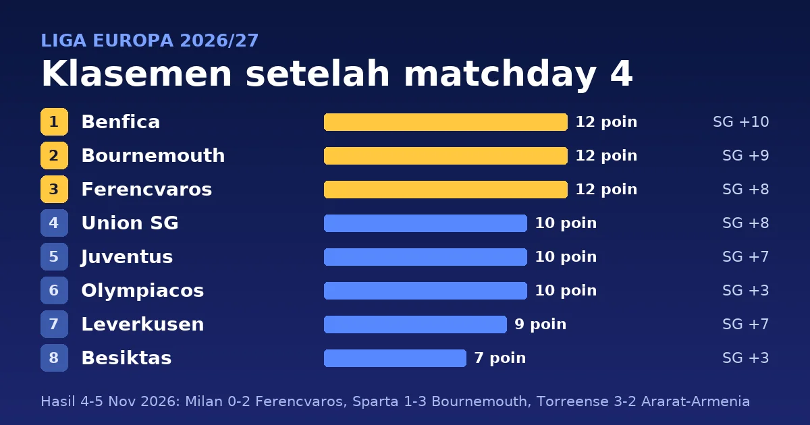

Matchday 4 fase liga Liga Europa 2026/27 dimainkan pada Rabu dan Kamis, 4-5 November 2026. Benfica, Bournemouth, dan Ferencvaros menjadi tiga tim yang menang di semua laganya, masing-masing dengan 12 poin. Ferencvaros menang 2-0 di San Siro atas AC Milan lewat dua gol Lenny Joseph, dan Milan berada di peringkat 28 dengan 3 poin. Bournemouth menang 3-1 di markas Sparta Prague, sedangkan Benfica mengalahkan Lech Poznan 3-1. Rennes dan Olympiacos bermain satu hari lebih awal, Rabu, 4 November, dan berakhir 0-0.

> **Poin Penting**
>
> - Benfica (13-3, selisih gol +10), Bournemouth (+9), dan Ferencvaros (+8) memimpin dengan 12 poin dan menjadi satu-satunya tim dengan empat kemenangan dari empat laga. Union St.-Gilloise, Juventus, dan Olympiacos menyusul dengan 10 poin.
> - Ferencvaros menang 2-0 di markas AC Milan lewat dua gol Lenny Joseph (menit 52 dan 66), dan Bamidele Isa Yusuf diusir di menit 77. Milan berada di peringkat 28 dengan 3 poin.
> - Torreense menang 3-2 atas Ararat-Armenia lewat gol Javier Vazquez (90+3') dan Musa Drammeh (90+5') setelah tertinggal 1-2. Torreense bermain dengan sepuluh orang sejak menit 25.
> - Lima tim, dari Sparta Prague (peringkat 22) sampai RB Salzburg (peringkat 26), sama-sama 4 poin di sekitar batas peringkat 24.

## Hasil lengkap matchday 4

Delapan belas laga dimainkan dalam dua hari. Skor mengikuti [Sky Sports](https://www.skysports.com/europa-league-scores-fixtures/2026-11-05) dan papan skor [ESPN](https://www.espn.com/soccer/scoreboard/_/date/20261105/league/uefa.europa), dengan tim tuan rumah di kolom kiri. Tanggal di tabel adalah tanggal di Eropa. Rennes vs Olympiacos dimajukan dari Kamis, 5 November, ke Rabu, 4 November, karena otoritas Prancis tidak dapat menjamin keamanan pada tanggal semula akibat rencana pemogokan dan demonstrasi ([UEFA](https://www.uefa.com/uefaeuropaleague/news/02aa-21ed9f2ed2e9-6a5898dc1fb4-1000--change-of-date-and-kickoff-time-for-rennes-vs-olympiacos/)).

| Tanggal | Tuan rumah | Skor | Tamu |
|---|---|:---:|---|
| Rabu, 4 Nov | Stade Rennais | 0-0 | Olympiacos |
| Kamis, 5 Nov | AC Milan | 0-2 | Ferencvaros |
| Kamis, 5 Nov | Anderlecht | 2-0 | RB Salzburg |
| Kamis, 5 Nov | Crystal Palace | 1-1 | TSG Hoffenheim |
| Kamis, 5 Nov | Levski Sofia | 1-0 | Jagiellonia Bialystok |
| Kamis, 5 Nov | Lillestrom | 0-1 | Viktoria Plzen |
| Kamis, 5 Nov | NEC Nijmegen | 3-1 | Omonia Nicosia |
| Kamis, 5 Nov | Real Sociedad | 1-1 | Lyon |
| Kamis, 5 Nov | Sparta Prague | 1-3 | AFC Bournemouth |
| Kamis, 5 Nov | AZ Alkmaar | 1-2 | Juventus |
| Kamis, 5 Nov | Bayer Leverkusen | 0-1 | Marseille |
| Kamis, 5 Nov | Benfica | 3-1 | Lech Poznan |
| Kamis, 5 Nov | Celta Vigo | 1-2 | Union St.-Gilloise |
| Kamis, 5 Nov | Celtic | 3-2 | Besiktas |
| Kamis, 5 Nov | Hapoel Be'er | 0-2 | OFI Crete |
| Kamis, 5 Nov | SK Sturm Graz | 2-3 | NK Celje |
| Kamis, 5 Nov | Sunderland | 0-2 | Dinamo Zagreb |
| Kamis, 5 Nov | Torreense | 3-2 | Ararat-Armenia |

Enam laga dimenangi tuan rumah, sembilan oleh tamu, dan tiga berakhir seri. Total 48 gol tercipta.

<!--more-->

## Detail pertandingan

Jam ditulis dalam WIB dengan waktu Eropa Tengah (CET) di dalam kurung. Eropa sudah memakai CET sejak 25 Oktober, jadi WIB lebih cepat enam jam dan laga malam di Eropa jatuh pada dini hari keesokan harinya di Indonesia. Pencetak gol, menit, dan kartu mengikuti papan skor ESPN untuk [4 November](https://www.espn.com/soccer/scoreboard/_/date/20261104/league/uefa.europa) dan [5 November](https://www.espn.com/soccer/scoreboard/_/date/20261105/league/uefa.europa). Tanda ⚽ menandai gol, 🟨 kartu kuning, dan 🟥 kartu merah.

### Laga Rabu, 4 November 2026 (tanggal Eropa)

#### Stade Rennais 0-0 Olympiacos

**Rabu, 4 November 2026, 22:30 WIB (16:30 CET)** · Roazhon Park, Rennes

| Stade Rennais | Olympiacos |
|---|---|
| 🟨 Valentin Rongier 88' | – |

Rennes belum kalah dengan satu kemenangan dan tiga seri, sedangkan Olympiacos belum kalah dengan tiga kemenangan dan satu seri.

### Laga Kamis, 5 November 2026 (tanggal Eropa)

#### AC Milan 0-2 Ferencvaros

**Jumat, 6 November 2026, 00:45 WIB (Kamis, 18:45 CET)** · San Siro, Milano

| AC Milan | Ferencvaros |
|---|---|
| 🟨 Alphadjo Cissè 32' 🟨 Koni De Winter 51' | ⚽ Lenny Joseph 52', 66' 🟨 Ádám Nagy 90+4' 🟥 Bamidele Isa Yusuf 77' |

Lenny Joseph mencetak dua gol dalam 14 menit, di menit 52 dan 66. Bamidele Isa Yusuf diusir di menit 77, tetapi Milan tidak mampu mencetak gol.

#### Anderlecht 2-0 RB Salzburg

**Jumat, 6 November 2026, 00:45 WIB (Kamis, 18:45 CET)** · Lotto Park, Brussels

| Anderlecht | RB Salzburg |
|---|---|
| ⚽ Ludwig Augustinsson 20' ⚽ Marten Winkler 90' 🟨 Mario Stroeykens 28' 🟨 Ali Maamar 78' 🟨 Léo Pétrot 83' 🟨 Marten Winkler 90+6' | 🟨 Edmund Baidoo 35' 🟨 Haris Tabakovic 45' 🟨 Valentin Zabransky 66' |

#### Crystal Palace 1-1 TSG Hoffenheim

**Jumat, 6 November 2026, 00:45 WIB (Kamis, 18:45 CET)** · Selhurst Park, London

| Crystal Palace | TSG Hoffenheim |
|---|---|
| ⚽ Daichi Kamada 90+1' 🟨 Jaydee Canvot 32' 🟨 Adam Wharton 58' 🟨 Honest Ahanor 60' 🟨 Yéremy Pino 62' 🟨 Eddie Nketiah 65' 🟥 Adam Wharton 77' (kuning kedua) | ⚽ Alexander Prass 7' 🟨 Ozan Kabak 6' 🟨 Wouter Burger 25' 🟨 Andrej Kramaric 68' |

Alexander Prass membuka skor untuk Hoffenheim di menit 7, dan Daichi Kamada menyamakan di menit 90+1. Adam Wharton diusir lewat kartu kuning kedua di menit 77.

#### Levski Sofia 1-0 Jagiellonia Bialystok

**Jumat, 6 November 2026, 00:45 WIB (Kamis, 18:45 CET)** · Vasil Levski National Stadium, Sofia

| Levski Sofia | Jagiellonia Bialystok |
|---|---|
| ⚽ Stivan Stoyanchov 83' 🟨 Everton Bala 72' 🟨 Stivan Stoyanchov 84' 🟨 David Kusso 90+2' | 🟨 Guilherme Montoia 54' 🟨 Taras Romanczuk 78' 🟨 Jesus Imaz 86' |

#### Lillestrom 0-1 Viktoria Plzen

**Jumat, 6 November 2026, 00:45 WIB (Kamis, 18:45 CET)** · Arasen Stadion, Lillestrøm

| Lillestrom | Viktoria Plzen |
|---|---|
| 🟨 Lars Ranger 24' 🟨 Gustav Nyheim 85' | ⚽ Prince Adu 10' 🟨 Sampson Dweh 32' 🟨 Patrik Hrosovský 65' 🟨 Filip Prebsl 76' 🟨 Florian Wiegele 90' |

#### NEC Nijmegen 3-1 Omonia Nicosia

**Jumat, 6 November 2026, 00:45 WIB (Kamis, 18:45 CET)** · Goffertstadion, Nijmegen

| NEC Nijmegen | Omonia Nicosia |
|---|---|
| ⚽ Bryan Linssen 50', 76' ⚽ Clement Bischoff 74' 🟨 Clement Bischoff 32' | ⚽ Loïs Diony 23' |

Bryan Linssen mencetak dua gol (50', 76') dan mencapai 4 gol di Liga Europa musim ini.

#### Real Sociedad 1-1 Lyon

**Jumat, 6 November 2026, 00:45 WIB (Kamis, 18:45 CET)** · Reale Arena, San Sebastian

| Real Sociedad | Lyon |
|---|---|
| ⚽ Orri Óskarsson 28' 🟨 Gonçalo Guedes 61' 🟨 Ander Barrenetxea 77' 🟨 Yangel Herrera 89' | ⚽ Corentin Tolisso 54' 🟨 Kail Boudache 38' 🟨 Julien Duranville 82' 🟨 Dominik Greif 87' 🟨 Abner 90+1' |

#### Sparta Prague 1-3 AFC Bournemouth

**Jumat, 6 November 2026, 00:45 WIB (Kamis, 18:45 CET)** · Generali Arena, Prague

| Sparta Prague | AFC Bournemouth |
|---|---|
| ⚽ Ebrima Singhateh 35' 🟨 Tobias Guddal 6' 🟨 Ki-Jana Hoever 30' 🟨 Matej Jurásek 84' 🟥 Tobias Guddal 37' (kuning kedua) | ⚽ Tyler Adams 57' ⚽ Evanilson 81' ⚽ Rayan 90' 🟨 Ryan Christie 20' 🟨 Amine Adli 55' |

Tobias Guddal diusir lewat kartu kuning kedua di menit 37, dua menit setelah Ebrima Singhateh membawa Sparta unggul 1-0. Bournemouth membalik lewat Tyler Adams (57'), Evanilson (81'), dan Rayan (90').

#### AZ Alkmaar 1-2 Juventus

**Jumat, 6 November 2026, 03:00 WIB (Kamis, 21:00 CET)** · AFAS Stadion, Alkmaar

| AZ Alkmaar | Juventus |
|---|---|
| ⚽ Mexx Meerdink 88' 🟨 Wesley Hoedt 28' | ⚽ Teun Koopmeiners 19' ⚽ Randal Kolo Muani 37' 🟨 Andrea Cambiaso 48' 🟨 Jeff Ekhator 85' 🟨 Juan Cabal 90+4' |

Teun Koopmeiners (19') dan Randal Kolo Muani (37') membawa Juventus unggul 2-0 sebelum turun minum. Mexx Meerdink memperkecil skor di menit 88.

#### Bayer Leverkusen 0-1 Marseille

**Jumat, 6 November 2026, 03:00 WIB (Kamis, 21:00 CET)** · BayArena, Leverkusen

| Bayer Leverkusen | Marseille |
|---|---|
| 🟨 Miguel Gutiérrez 6' | ⚽ Amine Gouiri 77' 🟨 Igor Paixão 38' 🟨 Ulisses Garcia 54' 🟨 Tochukwu Nnadi 90' |

Amine Gouiri mencetak satu-satunya gol di menit 77.

#### Benfica 3-1 Lech Poznan

**Jumat, 6 November 2026, 03:00 WIB (Kamis, 21:00 CET)** · Estádio da Luz, Lisbon

| Benfica | Lech Poznan |
|---|---|
| ⚽ Rafa Silva 6' ⚽ Gianluca Prestianni 67' ⚽ Georgiy Sudakov 90' 🟨 Daniel Banjaqui 42' 🟨 Manu Silva 60' | ⚽ Leo Bengtsson 72' 🟨 Yannick Agnero 27' |

#### Celta Vigo 1-2 Union St.-Gilloise

**Jumat, 6 November 2026, 03:00 WIB (Kamis, 21:00 CET)** · Balaidos, Vigo

| Celta Vigo | Union St.-Gilloise |
|---|---|
| ⚽ Pablo Durán 11' 🟨 Pablo Durán 90+5' | ⚽ Besfort Zeneli 35', 49' 🟨 Guilherme Smith 71' |

Pablo Durán membuka skor untuk Celta di menit 11, lalu Besfort Zeneli mencetak dua gol (35', 49') untuk Union St.-Gilloise.

#### Celtic 3-2 Besiktas

**Jumat, 6 November 2026, 03:00 WIB (Kamis, 21:00 CET)** · Celtic Park, Glasgow

| Celtic | Besiktas |
|---|---|
| ⚽ Callum Osmand 62' ⚽ Camilo Durán 78', 87' 🟨 Benjamin Nygren 60' | ⚽ Junior Olaitan 54' ⚽ Orkun Kökçü 85' 🟨 Amir Murillo 90+4' 🟨 Emir Han Topcu 90+5' |

Besiktas unggul lewat Junior Olaitan (54'), tetapi Celtic membalik lewat Callum Osmand (62') dan Camilo Durán (78'). Orkun Kökçü menyamakan skor 2-2 di menit 85, dan Durán mencetak gol kemenangan dua menit kemudian.

#### Hapoel Be'er 0-2 OFI Crete

**Jumat, 6 November 2026, 03:00 WIB (Kamis, 21:00 CET)** · Giulesti Stadium, Bucuresti

| Hapoel Be'er | OFI Crete |
|---|---|
| 🟨 Forson Amankwah 69' 🟨 Mohammad Knaan 83' 🟨 Djibril Diop 90+3' | ⚽ Achilleas Poungouras 45+2' ⚽ Taxiarchis Fountas 56' 🟨 Nicolaos Athanasiou 23' |

#### SK Sturm Graz 2-3 NK Celje

**Jumat, 6 November 2026, 03:00 WIB (Kamis, 21:00 CET)** · Merkur Arena, Graz

| SK Sturm Graz | NK Celje |
|---|---|
| ⚽ Oumar Diakité 40', 90+3' 🟨 Oumar Diakité 69' | ⚽ Svit Seslar 29', 73' ⚽ Benjamin Verbic 45' 🟨 Artemijus Tutyskinas 17' 🟨 Milot Avdyli 90+2' |

Oumar Diakité mencetak dua gol untuk Sturm Graz (40', 90+3'), tetapi Celje menang lewat dua gol Svit Seslar (29', 73') dan satu gol Benjamin Verbic (45').

#### Sunderland 0-2 Dinamo Zagreb

**Jumat, 6 November 2026, 03:00 WIB (Kamis, 21:00 CET)** · Stadium of Light, Sunderland

| Sunderland | Dinamo Zagreb |
|---|---|
| 🟨 Granit Xhaka 28' 🟨 Kevin Danso 36' 🟨 Trai Hume 55' | ⚽ Luka Stojkovic 22' ⚽ Dion Drena Beljo 39' 🟨 Niko Galesic 25' 🟨 Lukas Kacavenda 46' |

Dion Drena Beljo mencetak gol kedua Dinamo Zagreb di menit 39 dan mencapai 4 gol di Liga Europa musim ini.

#### Torreense 3-2 Ararat-Armenia

**Jumat, 6 November 2026, 03:00 WIB (Kamis, 21:00 CET)** · Estádio Dr. Magalhaes Pessoa, Leiria

| Torreense | Ararat-Armenia |
|---|---|
| ⚽ Jorge Aguirre 13' ⚽ Javier Vazquez 90+3' ⚽ Musa Drammeh 90+5' 🟨 Volnei Feltes 45+2' 🟨 Musa Drammeh 88' 🟨 Gustavo Sousa Alhinho Alves Rijo 88' 🟥 Jorge Aguirre 25' | ⚽ Karen Muradyan 41' ⚽ Bruno Wilson 58' 🟨 Bruno Wilson 43' 🟨 Karen Muradyan 45+2' 🟨 Bernardo Oliveira 48' 🟨 Arman Nersesyan 79' 🟨 Carlos França 84' 🟥 João Bravim 76' |

Jorge Aguirre mencetak gol pembuka di menit 13 tetapi diusir di menit 25. Ararat-Armenia menyamakan lewat Karen Muradyan (41') dan unggul 2-1 lewat Bruno Wilson (58'), lalu kehilangan João Bravim lewat kartu merah di menit 76. Javier Vazquez (90+3') dan Musa Drammeh (90+5') membalik skor di masa tambahan waktu.

## Klasemen setelah matchday 4

Klasemen di bawah dihitung dari hasil matchday 1 sampai 4 ([Sky Sports](https://www.skysports.com/europa-league-table)). Setiap tim memainkan delapan laga di fase liga: peringkat 1-8 langsung ke babak 16 besar, peringkat 9-24 ke babak play-off, dan peringkat 25-36 tersingkir ([regulasi UEFA](https://documents.uefa.com/r/Regulations-of-the-UEFA-Europa-League-2026/27/Article-17-Match-system-league-phase-Online)). Tim dengan poin sama diurutkan menurut selisih gol, jumlah gol, lalu gol tandang, kemenangan, dan kemenangan tandang. Dua pasang tim sama-sama punya poin, selisih gol, dan jumlah gol yang sama dan dipisahkan gol tandang dari hasil matchday 1-4: Sparta Prague di atas TSG Hoffenheim (4 gol tandang berbanding 1) dan AC Milan di atas Jagiellonia Bialystok (4 berbanding 1) ([UEFA](https://www.uefa.com/uefaeuropaleague/news/02a9-219e607cbaee-b25232b1c986-1000--europa-league-league-phase-standings-how-teams-level-on-/)).

| # | Tim | M | Me | S | K | Gol | SG | Poin |
|---:|---|:---:|:---:|:---:|:---:|:---:|:---:|:---:|
| 1 | Benfica | 4 | 4 | 0 | 0 | 13-3 | +10 | **12** |
| 2 | AFC Bournemouth | 4 | 4 | 0 | 0 | 11-2 | +9 | **12** |
| 3 | Ferencvaros | 4 | 4 | 0 | 0 | 11-3 | +8 | **12** |
| 4 | Union St.-Gilloise | 4 | 3 | 1 | 0 | 10-2 | +8 | **10** |
| 5 | Juventus | 4 | 3 | 1 | 0 | 11-4 | +7 | **10** |
| 6 | Olympiacos | 4 | 3 | 1 | 0 | 4-1 | +3 | **10** |
| 7 | Bayer Leverkusen | 4 | 3 | 0 | 1 | 8-1 | +7 | **9** |
| 8 | Besiktas | 4 | 2 | 1 | 1 | 11-8 | +3 | **7** |
| 9 | Dinamo Zagreb | 4 | 2 | 1 | 1 | 5-4 | +1 | 7 |
| 10 | Levski Sofia | 4 | 2 | 1 | 1 | 4-3 | +1 | 7 |
| 11 | Sunderland | 4 | 2 | 1 | 1 | 4-4 | 0 | 7 |
| 12 | NEC Nijmegen | 4 | 2 | 1 | 1 | 8-9 | -1 | 7 |
| 13 | Lyon | 4 | 2 | 1 | 1 | 6-7 | -1 | 7 |
| 14 | AZ Alkmaar | 4 | 2 | 0 | 2 | 7-4 | +3 | 6 |
| 15 | Anderlecht | 4 | 2 | 0 | 2 | 6-3 | +3 | 6 |
| 16 | OFI Crete | 4 | 2 | 0 | 2 | 5-4 | +1 | 6 |
| 17 | Stade Rennais | 4 | 1 | 3 | 0 | 4-3 | +1 | 6 |
| 18 | Omonia Nicosia | 4 | 2 | 0 | 2 | 6-7 | -1 | 6 |
| 19 | Torreense | 4 | 2 | 0 | 2 | 7-9 | -2 | 6 |
| 20 | Real Sociedad | 4 | 1 | 2 | 1 | 9-4 | +5 | 5 |
| 21 | Crystal Palace | 4 | 1 | 2 | 1 | 9-6 | +3 | 5 |
| 22 | Sparta Prague | 4 | 1 | 1 | 2 | 6-6 | 0 | 4 |
| 23 | TSG Hoffenheim | 4 | 1 | 1 | 2 | 6-6 | 0 | 4 |
| 24 | SK Sturm Graz | 4 | 1 | 1 | 2 | 3-6 | -3 | 4 |
| 25 | NK Celje | 4 | 1 | 1 | 2 | 5-9 | -4 | 4 |
| 26 | RB Salzburg | 4 | 1 | 1 | 2 | 3-8 | -5 | 4 |
| 27 | Celta Vigo | 4 | 1 | 0 | 3 | 4-6 | -2 | 3 |
| 28 | AC Milan | 4 | 1 | 0 | 3 | 4-7 | -3 | 3 |
| 29 | Jagiellonia Bialystok | 4 | 1 | 0 | 3 | 4-7 | -3 | 3 |
| 30 | Viktoria Plzen | 4 | 1 | 0 | 3 | 3-7 | -4 | 3 |
| 31 | Marseille | 4 | 1 | 0 | 3 | 2-6 | -4 | 3 |
| 32 | Celtic | 4 | 1 | 0 | 3 | 6-11 | -5 | 3 |
| 33 | Hapoel Be'er | 4 | 0 | 1 | 3 | 1-8 | -7 | 1 |
| 34 | Lillestrom | 4 | 0 | 1 | 3 | 2-10 | -8 | 1 |
| 35 | Lech Poznan | 4 | 0 | 1 | 3 | 2-12 | -10 | 1 |
| 36 | Ararat-Armenia | 4 | 0 | 0 | 4 | 4-14 | -10 | 0 |

Keterangan: M = main, Me = menang, S = seri, K = kalah, SG = selisih gol. Poin tebal menandai delapan tim teratas, yang langsung ke babak 16 besar.

## Apa artinya klasemen ini

Benfica, Bournemouth, dan Ferencvaros adalah satu-satunya tim dengan empat kemenangan dari empat laga. Mereka dipisahkan selisih gol: Benfica +10 (13-3), Bournemouth +9 (11-2), dan Ferencvaros +8 (11-3). Union St.-Gilloise (+8), Juventus (+7), dan Olympiacos (+3) menyusul dengan 10 poin, lalu Bayer Leverkusen (9 poin, +7) di peringkat 7. Olympiacos dan Leverkusen sama-sama hanya kebobolan satu gol, paling sedikit di liga ini.

Peringkat 8 sampai 13 rapat. Besiktas, Dinamo Zagreb, Levski Sofia, Sunderland, NEC Nijmegen, dan Lyon sama-sama 7 poin. Besiktas berada di peringkat 8, posisi terakhir yang langsung ke 16 besar, karena selisih gol +3 (11-8), dibanding +1 atau lebih rendah untuk lima tim lain di kelompok itu. Satu poin di bawahnya, enam tim memiliki 6 poin pada peringkat 14-19: AZ Alkmaar, Anderlecht, OFI Crete, Stade Rennais, Omonia Nicosia, dan Torreense.

Lima tim bertumpuk di 4 poin di sekitar batas peringkat 24, dari Sparta Prague (peringkat 22) sampai RB Salzburg (peringkat 26). Sturm Graz di peringkat 24 unggul atas NK Celje di peringkat 25 karena selisih gol (-3 berbanding -4). Sparta Prague dan TSG Hoffenheim sama-sama 4 poin, selisih gol 0, dan 6 gol, sehingga gol tandang yang memisahkan mereka. Real Sociedad (5 poin, +5) dan Crystal Palace (5 poin, +3) berada di peringkat 20 dan 21, satu poin di atas kelima tim itu.

Di zona tersingkir, enam tim memiliki 3 poin pada peringkat 27-32: Celta Vigo, AC Milan, Jagiellonia Bialystok, Viktoria Plzen, Marseille, dan Celtic. Hapoel Be'er Sheva, Lillestrom, dan Lech Poznan masing-masing punya 1 poin, dan Ararat-Armenia satu-satunya tim tanpa poin. Fase liga masih menyisakan empat matchday sampai 28 Januari 2027 ([UEFA](https://www.uefa.com/uefaeuropaleague/news/02a8-2174cafa5bb6-82bbc20c9b92-1000--2026-27-europa-league-all-the-league-phase-fixtures-and-re/)).

## Top skor sampai matchday 4

Bryan Linssen dari NEC Nijmegen dan Dion Drena Beljo dari Dinamo Zagreb memimpin daftar pencetak gol dengan masing-masing 4 gol. Sepuluh pemain lain tercantum dengan 3 gol ([ESPN](https://www.espn.com/soccer/stats/_/league/uefa.europa)).

| # | Pemain | Klub | Gol | Gol di MD4 |
|---:|---|---|:---:|:---:|
| 1 | Bryan Linssen | NEC Nijmegen | 4 | 2 |
| 1 | Dion Drena Beljo | Dinamo Zagreb | 4 | 1 |
| 3 | Alphadjo Cissè | AC Milan | 3 | – |
| 3 | Camilo Durán | Celtic | 3 | 2 |
| 3 | Kristoffer Zachariassen | Ferencvaros | 3 | – |
| 3 | Mexx Meerdink | AZ Alkmaar | 3 | 1 |
| 3 | Nick Woltemade | Juventus | 3 | – |
| 3 | Oumar Diakité | SK Sturm Graz | 3 | 2 |
| 3 | Randal Kolo Muani | Juventus | 3 | 1 |
| 3 | Rayan | AFC Bournemouth | 3 | 1 |
| 3 | Sergio Gómez | Real Sociedad | 3 | – |
| 3 | Yéremy Pino | Crystal Palace | 3 | – |

Pemain dengan jumlah gol sama diberi peringkat yang sama. Linssen, Camilo Durán, dan Oumar Diakité masing-masing mencetak dua gol di matchday 4. Beljo, Mexx Meerdink, Randal Kolo Muani, dan Rayan mencetak satu gol, sedangkan pemain lain di tabel tidak mencetak gol di matchday ini.

## Assist terbanyak sampai matchday 4

Javier Vazquez dari Torreense, Kristoffer Zachariassen dari Ferencvaros, Mikel Oyarzabal dari Real Sociedad, dan Junior Olaitan dari Besiktas memimpin dengan 3 assist. Delapan pemain lain tercantum dengan 2 assist di daftar 12 teratas ([ESPN](https://www.espn.com/soccer/stats/_/league/uefa.europa)).

| # | Pemain | Klub | Main | Assist |
|---:|---|---|:---:|:---:|
| 1 | Javier Vazquez | Torreense | 4 | **3** |
| 1 | Kristoffer Zachariassen | Ferencvaros | 4 | **3** |
| 1 | Mikel Oyarzabal | Real Sociedad | 4 | **3** |
| 1 | Junior Olaitan | Besiktas | 4 | **3** |
| 5 | Nicolaos Athanasiou | OFI Crete | 4 | 2 |
| 5 | Adam Wharton | Crystal Palace | 4 | 2 |
| 5 | Nick Woltemade | Juventus | 4 | 2 |
| 5 | Keito Nakamura | Lyon | 4 | 2 |
| 5 | Andrej Kramaric | TSG Hoffenheim | 4 | 2 |
| 5 | Tim Lemperle | TSG Hoffenheim | 4 | 2 |
| 5 | Bamidele Isa Yusuf | Ferencvaros | 4 | 2 |
| 5 | Randal Kolo Muani | Juventus | 4 | 2 |

Zachariassen juga mencetak 3 gol, sehingga ia terlibat langsung dalam enam dari 11 gol Ferencvaros. Vazquez mencetak gol penyama kedudukan 2-2 Torreense di menit 90+3 saat menang 3-2 atas Ararat-Armenia. Penghitungan assist bisa berbeda antar penyedia data karena definisinya tidak seragam. Tabel di atas mengikuti ESPN.

## Jadwal matchday 5

Matchday 5 dimainkan Kamis, 26 November 2026, atau Jumat dini hari, 27 November, di Indonesia. Delapan laga mulai pukul 18:45 CET (00:45 WIB) dan sepuluh laga lain pukul 21:00 CET (03:00 WIB) ([Sky Sports](https://www.skysports.com/europa-league-scores-fixtures/2026-11-05), [ESPN](https://www.espn.com/soccer/scoreboard/_/date/20261126/league/uefa.europa)). Beberapa laga yang menarik dilihat dari klasemen:

- Viktoria Plzen vs Benfica (Jumat, 27 Nov, 00:45 WIB)
- Celta Vigo vs AFC Bournemouth (Jumat, 27 Nov, 00:45 WIB)
- Olympiacos vs AC Milan (Jumat, 27 Nov, 00:45 WIB)
- Crystal Palace vs Real Sociedad (Jumat, 27 Nov, 03:00 WIB)
- Ferencvaros vs NK Celje (Jumat, 27 Nov, 03:00 WIB)
- TSG Hoffenheim vs SK Sturm Graz (Jumat, 27 Nov, 03:00 WIB)

Plzen vs Benfica mempertemukan tim peringkat 30 (3 poin) dengan pemimpin klasemen. Celta Vigo, peringkat 27, menjamu Bournemouth yang berada di peringkat 2. Olympiacos (peringkat 6, 10 poin) menjamu Milan (peringkat 28, 3 poin). Crystal Palace dan Real Sociedad sama-sama 5 poin dan hanya dipisahkan selisih gol (+3 berbanding +5). Ferencvaros, peringkat 3, menjamu Celje di peringkat 25. Hoffenheim (peringkat 23) dan Sturm Graz (peringkat 24) sama-sama 4 poin dan berebut posisi di sekitar batas play-off.

Rekap kompetisi lain di blog ini: [Liga Champions matchday 4](/2026/11/07/klasemen-liga-champions-matchday-4-2026), [Liga Konferensi matchday 3](/2026/11/07/klasemen-liga-konferensi-matchday-3-2026-27), dan [Serie A giornata 10](/2026/11/07/klasemen-serie-a-giornata-10-2026-27).

## Sumber

- Sky Sports, hasil Liga Europa [4 November](https://www.skysports.com/europa-league-scores-fixtures/2026-11-04) dan [5 November 2026](https://www.skysports.com/europa-league-scores-fixtures/2026-11-05), skor matchday 4 dan jadwal matchday 5 (halaman 5 November).
- ESPN, papan skor Liga Europa [4 November](https://www.espn.com/soccer/scoreboard/_/date/20261104/league/uefa.europa), [5 November](https://www.espn.com/soccer/scoreboard/_/date/20261105/league/uefa.europa), dan [26 November 2026](https://www.espn.com/soccer/scoreboard/_/date/20261126/league/uefa.europa), pencetak gol, menit, kartu, stadion, dan jam kick-off.
- Sky Sports, [Europa League table](https://www.skysports.com/europa-league-table) dan ESPN, [Europa League standings](https://www.espn.com/soccer/standings/_/league/uefa.europa), klasemen.
- ESPN, [Europa League Stats, 2026-27 Season](https://www.espn.com/soccer/stats/_/league/uefa.europa), top skor dan assist.
- UEFA, [perubahan tanggal dan jam Rennes vs Olympiacos](https://www.uefa.com/uefaeuropaleague/news/02aa-21ed9f2ed2e9-6a5898dc1fb4-1000--change-of-date-and-kickoff-time-for-rennes-vs-olympiacos/).
- UEFA, [regulasi Liga Europa 2026/27, pasal 17](https://documents.uefa.com/r/Regulations-of-the-UEFA-Europa-League-2026/27/Article-17-Match-system-league-phase-Online) dan [cara memisahkan tim dengan poin sama](https://www.uefa.com/uefaeuropaleague/news/02a9-219e607cbaee-b25232b1c986-1000--europa-league-league-phase-standings-how-teams-level-on-/), format dan aturan tiebreak.
- UEFA, [jadwal fase liga Liga Europa 2026/27](https://www.uefa.com/uefaeuropaleague/news/02a8-2174cafa5bb6-82bbc20c9b92-1000--2026-27-europa-league-all-the-league-phase-fixtures-and-re/), tanggal matchday.

---

*Klasemen setelah matchday 4, ditulis 7 November 2026. Penulis: Mahyuddin Susanto ([tentang penulis](https://www.udienz.web.id/about/), [kontak](https://www.udienz.web.id/contact.html)). Tulisan ini dibantu oleh AI.*
