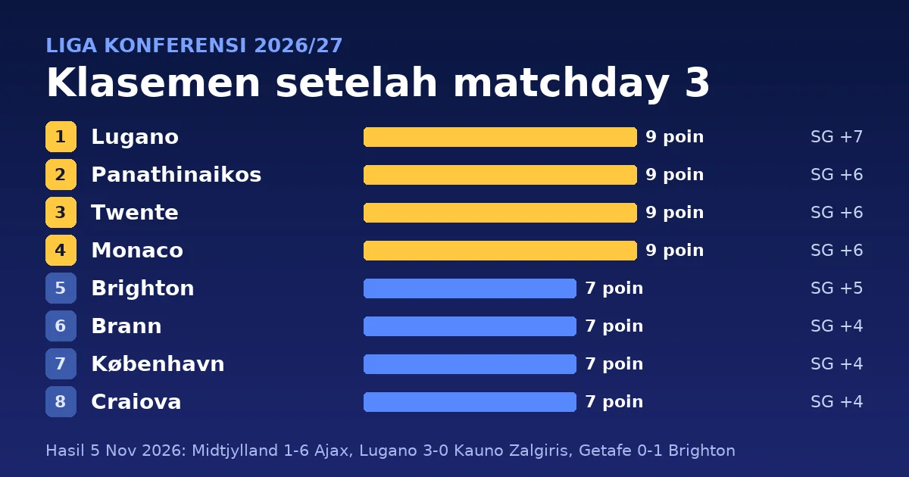

Matchday 3 fase liga Liga Konferensi (UEFA Conference League) 2026/27 dimainkan pada Kamis, 5 November 2026. Empat tim menang di ketiga laganya: Lugano memimpin dengan 9 poin dan selisih gol +7, disusul Panathinaikos, Twente, dan Monaco. Ajax menang 6-1 di markas Midtjylland, yang bermain dengan sepuluh orang sejak menit 43. Brighton menang 1-0 di Getafe dan menjadi satu-satunya tim yang belum kebobolan di fase liga ini.

> **Poin Penting**
>
> - Lugano (9 poin, selisih gol +7), Panathinaikos (+6), Twente (+6), dan Monaco (+6) menang di ketiga laganya. Panathinaikos, Twente, dan Monaco dipisahkan jumlah gol: 9, 8, dan 7.
> - Ajax menang 6-1 di markas FC Midtjylland, yang kehilangan Kjell-Arik Wätjen lewat kartu kuning kedua di menit 43. Ajax berada di peringkat 11 dengan 6 poin; selisih golnya (+6) sama dengan Panathinaikos, Twente, dan Monaco.
> - Brighton menang 1-0 di Getafe dan menjadi satu-satunya tim tanpa kebobolan (5-0 dalam tiga laga). Brighton, Brann, København, Craiova, Mjällby, dan Sint-Truidense sama-sama 7 poin di peringkat 5-10, dan Craiova di peringkat 8 menjadi tim terakhir di zona delapan besar.
> - Empat gol bunuh diri tercipta di matchday ini, tiga di antaranya mengubah hasil akhir: Dennis Hadzikadunic memberi Lincoln Red Imps kemenangan 1-0 atas Hajduk Split di menit 89, Javier Díaz memberi Red Star kemenangan 2-1 atas Inter D'Escaldes di menit 90+2, dan Vahid Selimovic membuat København unggul 2-0 di menit 22 pada laga yang berakhir 2-1 atas Iberia 1999.

## Hasil lengkap matchday 3

Delapan belas laga dimainkan dalam satu malam. Skor mengikuti [Sky Sports](https://www.skysports.com/football-scores-fixtures/2026-11-05) dan papan skor [ESPN](https://www.espn.com/soccer/scoreboard/_/date/20261105/league/uefa.europa.conf), dengan tim tuan rumah di kolom kiri. Tanggal di tabel adalah tanggal di Eropa.

| Tanggal | Tuan rumah | Skor | Tamu |
|---|---|:---:|---|
| Kamis, 5 Nov | AGF | 0-0 | Braga |
| Kamis, 5 Nov | Atalanta | 1-1 | Kairat Almaty |
| Kamis, 5 Nov | FC Midtjylland | 1-6 | Ajax Amsterdam |
| Kamis, 5 Nov | FC Thun | 3-1 | Heart of Midlothian |
| Kamis, 5 Nov | KuPS Kuopio | 0-0 | KAA Gent |
| Kamis, 5 Nov | Lincoln Red Imps | 1-0 | Hajduk Split |
| Kamis, 5 Nov | Mjällby AIF | 2-0 | Borac Banja Luka |
| Kamis, 5 Nov | Red Star Belgrade | 2-1 | Inter D'Escaldes |
| Kamis, 5 Nov | Trabzonspor | 0-1 | SC Freiburg |
| Kamis, 5 Nov | AS Monaco | 2-0 | FC Nordsjælland |
| Kamis, 5 Nov | CSU Craiova | 2-0 | Egnatia |
| Kamis, 5 Nov | F.C. København | 2-1 | Iberia 1999 |
| Kamis, 5 Nov | FC Lugano | 3-0 | Kauno Zalgiris |
| Kamis, 5 Nov | FC Twente | 3-1 | Pafos |
| Kamis, 5 Nov | Getafe | 0-1 | Brighton & Hove Albion |
| Kamis, 5 Nov | Panathinaikos | 2-1 | CSKA Sofia |
| Kamis, 5 Nov | Riga FC | 1-1 | Jablonec |
| Kamis, 5 Nov | Sint-Truidense | 1-1 | SK Brann |

Sepuluh laga dimenangi tuan rumah, tiga oleh tamu, dan lima berakhir seri. Total 42 gol tercipta.

<!--more-->

## Detail pertandingan

Jam ditulis dalam WIB dengan waktu Eropa Tengah (CET) di dalam kurung. Eropa sudah memakai CET sejak 25 Oktober, jadi WIB lebih cepat enam jam dan semua laga Kamis malam di Eropa jatuh pada dini hari Jumat di Indonesia. Pencetak gol, menit, dan kartu mengikuti [papan skor ESPN untuk 5 November](https://www.espn.com/soccer/scoreboard/_/date/20261105/league/uefa.europa.conf). Tanda ⚽ menandai gol, 🟨 kartu kuning, dan 🟥 kartu merah.

### Laga Kamis, 5 November 2026 (tanggal Eropa)

#### AGF 0-0 Braga

**Jumat, 6 November 2026, 00:45 WIB (Kamis, 18:45 CET)** · Cepheus Park Randers, Randers

| AGF | Braga |
|---|---|
| 🟨 Magnus Knudsen 67' 🟨 Colin Rösler 86' | 🟨 Adrian Leon Barisic 28' 🟨 Diogo Travassos 73' |

#### Atalanta 1-1 Kairat Almaty

**Jumat, 6 November 2026, 00:45 WIB (Kamis, 18:45 CET)** · New Balance Arena, Bergamo

| Atalanta | Kairat Almaty |
|---|---|
| ⚽ Nikola Krstovic 82' 🟨 Kamaldeen Sulemana 27' 🟨 Relja Obric 39' 🟨 Gianluca Scamacca 57' | ⚽ Marc Gual 53' 🟨 Gustavo Mendonça 20' 🟨 Aleksandr Mrynskiy 86' 🟨 Ismail Bekbolat 88' 🟨 Oiva Jukkola 88' |

#### FC Midtjylland 1-6 Ajax Amsterdam

**Jumat, 6 November 2026, 00:45 WIB (Kamis, 18:45 CET)** · MCH Arena, Herning

| FC Midtjylland | Ajax Amsterdam |
|---|---|
| ⚽ Friday Etim 28' 🟨 Kjell-Arik Wätjen 35' 🟨 Denil Castillo 45+1' 🟥 Kjell-Arik Wätjen 43' (kuning kedua) | ⚽ Tolu Arokodare 9', 52' ⚽ Owen Wijndal 59' ⚽ Davy Klaassen 67' ⚽ Oscar Gloukh 74' ⚽ Marcos Leonardo 82' |

Tolu Arokodare membuka skor di menit 9 dan Friday Etim menyamakan di menit 28. Wätjen diusir di menit 43, dan Ajax mencetak lima gol setelahnya: Arokodare (52'), Owen Wijndal (59'), Davy Klaassen (67'), Oscar Gloukh (74'), dan Marcos Leonardo (82').

#### FC Thun 3-1 Heart of Midlothian

**Jumat, 6 November 2026, 00:45 WIB (Kamis, 18:45 CET)** · Stockhorn Arena, Thun

| FC Thun | Heart of Midlothian |
|---|---|
| ⚽ Jamie McCart 22' (bunuh diri) ⚽ Brighton Labeau 34' ⚽ Furkan Dursun 56' 🟨 Nico Maier 37' 🟨 Furkan Dursun 45+2' 🟨 Nils Reichmuth 59' 🟨 Jan Bamert 81' | ⚽ Stuart Findlay 82' 🟨 Jamie McCart 77' |

Gol bunuh diri Jamie McCart di menit 22 membuka skor untuk Thun.

#### KuPS Kuopio 0-0 KAA Gent

**Jumat, 6 November 2026, 00:45 WIB (Kamis, 18:45 CET)** · Tammelan Stadion, Tampere

| KuPS Kuopio | KAA Gent |
|---|---|
| 🟨 Taneli Hämäläinen 52' | 🟨 Momodou Sonko 54' 🟨 Tibe De Vlieger 90+3' |

#### Lincoln Red Imps 1-0 Hajduk Split

**Jumat, 6 November 2026, 00:45 WIB (Kamis, 18:45 CET)** · Europa Point Stadium, Gibraltar

| Lincoln Red Imps | Hajduk Split |
|---|---|
| ⚽ Dennis Hadzikadunic 89' (bunuh diri) 🟨 Christian Rutjens 29' 🟨 Enrique Gómez 49' 🟨 Graeme Torrilla 79' | 🟨 Marin Soticek 58' 🟨 Abdoulie Sanyang 63' 🟨 Mathieu Acapandié 90+5' 🟨 Dario Maresic 90+5' |

Gol tunggal laga ini adalah gol bunuh diri Dennis Hadzikadunic di menit 89.

#### Mjällby AIF 2-0 Borac Banja Luka

**Jumat, 6 November 2026, 00:45 WIB (Kamis, 18:45 CET)** · Olympia, Helsingborg

| Mjällby AIF | Borac Banja Luka |
|---|---|
| ⚽ Jacob Bergstrom 54' ⚽ Mads Enggård 88' | 🟨 Ante Roguljic 15' 🟨 Amer Hiros 64' |

#### Red Star Belgrade 2-1 Inter D'Escaldes

**Jumat, 6 November 2026, 00:45 WIB (Kamis, 18:45 CET)** · Rajko Mitic Stadium, Belgrade

| Red Star Belgrade | Inter D'Escaldes |
|---|---|
| ⚽ Vladimir Lucic 80' ⚽ Javier Díaz 90+2' (bunuh diri) 🟨 Milos Veljkovic 72' 🟨 Matej Gashtarov 90' 🟥 Aleksandar Katai 35' | ⚽ Borja Arellano Monedero 62' 🟨 Domi Berlanga 43' 🟨 Álex Sánchez 45+3' 🟨 Jilmar Torres 89' 🟨 Juan Cámara 90+1' 🟥 Domi Berlanga 51' (kuning kedua) |

Kedua tim bermain dengan sepuluh orang: Aleksandar Katai diusir di menit 35 dan Domi Berlanga di menit 51. Inter D'Escaldes unggul lewat Borja Arellano (62'), Vladimir Lucic menyamakan di menit 80, dan gol bunuh diri Javier Díaz di menit 90+2 memberi Red Star kemenangan.

#### Trabzonspor 0-1 SC Freiburg

**Jumat, 6 November 2026, 00:45 WIB (Kamis, 18:45 CET)** · Papara Park, Trabzon

| Trabzonspor | SC Freiburg |
|---|---|
| 🟨 Noah Saviolo 27' 🟨 Chibuike Nwaiwu 53' | ⚽ Lukas Kübler 14' 🟨 Maximilian Eggestein 68' 🟨 Yannick Engelhardt 81' 🟨 Jordy Makengo 84' |

#### AS Monaco 2-0 FC Nordsjælland

**Jumat, 6 November 2026, 03:00 WIB (Kamis, 21:00 CET)** · Stade Louis II, Monaco

| AS Monaco | FC Nordsjælland |
|---|---|
| ⚽ Mathys Detourbet 33' ⚽ Matthis Abline 90+1' 🟨 Ilane Touré 17' | 🟨 Noah Markmann 30' 🟨 Victor Nelsson 66' |

#### CSU Craiova 2-0 Egnatia

**Jumat, 6 November 2026, 03:00 WIB (Kamis, 21:00 CET)** · Stadionul Ion Oblemenco, Craiova

| CSU Craiova | Egnatia |
|---|---|
| ⚽ Alexandru Cicaldau 24' ⚽ Nicusor Bancu 32' 🟨 Nikola Stevanovic 34' 🟨 Alexandru Cicaldau 74' 🟨 Simon Elisor 79' 🟨 David Matei 90' | 🟨 Enea Bitri 79' 🟥 Enea Bitri 83' (kuning kedua) |

Egnatia kehilangan Enea Bitri lewat kartu kuning kedua di menit 83.

#### F.C. København 2-1 Iberia 1999

**Jumat, 6 November 2026, 03:00 WIB (Kamis, 21:00 CET)** · Parken Stadium, Copenhagen

| F.C. København | Iberia 1999 |
|---|---|
| ⚽ Mohamed Elyounoussi 19' (pen.) ⚽ Vahid Selimovic 22' (bunuh diri) 🟨 Geovanni Vianney 7' 🟨 Ákos Markgráf 73' | ⚽ Amiran Dzagania 30' 🟨 Zviad Natchkebia 5' 🟨 Georgi Makaridze 18' 🟨 Nikoloz Dadiani 44' 🟨 Vahid Selimovic 76' 🟨 Lucas Brune 90+4' |

Mohamed Elyounoussi mencetak penalti di menit 19, lalu gol bunuh diri Vahid Selimovic di menit 22 menambah skor København. Amiran Dzagania memperkecil untuk Iberia 1999 di menit 30.

#### FC Lugano 3-0 Kauno Zalgiris

**Jumat, 6 November 2026, 03:00 WIB (Kamis, 21:00 CET)** · AIL Arena, Lugano

| FC Lugano | Kauno Zalgiris |
|---|---|
| ⚽ Yanis Cimignani 11' ⚽ Ezgjan Alioski 24' ⚽ Daniel Correia 32' 🟨 Damian Kelvin 58' | 🟨 Anthony Kalik 13' 🟨 Anton Tolordava 51' |

Lugano mencetak tiga gol dalam 32 menit pertama: Yanis Cimignani (11'), Ezgjan Alioski (24'), dan Daniel Correia (32').

#### FC Twente 3-1 Pafos

**Jumat, 6 November 2026, 03:00 WIB (Kamis, 21:00 CET)** · De Grolsch Veste, Enschede

| FC Twente | Pafos |
|---|---|
| ⚽ Ruud Nijstad 62' ⚽ Sondre Ørjasaeter 76' ⚽ Daouda Weidmann 82' 🟨 Ruud Nijstad 34' | ⚽ Lelê 39' 🟨 Lelê 40' 🟥 Lelê 64' (kuning kedua) |

Pafos unggul lewat Lelê (39'). Twente membalik lewat Ruud Nijstad (62'), Sondre Ørjasaeter (76'), dan Daouda Weidmann (82'), sementara Lelê diusir lewat kartu kuning kedua di menit 64.

#### Getafe 0-1 Brighton & Hove Albion

**Jumat, 6 November 2026, 03:00 WIB (Kamis, 21:00 CET)** · Estadio Coliseum, Getafe

| Getafe | Brighton & Hove Albion |
|---|---|
| 🟨 Johan Mojica 86' | ⚽ Malick Yalcouyé 64' 🟨 Costinha 33' 🟨 Jaouen Hadjam 58' 🟨 Michael Svoboda 83' 🟨 Georginio Rutter 84' |

Malick Yalcouyé mencetak satu-satunya gol di menit 64 untuk Brighton.

#### Panathinaikos 2-1 CSKA Sofia

**Jumat, 6 November 2026, 03:00 WIB (Kamis, 21:00 CET)** · Athens Olympic Stadium, Athens

| Panathinaikos | CSKA Sofia |
|---|---|
| ⚽ Davide Calabria 41' ⚽ Vicente Taborda 68' 🟨 Rick Van Drongelen 45' 🟨 Imran Louza 53' 🟨 Etienne Camara 77' 🟨 Santino Andino 81' | ⚽ Dinis Almeida 44' |

Davide Calabria membuka skor di menit 41 dan Dinis Almeida menyamakan untuk CSKA Sofia di menit 44. Vicente Taborda mencetak gol kemenangan di menit 68.

#### Riga FC 1-1 Jablonec

**Jumat, 6 November 2026, 03:00 WIB (Kamis, 21:00 CET)** · Skonto Stadions, Riga

| Riga FC | Jablonec |
|---|---|
| ⚽ Reginaldo Ramires 34' (pen.) 🟨 Maksims Tonisevs 55' | ⚽ Sebastian Nebyla 49' 🟨 Dusan Pavlovic 20' 🟨 Jiri Sláma 56' |

#### Sint-Truidense 1-1 SK Brann

**Jumat, 6 November 2026, 03:00 WIB (Kamis, 21:00 CET)** · Daio Wasabi Stayen Stadium, Sint-Truiden

| Sint-Truidense | SK Brann |
|---|---|
| ⚽ Nelson Ishiwatari 48' 🟨 Arbnor Muja 77' | ⚽ Ulrick Mathisen 78' 🟨 Saevar Atli Magnússon 89' |

Nelson Ishiwatari membawa Sint-Truidense unggul di menit 48, dan Ulrick Mathisen menyamakan untuk Brann di menit 78.

## Klasemen setelah matchday 3

Klasemen di bawah dihitung dari hasil matchday 1 sampai 3 ([Sky Sports](https://www.skysports.com/europa-conference-league-table)). Setiap tim memainkan enam laga di fase liga: peringkat 1-8 langsung ke babak 16 besar, peringkat 9-24 ke babak play-off, dan peringkat 25-36 tersingkir. Tim dengan poin sama diurutkan menurut selisih gol, jumlah gol, lalu gol tandang, kemenangan, dan kemenangan tandang. Empat pasang tim sama-sama punya poin, selisih gol, dan jumlah gol yang sama dan dipisahkan gol tandang dari hasil matchday 1-3: Brann di atas København, Riga di atas Thun, Pafos di atas Getafe, dan Hearts di atas KuPS Kuopio ([UEFA](https://www.uefa.com/uefaconferenceleague/news/02aa-21d6c1849391-7a5d14948dd9-1000--conference-league-league-phase-standings-how-teams-level-on-/)).

| # | Tim | M | Me | S | K | Gol | SG | Poin |
|---:|---|:---:|:---:|:---:|:---:|:---:|:---:|:---:|
| 1 | FC Lugano | 3 | 3 | 0 | 0 | 11-4 | +7 | **9** |
| 2 | Panathinaikos | 3 | 3 | 0 | 0 | 9-3 | +6 | **9** |
| 3 | FC Twente | 3 | 3 | 0 | 0 | 8-2 | +6 | **9** |
| 4 | AS Monaco | 3 | 3 | 0 | 0 | 7-1 | +6 | **9** |
| 5 | Brighton & Hove Albion | 3 | 2 | 1 | 0 | 5-0 | +5 | **7** |
| 6 | SK Brann | 3 | 2 | 1 | 0 | 7-3 | +4 | **7** |
| 7 | F.C. København | 3 | 2 | 1 | 0 | 7-3 | +4 | **7** |
| 8 | CSU Craiova | 3 | 2 | 1 | 0 | 6-2 | +4 | **7** |
| 9 | Mjällby AIF | 3 | 2 | 1 | 0 | 5-1 | +4 | 7 |
| 10 | Sint-Truidense | 3 | 2 | 1 | 0 | 4-1 | +3 | 7 |
| 11 | Ajax Amsterdam | 3 | 2 | 0 | 1 | 9-3 | +6 | 6 |
| 12 | Trabzonspor | 3 | 2 | 0 | 1 | 6-3 | +3 | 6 |
| 13 | Hajduk Split | 3 | 2 | 0 | 1 | 3-2 | +1 | 6 |
| 14 | SC Freiburg | 3 | 2 | 0 | 1 | 4-5 | -1 | 6 |
| 15 | Red Star Belgrade | 3 | 1 | 1 | 1 | 6-6 | 0 | 4 |
| 16 | Atalanta | 3 | 1 | 1 | 1 | 4-4 | 0 | 4 |
| 17 | Braga | 3 | 1 | 1 | 1 | 2-3 | -1 | 4 |
| 18 | KAA Gent | 3 | 1 | 1 | 1 | 1-2 | -1 | 4 |
| 19 | Riga FC | 3 | 0 | 3 | 0 | 3-3 | 0 | 3 |
| 20 | FC Thun | 3 | 1 | 0 | 2 | 3-3 | 0 | 3 |
| 21 | Borac Banja Luka | 3 | 1 | 0 | 2 | 3-4 | -1 | 3 |
| 22 | Lincoln Red Imps | 3 | 1 | 0 | 2 | 3-6 | -3 | 3 |
| 23 | Jablonec | 3 | 0 | 2 | 1 | 3-4 | -1 | 2 |
| 24 | AGF | 3 | 0 | 2 | 1 | 1-2 | -1 | 2 |
| 25 | FC Nordsjælland | 3 | 0 | 2 | 1 | 3-5 | -2 | 2 |
| 26 | Egnatia | 3 | 0 | 2 | 1 | 2-4 | -2 | 2 |
| 27 | Kairat Almaty | 3 | 0 | 2 | 1 | 3-7 | -4 | 2 |
| 28 | CSKA Sofia | 3 | 0 | 1 | 2 | 4-6 | -2 | 1 |
| 29 | Iberia 1999 | 3 | 0 | 1 | 2 | 2-5 | -3 | 1 |
| 30 | Pafos | 3 | 0 | 1 | 2 | 3-7 | -4 | 1 |
| 31 | Getafe | 3 | 0 | 1 | 2 | 3-7 | -4 | 1 |
| 32 | Heart of Midlothian | 3 | 0 | 1 | 2 | 2-6 | -4 | 1 |
| 33 | KuPS Kuopio | 3 | 0 | 1 | 2 | 2-6 | -4 | 1 |
| 34 | FC Midtjylland | 3 | 0 | 1 | 2 | 2-8 | -6 | 1 |
| 35 | Inter D'Escaldes | 3 | 0 | 0 | 3 | 2-7 | -5 | 0 |
| 36 | Kauno Zalgiris | 3 | 0 | 0 | 3 | 1-11 | -10 | 0 |

Keterangan: M = main, Me = menang, S = seri, K = kalah, SG = selisih gol. Poin tebal menandai delapan tim teratas, yang langsung ke babak 16 besar.

## Apa artinya klasemen ini

Empat tim masih sempurna setelah tiga laga. Lugano memimpin dengan selisih gol +7 (11-4), disusul Panathinaikos (9-3, +6), Twente (8-2, +6), dan Monaco (7-1, +6). Ketiga tim terakhir sama-sama +6 dan diurutkan menurut jumlah gol. Di bawah mereka, Brighton (7 poin, 5-0) di peringkat 5 menjadi satu-satunya tim tanpa kebobolan.

Peringkat 5 sampai 10 seluruhnya 7 poin: Brighton, Brann, København, Craiova, Mjällby, dan Sint-Truidense. Craiova di peringkat 8 dan Mjällby di peringkat 9 sama-sama selisih gol +4, dan Craiova unggul karena mencetak 6 gol berbanding 5. Brann di peringkat 6 berada di atas København di peringkat 7 pada selisih gol (+4) dan jumlah gol (7) yang sama, karena Brann mencetak lebih banyak gol tandang (5 berbanding 2).

Ajax (6 poin, 9-3) berada di peringkat 11. Selisih golnya (+6) sama dengan Panathinaikos, Twente, dan Monaco, tetapi poinnya tiga lebih sedikit karena sudah kalah satu laga. Trabzonspor, Hajduk Split, dan SC Freiburg melengkapi kelompok 6 poin di peringkat 12-14.

Batas peringkat 24 melibatkan lima tim yang sama-sama 2 poin pada peringkat 23-27: Jablonec, AGF, FC Nordsjælland, Egnatia, dan Kairat Almaty. AGF di peringkat 24 (selisih gol -1) unggul atas Nordsjælland di peringkat 25 (-2). Jablonec di peringkat 23 sama-sama -1 dengan AGF, tetapi mencetak 3 gol berbanding 1.

Di dasar klasemen, Kauno Zalgiris (selisih gol -10) dan Inter D'Escaldes (-5) kalah di ketiga laganya dan menjadi dua tim tanpa poin. Fase liga Liga Konferensi hanya enam laga per tim, jadi masih ada tiga matchday sampai 17 Desember 2026 ([UEFA](https://www.uefa.com/uefaconferenceleague/news/02a8-2174cb200f25-b94693ddff4e-1000--202627-conference-league-all-the-league-phase-fixtures/)).

## Top skor sampai matchday 3

Enam pemain memimpin dengan 3 gol: Niklas Castro dan Noah Holm (keduanya Brann), Albian Ajeti (Lugano), Tolu Arokodare (Ajax), Cyriel Dessers (Panathinaikos), dan Franculino Djú (Trabzonspor) ([ESPN](https://www.espn.com/soccer/stats/_/league/uefa.europa.conf)).

| # | Pemain | Klub | Gol | Gol di MD3 |
|---:|---|---|:---:|:---:|
| 1 | Albian Ajeti | FC Lugano | 3 | – |
| 1 | Cyriel Dessers | Panathinaikos | 3 | – |
| 1 | Franculino Djú | Trabzonspor | 3 | – |
| 1 | Niklas Castro | SK Brann | 3 | – |
| 1 | Noah Holm | SK Brann | 3 | – |
| 1 | Tolu Arokodare | Ajax Amsterdam | 3 | 2 |

Pemain dengan jumlah gol sama diberi peringkat yang sama. Arokodare satu-satunya dari keenam pemain itu yang mencetak gol di matchday 3, yaitu dua gol ke gawang Midtjylland.

## Assist terbanyak sampai matchday 3

Stefano Sensi dari CSKA Sofia memimpin dengan 3 assist dari tiga laga. Sebelas pemain lain tercantum dengan 2 assist di daftar 12 teratas ([ESPN](https://www.espn.com/soccer/stats/_/league/uefa.europa.conf)).

| # | Pemain | Klub | Main | Assist |
|---:|---|---|:---:|:---:|
| 1 | Stefano Sensi | CSKA Sofia | 3 | **3** |
| 2 | Luka Juricic | Borac Banja Luka | 3 | 2 |
| 2 | Alexandru Cicaldau | CSU Craiova | 3 | 2 |
| 2 | Mohamed Salah | Trabzonspor | 3 | 2 |
| 2 | Daniel Correia | FC Lugano | 3 | 2 |
| 2 | Tolu Arokodare | Ajax Amsterdam | 3 | 2 |
| 2 | Daouda Weidmann | FC Twente | 3 | 2 |
| 2 | Ibrahim Osman | Brighton & Hove Albion | 3 | 2 |
| 2 | Oscar Gloukh | Ajax Amsterdam | 3 | 2 |
| 2 | Andrews Tetteh | Panathinaikos | 3 | 2 |
| 2 | Thomas van den Belt | FC Twente | 3 | 2 |
| 2 | Carlos Mora | CSU Craiova | 2 | 2 |

Arokodare punya 3 gol dan 2 assist, sehingga terlibat langsung dalam lima dari 9 gol Ajax. Penghitungan assist bisa berbeda antar penyedia data karena definisinya tidak seragam. Tabel di atas mengikuti ESPN.

## Jadwal matchday 4

Matchday 4 dimainkan Kamis, 26 November 2026. Satu laga mulai pukul 16:30 CET (22:30 WIB), sembilan laga pukul 18:45 CET (00:45 WIB, Jumat), dan delapan laga pukul 21:00 CET (03:00 WIB, Jumat) ([ESPN](https://www.espn.com/soccer/scoreboard/_/date/20261126/league/uefa.europa.conf)). Beberapa laga yang menarik dilihat dari klasemen:

- Brighton & Hove Albion vs CSU Craiova (Jumat, 27 Nov, 00:45 WIB)
- Heart of Midlothian vs AS Monaco (Jumat, 27 Nov, 00:45 WIB)
- Jablonec vs FC Lugano (Jumat, 27 Nov, 00:45 WIB)
- SK Brann vs AGF (Jumat, 27 Nov, 00:45 WIB)
- SC Freiburg vs FC Twente (Jumat, 27 Nov, 03:00 WIB)
- FC Nordsjælland vs Panathinaikos (Jumat, 27 Nov, 03:00 WIB)

Craiova (peringkat 8, posisi terakhir di delapan besar) bertamu ke Brighton (peringkat 5), dan keduanya sama-sama 7 poin. Pemimpin Lugano bertandang ke Jablonec (peringkat 23, 2 poin), Monaco ke Hearts (peringkat 32, 1 poin), dan Panathinaikos ke Nordsjælland (peringkat 25, 2 poin). Twente bertamu ke Freiburg (peringkat 14), sedangkan Brann (peringkat 6) menjamu AGF (peringkat 24).

Rekap lain di blog ini: [Liga Champions matchday 4](/2026/11/07/klasemen-liga-champions-matchday-4-2026), [Liga Europa matchday 4](/2026/11/07/klasemen-liga-europa-matchday-4-2026-27), dan [Serie A giornata 10](/2026/11/07/klasemen-serie-a-giornata-10-2026-27).

## Sumber

- Sky Sports, [hasil sepak bola 5 November 2026](https://www.skysports.com/football-scores-fixtures/2026-11-05), skor.
- ESPN, papan skor Liga Konferensi [5 November](https://www.espn.com/soccer/scoreboard/_/date/20261105/league/uefa.europa.conf) dan [26 November 2026](https://www.espn.com/soccer/scoreboard/_/date/20261126/league/uefa.europa.conf), pencetak gol, menit, kartu, stadion, dan jam kick-off.
- Sky Sports, [Europa Conference League table](https://www.skysports.com/europa-conference-league-table) dan ESPN, [Conference League standings](https://www.espn.com/soccer/standings/_/league/uefa.europa.conf), klasemen.
- ESPN, [Conference League Stats, 2026-27 Season](https://www.espn.com/soccer/stats/_/league/uefa.europa.conf), top skor dan assist.
- UEFA, [cara memisahkan tim dengan poin sama di fase liga Liga Konferensi](https://www.uefa.com/uefaconferenceleague/news/02aa-21d6c1849391-7a5d14948dd9-1000--conference-league-league-phase-standings-how-teams-level-on-/) dan [jadwal fase liga 2026/27](https://www.uefa.com/uefaconferenceleague/news/02a8-2174cb200f25-b94693ddff4e-1000--202627-conference-league-all-the-league-phase-fixtures/), format, aturan tiebreak, dan tanggal matchday.

---

*Klasemen setelah matchday 3, ditulis 7 November 2026. Penulis: Mahyuddin Susanto ([tentang penulis](https://www.udienz.web.id/about/), [kontak](https://www.udienz.web.id/contact.html)). Tulisan ini dibantu oleh AI.*
