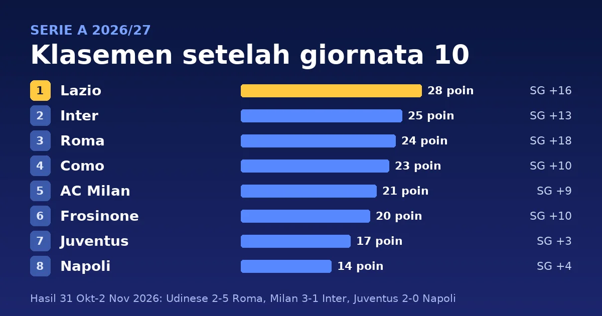

Giornata 10 Serie A 2026/27 dimainkan dari Sabtu, 31 Oktober, sampai Senin, 2 November 2026. Lazio memimpin klasemen dengan 28 poin setelah menang 2-1 atas Cagliari. Mereka sempat tertinggal oleh gol Nzola menit 20, lalu dibalikkan lewat gol Isaksen menit 36 dan Pinamonti menit 83. Inter, peringkat 2, kalah 1-3 dari Milan di derby Milan dan tertinggal tiga poin dari Lazio. Roma menang 5-2 di markas Udinese dan duduk di peringkat 3, empat poin di belakang Lazio.

> **Poin Penting**
>
> - Lazio (28 poin, 9 menang, 1 seri) memimpin tanpa kekalahan. Inter (25) tertinggal tiga poin, Roma (24) empat poin, dan Como (23) lima poin. Lazio dan Roma sama-sama belum pernah kalah musim ini.
> - Milan menang 3-1 atas Inter di San Siro. Itu kekalahan pertama Inter di Serie A musim ini, padahal Inter melepaskan 19 tembakan berbanding 7 milik Milan.
> - Roma mencetak empat gol dalam 37 menit pertama di Udinese dan menang 5-2. Dengan 28 gol, Roma menjadi tim tersubur di liga.
> - Juventus menang 2-0 atas Napoli yang bermain dengan 10 orang sejak menit 75, dan naik ke peringkat 7 dengan 17 poin. Di dasar klasemen, Monza (7 poin), Udinese (5), dan Venezia (3) menghuni zona degradasi. Angka itu belum memasukkan Venezia 2-1 Udinese di giornata 11.

## Hasil lengkap giornata 10

Sepuluh laga dimainkan dalam tiga hari. Skor mengikuti [Unione Sarda](https://www.unionesarda.it/en/the-tenth-round-of-the-championship-the-milan-derby-begins-nytsgmmb) dan papan skor [ESPN](https://www.espn.com/soccer/scoreboard/_/date/20261101/league/ita.1), dengan tim tuan rumah di kolom kiri. Tanggal di tabel adalah tanggal di Italia.

| Tanggal | Tuan rumah | Skor | Tamu |
|---|---|:---:|---|
| Sabtu, 31 Okt | Bologna | 2-1 | Monza |
| Sabtu, 31 Okt | Udinese | 2-5 | Roma |
| Sabtu, 31 Okt | Milan | 3-1 | Inter |
| Minggu, 1 Nov | Como | 1-0 | Venezia |
| Minggu, 1 Nov | Lazio | 2-1 | Cagliari |
| Minggu, 1 Nov | Frosinone | 2-0 | Torino |
| Minggu, 1 Nov | Lecce | 1-2 | Genoa |
| Minggu, 1 Nov | Juventus | 2-0 | Napoli |
| Senin, 2 Nov | Sassuolo | 2-4 | Fiorentina |
| Senin, 2 Nov | Atalanta | 0-3 | Parma |

Giornata ini menghasilkan 34 gol dari 10 laga, rata-rata 3,4 per laga. Enam laga dimenangi tuan rumah, empat dimenangi tamu, dan tidak ada yang berakhir seri. Udinese 2-5 Roma menjadi laga dengan gol terbanyak, tujuh.

<!--more-->

## Detail pertandingan

Jam ditulis dalam WIB dengan waktu Italia (CET) di dalam kurung. Italia sudah memakai CET sejak 25 Oktober, jadi WIB lebih cepat enam jam dan laga malam di Italia jatuh pada dini hari keesokan harinya di Indonesia. Pencetak gol, menit, dan kartu merah mengikuti papan skor ESPN untuk [31 Oktober](https://www.espn.com/soccer/scoreboard/_/date/20261031/league/ita.1), [1 November](https://www.espn.com/soccer/scoreboard/_/date/20261101/league/ita.1), dan [2 November](https://www.espn.com/soccer/scoreboard/_/date/20261102/league/ita.1). Kartu kuning mengikuti halaman susunan pemain Sky Sports untuk tiap laga. Tanda ⚽ menandai gol, 🟨 kartu kuning, dan 🟥 kartu merah.

### Laga Sabtu, 31 Oktober 2026 (tanggal Italia)

#### Bologna 2-1 Monza

**Sabtu, 31 Oktober 2026, 21:00 WIB (15:00 CET)** · Stadio Renato Dall'Ara, Bologna

| Bologna | Monza |
|---|---|
| ⚽ T. Pobega 33' ⚽ F. Bernardeschi 59' (pen.) 🟨 J. Odgaard 17' 🟨 T. Pobega 23' 🟨 N. Zortea 74' 🟨 M. Amondarain 90' | ⚽ G. Varela 6' (pen.) 🟨 R. Chaby 12' 🟨 L. Lucchesi 58' 🟨 P. Ciurria 76' |

Varela membuka skor Monza lewat penalti menit 6. Bologna membalik lewat Pobega, yang menerima umpan J. Miranda, dan penalti Bernardeschi. [Sky Sports](https://www.skysports.com/football/bologna-vs-monza/teams/6065401379679355232) mencatat penalti P. Cutrone untuk Monza di menit 81 tidak menjadi gol.

#### Udinese 2-5 Roma

**Minggu, 1 November 2026, 00:00 WIB (Sabtu, 18:00 CET)** · Stadio Friuli, Udine

| Udinese | Roma |
|---|---|
| ⚽ N. Zaniolo 50' ⚽ M. Palma 78' 🟨 L. Miller 23' | ⚽ B. Cristante 10' ⚽ R. Mora 31' ⚽ D. Malen 33' ⚽ E. Ndicka 37' ⚽ D. Ghilardi 90+2' 🟨 B. Cristante 60' |

Roma sudah unggul 4-0 di menit 37 lewat Cristante, Mora, Malen, dan Ndicka. Zaniolo dan Palma membalas dua gol di babak kedua, lalu Ghilardi menutup skor di masa tambahan waktu.

#### Milan 3-1 Inter

**Minggu, 1 November 2026, 02:45 WIB (Sabtu, 20:45 CET)** · San Siro (Stadio Giuseppe Meazza), Milan

| Milan | Inter |
|---|---|
| ⚽ C. Pulisic 4' ⚽ A. Rabiot 10' ⚽ D. Moreira 43' 🟨 K. De Winter 49' 🟨 D. Moreira 52' | ⚽ A. Bastoni 22' 🟨 Carlos Augusto 90' |

Milan unggul dua gol dalam 10 menit pertama lewat Pulisic dan Rabiot. Statistik [Sky Sports](https://www.skysports.com/football/ac-milan-vs-inter-milan/stats/4790000532865731232) mencatat Inter melepaskan 19 tembakan (8 tepat sasaran) berbanding 7 tembakan Milan (4 tepat sasaran), tetapi Inter hanya membalas satu gol lewat Bastoni.

### Laga Minggu, 1 November 2026 (tanggal Italia)

#### Como 1-0 Venezia

**Minggu, 1 November 2026, 18:30 WIB (12:30 CET)** · Stadio Giuseppe Sinigaglia, Como

| Como | Venezia |
|---|---|
| ⚽ L. Da Cunha 43' (pen.) 🟨 K. da Silva 86' | 🟨 S. Sohm 39' 🟨 Juan Jesus 41' |

Penalti Da Cunha menit 43 menjadi satu-satunya gol. Como melepaskan 19 tembakan (4 tepat sasaran) dan Venezia 7 (1 tepat sasaran), menurut [Sky Sports](https://www.skysports.com/football/como-vs-venezia/stats/8710486387299679232).

#### Lazio 2-1 Cagliari

**Minggu, 1 November 2026, 21:00 WIB (15:00 CET)** · Stadio Olimpico, Roma

| Lazio | Cagliari |
|---|---|
| ⚽ G. Isaksen 36' ⚽ A. Pinamonti 83' 🟨 A. Pinamonti 84' | ⚽ M. Nzola 20' 🟨 J. Fazzini 59' 🟨 J. Rodríguez 66' 🟨 A. Obert 76' 🟥 A. Obert 90+1' (kuning kedua) |

Lazio tertinggal oleh gol Nzola menit 20, menyamakan skor lewat Isaksen menit 36, dan memastikan kemenangan lewat Pinamonti menit 83. Cagliari mengakhiri laga dengan 10 orang setelah A. Obert menerima kartu kuning kedua di menit 90+1.

#### Frosinone 2-0 Torino

**Minggu, 1 November 2026, 21:00 WIB (15:00 CET)** · Stadio Benito Stirpe, Frosinone

| Frosinone | Torino |
|---|---|
| ⚽ F. Ghedjemis 48' ⚽ G. Calò 90+3' 🟨 P. Masini 62' | 🟨 Z. Aboukhlal 27' 🟨 G. Gineitis 33' 🟨 S. Coco-Bassey Oubina 66' |

Frosinone melepaskan 20 tembakan (8 tepat sasaran) dan Torino 12 (3 tepat sasaran), menurut [Sky Sports](https://www.skysports.com/football/frosinone-vs-torino/stats/7960852182592250232). Torino lebih banyak menguasai bola, 54,3%.

#### Lecce 1-2 Genoa

**Senin, 2 November 2026, 00:00 WIB (Minggu, 18:00 CET)** · Stadio Via del Mare, Lecce

| Lecce | Genoa |
|---|---|
| ⚽ Y. Maleh 40' 🟨 M. Kaba 59' 🟨 J. Siebert 70' | ⚽ M. Osmajic 11' ⚽ J. Messias 28' 🟨 H. Traoré 62' |

Genoa unggul 2-0 dalam 28 menit lewat Osmajic dan Messias. Maleh memperkecil skor di menit 40, dan Lecce tidak berhasil menyamakan kedudukan meski melepaskan 18 tembakan berbanding 13 milik Genoa ([Sky Sports](https://www.skysports.com/football/lecce-vs-genoa/stats/6635005422286434232)).

#### Juventus 2-0 Napoli

**Senin, 2 November 2026, 02:45 WIB (Minggu, 20:45 CET)** · Allianz Stadium, Torino

| Juventus | Napoli |
|---|---|
| ⚽ K. Alajbegovic 70' ⚽ J. Boga 87' 🟨 Douglas Luiz 16' 🟨 J. Lucumí 20' 🟨 K. Alajbegovic 71' | 🟨 L. Marianucci 38' 🟨 R. Marín 90+1' 🟥 L. Marianucci 75' (kuning kedua) |

Alajbegovic membuka skor di menit 70, lima menit sebelum L. Marianucci diusir keluar karena kartu kuning kedua. Boga menggandakan keunggulan Juventus di menit 87. Juventus unggul 18 tembakan berbanding 8 dan 13 sepak pojok berbanding 4 ([Sky Sports](https://www.skysports.com/football/juventus-vs-napoli/stats/6932684277158330232)).

### Laga Senin, 2 November 2026 (tanggal Italia)

#### Sassuolo 2-4 Fiorentina

**Selasa, 3 November 2026, 00:30 WIB (Senin, 18:30 CET)** · Mapei Stadium (Città del Tricolore), Reggio Emilia

| Sassuolo | Fiorentina |
|---|---|
| ⚽ A. Laurienté 25', 65' 🟨 I. Suleman Kakari 40' 🟨 G. Kulla 90+5' | ⚽ M. Pellegrino 45+2' ⚽ A. Njie 50' ⚽ F. Mastantuono 79' ⚽ V. Valdepeñas 90+3' 🟨 R. Dragusin 42' 🟨 A. Njie 44' 🟨 W. Gnonto 90+2' |

Sassuolo unggul lebih dulu lewat Laurienté di menit 25. Fiorentina menyamakan skor di masa tambahan waktu babak pertama lewat Pellegrino, berbalik unggul lewat Njie, dan mencetak dua gol lagi lewat Mastantuono (menit 79) dan Valdepeñas (menit 90+3) setelah Laurienté menyamakan skor di menit 65.

#### Atalanta 0-3 Parma

**Selasa, 3 November 2026, 02:45 WIB (Senin, 20:45 CET)** · Gewiss Stadium (New Balance Arena), Bergamo

| Atalanta | Parma |
|---|---|
| – | ⚽ G. Fabbian 41' ⚽ D. Zappacosta 47' (bunuh diri) ⚽ S. Lontani 58' |

Tidak ada kartu kuning maupun merah dalam laga ini. Atalanta menguasai bola 69,6% dan melepaskan 20 tembakan berbanding 6 milik Parma, tetapi tidak mencetak gol ([Sky Sports](https://www.skysports.com/football/atalanta-vs-parma/stats/6770659326139238232)).

## Klasemen setelah giornata 10

Klasemen di bawah dihitung dari hasil giornata 1 sampai 10 dan belum memasukkan Venezia 2-1 Udinese pada Jumat, 6 November, laga pembuka giornata 11. Tim dengan poin sama diurutkan lebih dulu menurut head-to-head, lalu selisih gol sesuai [aturan Serie A](https://sport.sky.it/calcio/serie-a/serie-a-classifica-avulsa-squadre-punti). Tiga tim terbawah (peringkat 18-20) terdegradasi ke Serie B.

| # | Tim | M | Me | S | K | Gol | SG | Poin |
|---:|---|:---:|:---:|:---:|:---:|:---:|:---:|:---:|
| 1 | Lazio | 10 | 9 | 1 | 0 | 24-8 | +16 | **28** |
| 2 | Inter | 10 | 8 | 1 | 1 | 26-13 | +13 | **25** |
| 3 | Roma | 10 | 7 | 3 | 0 | 28-10 | +18 | **24** |
| 4 | Como | 10 | 7 | 2 | 1 | 18-8 | +10 | **23** |
| 5 | Milan | 10 | 6 | 3 | 1 | 21-12 | +9 | 21 |
| 6 | Frosinone | 10 | 6 | 2 | 2 | 24-14 | +10 | 20 |
| 7 | Juventus | 10 | 5 | 2 | 3 | 13-10 | +3 | 17 |
| 8 | Napoli | 10 | 4 | 2 | 4 | 17-13 | +4 | 14 |
| 9 | Bologna | 10 | 4 | 2 | 4 | 14-13 | +1 | 14 |
| 10 | Torino | 10 | 4 | 1 | 5 | 14-16 | -2 | 13 |
| 11 | Genoa | 10 | 4 | 1 | 5 | 10-14 | -4 | 13 |
| 12 | Cagliari | 10 | 4 | 1 | 5 | 9-15 | -6 | 13 |
| 13 | Atalanta | 10 | 3 | 2 | 5 | 16-20 | -4 | 11 |
| 14 | Lecce | 10 | 3 | 0 | 7 | 11-21 | -10 | 9 |
| 15 | Fiorentina | 10 | 2 | 2 | 6 | 15-23 | -8 | 8 |
| 16 | Parma | 10 | 2 | 2 | 6 | 8-15 | -7 | 8 |
| 17 | Sassuolo | 10 | 2 | 2 | 6 | 16-26 | -10 | 8 |
| 18 | Monza | 10 | 2 | 1 | 7 | 17-24 | -7 | 7 |
| 19 | Udinese | 10 | 1 | 2 | 7 | 11-23 | -12 | 5 |
| 20 | Venezia | 10 | 1 | 0 | 9 | 6-20 | -14 | 3 |

Keterangan: M = main, Me = menang, S = seri, K = kalah, SG = selisih gol. Poin tebal menandai empat tim teratas.

## Apa artinya klasemen ini

Lazio dan Roma adalah satu-satunya tim yang belum kalah dalam 10 laga. Lazio punya 9 kemenangan dan 1 seri, Roma 7 kemenangan dan 3 seri. Inter masih di peringkat 2 dengan 25 poin meski kalah di derby, dan hanya dua poin di atas Como (23) di peringkat 4. Kekalahan dari Milan adalah satu-satunya kekalahan Inter musim ini. Roma mencetak 28 gol, paling banyak di liga, sedangkan Lazio dan Como sama-sama kebobolan 8 gol, paling sedikit.

Di tengah, Milan (21) berada di peringkat 5 dan unggul satu poin dari Frosinone (20). Frosinone mencetak 24 gol, sama dengan Lazio, dan hanya Roma (28) dan Inter (26) yang mencetak lebih banyak. Juventus (17) di peringkat 7 unggul tiga poin dari Napoli dan Bologna yang sama-sama 14 poin. Napoli di peringkat 8 karena menang 1-0 atas Bologna di giornata 4. Torino, Genoa, dan Cagliari sama-sama 13 poin dan diurutkan menurut selisih gol karena ketiganya belum saling bertemu.

Peringkat 15 sampai 18 hanya terpaut satu poin. Fiorentina, Parma, dan Sassuolo sama-sama 8 poin. Fiorentina berada paling atas di antara ketiganya karena menang 4-2 atas Sassuolo di giornata ini, sedangkan Parma belum bertemu keduanya. Parma di atas Sassuolo karena selisih gol (-7 berbanding -10). Sassuolo (peringkat 17) hanya unggul satu poin dari Monza di zona degradasi dan kebobolan 26 gol, terbanyak di liga. Udinese (5 poin) dan Venezia (3 poin) melengkapi tiga tim terbawah. Venezia baru menang sekali dan mencetak 6 gol, paling sedikit di liga.

## Top skor sampai giornata 10

Gustavo Varela dari Monza memimpin daftar pencetak gol dengan 9 gol dari 9 laga, termasuk penalti menit 6 di Bologna. Antonio Raimondo dari Frosinone dan Donyell Malen dari Roma menyusul dengan 8 gol ([ESPN](https://www.espn.com/soccer/stats/_/league/ita.1/view/scoring)). Frosinone punya dua pemain di antara sembilan teratas, Raimondo dan Giacomo Calò. Kolom terakhir menunjukkan gol tiap pemain di giornata 10.

| # | Pemain | Klub | Gol | Gol di G10 |
|---:|---|---|:---:|:---:|
| 1 | Gustavo Varela | Monza | **9** | 1 |
| 2 | Antonio Raimondo | Frosinone | **8** | 0 |
| 2 | Donyell Malen | Roma | **8** | 1 |
| 4 | Nikola Krstovic | Atalanta | 6 | 0 |
| 5 | Giacomo Calò | Frosinone | 5 | 1 |
| 5 | Tasos Douvikas | Como | 5 | 0 |
| 5 | Daniel Maldini | Cagliari | 5 | 0 |
| 5 | Marcus Thuram | Inter | 5 | 0 |
| 5 | Adrien Rabiot | Milan | 5 | 1 |
| 10 | Franco Mastantuono | Fiorentina | 4 | 1 |
| 10 | Gustav Isaksen | Lazio | 4 | 1 |
| 10 | Kevin De Bruyne | Napoli | 4 | 0 |

Pemain dengan jumlah gol sama diberi peringkat yang sama. Varela, Malen, Calò, Rabiot, Mastantuono, dan Isaksen masing-masing mencetak satu gol di giornata 10, sedangkan Raimondo, Krstovic, Douvikas, Maldini, Thuram, dan De Bruyne tidak mencetak gol.

## Assist terbanyak sampai giornata 10

Mattia Zaccagni dari Lazio dan Juan Miranda dari Bologna sama-sama mengoleksi 5 assist. Lima pemain menyusul dengan 4 assist, tiga di antaranya dari Frosinone: Giorgi Kvernadze, Romano Schmid, dan Farès Ghedjemis ([ESPN](https://www.espn.com/soccer/stats/_/league/ita.1)).

| # | Pemain | Klub | Main | Assist |
|---:|---|---|:---:|:---:|
| 1 | Mattia Zaccagni | Lazio | 10 | **5** |
| 1 | Juan Miranda | Bologna | 9 | **5** |
| 3 | Giorgi Kvernadze | Frosinone | 10 | 4 |
| 3 | Romano Schmid | Frosinone | 10 | 4 |
| 3 | Andy Diouf | Inter | 9 | 4 |
| 3 | Farès Ghedjemis | Frosinone | 8 | 4 |
| 3 | Paulo Dybala | Roma | 6 | 4 |
| 8 | Charles De Ketelaere | Atalanta | 10 | 3 |
| 8 | Nuno Tavares | Lazio | 10 | 3 |
| 8 | Matías Soulé | Roma | 10 | 3 |

Penghitungan assist bisa berbeda antar penyedia data karena definisinya tidak seragam. Tabel di atas mengikuti ESPN. Dybala mencapai 4 assist hanya dalam enam penampilan.

## Jadwal giornata 11

Giornata 11 dibuka Jumat, 6 November, ketika Venezia menang 2-1 atas Udinese ([Sky Sports](https://www.skysports.com/football/venezia-vs-udinese/teams/8701044572839578232)). Sembilan laga sisanya dijadwalkan pada 7-8 November waktu Italia, atau 7-9 November WIB ([Sky Sports](https://www.skysports.com/serie-a-scores-fixtures/2026-11-07)). Beberapa laga yang mempertemukan tim papan atas atau menyangkut zona bawah:

- Roma vs Sassuolo (Minggu, 8 Nov, 02:45 WIB)
- Napoli vs Lazio (Minggu, 8 Nov, 18:30 WIB)
- Genoa vs Milan (Minggu, 8 Nov, 21:00 WIB)
- Inter vs Como (Senin, 9 Nov, 00:00 WIB)
- Fiorentina vs Juventus (Senin, 9 Nov, 02:45 WIB)

Napoli vs Lazio mempertemukan pemimpin klasemen dengan tim peringkat 8 yang tertinggal 14 poin dari Lazio. Inter vs Como mempertemukan peringkat 2 dan 4, yang terpaut dua poin. Roma bisa memangkas jarak dengan Lazio bila menang atas Sassuolo, tim peringkat 17 dengan 8 poin.

## Sumber

- Unione Sarda, [The tenth round of the championship: the Milan derby begins](https://www.unionesarda.it/en/the-tenth-round-of-the-championship-the-milan-derby-begins-nytsgmmb), 31 Oktober-3 November 2026.
- ESPN, papan skor Serie A [31 Oktober](https://www.espn.com/soccer/scoreboard/_/date/20261031/league/ita.1), [1 November](https://www.espn.com/soccer/scoreboard/_/date/20261101/league/ita.1), dan [2 November 2026](https://www.espn.com/soccer/scoreboard/_/date/20261102/league/ita.1).
- Sky Sports, halaman susunan pemain dan statistik tiap laga (kartu kuning dan merah), lewat [daftar hasil Serie A](https://www.skysports.com/serie-a-scores-fixtures/2026-10-31) dan [jadwal 1-2 November 2026](https://www.skysports.com/football-scores-fixtures/2026-11-01).
- Fantacalcio Online, [giornata 10 Serie A 2026/27](https://www.fantacalcio-online.com/en/serie-a/2026-2027/diretta-live/10-giornata), jam kick-off tiap laga.
- Sky Sports, [Serie A table](https://www.skysports.com/serie-a-table) dan ESPN, [Serie A standings](https://www.espn.com/soccer/standings/_/league/ita.1), klasemen.
- ESPN, [Serie A Stats, 2026-27 Season](https://www.espn.com/soccer/stats/_/league/ita.1), top skor dan assist.
- Sky Sport Italia, [Serie A, classifica avulsa e gol: i criteri per le squadre a pari punti](https://sport.sky.it/calcio/serie-a/serie-a-classifica-avulsa-squadre-punti), aturan tiebreak.
- Sky Sports, [jadwal Serie A 7 November 2026](https://www.skysports.com/serie-a-scores-fixtures/2026-11-07), jadwal giornata 11.

---

*Klasemen setelah giornata 10, ditulis 7 November 2026. Penulis: Mahyuddin Susanto ([tentang penulis](https://www.udienz.web.id/about/), [kontak](https://www.udienz.web.id/contact.html)). Tulisan ini dibantu oleh AI.*
