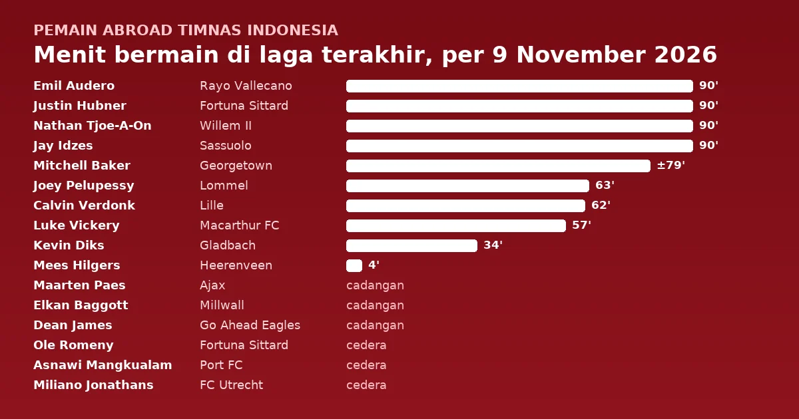
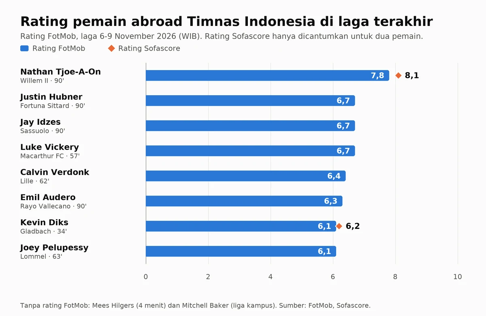

Laga terakhir 16 pemain abroad Timnas Indonesia dimainkan antara 7 dan 9 November 2026 waktu Indonesia, sebagai pembaruan dari [edisi 7 November](). Sepuluh pemain turun ke lapangan dan empat di antaranya bermain penuh 90 menit: Emil Audero, Justin Hubner, Nathan Tjoe-A-On, dan Jay Idzes. Tidak satu pun mencetak gol atau assist di laga terakhirnya. Di antara delapan pemain yang punya rating FotMob, Tjoe-A-On teratas dengan 7,8 saat Willem II bermain 1-1 melawan PEC Zwolle. Hanya tiga klub pemain yang menang: Lille, Heerenveen, dan Go Ahead Eagles. Tiga pemain absen karena cedera: Ole Romeny (engkel), Miliano Jonathans (lutut), dan Asnawi Mangkualam (ACL).

<!--more-->

> **Poin Penting**
>
> - Rating FotMob tertinggi: Nathan Tjoe-A-On (7,8), disusul Justin Hubner, Jay Idzes, dan Luke Vickery yang sama-sama 6,7. Tjoe-A-On juga mencatat rating Sofascore 8,1.
> - Empat pemain bermain penuh 90 menit. Audero dan Idzes menjalaninya dalam kekalahan: Rayo Vallecano kalah 0-1 dari Real Sociedad dan Sassuolo kalah 0-3 dari Roma.
> - Calvin Verdonk bermain 62 menit dan menerima kartu kuning menit ke-55 saat Lille menang 2-1 di Rennes. Mees Hilgers masuk menit ke-86 saat Heerenveen menang 5-3 atas Feyenoord.
> - Maarten Paes, Elkan Baggott, dan Dean James duduk di bangku cadangan tanpa dimainkan. Ole Romeny, Miliano Jonathans, dan Asnawi Mangkualam absen karena cedera.

Pantauan ini mencakup dua kelompok. Pertama, pemain abroad di skuad final FIFA ASEAN Cup 2026, pemanggilan resmi terakhir yang berakhir dengan gelar juara setelah Indonesia mengalahkan Thailand lewat adu penalti di final ([Databoks](https://databoks.katadata.co.id/en/sport/statistics/6ac447d1336cb/indonesia-wins-2026-fifa-asean-cup-mitchell-baker-named-top-scorer)). Kedua, pemain abroad yang populer tetapi tidak masuk pemanggilan itu, yang diberi tanda bintang (\*).

## Ringkasan laga terakhir

Hasil ditulis dari sudut pandang klub si pemain: M (menang), S (seri), K (kalah). Tanda (K) atau (T) setelah nama lawan berarti kandang atau tandang. Tanggal ditulis dalam WIB.

| Pemain | Klub (Liga) | Laga terakhir | Hasil | Menit | Kontribusi |
|---|---|---|:---:|:---:|---|
| Emil Audero | Rayo Vallecano (La Liga) | vs Real Sociedad (T), 8 Nov | K 0-1 | 90' | |
| Maarten Paes | Ajax (Eredivisie) | vs FC Twente (T), 8 Nov | S 2-2 | – | cadangan, tidak dimainkan |
| Elkan Baggott | Millwall (Championship) | vs West Bromwich Albion (T), 7 Nov | K 0-3 | – | cadangan, tidak dimainkan |
| Justin Hubner | Fortuna Sittard (Eredivisie) | vs Telstar (K), 7 Nov | S 2-2 | 90' | |
| Kevin Diks | Borussia Mönchengladbach (Bundesliga) | vs Hamburger SV (T), 7 Nov | K 1-3 | 34' | masuk menit ke-56 |
| Nathan Tjoe-A-On | Willem II (Eredivisie) | vs PEC Zwolle (K), 7 Nov | S 1-1 | 90' | rating FotMob tertinggi |
| Dean James | Go Ahead Eagles (Eredivisie) | vs Excelsior (T), 8 Nov | M 1-0 | – | cadangan, tidak dimainkan |
| Calvin Verdonk | Lille (Ligue 1) | vs Rennes (T), 8 Nov | M 2-1 | 62' | 🟨 55' |
| Jay Idzes\* | Sassuolo (Serie A) | vs Roma (T), 8 Nov | K 0-3 | 90' | |
| Mees Hilgers\* | SC Heerenveen (Eredivisie) | vs Feyenoord (K), 8 Nov | M 5-3 | 4' | masuk menit ke-86 |
| Asnawi Mangkualam\* | Port FC (Thai League 1) | vs Chonburi FC (K), 7 Nov | S 1-1 | – | cedera ACL |
| Joey Pelupessy | Lommel SK (Pro League) | vs Royal Antwerp (T), 8 Nov | S 2-2 | 63' | |
| Ole Romeny | Fortuna Sittard (Eredivisie) | vs Telstar (K), 7 Nov | S 2-2 | – | cedera engkel |
| Luke Vickery | Macarthur FC (A-League) | vs Brisbane Roar (K), 8 Nov | K 1-2 | 57' | |
| Mitchell Baker | Georgetown (liga kampus NCAA, AS) | vs UConn (T), 7 Nov | S 2-2 | ±79' | starter |
| Miliano Jonathans\* | FC Utrecht (Eredivisie) | vs NEC Nijmegen (K), 9 Nov | K 2-3 | – | cedera lutut |

## Rating pemain

Nathan Tjoe-A-On teratas di FotMob dengan 7,8. Justin Hubner, Jay Idzes, dan Luke Vickery sama-sama 6,7, sedangkan Kevin Diks dan Joey Pelupessy paling bawah dengan 6,1. Rating Sofascore hanya dicantumkan untuk Tjoe-A-On (8,1) dan Diks (6,2). Mees Hilgers dan Mitchell Baker tidak punya rating FotMob.

## Detail per pemain

Jam ditulis dalam WIB dengan waktu setempat di dalam kurung. Menit, rating FotMob, dan laga berikutnya diambil dari halaman pemain di FotMob, sedangkan rating Sofascore dari halaman pemain di Sofascore. Angka rating ditautkan ke halaman sumbernya. Rating Sofascore hanya dicantumkan untuk Kevin Diks dan Nathan Tjoe-A-On (diakses 7 November 2026); tanda – di kolom rating berarti tidak dicantumkan. Kedua penyedia menghitung rating dengan cara berbeda, jadi angkanya jarang sama.

### Kiper

#### Emil Audero (kiper) · Rayo Vallecano

**Real Sociedad 1-0 Rayo Vallecano** · La Liga · Minggu, 8 November 2026, 22:15 WIB (16:15 CET) · Estadio Municipal de Anoeta, San Sebastián

| Menit | Kontribusi | Rating FotMob | Rating Sofascore |
|---|---|---|---|
| 90' (starter) | – | [6,3](https://www.fotmob.com/players/602845/emil-audero) | – |

Orri Óskarsson mencetak satu-satunya gol menit ke-67 ([ESPN](https://www.espn.com/soccer/scoreboard/_/date/20261108/league/esp.1)). Rayo kalah sepekan setelah menang 3-0 atas Celta Vigo, laga yang Audero tutup dengan clean sheet.

**Laga berikutnya**: vs Valencia (K), La Liga, Sabtu, 21 November 2026, 22:15 WIB.

#### Maarten Paes (kiper) · Ajax

**FC Twente 2-2 Ajax** · Eredivisie · Minggu, 8 November 2026, 20:30 WIB (14:30 CET) · De Grolsch Veste, Enschede

Cadangan, tidak dimainkan. Menurut [FotMob](https://www.fotmob.com/players/805463/maarten-paes), Paes duduk di bangku cadangan dalam delapan laga klub terakhir Ajax sejak 11 Oktober tanpa dimainkan. Penampilan terakhirnya adalah laga FIFA ASEAN Cup melawan Malaysia pada 28 September. Ajax unggul 2-0 lewat Tolu Arokodare (menit 3) dan Rayane Bounida (66), lalu Twente menyamakan skor lewat gol bunuh diri Dies Janse (68) dan penalti Wout Weghorst di menit 90+5 ([ESPN](https://www.espn.com/soccer/scoreboard/_/date/20261108/league/ned.1)).

**Laga berikutnya**: vs ADO Den Haag (K), Eredivisie, Minggu, 22 November 2026, 20:30 WIB.

### Bek

#### Elkan Baggott (bek) · Millwall

**West Bromwich Albion 3-0 Millwall** · Championship · Sabtu, 7 November 2026, 22:00 WIB (15:00 GMT) · The Hawthorns, West Bromwich

Cadangan, tidak dimainkan. Baggott, yang dipinjam Millwall dari Ipswich Town, duduk di bangku cadangan dalam enam laga liga terakhir klubnya sejak 14 Oktober tanpa dimainkan. Penampilan terakhirnya untuk Millwall adalah 20 menit melawan West Ham United pada 19 September ([FotMob](https://www.fotmob.com/players/1193997/elkan-baggott)). Millwall kalah 0-3 dalam dua laga beruntun, setelah Birmingham City pada 4 November.

**Laga berikutnya**: vs Queens Park Rangers (K), Championship, Sabtu, 21 November 2026, 19:30 WIB.

#### Justin Hubner (bek) · Fortuna Sittard

**Fortuna Sittard 2-2 Telstar** · Eredivisie · Sabtu, 7 November 2026, 22:30 WIB (16:30 CET) · Fortuna Sittard Stadion, Sittard

| Menit | Kontribusi | Rating FotMob | Rating Sofascore |
|---|---|---|---|
| 90' (starter) | – | [6,7](https://www.fotmob.com/players/1213683/justin-hubner) | – |

Fortuna unggul 2-0 lewat penalti Mohamed Ihattaren (menit 15) dan gol bunuh diri Sem Valk (43), tetapi Telstar menyamakan skor sebelum jeda lewat Abdelnour Soualhia (45) dan Patrick Brouwer (45+2) ([ESPN](https://www.espn.com/soccer/scoreboard/_/date/20261107/league/ned.1)).

**Laga berikutnya**: vs Go Ahead Eagles (T), Eredivisie, Minggu, 22 November 2026, 22:45 WIB.

#### Kevin Diks (bek) · Borussia Mönchengladbach

**Hamburger SV 3-1 Borussia Mönchengladbach** · Bundesliga · Sabtu, 7 November 2026, 02:30 WIB (Jumat, 20:30 CET) · Volksparkstadion, Hamburg

| Menit | Kontribusi | Rating FotMob | Rating Sofascore |
|---|---|---|---|
| 34' (masuk menit ke-56) | – | [6,1](https://www.fotmob.com/players/566158/kevin-diks) | [6,2](https://www.sofascore.com/football/player/kevin-diks/583806) |

Diks memulai laga dari bangku cadangan dan masuk menggantikan Robin Hack pada menit ke-56 saat skor masih 1-1. Hamburg kemudian mencetak dua gol lewat Shafiq Nandja dan Albert Grønbæk.

**Laga berikutnya**: vs Borussia Dortmund (K), Bundesliga, Sabtu, 21 November 2026, 21:30 WIB.

#### Nathan Tjoe-A-On (bek kiri) · Willem II

**Willem II 1-1 PEC Zwolle** · Eredivisie · Sabtu, 7 November 2026, 02:00 WIB (Jumat, 20:00 CET) · Koning Willem II Stadion, Tilburg

| Menit | Kontribusi | Rating FotMob | Rating Sofascore |
|---|---|---|---|
| 90' (starter) | – | [7,8](https://www.fotmob.com/players/1075242/nathan-tjoe) | [8,1](https://www.sofascore.com/football/player/nathan-tjoe-a-on/992651) |

Kedua gol lahir dalam tiga menit pertama: Sydney van Hooijdonk untuk PEC Zwolle dan Hidde ter Avest untuk Willem II. Willem II belum bermain lagi sejak laga ini.

**Laga berikutnya**: vs FC Twente (T), Eredivisie, Minggu, 22 November 2026, 18:15 WIB.

#### Dean James (bek kiri) · Go Ahead Eagles

**Excelsior 0-1 Go Ahead Eagles** · Eredivisie · Minggu, 8 November 2026, 03:00 WIB (Sabtu, 21:00 CET) · Stadion Woudestein, Rotterdam

Cadangan, tidak dimainkan. James sebelumnya ditarik saat jeda di laga kontra Cambuur pada 1 November ([FotMob](https://www.fotmob.com/players/1180694/dean-james)). Søren Tengstedt mencetak satu-satunya gol Go Ahead Eagles pada menit ke-72 ([ESPN](https://www.espn.com/soccer/scoreboard/_/date/20261107/league/ned.1)).

**Laga berikutnya**: vs Fortuna Sittard (K), Eredivisie, Minggu, 22 November 2026, 22:45 WIB.

#### Calvin Verdonk (bek kiri) · Lille

**Rennes 1-2 Lille** · Ligue 1 · Minggu, 8 November 2026, 21:00 WIB (15:00 CET) · Roazhon Park, Rennes

| Menit | Kontribusi | Rating FotMob | Rating Sofascore |
|---|---|---|---|
| 62' (starter, diganti Romain Perraud) | 🟨 55' | [6,4](https://www.fotmob.com/players/622137/calvin-verdonk) | – |

Soriba Diaoune membawa Lille unggul menit ke-24, Boulaye Dia menyamakan skor untuk Rennes menit ke-31, dan Nathan Ngoy mencetak gol kemenangan Lille menit ke-68 ([ESPN](https://www.espn.com/soccer/scoreboard/_/date/20261108/league/fra.1)).

**Laga berikutnya**: vs Lyon (K), Ligue 1, Minggu, 22 November 2026, 02:45 WIB.

#### Jay Idzes\* (bek) · Sassuolo

**Roma 3-0 Sassuolo** · Serie A · Minggu, 8 November 2026, 02:45 WIB (Sabtu, 20:45 CET) · Stadio Olimpico, Roma

| Menit | Kontribusi | Rating FotMob | Rating Sofascore |
|---|---|---|---|
| 90' (starter) | – | [6,7](https://www.fotmob.com/players/937412/jay-idzes) | – |

Idzes tidak masuk pemanggilan FIFA ASEAN Cup. Mario Hermoso dan Rodrigo Mora mencetak gol Roma, ditambah gol bunuh diri Sebastian Walukiewicz dari Sassuolo. Laga ini dibahas di [rekap Serie A giornata 11](/2026/11/09/klasemen-serie-a-giornata-11-2026-27).

**Laga berikutnya**: vs Genoa (K), Serie A, Minggu, 22 November 2026, 18:30 WIB.

#### Mees Hilgers\* (bek) · SC Heerenveen

**SC Heerenveen 5-3 Feyenoord** · Eredivisie · Minggu, 8 November 2026, 18:15 WIB (12:15 CET) · Abe Lenstra Stadion, Heerenveen

| Menit | Kontribusi | Rating FotMob | Rating Sofascore |
|---|---|---|---|
| 4' (masuk menit ke-86, menggantikan Sam Kersten) | – | – | – |

Hilgers masuk saat Heerenveen unggul 4-3. Ringo Meerveld mencetak tiga gol untuk Heerenveen, di menit 61, 84, dan 90+3 ([ESPN](https://www.espn.com/soccer/scoreboard/_/date/20261108/league/ned.1)). Sebelumnya Hilgers duduk di bangku cadangan melawan NEC Nijmegen pada 1 November dan bermain 14 menit di Piala KNVB pada 29 Oktober ([FotMob](https://www.fotmob.com/players/1192130/mees-hilgers)).

**Laga berikutnya**: vs FC Groningen (T), Eredivisie, Minggu, 22 November 2026, 03:00 WIB.

#### Asnawi Mangkualam\* (bek kanan) · Port FC

**Port FC 1-1 Chonburi FC** · Thai League 1 · Sabtu, 7 November 2026, 19:00 WIB ([FotMob](https://www.fotmob.com/teams/165255/overview/port-fc))

Tidak masuk skuad: masih dalam pemulihan cedera ACL. Asnawi menjalani operasi pada 28 Januari 2026 ([detikHealth](https://health.detik.com/kebugaran/d-8333320/menyoal-cedera-acl-dialami-asnawi-sampai-harus-naik-meja-operasi/amp)) dan sempat kembali berlatih pada Mei ([Suara](https://www.suara.com/bola/2026/05/08/095947/asnawi-mangkualam-pulih-lebih-cepat-dari-cedera-acl-dipanggil-john-herdman-untuk-piala-aff)). Pada Oktober ia masih absen saat Port FC kalah dari Persib dan Kashiwa Reysol, dan tidak didaftarkan di skuad Thai League 2026/27 ([Chatnews](https://chatnews.id/port-fc-kalah-dari-persib-dan-kashiwa-reysol-tanpa-asnawi)). Penampilan terakhirnya tercatat pada 18 Januari ([FotMob](https://www.fotmob.com/players/799669/asnawi-bahar)).

**Laga berikutnya**: vs Svay Rieng (T), ASEAN Club Championship, Kamis, 19 November 2026, 19:00 WIB.

### Gelandang

#### Joey Pelupessy (gelandang) · Lommel SK

**Royal Antwerp 2-2 Lommel SK** · Pro League Belgia · Minggu, 8 November 2026, 02:45 WIB (Sabtu, 20:45 CET) · Bosuilstadion, Deurne

| Menit | Kontribusi | Rating FotMob | Rating Sofascore |
|---|---|---|---|
| 63' (starter, diganti Isaiah Dada-Mascoll) | – | [6,1](https://www.fotmob.com/players/248151/joey-pelupessy) | – |

Lommel dua kali menyamakan skor lewat Don-Angelo Konadu (menit 47 dan 66) setelah Antwerp unggul lewat Snayder Porozo (40) dan Modibo Fofana (52) ([ESPN](https://www.espn.com/soccer/scoreboard/_/date/20261107/league/bel.1)).

**Laga berikutnya**: vs Standard Liège (K), Pro League Belgia, Senin, 23 November 2026, 01:15 WIB.

### Penyerang

#### Ole Romeny (penyerang) · Fortuna Sittard

**Fortuna Sittard 2-2 Telstar** · Eredivisie · Sabtu, 7 November 2026, 22:30 WIB (16:30 CET) · Fortuna Sittard Stadion, Sittard

Tidak masuk skuad: cedera engkel kambuh setelah ia bermain 45 menit melawan Excelsior pada 25 Oktober ([Bola.com](https://www.bola.com/dunia/read/8323621/cedera-engkel-ole-romeny-menepi-lagi-dari-skuad-fortuna-sittard)). Romeny bermain di Fortuna dengan status pinjaman dari Oxford United.

**Laga berikutnya**: vs Go Ahead Eagles (T), Eredivisie, Minggu, 22 November 2026, 22:45 WIB.

#### Luke Vickery (sayap) · Macarthur FC

**Macarthur FC 1-2 Brisbane Roar** · A-League · Minggu, 8 November 2026, 11:00 WIB (15:00 AEDT) · Campbelltown Sports Stadium, Sydney

| Menit | Kontribusi | Rating FotMob | Rating Sofascore |
|---|---|---|---|
| 57' (starter, diganti Ryan Fraser) | – | [6,7](https://www.fotmob.com/players/1612270/luke-vickery) | – |

Brisbane Roar unggul lewat Sabit James Ngor (menit 48), Apostolos Stamatelopoulos menyamakan skor untuk Macarthur (64), dan Justin Vidić mencetak gol kemenangan tamu di menit 90+5.

**Laga berikutnya**: vs Wellington Phoenix (T), A-League, Minggu, 22 November 2026, 09:00 WIB.

#### Mitchell Baker (penyerang) · Georgetown

**UConn 2-2 Georgetown** · NCAA Divisi I (Big East) · Sabtu, 7 November 2026, 07:00 WIB (Jumat, 19:00 EST) · Joseph J. Morrone Stadium, Storrs

| Menit | Kontribusi | Rating FotMob | Rating Sofascore |
|---|---|---|---|
| ±79' (starter) | 1 tembakan | – | – |

Top skor FIFA ASEAN Cup 2026 ini bermain untuk tim universitas Georgetown di liga kampus Amerika Serikat. Aturan liga kampus membolehkan pemain masuk kembali setelah diganti: Baker ditarik pada menit ke-34, lalu turun lagi di babak kedua ([Georgetown Athletics](https://guhoyas.com/sports/mens-soccer/stats/2026/uconn/boxscore/22017)). FotMob dan Sofascore tidak memberi rating untuk liga kampus.

**Laga berikutnya**: vs Seton Hall, turnamen Big East (tempat netral, Boyds, Maryland), Jumat, 13 November 2026, 07:30 WIB.

#### Miliano Jonathans\* (sayap) · FC Utrecht

**FC Utrecht 2-3 NEC Nijmegen** · Eredivisie · Senin, 9 November 2026, 02:00 WIB (Minggu, 20:00 CET) · Stadion Galgenwaard, Utrecht ([ESPN](https://www.espn.com/soccer/scoreboard/_/date/20261108/league/ned.1))

Tidak masuk skuad: pemulihan cedera ligamen lutut (ACL) yang dialaminya pada Maret 2026 saat dipinjamkan ke Excelsior, cedera serupa kedua dalam sekitar dua tahun ([Bola.com](https://www.bola.com/dunia/read/6295372/miliano-jonathans-kena-cedera-acl-lagi-musim-berakhir-dan-gagal-tampil-di-fifa-series-bersama-timnas-indonesia)). FotMob mencatat penampilan terakhirnya pada 7 Maret 2026 dan masih mendaftarnya sebagai cedera lutut ([FotMob](https://www.fotmob.com/players/1359577/miliano-jonathans)).

**Laga berikutnya**: vs Cambuur (K), Eredivisie, Minggu, 22 November 2026, 00:45 WIB.

## Jadwal laga berikutnya

Laga berikutnya semua pemain, diurutkan menurut waktu WIB. Pemain yang sedang cedera tetap dicantumkan.

| Waktu (WIB) | Laga | Kompetisi | Pemain |
|---|---|---|---|
| Jumat, 13 Nov, 07:30 | Georgetown vs Seton Hall | Turnamen Big East | Baker |
| Kamis, 19 Nov, 19:00 | Svay Rieng vs Port FC | ASEAN Club Championship | Asnawi (cedera) |
| Sabtu, 21 Nov, 19:30 | Millwall vs Queens Park Rangers | Championship | Baggott |
| Sabtu, 21 Nov, 21:30 | Borussia Mönchengladbach vs Borussia Dortmund | Bundesliga | Diks |
| Sabtu, 21 Nov, 22:15 | Rayo Vallecano vs Valencia | La Liga | Audero |
| Minggu, 22 Nov, 00:45 | FC Utrecht vs Cambuur | Eredivisie | Jonathans (cedera) |
| Minggu, 22 Nov, 02:45 | Lille vs Lyon | Ligue 1 | Verdonk |
| Minggu, 22 Nov, 03:00 | FC Groningen vs SC Heerenveen | Eredivisie | Hilgers |
| Minggu, 22 Nov, 09:00 | Wellington Phoenix vs Macarthur FC | A-League | Vickery |
| Minggu, 22 Nov, 18:15 | FC Twente vs Willem II | Eredivisie | Tjoe-A-On |
| Minggu, 22 Nov, 18:30 | Sassuolo vs Genoa | Serie A | Idzes |
| Minggu, 22 Nov, 20:30 | Ajax vs ADO Den Haag | Eredivisie | Paes |
| Minggu, 22 Nov, 22:45 | Go Ahead Eagles vs Fortuna Sittard | Eredivisie | Hubner, Romeny (cedera), James |
| Senin, 23 Nov, 01:15 | Lommel SK vs Standard Liège | Pro League Belgia | Pelupessy |

Timnas Indonesia tidak bertanding di FIFA Matchday November, jadi semua jadwal di atas adalah laga klub.

## Sumber

- FotMob, halaman pemain (menit, rating FotMob, laga terakhir) dan halaman laga (skor, pencetak gol, stadion, pergantian pemain), serta halaman tim (laga berikutnya), diakses 9 November 2026. Tautan per pemain ada di kolom rating.
- Sofascore, halaman pemain [Kevin Diks](https://www.sofascore.com/football/player/kevin-diks/583806) dan [Nathan Tjoe-A-On](https://www.sofascore.com/football/player/nathan-tjoe-a-on/992651) (rating Sofascore), diakses 7 November 2026.
- ESPN, papan skor Eredivisie [7 November](https://www.espn.com/soccer/scoreboard/_/date/20261107/league/ned.1) dan [8 November 2026](https://www.espn.com/soccer/scoreboard/_/date/20261108/league/ned.1), La Liga [8 November](https://www.espn.com/soccer/scoreboard/_/date/20261108/league/esp.1), Ligue 1 [8 November](https://www.espn.com/soccer/scoreboard/_/date/20261108/league/fra.1), dan Pro League Belgia [7 November](https://www.espn.com/soccer/scoreboard/_/date/20261107/league/bel.1), pencetak gol dan jadwal laga berikutnya.
- FotMob, halaman tim [Port FC](https://www.fotmob.com/teams/165255/overview/port-fc) dan [FC Utrecht](https://www.fotmob.com/teams/9908/overview/fc-utrecht), hasil dan jadwal laga berikutnya.
- Georgetown Athletics, [box score Georgetown vs UConn](https://guhoyas.com/sports/mens-soccer/stats/2026/uconn/boxscore/22017) dan [jadwal](https://guhoyas.com/sports/mens-soccer/schedule), November 2026.
- Fantamaster, [Serie A 2026/27, giornata 6-12: date e orari](https://www.fantamaster.it/seriea-6-12-giornata-date-orari-calendario-quando-si-gioca-milan-inter/), jam Sassuolo vs Genoa.
- Bola.com, [Cedera Engkel, Ole Romeny Menepi Lagi dari Skuad Fortuna Sittard](https://www.bola.com/dunia/read/8323621/cedera-engkel-ole-romeny-menepi-lagi-dari-skuad-fortuna-sittard), November 2026.
- Bola.com, [Miliano Jonathans Kena Cedera ACL Lagi](https://www.bola.com/dunia/read/6295372/miliano-jonathans-kena-cedera-acl-lagi-musim-berakhir-dan-gagal-tampil-di-fifa-series-bersama-timnas-indonesia), Maret 2026.
- detikHealth, [Menyoal Cedera ACL, Dialami Asnawi Sampai Harus Naik Meja Operasi](https://health.detik.com/kebugaran/d-8333320/menyoal-cedera-acl-dialami-asnawi-sampai-harus-naik-meja-operasi/amp), Januari 2026.
- Chatnews, [Port FC Kalah dari Persib dan Kashiwa Reysol Tanpa Asnawi](https://chatnews.id/port-fc-kalah-dari-persib-dan-kashiwa-reysol-tanpa-asnawi), Oktober 2026.
- Suara, [Asnawi Mangkualam Pulih Lebih Cepat dari Cedera ACL](https://www.suara.com/bola/2026/05/08/095947/asnawi-mangkualam-pulih-lebih-cepat-dari-cedera-acl-dipanggil-john-herdman-untuk-piala-aff), 8 Mei 2026.
- Databoks, [Indonesia Wins 2026 FIFA ASEAN Cup, Mitchell Baker Named Top Scorer](https://databoks.katadata.co.id/en/sport/statistics/6ac447d1336cb/indonesia-wins-2026-fifa-asean-cup-mitchell-baker-named-top-scorer), Oktober 2026.
- detikSport, [Timnas Indonesia Absen di FIFA Matchday November, tapi Gelar TC di Bali](https://sport.detik.com/sepakbola/liga-indonesia/d-8741976/timnas-indonesia-absen-di-fifa-matchday-november-tapi-gelar-tc-di-bali), November 2026.

---

*Data per 9 November 2026, mencakup laga yang selesai hingga Senin pagi, 9 November (WIB). Penulis: Mahyuddin Susanto ([tentang penulis](https://www.udienz.web.id/about/), [kontak](https://www.udienz.web.id/contact.html)). Tulisan ini dibantu oleh AI.*
