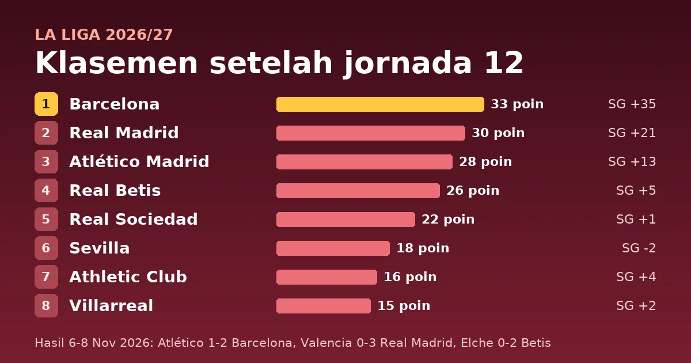

Jornada 12 La Liga 2026/27 dimainkan dari Jumat, 6 November, sampai Minggu, 8 November 2026 (tanggal setempat). Barcelona memimpin klasemen dengan 33 poin setelah menang 2-1 di markas Atlético Madrid. Giuliano Simeone membuka skor untuk Atlético pada menit 10, lalu Fermín López membalik keadaan dengan dua gol pada menit 45 dan 66. Real Madrid menang 3-0 di Valencia dan berada tiga poin di belakang Barcelona, sedangkan Atlético berada di peringkat 3 dengan 28 poin.

<!--more-->

## Poin Penting

> **Poin Penting**
>
> - Barcelona (33 poin) hanya kalah sekali dalam 12 laga. Mereka unggul tiga poin atas Real Madrid (30) dan lima poin atas Atlético Madrid (28).
> - Fermín López mencetak dua gol dalam kemenangan 2-1 di Atlético dan kini punya 7 gol musim ini. Raphinha tetap teratas di daftar top skor dengan 15 gol, diikuti Kylian Mbappé (13).
> - Real Madrid menang 3-0 di Valencia lewat gol Federico Valverde, Arda Güler, dan Mbappé. José Gayà dikartu merah pada menit 79.
> - Málaga belum menang dalam 12 laga dan berada di dasar dengan 5 poin, empat poin di bawah Valencia (9).

## Hasil lengkap jornada 12

| Tanggal | Tuan rumah | Skor | Tamu |
|---|---|---|---|
| Jumat, 6 Nov | Sevilla | 0-0 | Alavés |
| Sabtu, 7 Nov | Málaga | 1-2 | Racing Santander |
| Sabtu, 7 Nov | Espanyol | 0-0 | Deportivo |
| Sabtu, 7 Nov | Osasuna | 1-1 | Athletic Club |
| Sabtu, 7 Nov | Valencia | 0-3 | Real Madrid |
| Minggu, 8 Nov | Elche | 0-2 | Real Betis |
| Minggu, 8 Nov | Real Sociedad | 1-0 | Rayo Vallecano |
| Minggu, 8 Nov | Celta Vigo | 0-0 | Levante |
| Minggu, 8 Nov | Villarreal | 2-0 | Getafe |
| Minggu, 8 Nov | Atlético Madrid | 1-2 | Barcelona |

Dari 10 laga, 2 dimenangi tuan rumah, 4 dimenangi tamu, dan 4 berakhir seri, dengan 16 gol. Tiga seri di antaranya 0-0: Sevilla-Alavés, Espanyol-Deportivo, dan Celta Vigo-Levante.

## Detail pertandingan

Jam ditulis dalam WIB dengan waktu Spanyol daratan (CET) di dalam kurung. Spanyol memakai CET sejak 25 Oktober, jadi WIB lebih cepat enam jam dan laga malam di Spanyol jatuh pada dini hari keesokan harinya di Indonesia. Pencetak gol, menit, dan kartu mengikuti ESPN untuk [6 November](https://www.espn.com/soccer/scoreboard/_/date/20261106/league/esp.1), [7 November](https://www.espn.com/soccer/scoreboard/_/date/20261107/league/esp.1), dan [8 November](https://www.espn.com/soccer/scoreboard/_/date/20261108/league/esp.1), dan jumlah kartu di Valencia-Real Madrid serta Elche-Betis mengikuti Sky Sports. Tanda ⚽ menandai gol, 🟨 kartu kuning, dan 🟥 kartu merah.

### Laga Jumat, 6 November 2026 (tanggal setempat)

#### Sevilla 0-0 Alavés

**Sabtu, 7 November 2026, 03:00 WIB (Jumat, 21:00 CET)** · Ramón Sánchez Pizjuán Stadium, Sevilla

| Sevilla | Alavés |
|---|---|
| 🟨 Arouna Sangante 47' | 🟨 Pablo Ibáñez 30' 🟨 Toni Martínez 63' 🟨 Nicolás Valentini 64' |

### Laga Sabtu, 7 November 2026 (tanggal setempat)

#### Málaga 1-2 Racing Santander

**Sabtu, 7 November 2026, 20:00 WIB (14:00 CET)** · La Rosaleda, Malaga

| Málaga | Racing Santander |
|---|---|
| ⚽ Carlos Dotor 28' 🟨 Adam Aznou 38' 🟨 Einar Galilea 45+1' 🟨 Adrián Niño 76' 🟨 Chupete 80' 🟨 Carlos Dotor 90' 🟥 Adam Aznou 64' (kuning kedua) | ⚽ Iker Luque 50' ⚽ Yassir Zabiri 60' 🟨 Julen Agirrezabala 31' 🟨 Giorgi Guliashvili 90+1' |

Málaga unggul lewat Carlos Dotor menit 28. Racing membalik skor lewat Iker Luque (50') dan Yassir Zabiri (60'), gol ke-9 Zabiri musim ini, lalu Adam Aznou menerima kartu kuning kedua pada menit 64.

#### Espanyol 0-0 Deportivo

**Sabtu, 7 November 2026, 22:15 WIB (16:15 CET)** · RCDE Stadium, Barcelona

| Espanyol | Deportivo |
|---|---|
| 🟨 Roberto Fernández 44' 🟨 Leandro Cabrera 73' 🟨 Alejandro Santiago 77' 🟨 Gabriel Moscardo 89' | 🟨 Luismi Cruz 39' 🟨 Diego Villares 81' 🟨 Lorenzo Amatucci 82' 🟨 Pierre-Emerick Aubameyang 89' |

#### Osasuna 1-1 Athletic Club

**Minggu, 8 November 2026, 00:30 WIB (Sabtu, 18:30 CET)** · El Sadar, Pamplona

| Osasuna | Athletic Club |
|---|---|
| ⚽ Alejandro Catena 90' 🟨 Jon Moncayola 45+2' 🟨 Ante Budimir 54' 🟨 Iker Muñoz 90+4' | ⚽ Nico Williams 84' 🟨 Oihan Sancet 90+3' |

Nico Williams membawa Athletic unggul menit 84, lalu Alejandro Catena menyamakan kedudukan untuk Osasuna pada menit 90.

#### Valencia 0-3 Real Madrid

**Minggu, 8 November 2026, 03:00 WIB (Sabtu, 21:00 CET)** · Mestalla Stadium, Manises

| Valencia | Real Madrid |
|---|---|
| 🟨 Pablo Maffeo 26' 🟨 Guido Rodríguez 50' 🟨 Luis Rioja 80' 🟨 Pepelu 81' 🟥 José Gayà 79' | ⚽ Federico Valverde 28' ⚽ Arda Güler 36' ⚽ Kylian Mbappé 75' 🟨 Andriy Lunin 45' 🟨 Yan Diomande 80' 🟨 Kylian Mbappé 81' |

Real Madrid unggul 2-0 pada menit 36 lewat Valverde dan Güler. Mbappé menambah gol ketiga pada menit 75, empat menit sebelum Gayà dikartu merah.

### Laga Minggu, 8 November 2026 (tanggal setempat)

#### Elche 0-2 Real Betis

**Minggu, 8 November 2026, 20:00 WIB (14:00 CET)** · Estadio Martínez Valero, Elche

| Elche | Real Betis |
|---|---|
| 🟨 Federico Redondo 59' 🟨 Grady Diangana 68' 🟨 Martim Neto 82' 🟨 Javier Morcillo 84' | ⚽ Rodrigo Riquelme 81' ⚽ Marc Bartra 89' |

Kedua gol Betis lahir setelah menit 80: Rodrigo Riquelme (81') dan Marc Bartra (89').

#### Real Sociedad 1-0 Rayo Vallecano

**Minggu, 8 November 2026, 22:15 WIB (16:15 CET)** · Reale Arena, San Sebastian

| Real Sociedad | Rayo Vallecano |
|---|---|
| ⚽ Orri Óskarsson 67' 🟨 Igor Zubeldia 50' 🟨 Beñat Turrientes 61' | 🟨 Giorgi Tsitaishvili 34' 🟨 Gnangoro Bouare Samake 88' |

#### Celta Vigo 0-0 Levante

**Senin, 9 November 2026, 00:30 WIB (Minggu, 18:30 CET)** · Balaidos, Vigo

| Celta Vigo | Levante |
|---|---|
| 🟨 Javi Galán 88' | 🟨 Dani Requena 32' 🟨 Adrián de la Fuente 63' |

#### Villarreal 2-0 Getafe

**Senin, 9 November 2026, 00:30 WIB (Minggu, 18:30 CET)** · Estadio de la Cerámica, Villarreal

| Villarreal | Getafe |
|---|---|
| ⚽ Tajon Buchanan 80' ⚽ Carlos Romero 90+1' 🟨 Santi Comesaña 67' 🟨 Renato Veiga 76' | 🟨 Mario Martín 32' 🟨 Nemanja Gudelj 62' |

#### Atlético Madrid 1-2 Barcelona

**Senin, 9 November 2026, 03:00 WIB (Minggu, 21:00 CET)** · Riyadh Air Metropolitano, Madrid

| Atlético Madrid | Barcelona |
|---|---|
| ⚽ Giuliano Simeone 10' 🟨 Álex Baena 43' 🟨 Marcos Llorente 87' 🟨 Marc Pubill 88' 🟨 Morten Hjulmand 90+4' | ⚽ Fermín López 45', 66' 🟨 Marc Bernal 74' |

Barcelona unggul tiga poin dari Real Madrid dan lima poin dari Atlético setelah laga ini. Fermín López kini punya 7 gol, sama dengan Sergio Camello (Rayo Vallecano).

## Klasemen setelah jornada 12

| # | Tim | M | Me | S | K | Gol | SG | Poin |
|---|---|---|---|---|---|---|---|---|
| 1 | Barcelona | 12 | 11 | 0 | 1 | 48-13 | +35 | **33** |
| 2 | Real Madrid | 12 | 10 | 0 | 2 | 31-10 | +21 | **30** |
| 3 | Atlético Madrid | 12 | 9 | 1 | 2 | 23-10 | +13 | **28** |
| 4 | Real Betis | 12 | 8 | 2 | 2 | 20-15 | +5 | **26** |
| 5 | Real Sociedad | 12 | 7 | 1 | 4 | 21-20 | +1 | 22 |
| 6 | Sevilla | 12 | 5 | 3 | 4 | 17-19 | -2 | 18 |
| 7 | Athletic Club | 11 | 4 | 4 | 3 | 15-11 | +4 | 16 |
| 8 | Villarreal | 12 | 4 | 3 | 5 | 17-15 | +2 | 15 |
| 9 | Deportivo | 12 | 3 | 6 | 3 | 15-14 | +1 | 15 |
| 10 | Racing Santander | 12 | 4 | 2 | 6 | 17-30 | -13 | 14 |
| 11 | Celta Vigo | 12 | 2 | 7 | 3 | 10-10 | 0 | 13 |
| 12 | Alavés | 12 | 3 | 4 | 5 | 15-17 | -2 | 13 |
| 13 | Espanyol | 12 | 3 | 3 | 6 | 13-14 | -1 | 12 |
| 14 | Rayo Vallecano | 11 | 3 | 3 | 5 | 15-21 | -6 | 12 |
| 15 | Getafe | 12 | 3 | 3 | 6 | 8-18 | -10 | 12 |
| 16 | Osasuna | 12 | 3 | 3 | 6 | 12-23 | -11 | 12 |
| 17 | Levante | 12 | 2 | 5 | 5 | 16-21 | -5 | 11 |
| 18 | Elche | 12 | 2 | 4 | 6 | 14-20 | -6 | 10 |
| 19 | Valencia | 12 | 2 | 3 | 7 | 8-20 | -12 | 9 |
| 20 | Málaga | 12 | 0 | 5 | 7 | 9-23 | -14 | 5 |

M = main, Me = menang, S = seri, K = kalah, SG = selisih gol.

Empat tim teratas dicetak tebal sebagai acuan zona Liga Champions. Jumlah tiket Spanyol untuk musim 2027/28 bergantung pada koefisien UEFA musim ini, jadi belum final. Tiga tim terbawah degradasi ke Segunda División. Athletic Club dan Rayo Vallecano baru bermain 11 kali karena laga jornada 8 mereka dihentikan di menit 33 dan belum selesai. ESPN mencatat laga itu dijadwalkan ulang pada [9 Desember](https://www.espn.com/soccer/scoreboard/_/date/20261209/league/esp.1). Tim dengan poin sama diurutkan menurut selisih gol seperti di tabel ESPN. La Liga mengutamakan head-to-head, sehingga urutan Villarreal-Deportivo (15 poin), Celta Vigo-Alavés (13), dan empat tim berpoin 12 (Espanyol, Rayo Vallecano, Getafe, Osasuna) bisa berbeda di tabel resmi.

## Apa artinya klasemen ini

**Puncak.** Barcelona punya 11 kemenangan dari 12 laga, 48 gol, dan selisih gol +35, tertinggi di liga. Real Madrid (30 poin, +21) menjaga jarak tiga poin, sedangkan Atlético (28) tertinggal lima poin dan sudah kalah dua kali. Betis di peringkat 4 dengan 26 poin, dua poin di bawah Atlético dan empat poin di atas Real Sociedad (22).

**Tengah.** Real Sociedad menang 1-0 atas Rayo Vallecano lewat gol Orri Óskarsson menit 67 dan berada di peringkat 5. Sevilla (18) di peringkat 6, diikuti Athletic Club (16, 11 laga), lalu Villarreal dan Deportivo yang sama-sama 15 poin. Villarreal menang 2-0 atas Getafe, sedangkan Deportivo bermain 0-0 di Espanyol.

**Bawah.** Empat tim berbagi 12 poin di peringkat 13-16: Espanyol, Rayo Vallecano (11 laga), Getafe, dan Osasuna. Levante (11 poin) di peringkat 17, satu poin di atas Elche (10) yang berada di zona degradasi. Valencia (9) ada di peringkat 19, dan Málaga (5 poin, belum menang) tertinggal empat poin dari Valencia.

## Top skor sampai jornada 12

| # | Pemain | Klub | Gol | Gol di Jornada 12 |
|---|---|---|---|---|
| 1 | Raphinha | Barcelona | 15 | – |
| 2 | Kylian Mbappé | Real Madrid | 13 | 1 |
| 3 | Lamine Yamal | Barcelona | 10 | – |
| 4 | Yassir Zabiri | Racing Santander | 9 | 1 |
| 5 | Ante Budimir | Osasuna | 8 | – |
| 6 | Fermín López | Barcelona | 7 | 2 |
| 6 | Sergio Camello | Rayo Vallecano | 7 | – |
| 8 | Fer Niño | Elche | 6 | – |
| 8 | Roberto Fernández | Espanyol | 6 | – |
| 10 | Adrián Niño | Málaga | 5 | – |
| 10 | Lucas Boyé | Alavés | 5 | – |
| 10 | Pierre-Emerick Aubameyang | Deportivo | 5 | – |
| 10 | Roger Brugué | Levante | 5 | – |
| 10 | Álex Baena | Atlético Madrid | 5 | – |

## Assist terbanyak sampai jornada 12

Data dari [statistik ESPN](https://www.espn.com/soccer/stats/_/league/esp.1/view/assists). Definisi assist bisa berbeda antar penyedia data.

| # | Pemain | Klub | Main | Assist |
|---|---|---|---|---|
| 1 | Lamine Yamal | Barcelona | 11 | 7 |
| 2 | Javi Hernandez | Espanyol | 12 | 6 |
| 3 | Fermín López | Barcelona | 10 | 5 |
| 4 | Álex Berenguer | Athletic Club | 12 | 4 |
| 4 | Arda Güler | Real Madrid | 12 | 4 |
| 4 | Mariano Díaz | Alavés | 12 | 4 |
| 4 | Alberto Moleiro | Villarreal | 11 | 4 |
| 4 | Anthony Gordon | Barcelona | 10 | 4 |

## Jadwal jornada berikutnya

Jornada 13 dimainkan 20-23 November 2026 (jadwal [ESPN](https://www.espn.com/soccer/scoreboard/_/date/20261121/league/esp.1)). Jam WIB di bawah memakai CET (WIB lebih cepat enam jam).

- **Valencia vs Rayo Vallecano**, Sabtu, 21 November, 22:15 WIB (16:15 CET). Valencia (9 poin) bermain di kandang Rayo setelah kalah 0-3 dari Real Madrid.
- **Betis vs Sevilla**, Minggu, 22 November, 00:30 WIB (Sabtu, 18:30 CET). Peringkat 4 bertemu peringkat 6, selisih delapan poin.
- **Real Madrid vs Celta Vigo**, Minggu, 22 November, 03:00 WIB (Sabtu, 21:00 CET). Madrid menjamu tim peringkat 11.
- **Villarreal vs Barcelona**, Minggu, 22 November, 20:00 WIB. Barcelona memimpin klasemen, Villarreal ada di peringkat 8.
- **Elche vs Levante**, Selasa, 24 November, 03:00 WIB (Senin, 21:00 CET). Peringkat 18 bertemu peringkat 17, selisih satu poin.

## Sumber

- ESPN, data laga dan klasemen La Liga (diambil 2026-11-09)
- ESPN, [papan skor La Liga](https://www.espn.com/soccer/scoreboard/_/date/20261108/league/esp.1), [klasemen](https://www.espn.com/soccer/standings/_/league/esp.1), dan [statistik pemain](https://www.espn.com/soccer/stats/_/league/esp.1).
- Sky Sports, [Valencia vs Real Madrid](https://www.skysports.com/football/valencia-vs-real-madrid/stats/5110598824550996232) dan [Elche vs Real Betis](https://www.skysports.com/football/elche-vs-real-betis/stats/7861753085606172232), jumlah kartu.

---

*Klasemen setelah jornada 12, ditulis 9 November 2026. Penulis: Mahyuddin Susanto ([tentang penulis](https://www.udienz.web.id/about/), [kontak](https://www.udienz.web.id/contact.html)). Tulisan ini dibantu oleh AI.*
