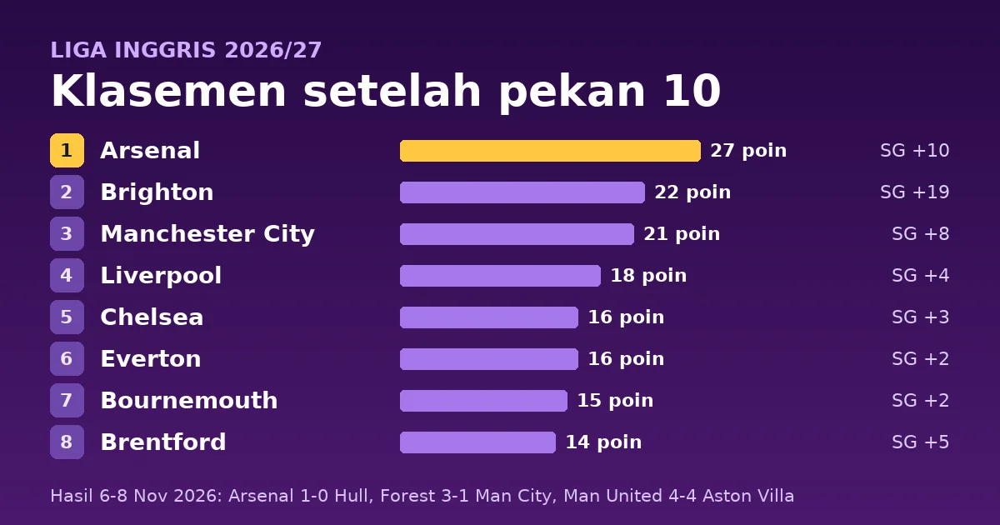

Pekan ke-10 Liga Inggris 2026/27 dimainkan dari Jumat, 6 November, sampai Minggu, 8 November 2026 (tanggal setempat). Arsenal memimpin klasemen dengan 27 poin setelah menang 1-0 atas Hull City lewat gol Martin Ødegaard pada menit 72. Brighton & Hove Albion menang 2-0 atas Brentford dan berada lima poin di belakang Arsenal. Manchester City kalah 1-3 di Nottingham Forest dan tertinggal enam poin. Laga paling ramai gol pekan ini berakhir 4-4 antara Manchester United dan Aston Villa.

<!--more-->

## Poin Penting

> **Poin Penting**
>
> - Arsenal (27 poin) menang sembilan dari sepuluh laga dan kebobolan paling sedikit di liga, lima gol. Brighton (22) tertinggal lima poin dan Manchester City (21) enam poin.
> - Manchester City kalah 1-3 di Nottingham Forest. Liam Delap mencetak dua gol dan Rayan Cherki membalas satu gol untuk City pada menit 52.
> - Manchester United dan Aston Villa bermain 4-4. Villa unggul 4-2 pada menit 53, lalu Joshua Zirkzee (90+2') dan Patrick Dorgu (90+6') menyamakan kedudukan.
> - Crystal Palace (7 poin) ada di dasar klasemen setelah kalah 1-3 dari Liverpool. Manchester United (8) dan Sunderland (8) menempati dua peringkat di atasnya.

## Hasil lengkap pekan 10

| Tanggal | Tuan rumah | Skor | Tamu |
|---|---|---|---|
| Jumat, 6 Nov | Everton | 3-1 | Coventry City |
| Sabtu, 7 Nov | Leeds United | 1-0 | Tottenham Hotspur |
| Sabtu, 7 Nov | Arsenal | 1-0 | Hull City |
| Sabtu, 7 Nov | Fulham | 1-1 | Newcastle United |
| Sabtu, 7 Nov | Nottingham Forest | 3-1 | Manchester City |
| Minggu, 8 Nov | Brighton & Hove Albion | 2-0 | Brentford |
| Minggu, 8 Nov | Crystal Palace | 1-3 | Liverpool |
| Minggu, 8 Nov | Ipswich Town | 1-2 | AFC Bournemouth |
| Minggu, 8 Nov | Sunderland | 1-0 | Chelsea |
| Minggu, 8 Nov | Manchester United | 4-4 | Aston Villa |

Dari 10 laga, 6 dimenangi tuan rumah, 2 dimenangi tamu, dan 2 berakhir seri, dengan 30 gol. Delapan di antaranya lahir di Old Trafford.

## Detail pertandingan

Jam ditulis dalam WIB dengan waktu Inggris (GMT) di dalam kurung. Inggris memakai GMT sejak 25 Oktober, jadi WIB lebih cepat tujuh jam dan laga malam di Inggris jatuh pada dini hari keesokan harinya di Indonesia. Pencetak gol, menit, dan kartu mengikuti ESPN untuk [6 November](https://www.espn.com/soccer/scoreboard/_/date/20261106/league/eng.1), [7 November](https://www.espn.com/soccer/scoreboard/_/date/20261107/league/eng.1), dan [8 November](https://www.espn.com/soccer/scoreboard/_/date/20261108/league/eng.1), dan jumlah kartu di Leeds-Tottenham, Arsenal-Hull, dan Sunderland-Chelsea mengikuti Sky Sports. Tanda ⚽ menandai gol, 🟨 kartu kuning, dan 🟥 kartu merah.

### Laga Jumat, 6 November 2026 (tanggal setempat)

#### Everton 3-1 Coventry City

**Sabtu, 7 November 2026, 03:00 WIB (Jumat, 20:00 GMT)** · Hill Dickinson Stadium, Liverpool

| Everton | Coventry City |
|---|---|
| ⚽ Thierno Barry 56', 61' ⚽ Kiernan Dewsbury-Hall 81' 🟨 Jarrad Branthwaite 88' | ⚽ Yann Gboho 52' 🟨 Caleb Yirenkyi 88' |

Yann Gboho membuka skor untuk Coventry pada menit 52. Thierno Barry membalik keadaan dengan dua gol dalam lima menit (56' dan 61'), lalu Kiernan Dewsbury-Hall menutup di menit 81. Barry kini punya 6 gol musim ini.

### Laga Sabtu, 7 November 2026 (tanggal setempat)

#### Leeds United 1-0 Tottenham Hotspur

**Sabtu, 7 November 2026, 19:30 WIB (12:30 GMT)** · Elland Road, Leeds

| Leeds United | Tottenham Hotspur |
|---|---|
| ⚽ Noah Okafor 79' 🟨 Sean Longstaff 22' 🟨 Noah Okafor 80' | 🟨 Micky van de Ven 15' 🟨 Pedro Porro 51' 🟨 Sandro Tonali 88' |

Noah Okafor mencetak satu-satunya gol pada menit 79, lalu dikartu kuning semenit kemudian karena selebrasi berlebihan, menurut catatan ESPN.

#### Arsenal 1-0 Hull City

**Sabtu, 7 November 2026, 22:00 WIB (15:00 GMT)** · Emirates Stadium, London

| Arsenal | Hull City |
|---|---|
| ⚽ Martin Ødegaard 72' | 🟨 Lewie Coyle 34' 🟨 Lucas Gourna-Douath 48' 🟨 Brooke Norton-Cuffy 61' 🟨 Elliot Stroud 75' 🟨 Nobel Mendy 87' |

#### Fulham 1-1 Newcastle United

**Sabtu, 7 November 2026, 22:00 WIB (15:00 GMT)** · Craven Cottage, London

| Fulham | Newcastle United |
|---|---|
| ⚽ Rodrigo Muniz 83' | ⚽ Jacob Murphy 80' 🟨 Fabian Schär 90' 🟨 Amar Dedic 90+2' |

#### Nottingham Forest 3-1 Manchester City

**Minggu, 8 November 2026, 00:30 WIB (Sabtu, 17:30 GMT)** · The City Ground, Nottingham

| Nottingham Forest | Manchester City |
|---|---|
| ⚽ Jair Cunha 6' ⚽ Liam Delap 18', 73' 🟨 James McAtee 64' 🟨 Dan Ndoye 69' 🟨 Luca Netz 90+4' 🟨 Igor Jesus 90+5' | ⚽ Rayan Cherki 52' |

Forest unggul 2-0 pada menit 18 lewat Jair Cunha dan Liam Delap. Cherki memperkecil skor di menit 52, tetapi Delap menjawab dengan gol kedua pada menit 73.

### Laga Minggu, 8 November 2026 (tanggal setempat)

#### Brighton & Hove Albion 2-0 Brentford

**Minggu, 8 November 2026, 21:00 WIB (14:00 GMT)** · American Express Stadium, Falmer

| Brighton & Hove Albion | Brentford |
|---|---|
| ⚽ Diego Gómez 15' ⚽ Pascal Gross 42' (pen.) 🟨 Chema Andrés 22' 🟨 Olivier Boscagli 27' 🟨 Mats Wieffer 51' 🟨 Lewis Dunk 61' | 🟨 Kristoffer Ajer 5' 🟨 Kevin Schade 69' 🟥 Igor Thiago 23' |

Brentford bermain sepuluh pemain sejak Igor Thiago dikartu merah pada menit 23.

#### Crystal Palace 1-3 Liverpool

**Minggu, 8 November 2026, 21:00 WIB (14:00 GMT)** · Selhurst Park, London

| Crystal Palace | Liverpool |
|---|---|
| ⚽ Eddie Nketiah 90+5' (pen.) 🟨 Yéremy Pino 71' 🟨 Jefferson Lerma 82' | ⚽ Alexis Mac Allister 40' ⚽ Florian Wirtz 54' ⚽ Alexander Isak 89' 🟨 Ronald Araujo 24' 🟨 Bradley Barcola 59' 🟨 Víctor Muñoz 82' 🟨 Alexis Mac Allister 83' |

Liverpool unggul 2-0 sebelum Alexander Isak menambah gol ketiga pada menit 89. Eddie Nketiah mencetak gol hiburan lewat penalti di menit 90+5.

#### Ipswich Town 1-2 AFC Bournemouth

**Minggu, 8 November 2026, 21:00 WIB (14:00 GMT)** · Portman Road, Ipswich

| Ipswich Town | AFC Bournemouth |
|---|---|
| ⚽ Jack Clarke 73' (pen.) 🟨 Julio Enciso 43' 🟨 Zian Flemming 90+9' | ⚽ Evanilson 5' ⚽ Leif Davis 46' (bunuh diri) 🟨 Adam Smith 43' 🟨 Marcus Tavernier 43' 🟨 António Silva 90+3' |

Evanilson membuka skor pada menit 5. Gol kedua Bournemouth adalah gol bunuh diri Leif Davis di menit 46, sebelum Jack Clarke memperkecil skor lewat penalti di menit 73.

#### Sunderland 1-0 Chelsea

**Minggu, 8 November 2026, 21:00 WIB (14:00 GMT)** · Stadium of Light, Sunderland

| Sunderland | Chelsea |
|---|---|
| ⚽ Enzo Le Fée 36' (pen.) 🟨 Jules Ahoka 21' 🟨 Thomas Meunier 50' 🟨 Brian Brobbey 53' 🟨 Luke O'Nien 90' 🟨 Nilson Angulo 90+4' | 🟨 Levi Colwill 35' 🟨 Pedro Neto 55' 🟨 Moisés Caicedo 76' 🟨 Wesley Fofana 90+2' |

Enzo Le Fée mencetak satu-satunya gol lewat penalti pada menit 36.

#### Manchester United 4-4 Aston Villa

**Minggu, 8 November 2026, 23:30 WIB (16:30 GMT)** · Old Trafford, Manchester

| Manchester United | Aston Villa |
|---|---|
| ⚽ Bruno Fernandes 16' (pen.) ⚽ Youri Tielemans 44' ⚽ Joshua Zirkzee 90+2' ⚽ Patrick Dorgu 90+6' 🟨 Ayden Heaven 57' | ⚽ Alysson 1' ⚽ Nicolas Jackson 4' ⚽ John McGinn 48' (pen.) ⚽ Leon Goretzka 53' 🟨 Zion Suzuki 90+7' |

Villa unggul 2-0 pada menit 4 lewat Alysson dan Nicolas Jackson. Manchester United menyamakan 2-2 lewat Bruno Fernandes (16', penalti) dan Youri Tielemans (44'). John McGinn (48', penalti) dan Leon Goretzka (53') membawa Villa unggul 4-2, sebelum Joshua Zirkzee dan Patrick Dorgu mencetak dua gol di masa tambahan waktu.

## Klasemen setelah pekan 10

| # | Tim | M | Me | S | K | Gol | SG | Poin |
|---|---|---|---|---|---|---|---|---|
| 1 | Arsenal | 10 | 9 | 0 | 1 | 15-5 | +10 | **27** |
| 2 | Brighton & Hove Albion | 10 | 7 | 1 | 2 | 26-7 | +19 | **22** |
| 3 | Manchester City | 10 | 7 | 0 | 3 | 21-13 | +8 | **21** |
| 4 | Liverpool | 10 | 5 | 3 | 2 | 14-10 | +4 | **18** |
| 5 | Chelsea | 10 | 5 | 1 | 4 | 19-16 | +3 | **16** |
| 6 | Everton | 10 | 4 | 4 | 2 | 12-10 | +2 | 16 |
| 7 | AFC Bournemouth | 10 | 4 | 3 | 3 | 16-14 | +2 | 15 |
| 8 | Brentford | 10 | 3 | 5 | 2 | 16-11 | +5 | 14 |
| 9 | Leeds United | 10 | 3 | 5 | 2 | 10-8 | +2 | 14 |
| 10 | Aston Villa | 10 | 3 | 4 | 3 | 14-17 | -3 | 13 |
| 11 | Tottenham Hotspur | 10 | 3 | 3 | 4 | 10-11 | -1 | 12 |
| 12 | Newcastle United | 10 | 3 | 3 | 4 | 13-16 | -3 | 12 |
| 13 | Hull City | 10 | 2 | 5 | 3 | 11-11 | 0 | 11 |
| 14 | Ipswich Town | 10 | 3 | 2 | 5 | 15-20 | -5 | 11 |
| 15 | Fulham | 10 | 2 | 4 | 4 | 10-12 | -2 | 10 |
| 16 | Nottingham Forest | 10 | 2 | 3 | 5 | 9-13 | -4 | 9 |
| 17 | Coventry City | 10 | 3 | 0 | 7 | 10-19 | -9 | 9 |
| 18 | Manchester United | 10 | 1 | 5 | 4 | 14-19 | -5 | 8 |
| 19 | Sunderland | 10 | 2 | 2 | 6 | 8-17 | -9 | 8 |
| 20 | Crystal Palace | 10 | 2 | 1 | 7 | 10-24 | -14 | 7 |

M = main, Me = menang, S = seri, K = kalah, SG = selisih gol.

Lima tim teratas dicetak tebal sebagai acuan zona Liga Champions. Jumlah tiket Inggris untuk musim 2027/28 bergantung pada koefisien UEFA musim ini, jadi belum final. Tiga tim terbawah degradasi ke Championship. Semua tim sudah bermain 10 kali, dan setiap pasangan tim berpoin sama pada tabel ini terpisah oleh selisih gol, sehingga urutannya tidak bergantung pada head-to-head.

## Apa artinya klasemen ini

**Puncak.** Arsenal punya 9 kemenangan dari 10 laga dan hanya kebobolan 5 gol, paling sedikit di liga. Brighton memiliki serangan terbaik dengan 26 gol dan selisih gol +19, tertinggi di liga, tetapi tertinggal lima poin dari Arsenal. Manchester City (21 poin) tiga kali kalah dalam sepuluh laga dan Liverpool (18) menempati peringkat 4.

**Perebutan peringkat 5.** Chelsea (selisih gol +3) dan Everton (+2) sama-sama 16 poin. Chelsea kalah 0-1 di Sunderland, sedangkan Everton menang 3-1 atas Coventry. Bournemouth (15) hanya satu poin di belakang keduanya, dan Brentford serta Leeds sama-sama 14.

**Bawah.** Crystal Palace (7 poin) di dasar dengan selisih gol -14, terburuk di liga. Tiga tim terbawah, yaitu Manchester United (8 poin), Sunderland (8), dan Crystal Palace (7), ada di zona degradasi. Nottingham Forest (peringkat 16) dan Coventry sama-sama 9 poin, satu poin di atas garis itu.

## Top skor sampai pekan 10

| # | Pemain | Klub | Gol | Gol di Pekan 10 |
|---|---|---|---|---|
| 1 | Erling Haaland | Manchester City | 9 | – |
| 2 | Alexander Isak | Liverpool | 7 | 1 |
| 3 | Nicolas Jackson | Aston Villa | 6 | 1 |
| 3 | Thierno Barry | Everton | 6 | 2 |
| 5 | Evanilson | AFC Bournemouth | 5 | 1 |
| 5 | João Pedro | Chelsea | 5 | – |
| 5 | Marcus Tavernier | AFC Bournemouth | 5 | – |
| 5 | Morgan Rogers | Chelsea | 5 | – |
| 5 | Rayan Cherki | Manchester City | 5 | 1 |
| 10 | Bruno Fernandes | Manchester United | 4 | 1 |
| 10 | Bryan Mbeumo | Manchester United | 4 | – |
| 10 | Pascal Gross | Brighton & Hove Albion | 4 | 1 |

## Jadwal pekan berikutnya

Pekan ke-11 dijadwalkan 21-23 November 2026 ([ESPN](https://www.espn.com/soccer/scoreboard/_/date/20261121/league/eng.1), [22 November](https://www.espn.com/soccer/scoreboard/_/date/20261122/league/eng.1), [23 November](https://www.espn.com/soccer/scoreboard/_/date/20261123/league/eng.1)). Berikut enam laga pilihan. Jam WIB di bawah memakai GMT (WIB lebih cepat tujuh jam).

- **Manchester City vs Fulham**, Sabtu, 21 November, 19:30 WIB (12:30 GMT). City (peringkat 3) menjamu Fulham (peringkat 15) setelah kalah di Forest.
- **Leeds United vs Chelsea**, Sabtu, 21 November, 22:00 WIB (15:00 GMT). Peringkat 9 menjamu peringkat 5.
- **Arsenal vs Newcastle United**, Minggu, 22 November, 00:30 WIB (Sabtu, 17:30 GMT). Pemimpin klasemen menjamu peringkat 12.
- **Brighton & Hove Albion vs Hull City**, Minggu, 22 November, 21:00 WIB (14:00 GMT). Peringkat 2 melawan peringkat 13.
- **Manchester United vs Liverpool**, Minggu, 22 November, 23:30 WIB (16:30 GMT). Peringkat 18 menjamu peringkat 4, selisih sepuluh poin.
- **Everton vs Brentford**, Selasa, 24 November, 03:00 WIB (Senin, 20:00 GMT). Peringkat 6 melawan peringkat 8.

## Sumber

- ESPN, data laga dan klasemen Liga Inggris (diambil 2026-11-09)
- Rekap lain di blog ini: [Serie A giornata 10](/2026/11/07/klasemen-serie-a-giornata-10-2026-27) dan [Liga Champions matchday 4](/2026/11/07/klasemen-liga-champions-matchday-4-2026).
- ESPN, per 9 November, [papan skor Liga Inggris](https://www.espn.com/soccer/scoreboard/_/date/20261108/league/eng.1) dan [klasemen](https://www.espn.com/soccer/standings/_/league/eng.1).
- Sky Sports, [Leeds vs Tottenham](https://www.skysports.com/football/leeds-united-vs-tottenham-hotspur/stats/7230144843797239232), [Arsenal vs Hull](https://www.skysports.com/football/arsenal-vs-hull-city/stats/8264108816371826232), dan [Sunderland vs Chelsea](https://www.skysports.com/football/sunderland-vs-chelsea/stats/6275693211850041232), jumlah kartu.

---

*Klasemen setelah pekan 10, ditulis 9 November 2026. Penulis: Mahyuddin Susanto ([tentang penulis](https://www.udienz.web.id/about/), [kontak](https://www.udienz.web.id/contact.html)). Tulisan ini dibantu oleh AI.*
