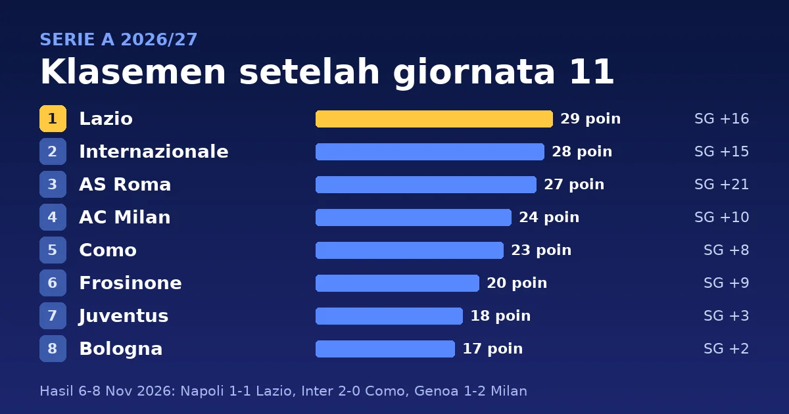

Giornata 11 Serie A 2026/27 dimainkan dari Jumat, 6 November, sampai Minggu, 8 November 2026. Lazio tetap memimpin klasemen dengan 29 poin setelah bermain 1-1 di markas Napoli. Davide Frattesi membawa Lazio unggul menit 28, lalu gol bunuh diri Alfonso Pedraza menit 48 menyamakan kedudukan. Inter menang 2-0 atas Como dan tertinggal satu poin dari Lazio, sedangkan Roma menang 3-0 atas Sassuolo dan berada dua poin di belakang. Milan menang 2-1 di Genoa dan naik ke peringkat 4 dengan 24 poin. Ini lanjutan dari [rekap giornata 10](/2026/11/07/klasemen-serie-a-giornata-10-2026-27).

> **Poin Penting**
>
> - Lazio (29 poin) belum kalah dalam 11 laga, tetapi hanya meraih satu poin di Napoli. Inter (28) tertinggal satu poin, Roma (27) dua poin, dan Milan (24) lima poin.
> - Inter menang 2-0 atas Como lewat gol Pio Esposito menit 12 dan Marcus Thuram menit 19. Como turun ke peringkat 5 dengan 23 poin dan disalip Milan.
> - Roma menang 3-0 atas Sassuolo dan belum kalah dalam 11 laga. Dengan 31 gol dan selisih gol +21, Roma tersubur dan terbaik di liga.
> - Monza (7 poin), Venezia (6), dan Udinese (5) menghuni zona degradasi. Venezia menang 2-1 atas Udinese, sedangkan Monza kalah 0-1 dari Atalanta.

## Hasil lengkap giornata 11

| Tanggal | Tuan rumah | Skor | Tamu |
|---|---|---|---|
| Jumat, 6 Nov | Venezia | 2-1 | Udinese |
| Sabtu, 7 Nov | Cagliari | 1-0 | Frosinone |
| Sabtu, 7 Nov | Torino | 1-1 | Lecce |
| Sabtu, 7 Nov | Parma | 1-2 | Bologna |
| Sabtu, 7 Nov | AS Roma | 3-0 | Sassuolo |
| Minggu, 8 Nov | Napoli | 1-1 | Lazio |
| Minggu, 8 Nov | Genoa | 1-2 | AC Milan |
| Minggu, 8 Nov | Monza | 0-1 | Atalanta |
| Minggu, 8 Nov | Internazionale | 2-0 | Como |
| Minggu, 8 Nov | Fiorentina | 2-2 | Juventus |

Sepuluh laga dimainkan dalam tiga hari. Empat laga dimenangkan tuan rumah, tiga laga dimenangkan tamu, dan tiga laga berakhir seri, dengan total 24 gol. Skor mengikuti [Fantacalcio Online](https://www.fantacalcio-online.com/en/serie-a/2026-2027/diretta-live/11-giornata) dan papan skor [ESPN](https://www.espn.com/soccer/scoreboard/_/date/20261107/league/ita.1), dengan tim tuan rumah di kolom kiri. Tanggal di tabel adalah tanggal di Italia.

## Detail pertandingan

Jam ditulis dalam WIB dengan waktu Italia (CET) di dalam kurung. Italia memakai CET sejak 25 Oktober, jadi WIB lebih cepat enam jam dan laga malam di Italia jatuh pada dini hari keesokan harinya di Indonesia. Pencetak gol, menit, dan kartu mengikuti ESPN untuk [6 November](https://www.espn.com/soccer/scoreboard/_/date/20261106/league/ita.1), [7 November](https://www.espn.com/soccer/scoreboard/_/date/20261107/league/ita.1), dan [8 November](https://www.espn.com/soccer/scoreboard/_/date/20261108/league/ita.1). Tanda ⚽ menandai gol, 🟨 kartu kuning, dan 🟥 kartu merah.

### Laga Jumat, 6 November 2026 (tanggal setempat)

#### Venezia 2-1 Udinese

**Sabtu, 7 November 2026, 02:45 WIB (Jumat, 20:45 CET)** · Stadio Pier Luigi Penzo, Venezia

| Venezia | Udinese |
|---|---|
| ⚽ Toma Basic 53' ⚽ Enrique Perez 65' 🟨 Pasquale Mazzocchi 51' | ⚽ Matías Moreno 57' (bunuh diri) 🟨 Matteo Palma 90+5' |

### Laga Sabtu, 7 November 2026 (tanggal setempat)

#### Cagliari 1-0 Frosinone

**Sabtu, 7 November 2026, 21:00 WIB (15:00 CET)** · Unipol Domus, Cagliari

| Cagliari | Frosinone |
|---|---|
| ⚽ Michel Adopo 38' 🟨 Jacopo Fazzini 69' 🟨 Nicola Grandu 70' 🟨 Zé Pedro 87' | 🟨 Gabriele Bracaglia 13' 🟨 Anthony Oyono 60' 🟨 Ilario Monterisi 85' |

#### Torino 1-1 Lecce

**Sabtu, 7 November 2026, 21:00 WIB (15:00 CET)** · Stadio Olimpico Grande Torino, Torino

| Torino | Lecce |
|---|---|
| ⚽ Kialonda Gaspar 60' (bunuh diri) | ⚽ Daniel Bragança 73' (bunuh diri) 🟨 Youssef Maleh 45+2' 🟨 Amar Ahmed 84' |

#### Parma 1-2 Bologna

**Minggu, 8 November 2026, 00:00 WIB (Sabtu, 18:00 CET)** · Ennio Tardini, Parma

| Parma | Bologna |
|---|---|
| ⚽ Vincent Sierro 81' (pen.) 🟨 José Romero 14' 🟨 Mariano Troilo 42' 🟨 Enrico Del Prato 72' 🟥 Abdoulaye Ndiaye 9' | ⚽ Arthur Theate 53' ⚽ Riccardo Orsolini 72' (pen.) 🟨 Nicolò Casale 20' 🟨 Martin Vitík 80' |

#### AS Roma 3-0 Sassuolo

**Minggu, 8 November 2026, 02:45 WIB (Sabtu, 20:45 CET)** · Olimpico, Roma

| AS Roma | Sassuolo |
|---|---|
| ⚽ Mario Hermoso 27' ⚽ Sebastian Walukiewicz 30' (bunuh diri) ⚽ Rodrigo Mora 58' | – |

### Laga Minggu, 8 November 2026 (tanggal setempat)

#### Napoli 1-1 Lazio

**Minggu, 8 November 2026, 18:30 WIB (12:30 CET)** · Stadio Diego Armando Maradona, Napoli

| Napoli | Lazio |
|---|---|
| ⚽ Alfonso Pedraza 48' (bunuh diri) 🟨 Noa Lang 44' 🟨 Billy Gilmour 65' 🟨 Antonio Vergara 66' | ⚽ Davide Frattesi 28' 🟨 Alfonso Pedraza 78' |

#### Genoa 1-2 AC Milan

**Minggu, 8 November 2026, 21:00 WIB (15:00 CET)** · Stadio Luigi Ferraris, Genova

| Genoa | AC Milan |
|---|---|
| ⚽ Mikael Ellertsson 88' 🟨 Alessandro Marcandalli 50' 🟨 Kingsley Ehizibue 90+4' | ⚽ Alphadjo Cissè 13' ⚽ Christian Pulisic 19' 🟨 Sankhoun Diawara 28' 🟨 Adrien Rabiot 50' 🟨 Christian Pulisic 76' 🟨 Mario Gila 87' |

#### Monza 0-1 Atalanta

**Minggu, 8 November 2026, 21:00 WIB (15:00 CET)** · U-Power Stadium, Monza

| Monza | Atalanta |
|---|---|
| 🟨 Eddy Kouadio 14' 🟨 Leonardo Colombo 48' 🟨 Andrea Carboni 90+2' 🟨 Andrea Colpani 90+3' | ⚽ Nikola Krstovic 49' 🟨 Éderson 85' 🟨 Charles De Ketelaere 90+2' |

#### Internazionale 2-0 Como

**Senin, 9 November 2026, 00:00 WIB (Minggu, 18:00 CET)** · San Siro, Milano

| Internazionale | Como |
|---|---|
| ⚽ Pio Esposito 12' ⚽ Marcus Thuram 19' 🟨 Pio Esposito 72' | – |

#### Fiorentina 2-2 Juventus

**Senin, 9 November 2026, 02:45 WIB (Minggu, 20:45 CET)** · Stadio Artemio Franchi, Firenze

| Fiorentina | Juventus |
|---|---|
| ⚽ Mateo Pellegrino 4' ⚽ Alieu Njie 54' 🟨 Christ Inao Oulaï 50' | ⚽ Nick Woltemade 32' ⚽ Bremer 66' 🟨 Juan Cabal 13' 🟨 Bremer 22' 🟨 Randal Kolo Muani 73' |

## Klasemen setelah giornata 11

| # | Tim | M | Me | S | K | Gol | SG | Poin |
|---|---|---|---|---|---|---|---|---|
| 1 | Lazio | 11 | 9 | 2 | 0 | 25-9 | +16 | **29** |
| 2 | Internazionale | 11 | 9 | 1 | 1 | 28-13 | +15 | **28** |
| 3 | AS Roma | 11 | 8 | 3 | 0 | 31-10 | +21 | **27** |
| 4 | AC Milan | 11 | 7 | 3 | 1 | 23-13 | +10 | **24** |
| 5 | Como | 11 | 7 | 2 | 2 | 18-10 | +8 | 23 |
| 6 | Frosinone | 11 | 6 | 2 | 3 | 24-15 | +9 | 20 |
| 7 | Juventus | 11 | 5 | 3 | 3 | 15-12 | +3 | 18 |
| 8 | Bologna | 11 | 5 | 2 | 4 | 16-14 | +2 | 17 |
| 9 | Cagliari | 11 | 5 | 1 | 5 | 10-15 | -5 | 16 |
| 10 | Napoli | 11 | 4 | 3 | 4 | 18-14 | +4 | 15 |
| 11 | Torino | 11 | 4 | 2 | 5 | 15-17 | -2 | 14 |
| 12 | Atalanta | 11 | 4 | 2 | 5 | 17-20 | -3 | 14 |
| 13 | Genoa | 11 | 4 | 1 | 6 | 11-16 | -5 | 13 |
| 14 | Lecce | 11 | 3 | 1 | 7 | 12-22 | -10 | 10 |
| 15 | Fiorentina | 11 | 2 | 3 | 6 | 17-25 | -8 | 9 |
| 16 | Parma | 11 | 2 | 2 | 7 | 9-17 | -8 | 8 |
| 17 | Sassuolo | 11 | 2 | 2 | 7 | 16-29 | -13 | 8 |
| 18 | Monza | 11 | 2 | 1 | 8 | 17-25 | -8 | 7 |
| 19 | Venezia | 11 | 2 | 0 | 9 | 8-21 | -13 | 6 |
| 20 | Udinese | 11 | 1 | 2 | 8 | 12-25 | -13 | 5 |

M = main, Me = menang, S = seri, K = kalah, SG = selisih gol.

Poin tebal menandai empat tim teratas. Tiga tim terbawah degradasi ke Serie B. Tim dengan poin sama diurutkan lebih dulu menurut hasil pertemuan langsung, lalu selisih gol keseluruhan ([Sky Sport Italia](https://sport.sky.it/calcio/serie-a/serie-a-classifica-avulsa-squadre-punti)).

## Apa artinya klasemen ini

Lazio dan Roma sama-sama belum kalah dalam 11 laga. Lazio punya 9 kemenangan dan 2 seri, Roma 8 kemenangan dan 3 seri. Inter (9 menang, 1 seri, 1 kalah) berada di antara keduanya dengan 28 poin. Roma mencetak 31 gol, paling banyak di liga, dan punya selisih gol +21, terbaik di liga. Lazio kebobolan 9 gol, paling sedikit.

Milan (24) naik ke peringkat 4 dan unggul satu poin dari Como (23), yang kalah 0-2 dari Inter. Frosinone (20) kalah 0-1 di Cagliari dan tetap di peringkat 6, tiga poin di bawah Como dan dua poin di atas Juventus (18). Bologna menang 2-1 di Parma dan naik ke peringkat 8 dengan 17 poin. Cagliari (16) berada di peringkat 9, satu poin di atas Napoli (15) yang ditahan Lazio.

Torino dan Atalanta sama-sama 14 poin di peringkat 11 dan 12. Keduanya belum bertemu musim ini, jadi Torino di atas karena selisih gol (-2 berbanding -3). Fiorentina (9 poin) di peringkat 15 hanya unggul satu poin dari Parma dan Sassuolo yang sama-sama 8 poin. Parma di atas Sassuolo karena selisih gol (-8 berbanding -13); keduanya belum bertemu musim ini. Sassuolo kebobolan 29 gol, terbanyak di liga.

Di zona degradasi, Monza (18) punya 7 poin, Venezia (19) 6 poin, dan Udinese (20) 5 poin. Monza hanya satu poin di bawah Parma dan Sassuolo. Venezia baru menang dua kali dan mencetak 8 gol, paling sedikit di liga.

## Top skor sampai giornata 11

Pemain dengan jumlah gol sama diberi peringkat yang sama. Krstovic, Thuram, dan Cissè masing-masing mencetak satu gol di giornata 11, sedangkan Varela, Raimondo, Malen, Rabiot, Maldini, Calo, dan Douvikas tidak mencetak gol ([ESPN](https://www.espn.com/soccer/stats/_/league/ita.1)).

| # | Pemain | Klub | Gol | Gol di Giornata 11 |
|---|---|---|---|---|
| 1 | Gustavo Varela | Monza | 9 | – |
| 2 | Antonio Raimondo | Frosinone | 8 | – |
| 2 | Donyell Malen | AS Roma | 8 | – |
| 4 | Nikola Krstovic | Atalanta | 7 | 1 |
| 5 | Marcus Thuram | Internazionale | 6 | 1 |
| 6 | Adrien Rabiot | AC Milan | 5 | – |
| 6 | Alphadjo Cissè | AC Milan | 5 | 1 |
| 6 | Daniel Maldini | Cagliari | 5 | – |
| 6 | Giacomo Calo | Frosinone | 5 | – |
| 6 | Tasos Douvikas | Como | 5 | – |

## Assist terbanyak sampai giornata 11

Mattia Zaccagni dari Lazio dan Juan Miranda dari Bologna sama-sama mengoleksi 5 assist. Lima pemain menyusul dengan 4 assist, tiga di antaranya dari Frosinone: Giorgi Kvernadze, Romano Schmid, dan Farès Ghedjemis ([ESPN](https://www.espn.com/soccer/stats/_/league/ita.1)).

| # | Pemain | Klub | Main | Assist |
|---:|---|---|:---:|:---:|
| 1 | Mattia Zaccagni | Lazio | 10 | **5** |
| 1 | Juan Miranda | Bologna | 10 | **5** |
| 3 | Giorgi Kvernadze | Frosinone | 11 | 4 |
| 3 | Romano Schmid | Frosinone | 11 | 4 |
| 3 | Andy Diouf | Inter | 9 | 4 |
| 3 | Farès Ghedjemis | Frosinone | 9 | 4 |
| 3 | Paulo Dybala | Roma | 6 | 4 |

Tujuh pemain berada di 3 assist: Nicolò Cambiaghi, Matías Soulé, Charles De Ketelaere, Wesley, Nuno Tavares, Matteo Politano, dan Nico Paz. Penghitungan assist bisa berbeda antar penyedia data karena definisinya tidak seragam. Tabel di atas mengikuti ESPN.

## Jadwal giornata berikutnya

Giornata 12 dijadwalkan Sabtu, 21 November, sampai Senin, 23 November 2026 waktu Italia, atau 21-24 November WIB ([Fantamaster](https://www.fantamaster.it/seriea-6-12-giornata-date-orari-calendario-quando-si-gioca-milan-inter/)). Beberapa laga yang mempertemukan tim papan atas atau menyangkut zona bawah:

- Parma vs Roma (Minggu, 22 Nov, 00:00 WIB)
- Milan vs Frosinone (Minggu, 22 Nov, 21:00 WIB)
- Atalanta vs Inter (Senin, 23 Nov, 02:45 WIB)
- Monza vs Fiorentina (Selasa, 24 Nov, 00:30 WIB)

Parma vs Roma mempertemukan peringkat 16 (8 poin) dengan Roma yang belum kalah dan tertinggal dua poin dari Lazio. Milan vs Frosinone mempertemukan peringkat 4 dan 6, yang terpaut empat poin. Atalanta vs Inter mempertemukan peringkat 12 (14 poin) dengan Inter (28 poin), yang hanya terpaut satu poin dari Lazio. Monza vs Fiorentina mempertemukan peringkat 18 dan 15, yang terpaut dua poin. Lazio, pemimpin klasemen, menjamu Lecce (peringkat 14) pada Sabtu, 21 Nov, pukul 21:00 WIB.

## Sumber

- ESPN, papan skor Serie A [6 November](https://www.espn.com/soccer/scoreboard/_/date/20261106/league/ita.1), [7 November](https://www.espn.com/soccer/scoreboard/_/date/20261107/league/ita.1), dan [8 November 2026](https://www.espn.com/soccer/scoreboard/_/date/20261108/league/ita.1), serta [komentar Monza vs Atalanta](https://www.espn.com/soccer/commentary/_/gameId/401874800) untuk kartu di laga itu.
- Fantacalcio Online, [giornata 11 Serie A 2026/27](https://www.fantacalcio-online.com/en/serie-a/2026-2027/diretta-live/11-giornata), skor dan jam kick-off tiap laga.
- ESPN, [Serie A standings](https://www.espn.com/soccer/standings/_/league/ita.1), klasemen, dan [Serie A Stats, 2026-27 Season](https://www.espn.com/soccer/stats/_/league/ita.1), top skor dan assist.
- Sky Sport Italia, [Serie A, classifica avulsa e gol: i criteri per le squadre a pari punti](https://sport.sky.it/calcio/serie-a/serie-a-classifica-avulsa-squadre-punti), aturan tiebreak.
- Fantamaster, [Serie A 2026/27, giornata 6-12: date e orari](https://www.fantamaster.it/seriea-6-12-giornata-date-orari-calendario-quando-si-gioca-milan-inter/), jadwal giornata 12.

---

*Klasemen setelah giornata 11, ditulis 9 November 2026. Penulis: Mahyuddin Susanto ([tentang penulis](https://www.udienz.web.id/about/), [kontak](https://www.udienz.web.id/contact.html)). Tulisan ini dibantu oleh AI.*
