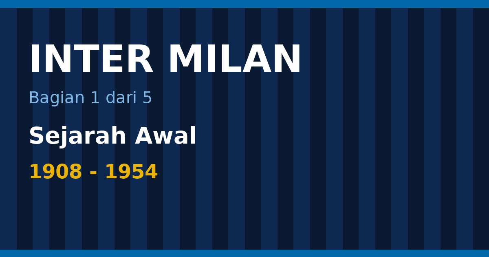

Inter Milan lahir pada 9 Maret 1908 dari sebuah pertengkaran. Sekelompok anggota Milan Cricket and Football Club memutuskan keluar dan mendirikan klub sendiri, lalu memberinya nama yang sengaja terdengar seperti pernyataan sikap: Internazionale. Seabad lebih kemudian klub itu mengoleksi 21 Scudetto, 10 Coppa Italia, 3 Piala Eropa (kini Liga Champions), dan satu catatan yang jarang dibahas: Inter tidak pernah terdegradasi dari kasta teratas sejak debutnya di liga pada 1909 ([Wikipedia](https://en.wikipedia.org/wiki/FC_Internazionale_Milano)).

Ini bagian pertama dari lima tulisan tentang Inter. Bagian ini mencakup tahun 1908 sampai pertengahan 1950-an: kelahiran klub, dua gelar liga pertama, masa ketika rezim Fasis memaksa Inter berganti nama, era Giuseppe Meazza, dan dua Scudetto beruntun di awal 1950-an. Bagian kedua membahas era Grande Inter di bawah Helenio Herrera. Bagian ketiga membahas Massimo Moratti dan treble 2010. Bagian keempat membahas masa Suning dan Oaktree sampai Scudetto ke-21 pada 2026. Bagian kelima merangkum seluruh prestasi, rekor, dan timeline dalam satu tempat.

<!--more-->

*Ilustrasi: dibuat untuk tulisan ini.*

> **Poin Penting**
>
> - Inter didirikan pada 9 Maret 1908 setelah memisahkan diri dari Milan Cricket and Football Club. Nama Internazionale dipilih karena klub menerima pemain dari mana saja.
> - Scudetto pertama datang pada 1910 dan kedua pada 1920. Total lima gelar liga sudah terkumpul sebelum Perang Dunia II berakhir: 1910, 1920, 1930, 1938, dan 1940.
> - Giuseppe Meazza masih memegang rekor pencetak gol terbanyak klub, 284 gol dalam 408 laga, dan stadion San Siro kini memakai namanya.
> - Pada 1928 klub dipaksa bergabung dan berganti nama menjadi Ambrosiana. Nama Inter kembali dipakai penuh setelah perang.
> - Inter menjuarai liga lagi pada 1953 dan 1954, dua gelar yang menutup bab awal sebelum era Grande Inter.

Daftar isi bagian ini

* TOC
{:toc}

## Milan, 1908: sebuah perpecahan

Sepak bola Italia di awal abad ke-20 masih seperti klub sosial. Pertandingan resmi sedikit, liga baru berjalan beberapa musim, dan klub-klub besar di kota-kota utara lahir dari kelompok ekspatriat, pedagang, dan pelajar. Milan Cricket and Football Club adalah salah satunya. Dari dalam klub itulah muncul kelompok yang tidak sepakat soal arah klub, dan pada 9 Maret 1908 kelompok ini mendirikan Foot-Ball Club Internazionale ([Wikipedia, sejarah Inter](https://en.wikipedia.org/wiki/History_of_Inter_Milan)).

Salah satu pendirinya, Giorgio Muggiani, juga yang merancang lambang klub. Menurut kutipan yang dicatat Wikipedia, ia menjelaskan nama klub dengan kalimat sederhana: klub ini disebut Internazionale karena "kita bersaudara di seluruh dunia". Biru dan hitam dipilih sebagai warna klub, dengan latar bintang-bintang di lambangnya. Dari situ lahir julukan *I Nerazzurri*, "si biru-hitam", yang sampai sekarang lebih sering dipakai daripada nama resminya.

Nama itu punya arti praktis. Pada masa itu pembatasan pemain asing menjadi bahan perdebatan di sepak bola Italia, dan Inter memilih jalan sebaliknya: klub terbuka untuk pemain dari negara mana pun. Keterbukaan itu menjadi identitas yang bertahan lama. Dari Lothar Matthäus dan Ronaldo sampai Zlatan Ibrahimović di era berikutnya, daftar pemain Inter memang selalu dipenuhi nama dari luar Italia.

<figure class="blog-chart">
<svg viewBox="0 0 420 396" width="420" height="396" role="img" aria-label="Timeline Inter Milan 1908 sampai 1954: 1908, 9 Maret: Foot-Ball Club Internazionale berdiri setelah memisahkan diri dari Milan Cricket and Football Club; 1910, Scudetto pertama, kapten dan pelatih Virgilio Fossati; 1920, Scudetto kedua; 1928, Dipaksa bergabung dan berganti nama menjadi Ambrosiana; 1930, Scudetto ketiga; Meazza 38 gol dalam 39 laga; 1931, Nama menjadi Ambrosiana-Inter; 1938, Scudetto keempat; 1939, Coppa Italia pertama; 1940, Scudetto kelima; 1953, Scudetto keenam; 1954, Scudetto ketujuh" style="max-width:100%;height:auto;font-family:sans-serif">
<line x1="86" y1="8" x2="86" y2="388" stroke="#9ca3af" stroke-width="2"></line>
<text x="76" y="22" text-anchor="end" font-size="13" font-weight="bold" fill="currentColor">1908</text>
<circle cx="86" cy="18" r="5" fill="#3b82f6"></circle>
<text x="100" y="22" text-anchor="start" font-size="13" font-weight="normal" fill="currentColor">9 Maret: Foot-Ball Club Internazionale berdiri</text>
<text x="100" y="38" text-anchor="start" font-size="13" font-weight="normal" fill="currentColor">setelah memisahkan diri dari Milan Cricket and</text>
<text x="100" y="54" text-anchor="start" font-size="13" font-weight="normal" fill="currentColor">Football Club</text>
<text x="76" y="82" text-anchor="end" font-size="13" font-weight="bold" fill="currentColor">1910</text>
<circle cx="86" cy="78" r="5" fill="#eab308"></circle>
<text x="100" y="82" text-anchor="start" font-size="13" font-weight="normal" fill="currentColor">Scudetto pertama, kapten dan pelatih Virgilio</text>
<text x="100" y="98" text-anchor="start" font-size="13" font-weight="normal" fill="currentColor">Fossati</text>
<text x="76" y="126" text-anchor="end" font-size="13" font-weight="bold" fill="currentColor">1920</text>
<circle cx="86" cy="122" r="5" fill="#eab308"></circle>
<text x="100" y="126" text-anchor="start" font-size="13" font-weight="normal" fill="currentColor">Scudetto kedua</text>
<text x="76" y="154" text-anchor="end" font-size="13" font-weight="bold" fill="currentColor">1928</text>
<circle cx="86" cy="150" r="5" fill="#ef4444"></circle>
<text x="100" y="154" text-anchor="start" font-size="13" font-weight="normal" fill="currentColor">Dipaksa bergabung dan berganti nama menjadi</text>
<text x="100" y="170" text-anchor="start" font-size="13" font-weight="normal" fill="currentColor">Ambrosiana</text>
<text x="76" y="198" text-anchor="end" font-size="13" font-weight="bold" fill="currentColor">1930</text>
<circle cx="86" cy="194" r="5" fill="#eab308"></circle>
<text x="100" y="198" text-anchor="start" font-size="13" font-weight="normal" fill="currentColor">Scudetto ketiga; Meazza 38 gol dalam 39 laga</text>
<text x="76" y="226" text-anchor="end" font-size="13" font-weight="bold" fill="currentColor">1931</text>
<circle cx="86" cy="222" r="5" fill="#9ca3af"></circle>
<text x="100" y="226" text-anchor="start" font-size="13" font-weight="normal" fill="currentColor">Nama menjadi Ambrosiana-Inter</text>
<text x="76" y="254" text-anchor="end" font-size="13" font-weight="bold" fill="currentColor">1938</text>
<circle cx="86" cy="250" r="5" fill="#eab308"></circle>
<text x="100" y="254" text-anchor="start" font-size="13" font-weight="normal" fill="currentColor">Scudetto keempat</text>
<text x="76" y="282" text-anchor="end" font-size="13" font-weight="bold" fill="currentColor">1939</text>
<circle cx="86" cy="278" r="5" fill="#eab308"></circle>
<text x="100" y="282" text-anchor="start" font-size="13" font-weight="normal" fill="currentColor">Coppa Italia pertama</text>
<text x="76" y="310" text-anchor="end" font-size="13" font-weight="bold" fill="currentColor">1940</text>
<circle cx="86" cy="306" r="5" fill="#eab308"></circle>
<text x="100" y="310" text-anchor="start" font-size="13" font-weight="normal" fill="currentColor">Scudetto kelima</text>
<text x="76" y="338" text-anchor="end" font-size="13" font-weight="bold" fill="currentColor">1953</text>
<circle cx="86" cy="334" r="5" fill="#eab308"></circle>
<text x="100" y="338" text-anchor="start" font-size="13" font-weight="normal" fill="currentColor">Scudetto keenam</text>
<text x="76" y="366" text-anchor="end" font-size="13" font-weight="bold" fill="currentColor">1954</text>
<circle cx="86" cy="362" r="5" fill="#eab308"></circle>
<text x="100" y="366" text-anchor="start" font-size="13" font-weight="normal" fill="currentColor">Scudetto ketujuh</text>
</svg>
<figcaption>Tonggak Inter dari 1908 sampai 1954. Kuning menandai trofi, merah menandai paksaan ganti nama.</figcaption>
</figure>

## Dua Scudetto pertama: 1910 dan 1920

Hanya dua musim setelah berdiri, Inter sudah juara. Scudetto 1909–10 menjadi gelar liga pertama klub, dengan Virgilio Fossati sebagai kapten sekaligus pelatih ([Wikipedia, sejarah Inter](https://en.wikipedia.org/wiki/History_of_Inter_Milan)). Fossati kemudian tewas di Perang Dunia I, sebuah nasib yang dialami banyak pemain dari generasinya. Gelar kedua datang pada 1919–20, setelah liga kembali berjalan sesudah perang.

Dua gelar itu terpisah satu dekade penuh, dan kedua-duanya dimenangi dalam format kejuaraan yang sangat berbeda dari Serie A modern. Liga belum berbentuk satu tabel nasional dengan 20 klub. Pada awalnya kejuaraan dibagi menurut wilayah dengan babak final antarjuara wilayah, sehingga "juara Italia" lebih mirip pemenang turnamen daripada pemuncak klasemen musim panjang. Format baru berupa liga satu tabel nasional baru berjalan mulai musim 1929–30, dan Inter memenangi musim pertama format itu.

Rekor kehadiran Inter di kasta teratas, yang tak pernah putus sejak 1909, bermula dari masa ini. Klub besar lain di Italia pernah turun kasta, dan sebagian terseret skandal. Inter, sampai sekarang, tidak pernah.

## Ambrosiana: ketika nama klub dilarang

Kemajuan klub terganggu pada akhir 1920-an. Rezim Fasis Italia saat itu menekan nama-nama yang dianggap terlalu asing atau internasional. Pada 1928 Inter dipaksa bergabung dengan Unione Sportiva Milanese dan berganti nama menjadi Società Sportiva Ambrosiana, merujuk pada Santo Ambrosius, pelindung kota Milan ([Wikipedia, sejarah Inter](https://en.wikipedia.org/wiki/History_of_Inter_Milan)).

Reaksi pendukung muncul cepat. Para pemegang saham dan suporter menekan pimpinan klub, dan pada 1931 nama diubah menjadi Associazione Sportiva Ambrosiana-Inter. Kata "Inter" kembali ke nama klub, walau masih menempel pada "Ambrosiana". Setelah perang, klub kembali memakai nama Internazionale sepenuhnya, dan baru pada 1967 nama resminya menjadi Football Club Internazionale Milano seperti sekarang.

<figure class="blog-chart">
<svg viewBox="0 0 420 266" width="420" height="266" role="img" aria-label="Perubahan nama klub dari 1908 sampai 1967: 1908: Foot-Ball Club Internazionale, Nama pendirian; 1928: Società Sportiva Ambrosiana, Hasil penggabungan paksa; 1931: Associazione Sportiva Ambrosiana-Inter, Kata Inter kembali setelah tekanan suporter; Setelah perang: Internazionale, Nama lama dipakai lagi; 1967 menjadi FC Internazionale Milano" style="max-width:100%;height:auto;font-family:sans-serif">
<rect x="20" y="0" width="380" height="50" rx="8" fill="none" stroke="#3b82f6" stroke-width="2"></rect>
<text x="210.0" y="22" text-anchor="middle" font-size="14" font-weight="bold" fill="currentColor">1908: Foot-Ball Club Internazionale</text>
<text x="210.0" y="40" text-anchor="middle" font-size="12" font-weight="normal" fill="#9ca3af">Nama pendirian</text>
<line x1="210.0" y1="50" x2="210.0" y2="66" stroke="#9ca3af" stroke-width="2"></line>
<polygon points="210.0,72 205.0,64 215.0,64" fill="#9ca3af"></polygon>
<rect x="20" y="72" width="380" height="50" rx="8" fill="none" stroke="#ef4444" stroke-width="2"></rect>
<text x="210.0" y="94" text-anchor="middle" font-size="14" font-weight="bold" fill="currentColor">1928: Società Sportiva Ambrosiana</text>
<text x="210.0" y="112" text-anchor="middle" font-size="12" font-weight="normal" fill="#9ca3af">Hasil penggabungan paksa</text>
<line x1="210.0" y1="122" x2="210.0" y2="138" stroke="#9ca3af" stroke-width="2"></line>
<polygon points="210.0,144 205.0,136 215.0,136" fill="#9ca3af"></polygon>
<rect x="20" y="144" width="380" height="50" rx="8" fill="none" stroke="#9ca3af" stroke-width="2"></rect>
<text x="210.0" y="166" text-anchor="middle" font-size="14" font-weight="bold" fill="currentColor">1931: Associazione Sportiva Ambrosiana-Inter</text>
<text x="210.0" y="184" text-anchor="middle" font-size="12" font-weight="normal" fill="#9ca3af">Kata Inter kembali setelah tekanan suporter</text>
<line x1="210.0" y1="194" x2="210.0" y2="210" stroke="#9ca3af" stroke-width="2"></line>
<polygon points="210.0,216 205.0,208 215.0,208" fill="#9ca3af"></polygon>
<rect x="20" y="216" width="380" height="50" rx="8" fill="none" stroke="#3b82f6" stroke-width="2"></rect>
<text x="210.0" y="238" text-anchor="middle" font-size="14" font-weight="bold" fill="currentColor">Setelah perang: Internazionale</text>
<text x="210.0" y="256" text-anchor="middle" font-size="12" font-weight="normal" fill="#9ca3af">Nama lama dipakai lagi; 1967 menjadi FC Internazionale Milano</text>
</svg>
<figcaption>Empat nama dalam satu klub: dari Internazionale sampai Football Club Internazionale Milano.</figcaption>
</figure>

Episode ini sering dilupakan karena sebagian besar gelar era 1930-an tercatat atas nama Ambrosiana. Ketika membaca daftar juara Serie A, nama "Ambrosiana-Inter" muncul pada 1938 dan 1940, sedangkan gelar 1930 tercatat atas nama Ambrosiana. Klub yang sama, dengan sejarah yang sama, hanya dengan papan nama yang berbeda.

## 1929–30: Serie A lahir, Ambrosiana juara pertama

Musim 1929–30 adalah musim pertama Serie A dalam bentuk liga nasional satu tabel. Delapan belas klub, sembilan teratas dari tiap grup Divisione Nazionale musim sebelumnya, saling bertemu dalam sistem kompetisi penuh, sehingga setiap klub memainkan 34 laga dan total ada 306 pertandingan ([Wikipedia, Serie A 1929–30](https://en.wikipedia.org/wiki/1929%E2%80%9330_Serie_A)).

Ambrosiana, nama Inter saat itu, menutup musim dengan 50 poin dari 34 laga: 22 menang, 6 seri, dan 6 kalah, mencetak 85 gol dan kebobolan 38. Genoa di peringkat kedua mengumpulkan 48 poin, Juventus 45, Torino 39, Napoli 37, dan Roma 36 ([Wikipedia, Serie A 1929–30](https://en.wikipedia.org/wiki/1929%E2%80%9330_Serie_A)).

| Posisi | Klub | Poin |
|--------|------|------|
| 1 | Ambrosiana (Inter) | 50 |
| 2 | Genoa | 48 |
| 3 | Juventus | 45 |
| 4 | Torino | 39 |
| 5 | Napoli | 37 |
| 6 | Roma | 36 |

Pemain Inter era awal dengan catatan paling mencolok adalah Giuseppe Meazza. Ia pencetak gol terbanyak sepanjang sejarah klub dengan 284 gol dalam 408 pertandingan, rekor yang bertahan sampai sekarang. Pada musim itu ia mencetak 31 gol di liga dan menjadi pencetak gol terbanyak Serie A pertama. Jika semua kompetisi dihitung, ia mencetak 38 gol dalam 39 pertandingan, rekor satu musim klub sampai sekarang ([Wikipedia](https://en.wikipedia.org/wiki/FC_Internazionale_Milano)). Ia kemudian juga memperkuat tim nasional Italia yang menjuarai Piala Dunia 1934 dan 1938.

<figure class="blog-chart">
<svg viewBox="0 0 420 168" width="420" height="168" role="img" aria-label="Angka kunci Giuseppe Meazza dan stadion San Siro: 284 gol, Rekor gol klub, dalam 408 laga; 38 gol, Rekor satu musim, dalam 39 laga, 1929-30; 1980, San Siro dinamai Meazza, dipakai bersama Milan sejak 1947; 75.817, Kapasitas reguler, maksimum 80.018" style="max-width:100%;height:auto;font-family:sans-serif">
<rect x="0.0" y="0" width="204.0" height="78" rx="8" fill="none" stroke="#eab308" stroke-width="2"></rect>
<text x="102.0" y="24" text-anchor="middle" font-size="15" font-weight="bold" fill="currentColor">284 gol</text>
<text x="102.0" y="46" text-anchor="middle" font-size="13" font-weight="normal" fill="currentColor">Rekor gol klub</text>
<text x="102.0" y="64" text-anchor="middle" font-size="12" font-weight="normal" fill="#9ca3af">dalam 408 laga</text>
<rect x="216.0" y="0" width="204.0" height="78" rx="8" fill="none" stroke="#eab308" stroke-width="2"></rect>
<text x="318.0" y="24" text-anchor="middle" font-size="15" font-weight="bold" fill="currentColor">38 gol</text>
<text x="318.0" y="46" text-anchor="middle" font-size="13" font-weight="normal" fill="currentColor">Rekor satu musim</text>
<text x="318.0" y="64" text-anchor="middle" font-size="12" font-weight="normal" fill="#9ca3af">dalam 39 laga, 1929-30</text>
<rect x="0.0" y="90" width="204.0" height="78" rx="8" fill="none" stroke="#3b82f6" stroke-width="2"></rect>
<text x="102.0" y="114" text-anchor="middle" font-size="15" font-weight="bold" fill="currentColor">1980</text>
<text x="102.0" y="136" text-anchor="middle" font-size="13" font-weight="normal" fill="currentColor">San Siro dinamai Meazza</text>
<text x="102.0" y="154" text-anchor="middle" font-size="12" font-weight="normal" fill="#9ca3af">dipakai bersama Milan sejak 1947</text>
<rect x="216.0" y="90" width="204.0" height="78" rx="8" fill="none" stroke="#3b82f6" stroke-width="2"></rect>
<text x="318.0" y="114" text-anchor="middle" font-size="15" font-weight="bold" fill="currentColor">75.817</text>
<text x="318.0" y="136" text-anchor="middle" font-size="13" font-weight="normal" fill="currentColor">Kapasitas reguler</text>
<text x="318.0" y="154" text-anchor="middle" font-size="12" font-weight="normal" fill="#9ca3af">maksimum 80.018</text>
</svg>
<figcaption>Empat angka yang melekat pada nama Meazza.</figcaption>
</figure>

Setelah Meazza meninggal pada 1979, klub dan kota mengambil keputusan besar. Pada 1980 stadion San Siro secara resmi dinamai Stadio Giuseppe Meazza. Stadion itu dipakai bersama Milan sejak 1947, dan sampai sekarang kapasitasnya tercatat 75.817 untuk laga biasa dan 80.018 untuk kapasitas maksimum ([Wikipedia](https://en.wikipedia.org/wiki/FC_Internazionale_Milano)). Orang Milan sendiri tetap menyebutnya San Siro.

## Perang, lalu kembali ke nama lama

Sepak bola Italia terhenti dan terdistorsi selama Perang Dunia II. Liga berjalan dalam format darurat, banyak pemain dipanggil atau hilang dari kompetisi, dan klub-klub kehilangan stabilitas yang sudah mereka bangun. Inter keluar dari periode itu dengan pergantian nama kembali ke Internazionale, mengakhiri masa Ambrosiana yang sudah berlangsung sejak 1928.

Satu catatan penting: tidak ada gelar liga selama beberapa tahun pertama setelah perang. Dominasi saat itu berada di klub-klub lain, dan Inter menunggu sampai awal 1950-an untuk kembali ke puncak.

## 1953 dan 1954: dua gelar beruntun

Penantian itu berakhir pada musim 1952–53, ketika Inter menjuarai Serie A, dan berlanjut dengan gelar kedua pada 1953–54. Kedua gelar tersebut dimenangi dengan Attilio Giovannini sebagai kapten ([Wikipedia, sejarah Inter](https://en.wikipedia.org/wiki/History_of_Inter_Milan)).

Gelar beruntun ini penting karena dua alasan. Ia menunjukkan bahwa Inter masih sanggup bersaing setelah era Meazza berakhir, dan ia menyiapkan landasan untuk perubahan besar yang datang dua tahun kemudian, ketika kepemilikan klub berpindah tangan dan Inter memasuki dekade yang paling terkenal dalam sejarahnya. Perubahan itu menjadi pokok bagian kedua.

Satu laga dari periode ini juga masih sering disebut dalam rivalitas Derby d'Italia melawan Juventus. Pada 1954 Inter menang 6–0, kemenangan terbesar Inter dalam fixture itu menurut catatan Wikipedia ([Wikipedia](https://en.wikipedia.org/wiki/FC_Internazionale_Milano)). Skor itu bertahan sebagai pembanding setiap kali kedua klub bertemu lagi.

<figure class="blog-chart">
<svg viewBox="0 0 700 342" width="700" height="342" role="img" aria-label="Garis waktu tujuh Scudetto Inter sebelum 1955: 1910, Scudetto; 1920, Scudetto; 1930, Scudetto; 1938, Scudetto; 1940, Scudetto; 1953, Scudetto; 1954, Scudetto" style="max-width:100%;height:auto;font-family:sans-serif">
<line x1="24" y1="172" x2="676" y2="172" stroke="#9ca3af" stroke-width="2"></line>
<line x1="51.2" y1="168" x2="51.2" y2="176" stroke="#9ca3af"></line>
<text x="51.16666666666667" y="192" text-anchor="middle" font-size="11" font-weight="normal" fill="#9ca3af">1910</text>
<line x1="119.1" y1="168" x2="119.1" y2="176" stroke="#9ca3af"></line>
<text x="119.08333333333333" y="192" text-anchor="middle" font-size="11" font-weight="normal" fill="#9ca3af">1915</text>
<line x1="187.0" y1="168" x2="187.0" y2="176" stroke="#9ca3af"></line>
<text x="187.0" y="192" text-anchor="middle" font-size="11" font-weight="normal" fill="#9ca3af">1920</text>
<line x1="254.9" y1="168" x2="254.9" y2="176" stroke="#9ca3af"></line>
<text x="254.91666666666666" y="192" text-anchor="middle" font-size="11" font-weight="normal" fill="#9ca3af">1925</text>
<line x1="322.8" y1="168" x2="322.8" y2="176" stroke="#9ca3af"></line>
<text x="322.8333333333333" y="192" text-anchor="middle" font-size="11" font-weight="normal" fill="#9ca3af">1930</text>
<line x1="390.8" y1="168" x2="390.8" y2="176" stroke="#9ca3af"></line>
<text x="390.75" y="192" text-anchor="middle" font-size="11" font-weight="normal" fill="#9ca3af">1935</text>
<line x1="458.7" y1="168" x2="458.7" y2="176" stroke="#9ca3af"></line>
<text x="458.6666666666667" y="192" text-anchor="middle" font-size="11" font-weight="normal" fill="#9ca3af">1940</text>
<line x1="526.6" y1="168" x2="526.6" y2="176" stroke="#9ca3af"></line>
<text x="526.5833333333333" y="192" text-anchor="middle" font-size="11" font-weight="normal" fill="#9ca3af">1945</text>
<line x1="594.5" y1="168" x2="594.5" y2="176" stroke="#9ca3af"></line>
<text x="594.5" y="192" text-anchor="middle" font-size="11" font-weight="normal" fill="#9ca3af">1950</text>
<line x1="662.4" y1="168" x2="662.4" y2="176" stroke="#9ca3af"></line>
<text x="662.4166666666666" y="192" text-anchor="middle" font-size="11" font-weight="normal" fill="#9ca3af">1955</text>
<line x1="51.2" y1="172" x2="51.2" y2="130" stroke="#eab308" stroke-width="1"></line>
<circle cx="51.2" cy="172" r="5" fill="#eab308"></circle>
<text x="51.2" y="120" text-anchor="start" font-size="12" font-weight="bold" fill="currentColor">1910</text>
<text x="51.2" y="134" text-anchor="start" font-size="11" font-weight="normal" fill="currentColor">Scudetto</text>
<line x1="187.0" y1="172" x2="187.0" y2="204" stroke="#eab308" stroke-width="1"></line>
<circle cx="187.0" cy="172" r="5" fill="#eab308"></circle>
<text x="187.0" y="216" text-anchor="middle" font-size="12" font-weight="bold" fill="currentColor">1920</text>
<text x="187.0" y="230" text-anchor="middle" font-size="11" font-weight="normal" fill="currentColor">Scudetto</text>
<line x1="322.8" y1="172" x2="322.8" y2="86" stroke="#eab308" stroke-width="1"></line>
<circle cx="322.8" cy="172" r="5" fill="#eab308"></circle>
<text x="322.8" y="76" text-anchor="middle" font-size="12" font-weight="bold" fill="currentColor">1930</text>
<text x="322.8" y="90" text-anchor="middle" font-size="11" font-weight="normal" fill="currentColor">Scudetto</text>
<line x1="431.5" y1="172" x2="431.5" y2="244" stroke="#eab308" stroke-width="1"></line>
<circle cx="431.5" cy="172" r="5" fill="#eab308"></circle>
<text x="431.5" y="256" text-anchor="middle" font-size="12" font-weight="bold" fill="currentColor">1938</text>
<text x="431.5" y="270" text-anchor="middle" font-size="11" font-weight="normal" fill="currentColor">Scudetto</text>
<line x1="458.7" y1="172" x2="458.7" y2="42" stroke="#eab308" stroke-width="1"></line>
<circle cx="458.7" cy="172" r="5" fill="#eab308"></circle>
<text x="458.7" y="32" text-anchor="middle" font-size="12" font-weight="bold" fill="currentColor">1940</text>
<text x="458.7" y="46" text-anchor="middle" font-size="11" font-weight="normal" fill="currentColor">Scudetto</text>
<line x1="635.2" y1="172" x2="635.2" y2="284" stroke="#eab308" stroke-width="1"></line>
<circle cx="635.2" cy="172" r="5" fill="#eab308"></circle>
<text x="635.2" y="296" text-anchor="middle" font-size="12" font-weight="bold" fill="currentColor">1953</text>
<text x="635.2" y="310" text-anchor="middle" font-size="11" font-weight="normal" fill="currentColor">Scudetto</text>
<line x1="648.8" y1="172" x2="648.8" y2="130" stroke="#eab308" stroke-width="1"></line>
<circle cx="648.8" cy="172" r="5" fill="#eab308"></circle>
<text x="648.8" y="120" text-anchor="end" font-size="12" font-weight="bold" fill="currentColor">1954</text>
<text x="648.8" y="134" text-anchor="end" font-size="11" font-weight="normal" fill="currentColor">Scudetto</text>
</svg>
<figcaption>Tujuh Scudetto pertama Inter pada garis waktu 1908 sampai 1955.</figcaption>
</figure>

## Orang-orang di balik gelar

Sejarah awal klub ini sering dibaca sebagai deretan angka, padahal ada beberapa nama yang bisa diikuti satu per satu.

**Giorgio Muggiani** adalah salah satu pendiri dan perancang lambang klub. Kalimat yang dikutip Wikipedia, bahwa klub bernama Internazionale karena "kita bersaudara di seluruh dunia", datang darinya ([Wikipedia, sejarah Inter](https://en.wikipedia.org/wiki/History_of_Inter_Milan)). Dua hal yang dibawa Muggiani, yaitu nama dan lambang, tetap dikenali 118 tahun kemudian.

**Virgilio Fossati** adalah kapten sekaligus pelatih ketika Inter menjuarai liga untuk pertama kalinya pada 1910. Ia tewas dalam Perang Dunia I.

**Giuseppe Meazza** adalah pemain yang menghubungkan masa awal dengan masa kejayaan pertama. Ia mencetak 284 gol dalam 408 laga, dan namanya melekat pada stadion sampai sekarang. Namanya juga masih tertulis di nama stadion.

**Attilio Giovannini** adalah kapten ketika Inter menjuarai liga pada 1953 dan 1954. Ia jarang disebut di luar Italia, tetapi dua gelar beruntun itulah yang menjaga Inter tetap relevan antara era Meazza dan era Herrera.

Keempat nama ini mewakili empat tahap klub: pendiri, pemain-pelatih generasi pertama, bintang generasi 1930-an, dan kapten generasi 1950-an. Setelah itu klub memasuki masa yang lain, ketika pemilik, pelatih, dan taktik mulai menentukan sama besarnya dengan pemain.

## Apa yang dibangun Inter sebelum 1955

Kalau seluruh periode 1908–1954 dirangkum, ada empat fondasi yang terus terbawa sampai hari ini.

**Identitas terbuka.** Nama Internazionale dan kebiasaan merekrut pemain asing dibentuk sejak hari pertama.

**Kemampuan bertahan.** Dari 1909 sampai sekarang, Inter tidak pernah turun kasta. Rekor itu menjadi kebanggaan tersendiri karena banyak rival pernah mengalaminya.

**Budaya pencetak gol.** Dari Meazza, klub mewarisi tradisi penyerang yang menentukan: Ronaldo, Vieri, Milito, dan Lautaro Martínez bisa dilihat sebagai penerus satu garis yang sama.

**Stadion bersama.** San Siro, yang dipakai bersama Milan sejak 1947, membuat Inter hidup berdampingan dengan rival sekotanya. Derby della Madonnina lahir dari situ.

## Yang menyusul

Pada pertengahan 1950-an, Inter sudah punya lima Scudetto sebelum perang berakhir, dua lagi setelahnya, satu Coppa Italia, dan nama yang kembali utuh. Itu cukup untuk membuatnya menjadi salah satu klub besar Italia, tetapi belum cukup untuk membuatnya terkenal di seluruh Eropa. Perubahan itu terjadi pada 1955, ketika Angelo Moratti mengambil alih kepresidenan klub, dan lima tahun kemudian ketika Helenio Herrera tiba dari Barcelona.

Bagian kedua mengikuti perjalanan itu: sistem catenaccio, dua Piala Eropa beruntun, dua Piala Interkontinental, dan juga dua final Eropa yang dikalahkan. Setelahnya ada masa 1970-an dan 1980-an yang lebih sunyi, dengan Scudetto 1971 dan 1980, dan musim 1988–89 yang tercatat sebagai salah satu musim terbaik klub.

## Ringkasan

- Inter berdiri pada 9 Maret 1908 setelah memisahkan diri dari Milan Cricket and Football Club, dengan nama yang menegaskan keterbukaan terhadap pemain dari mana saja.
- Lima Scudetto sebelum perang berakhir: 1910, 1920, 1930, 1938, dan 1940. Dua lagi menyusul pada 1953 dan 1954.
- Giuseppe Meazza menjadi pencetak gol terbanyak klub dengan 284 gol, dan San Siro kini memakai namanya.
- Rezim Fasis memaksa klub berganti nama menjadi Ambrosiana pada 1928; nama Inter kembali dipakai penuh setelah perang.
- Inter tidak pernah terdegradasi dari kasta teratas sejak 1909.

Tulisan ini dibantu oleh AI.
