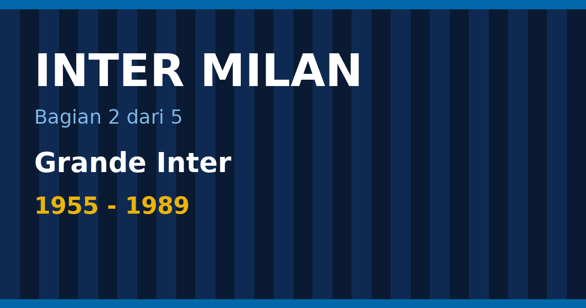

Pada 1960 Inter merekrut seorang pelatih dari Barcelona, dan dalam waktu kurang dari lima tahun klub ini menjadi juara Eropa dua kali berturut-turut. Pelatih itu Helenio Herrera, dan masa yang ia pimpin di bawah presiden Angelo Moratti dikenang sebagai Grande Inter. Piala Eropa 1963–64 dan 1964–65, dua Piala Interkontinental, dan tiga Scudetto pada 1963, 1965, dan 1966 menjadi puncak sejarah Inter di abad ke-20.

Bagian kedua ini membahas Grande Inter dan apa yang terjadi sesudahnya: dua final Eropa yang kalah pada 1967 dan 1972, Scudetto 1971 dan 1980, dua Coppa Italia, dan musim 1988–89 yang termasuk yang terbaik. Bagian pertama membahas sejarah awal sampai 1954, bagian ketiga membahas era Massimo Moratti dan treble 2010.

<!--more-->

*Ilustrasi: dibuat untuk tulisan ini.*

> **Poin Penting**
>
> - Helenio Herrera tiba dari Barcelona pada 1960 dan mengadaptasi catenaccio, sistem bertahan yang diciptakan Karl Rappan.
> - Inter menjuarai Piala Eropa 1964 (3–1 atas Real Madrid, dua gol Sandro Mazzola) dan 1965 (1–0 atas Benfica, gol Jair). Keduanya disusul Piala Interkontinental atas Independiente.
> - Final Piala Eropa kalah dua kali: dari Celtic pada 1967 dan dari Ajax pada 1972 (0–2).
> - Scudetto ke-11 jatuh pada 1971, ke-12 pada 1980, dan ke-13 pada 1988–89 di bawah Giovanni Trapattoni.
> - Sampai sekarang, 1964 dan 1965 tetap menjadi satu-satunya masa Inter menjuarai Eropa dua musim berturut-turut.

Daftar isi bagian ini

* TOC
{:toc}

## 1955: Angelo Moratti dan klub yang berubah

Perubahan terbesar bagi Inter pada pertengahan 1950-an bukan di lapangan, melainkan di ruang rapat. Angelo Moratti, pengusaha minyak, mengambil alih kepresidenan klub pada 1955 dan menggelontorkan uang untuk merekrut pemain dan pelatih. Seperti dicatat sejarah klub, hasil nyatanya baru terlihat setelah ia membawa pelatih yang tepat: Helenio Herrera, yang pindah dari Barcelona pada 1960 dengan Luis Suárez menyusul dari Barcelona ([Wikipedia, sejarah Inter](https://en.wikipedia.org/wiki/History_of_Inter_Milan)).

Moratti punya satu kebiasaan yang membedakannya dari presiden klub lain: ia memberi pelatih kuasa penuh atas tim. Herrera memakai kuasa itu untuk mengubah klub dari segi taktik, latihan, hingga cara pemain makan dan beristirahat. Metodenya keras dan sering dikritik, tetapi hasilnya konsisten.

<figure class="blog-chart">
<svg viewBox="0 0 700 342" width="700" height="342" role="img" aria-label="Garis waktu Inter 1955 sampai 1989: 1955, Moratti; 1960, Herrera; 1964, Piala Eropa; 1965, Piala Eropa; 1966, Scudetto; 1967, Final kalah; 1971, Scudetto; 1972, Final kalah; 1980, Scudetto; 1989, Scudetto" style="max-width:100%;height:auto;font-family:sans-serif">
<line x1="24" y1="172" x2="676" y2="172" stroke="#9ca3af" stroke-width="2"></line>
<line x1="41.6" y1="168" x2="41.6" y2="176" stroke="#9ca3af"></line>
<text x="41.62162162162162" y="192" text-anchor="middle" font-size="11" font-weight="normal" fill="#9ca3af">1955</text>
<line x1="129.7" y1="168" x2="129.7" y2="176" stroke="#9ca3af"></line>
<text x="129.72972972972974" y="192" text-anchor="middle" font-size="11" font-weight="normal" fill="#9ca3af">1960</text>
<line x1="217.8" y1="168" x2="217.8" y2="176" stroke="#9ca3af"></line>
<text x="217.83783783783784" y="192" text-anchor="middle" font-size="11" font-weight="normal" fill="#9ca3af">1965</text>
<line x1="305.9" y1="168" x2="305.9" y2="176" stroke="#9ca3af"></line>
<text x="305.94594594594594" y="192" text-anchor="middle" font-size="11" font-weight="normal" fill="#9ca3af">1970</text>
<line x1="394.1" y1="168" x2="394.1" y2="176" stroke="#9ca3af"></line>
<text x="394.05405405405406" y="192" text-anchor="middle" font-size="11" font-weight="normal" fill="#9ca3af">1975</text>
<line x1="482.2" y1="168" x2="482.2" y2="176" stroke="#9ca3af"></line>
<text x="482.1621621621622" y="192" text-anchor="middle" font-size="11" font-weight="normal" fill="#9ca3af">1980</text>
<line x1="570.3" y1="168" x2="570.3" y2="176" stroke="#9ca3af"></line>
<text x="570.2702702702703" y="192" text-anchor="middle" font-size="11" font-weight="normal" fill="#9ca3af">1985</text>
<line x1="658.4" y1="168" x2="658.4" y2="176" stroke="#9ca3af"></line>
<text x="658.3783783783783" y="192" text-anchor="middle" font-size="11" font-weight="normal" fill="#9ca3af">1990</text>
<line x1="41.6" y1="172" x2="41.6" y2="130" stroke="#3b82f6" stroke-width="1"></line>
<circle cx="41.6" cy="172" r="5" fill="#3b82f6"></circle>
<text x="41.6" y="120" text-anchor="start" font-size="12" font-weight="bold" fill="currentColor">1955</text>
<text x="41.6" y="134" text-anchor="start" font-size="11" font-weight="normal" fill="currentColor">Moratti</text>
<line x1="129.7" y1="172" x2="129.7" y2="204" stroke="#3b82f6" stroke-width="1"></line>
<circle cx="129.7" cy="172" r="5" fill="#3b82f6"></circle>
<text x="129.7" y="216" text-anchor="middle" font-size="12" font-weight="bold" fill="currentColor">1960</text>
<text x="129.7" y="230" text-anchor="middle" font-size="11" font-weight="normal" fill="currentColor">Herrera</text>
<line x1="200.2" y1="172" x2="200.2" y2="86" stroke="#eab308" stroke-width="1"></line>
<circle cx="200.2" cy="172" r="5" fill="#eab308"></circle>
<text x="200.2" y="76" text-anchor="middle" font-size="12" font-weight="bold" fill="currentColor">1964</text>
<text x="200.2" y="90" text-anchor="middle" font-size="11" font-weight="normal" fill="currentColor">Piala Eropa</text>
<line x1="217.8" y1="172" x2="217.8" y2="244" stroke="#eab308" stroke-width="1"></line>
<circle cx="217.8" cy="172" r="5" fill="#eab308"></circle>
<text x="217.8" y="256" text-anchor="middle" font-size="12" font-weight="bold" fill="currentColor">1965</text>
<text x="217.8" y="270" text-anchor="middle" font-size="11" font-weight="normal" fill="currentColor">Piala Eropa</text>
<line x1="235.5" y1="172" x2="235.5" y2="42" stroke="#eab308" stroke-width="1"></line>
<circle cx="235.5" cy="172" r="5" fill="#eab308"></circle>
<text x="235.5" y="32" text-anchor="middle" font-size="12" font-weight="bold" fill="currentColor">1966</text>
<text x="235.5" y="46" text-anchor="middle" font-size="11" font-weight="normal" fill="currentColor">Scudetto</text>
<line x1="253.1" y1="172" x2="253.1" y2="284" stroke="#ef4444" stroke-width="1"></line>
<circle cx="253.1" cy="172" r="5" fill="#ef4444"></circle>
<text x="253.1" y="296" text-anchor="middle" font-size="12" font-weight="bold" fill="currentColor">1967</text>
<text x="253.1" y="310" text-anchor="middle" font-size="11" font-weight="normal" fill="currentColor">Final kalah</text>
<line x1="323.6" y1="172" x2="323.6" y2="130" stroke="#eab308" stroke-width="1"></line>
<circle cx="323.6" cy="172" r="5" fill="#eab308"></circle>
<text x="323.6" y="120" text-anchor="middle" font-size="12" font-weight="bold" fill="currentColor">1971</text>
<text x="323.6" y="134" text-anchor="middle" font-size="11" font-weight="normal" fill="currentColor">Scudetto</text>
<line x1="341.2" y1="172" x2="341.2" y2="204" stroke="#ef4444" stroke-width="1"></line>
<circle cx="341.2" cy="172" r="5" fill="#ef4444"></circle>
<text x="341.2" y="216" text-anchor="middle" font-size="12" font-weight="bold" fill="currentColor">1972</text>
<text x="341.2" y="230" text-anchor="middle" font-size="11" font-weight="normal" fill="currentColor">Final kalah</text>
<line x1="482.2" y1="172" x2="482.2" y2="86" stroke="#eab308" stroke-width="1"></line>
<circle cx="482.2" cy="172" r="5" fill="#eab308"></circle>
<text x="482.2" y="76" text-anchor="middle" font-size="12" font-weight="bold" fill="currentColor">1980</text>
<text x="482.2" y="90" text-anchor="middle" font-size="11" font-weight="normal" fill="currentColor">Scudetto</text>
<line x1="640.8" y1="172" x2="640.8" y2="244" stroke="#eab308" stroke-width="1"></line>
<circle cx="640.8" cy="172" r="5" fill="#eab308"></circle>
<text x="640.8" y="256" text-anchor="end" font-size="12" font-weight="bold" fill="currentColor">1989</text>
<text x="640.8" y="270" text-anchor="end" font-size="11" font-weight="normal" fill="currentColor">Scudetto</text>
</svg>
<figcaption>Tonggak penting Inter dari 1955 sampai 1989. Kuning trofi, merah final yang kalah.</figcaption>
</figure>

## Catenaccio: bertahan sebagai senjata

Herrera tidak menciptakan catenaccio. Wikipedia mencatat bahwa sistem ini diciptakan Karl Rappan, pelatih kelahiran Austria, dan Herrera yang mengadaptasinya untuk Inter ([Wikipedia, sejarah Inter](https://en.wikipedia.org/wiki/History_of_Inter_Milan)). Kata *catenaccio* berarti "gerendel" dalam bahasa Italia, dan gambaran itu tepat: pertahanan dipasang serapat gerendel pintu, dengan satu pemain bebas di belakang garis bek yang menjaga lawan secara ketat.

Pada final Piala Eropa 1964, kapten Armando Picchi bermain sebagai libero, dengan Tarcisio Burgnich dan Giacinto Facchetti di kedua sisi serta Aristide Guarneri dan Carlo Tagnin di depannya ([Wikipedia, final 1964](https://en.wikipedia.org/wiki/1964_European_Cup_final)). Gagasan dasarnya sederhana. Tim membiarkan lawan menguasai bola, lalu menutup ruang di depan gawang dengan marking ketat satu lawan satu, dengan seorang libero di belakang untuk menyapu bola yang lolos. Begitu bola direbut, serangan balik dilancarkan dengan cepat lewat beberapa pemain yang sudah ditugaskan untuk itu. Pada masa Herrera, bek sayap seperti Giacinto Facchetti ikut naik menyerang, salah satu inovasi yang membuat catenaccio versi Inter lebih dari sekadar bertahan.

<figure class="blog-chart">
<svg viewBox="0 0 420 168" width="420" height="168" role="img" aria-label="Empat unsur catenaccio versi Inter: Libero, Menyapu bola yang lolos, di belakang garis bek; Marking ketat, Satu lawan satu, di sekitar gawang; Serangan balik, Bola direbut, lalu, dilepas cepat ke depan; Bek sayap naik, Facchetti ikut menyerang, peran bek sayap" style="max-width:100%;height:auto;font-family:sans-serif">
<rect x="0.0" y="0" width="204.0" height="78" rx="8" fill="none" stroke="#3b82f6" stroke-width="2"></rect>
<text x="102.0" y="24" text-anchor="middle" font-size="15" font-weight="bold" fill="currentColor">Libero</text>
<text x="102.0" y="46" text-anchor="middle" font-size="13" font-weight="normal" fill="currentColor">Menyapu bola yang lolos</text>
<text x="102.0" y="64" text-anchor="middle" font-size="12" font-weight="normal" fill="#9ca3af">di belakang garis bek</text>
<rect x="216.0" y="0" width="204.0" height="78" rx="8" fill="none" stroke="#3b82f6" stroke-width="2"></rect>
<text x="318.0" y="24" text-anchor="middle" font-size="15" font-weight="bold" fill="currentColor">Marking ketat</text>
<text x="318.0" y="46" text-anchor="middle" font-size="13" font-weight="normal" fill="currentColor">Satu lawan satu</text>
<text x="318.0" y="64" text-anchor="middle" font-size="12" font-weight="normal" fill="#9ca3af">di sekitar gawang</text>
<rect x="0.0" y="90" width="204.0" height="78" rx="8" fill="none" stroke="#eab308" stroke-width="2"></rect>
<text x="102.0" y="114" text-anchor="middle" font-size="15" font-weight="bold" fill="currentColor">Serangan balik</text>
<text x="102.0" y="136" text-anchor="middle" font-size="13" font-weight="normal" fill="currentColor">Bola direbut, lalu</text>
<text x="102.0" y="154" text-anchor="middle" font-size="12" font-weight="normal" fill="#9ca3af">dilepas cepat ke depan</text>
<rect x="216.0" y="90" width="204.0" height="78" rx="8" fill="none" stroke="#eab308" stroke-width="2"></rect>
<text x="318.0" y="114" text-anchor="middle" font-size="15" font-weight="bold" fill="currentColor">Bek sayap naik</text>
<text x="318.0" y="136" text-anchor="middle" font-size="13" font-weight="normal" fill="currentColor">Facchetti ikut menyerang</text>
<text x="318.0" y="154" text-anchor="middle" font-size="12" font-weight="normal" fill="#9ca3af">peran bek sayap</text>
</svg>
<figcaption>Skema konsep catenaccio versi Herrera, bukan susunan pemain pertandingan tertentu.</figcaption>
</figure>

Catenaccio sering dicap negatif karena dianggap tidak menghibur. Penilaian itu mengabaikan fakta bahwa sistem ini memenangkan banyak hal. Dalam rentang beberapa musim, Inter versi Herrera menjuarai liga, Piala Eropa, dan Piala Interkontinental. Gaya bermain yang dianggap membosankan oleh sebagian orang itu juga yang membuat banyak pelatih sesudahnya meniru pendekatan serupa.

## Tiga Scudetto: 1963, 1965, dan 1966

Dalam daftar juara Serie A, era Herrera meninggalkan tiga entri untuk Inter: 1962–63, 1964–65, dan 1965–66 ([Wikipedia](https://en.wikipedia.org/wiki/FC_Internazionale_Milano)). Gelar 1966 menjadi Scudetto kesepuluh klub. Di Italia, klub yang mencapai sepuluh gelar liga berhak memasang satu bintang di jersey. Dengan gelar itu Inter berhak atas bintang pertamanya, yang baru tampil di lambang klub pada 1979, dan bintang kedua baru datang saat Scudetto ke-20 pada 2024, yang dibahas di bagian keempat.

## 1964: Real Madrid dikalahkan

Puncak pertama datang pada final Piala Eropa 1963–64. Dalam perjalanan ke final, Inter menyingkirkan Partizan di perempat final dan Borussia Dortmund di semifinal. Di final, mereka menang 3–1 atas Real Madrid, dengan Sandro Mazzola mencetak dua gol ([Wikipedia, sejarah Inter](https://en.wikipedia.org/wiki/History_of_Inter_Milan)). Lawannya bukan tim sembarangan: Real Madrid menjuarai lima edisi pertama Piala Eropa secara beruntun.

Kemenangan itu mempertemukan Inter dengan juara Amerika Selatan di Piala Interkontinental, yaitu Independiente dari Argentina. Inter memenangi pertemuan itu dan membawa pulang trofi dunia antarklub pertamanya.

### Jalan ke Wina

Perjalanan Inter di Piala Eropa 1963–64 dimulai dari babak pendahuluan melawan Everton: 0–0 di Inggris dan 1–0 di Milan. Di babak pertama, AS Monaco disingkirkan dengan agregat 4–1 (menang 1–0 di kandang dan 3–1 tandang). Partizan jatuh di perempat final dengan agregat 4–1 (2–0 tandang, 2–1 kandang), dan Borussia Dortmund di semifinal dengan agregat 4–2 (2–2 tandang, 2–0 kandang) ([Wikipedia, final 1964](https://en.wikipedia.org/wiki/1964_European_Cup_final)).

### Final: 27 Mei 1964

Final dimainkan di Praterstadion, Wina, di depan 71.333 penonton, dengan wasit Josef Stoll dari Austria. Sandro Mazzola membuka skor pada menit 43. Aurelio Milani menambah pada menit 61, Felo memperkecil untuk Real Madrid pada menit 70, dan Mazzola mengunci kemenangan 3–1 pada menit 76 ([Wikipedia, final 1964](https://en.wikipedia.org/wiki/1964_European_Cup_final)).

Susunan pemain dua tim memperlihatkan benturan dua generasi. Real Madrid memainkan Alfredo Di Stéfano, Ferenc Puskás, dan Paco Gento, trio yang sudah menjadi legenda, di bawah pelatih Miguel Muñoz. Inter diturunkan Herrera dengan susunan di bawah ini.

| Posisi | Pemain | Catatan |
|--------|--------|---------|
| Kiper | Giuliano Sarti | |
| Bek kanan | Tarcisio Burgnich | |
| Bek kiri | Giacinto Facchetti | |
| Gelandang bertahan | Carlo Tagnin | |
| Bek tengah | Aristide Guarneri | |
| Libero | Armando Picchi | Kapten |
| Sayap kanan | Jair da Costa | Pencetak gol final 1965 |
| Gelandang | Sandro Mazzola | Dua gol (43' dan 76') |
| Penyerang tengah | Aurelio Milani | Gol (61') |
| Gelandang | Luis Suárez | Datang dari Barcelona |
| Sayap kiri | Mario Corso | |

Susunan ini menjawab pertanyaan lama tentang catenaccio: sistem itu tidak berarti seluruh tim menumpuk di belakang. Mazzola, Suárez, dan Corso bermain di lini serang, sementara Facchetti dan Burgnich bergantian naik dari posisi bek.

## 1965: final di rumah sendiri

Setahun kemudian, Inter mempertahankan gelar. Di Piala Eropa 1964–65, Inter mendapat bye di babak pendahuluan, lalu menghancurkan Dinamo București dengan agregat 7–0 (6–0 di kandang dan 1–0 tandang). Rangers jatuh dengan agregat 3–2 di perempat final (3–1 di Milan, kalah 0–1 di Skotlandia). Semifinal melawan Liverpool menjadi yang paling dramatis: kalah 1–3 di Anfield, lalu menang 3–0 di San Siro untuk agregat 4–3 ([Wikipedia, final 1965](https://en.wikipedia.org/wiki/1965_European_Cup_final)).

Final dimainkan di San Siro pada 27 Mei 1965, kandang Inter sendiri, di depan 89.000 penonton, dengan wasit Gottfried Dienst dari Swiss. Lawannya Benfica, finalis tahun-tahun sebelumnya dan klub Eusébio, di bawah pelatih Elek Schwartz. Satu-satunya gol lahir pada menit ke-43, dicetak Jair ([Wikipedia, final 1965](https://en.wikipedia.org/wiki/1965_European_Cup_final)). Susunan pemain Inter malam itu: Sarti; Burgnich, Facchetti, Bedin, Guarneri, Picchi (kapten); Jair, Mazzola, Peiró, Suárez, Corso.

Bermain di depan pendukung sendiri tidak mudah, tetapi hasil itu menegaskan bahwa gelar 1964 bukan kebetulan. Piala Interkontinental 1965 kembali mempertemukan Inter dengan Independiente, dan Inter memenangi lagi. Dengan begitu daftar Inter di level dunia mencatat dua Piala Interkontinental, pada 1964 dan 1965 ([Wikipedia](https://en.wikipedia.org/wiki/FC_Internazionale_Milano)). Klub ini baru menambahkan trofi dunia lagi pada 2010, lewat Piala Dunia Antarklub FIFA, yang dibahas di bagian ketiga.

<figure class="blog-chart">
<svg viewBox="0 0 420 168" width="420" height="168" role="img" aria-label="Empat final Piala Eropa Inter era 1960-an dan 1970-an: 1964, Inter 3-1 Real Madrid, Mazzola dua gol; 1965, Inter 1-0 Benfica, gol Jair di San Siro; 1967, Inter 1-2 Celtic, Mazzola mencetak penalti; 1972, Inter 0-2 Ajax, final kedua yang kalah" style="max-width:100%;height:auto;font-family:sans-serif">
<rect x="0.0" y="0" width="204.0" height="78" rx="8" fill="none" stroke="#22c55e" stroke-width="2"></rect>
<text x="102.0" y="24" text-anchor="middle" font-size="15" font-weight="bold" fill="currentColor">1964</text>
<text x="102.0" y="46" text-anchor="middle" font-size="13" font-weight="normal" fill="currentColor">Inter 3-1 Real Madrid</text>
<text x="102.0" y="64" text-anchor="middle" font-size="12" font-weight="normal" fill="#9ca3af">Mazzola dua gol</text>
<rect x="216.0" y="0" width="204.0" height="78" rx="8" fill="none" stroke="#22c55e" stroke-width="2"></rect>
<text x="318.0" y="24" text-anchor="middle" font-size="15" font-weight="bold" fill="currentColor">1965</text>
<text x="318.0" y="46" text-anchor="middle" font-size="13" font-weight="normal" fill="currentColor">Inter 1-0 Benfica</text>
<text x="318.0" y="64" text-anchor="middle" font-size="12" font-weight="normal" fill="#9ca3af">gol Jair di San Siro</text>
<rect x="0.0" y="90" width="204.0" height="78" rx="8" fill="none" stroke="#ef4444" stroke-width="2"></rect>
<text x="102.0" y="114" text-anchor="middle" font-size="15" font-weight="bold" fill="currentColor">1967</text>
<text x="102.0" y="136" text-anchor="middle" font-size="13" font-weight="normal" fill="currentColor">Inter 1-2 Celtic</text>
<text x="102.0" y="154" text-anchor="middle" font-size="12" font-weight="normal" fill="#9ca3af">Mazzola mencetak penalti</text>
<rect x="216.0" y="90" width="204.0" height="78" rx="8" fill="none" stroke="#ef4444" stroke-width="2"></rect>
<text x="318.0" y="114" text-anchor="middle" font-size="15" font-weight="bold" fill="currentColor">1972</text>
<text x="318.0" y="136" text-anchor="middle" font-size="13" font-weight="normal" fill="currentColor">Inter 0-2 Ajax</text>
<text x="318.0" y="154" text-anchor="middle" font-size="12" font-weight="normal" fill="#9ca3af">final kedua yang kalah</text>
</svg>
<figcaption>Dua final dimenangi, dua dikalahkan. Hijau menang, merah kalah.</figcaption>
</figure>

## Dua final yang hilang: 1967 dan 1972

Tidak ada dinasti yang bertahan selamanya. Final Piala Eropa 1967 dimainkan pada 25 Mei di Estádio Nacional, Lisbon, di depan 45.000 penonton. Inter datang dengan dua masalah: Luis Suárez dan Jair, dua pemain kunci final 1964 dan 1965, cedera dan tidak bisa bermain. Lawannya Celtic, asuhan Jock Stein ([Wikipedia, final 1967](https://en.wikipedia.org/wiki/1967_European_Cup_final)).

Inter memimpin lebih dulu lewat penalti Sandro Mazzola pada menit ke-7. Setelah itu Inter bertahan sangat dalam, dan Celtic menguasai sisa pertandingan. Tommy Gemmell menyamakan kedudukan pada menit ke-63, dan Stevie Chalmers membalikkan skor pada menit ke-84. Skor akhir 1–2 ([Wikipedia, final 1967](https://en.wikipedia.org/wiki/1967_European_Cup_final)).

Jalan Inter ke Lisbon sendiri berat: Torpedo Moscow (agregat 1–0), Vasas (4–1), dan Real Madrid (3–0) disingkirkan, lalu CSKA Red Flag di semifinal, dengan agregat 2–2 dan laga ulang di Bologna yang dimenangi 1–0. Kekalahan di final menutup masa terbaik Inter di Eropa.

Pada tahun yang sama, nama resmi klub kembali diubah menjadi Football Club Internazionale Milano. Herrera meninggalkan klub tidak lama kemudian, dan Angelo Moratti melepas kepresidenan pada 1968.

Kesempatan Eropa berikutnya datang pada 31 Mei 1972. Di De Kuip, Rotterdam, Inter kembali ke final Piala Eropa dan kalah 0–2 dari Ajax di depan 61.354 penonton. Kedua gol dicetak Johan Cruyff, pada menit ke-47 dan ke-78. Inter kali ini dilatih Giovanni Invernizzi, bukan Herrera, dengan Mazzola sebagai kapten ([Wikipedia, final 1972](https://en.wikipedia.org/wiki/1972_European_Cup_final)). Ajax menang untuk kedua kalinya berturut-turut, dan pertandingan itu sering disebut sebagai salah satu puncak "sepak bola total" melawan catenaccio Inter yang bertahan dalam. Setelah itu Inter harus menunggu 38 tahun sebelum kembali ke final Piala Champions, yaitu pada 2010.

<figure class="blog-chart">
<svg viewBox="0 0 420 220" width="420" height="220" role="img" aria-label="Jumlah trofi Inter per dekade 1950-an sampai 1980-an: 1950-an 2; 1960-an 7; 1970-an 2; 1980-an 4" style="max-width:100%;height:auto;font-family:sans-serif">
<line x1="30" y1="186" x2="414" y2="186" stroke="#9ca3af"></line>
<rect x="47.1" y="139.7" width="60.8" height="46.3" rx="3" fill="#3b82f6"></rect>
<text x="77.5" y="134.71428571428572" text-anchor="middle" font-size="12" font-weight="bold" fill="currentColor">2</text>
<text x="77.5" y="202" text-anchor="middle" font-size="12" font-weight="normal" fill="currentColor">1950-an</text>
<rect x="142.1" y="24.0" width="60.8" height="162.0" rx="3" fill="#eab308"></rect>
<text x="172.5" y="19.0" text-anchor="middle" font-size="12" font-weight="bold" fill="currentColor">7</text>
<text x="172.5" y="202" text-anchor="middle" font-size="12" font-weight="normal" fill="currentColor">1960-an</text>
<rect x="237.1" y="139.7" width="60.8" height="46.3" rx="3" fill="#3b82f6"></rect>
<text x="267.5" y="134.71428571428572" text-anchor="middle" font-size="12" font-weight="bold" fill="currentColor">2</text>
<text x="267.5" y="202" text-anchor="middle" font-size="12" font-weight="normal" fill="currentColor">1970-an</text>
<rect x="332.1" y="93.4" width="60.8" height="92.6" rx="3" fill="#3b82f6"></rect>
<text x="362.5" y="88.42857142857143" text-anchor="middle" font-size="12" font-weight="bold" fill="currentColor">4</text>
<text x="362.5" y="202" text-anchor="middle" font-size="12" font-weight="normal" fill="currentColor">1980-an</text>
</svg>
<figcaption>Trofi per dekade, 1950-an sampai 1980-an: 1960-an menjadi puncak dengan tujuh trofi.</figcaption>
</figure>

## Dekade 1970-an: Scudetto 1971

Inter keluar dari masa Herrera tanpa kehilangan kemampuan bersaing. Scudetto ke-11 jatuh pada musim 1970–71 ([Wikipedia, sejarah Inter](https://en.wikipedia.org/wiki/History_of_Inter_Milan)). Itu setahun sebelum final Ajax dan masih berasal dari generasi yang dibentuk di era Grande Inter, ketika Mazzola dan Facchetti masih menjadi tulang punggung tim.

Setelah 1971, dekade itu berjalan sepi. Inter memenangi Coppa Italia 1977–78, tetapi tidak ada gelar liga sampai 1980. Banyak klub lain di Italia pada saat itu yang tampil lebih kuat, dan Inter berada di posisi pengejar.

## 1980 dan Coppa Italia 1982

Scudetto ke-12 datang pada 1979–80 ([Wikipedia, sejarah Inter](https://en.wikipedia.org/wiki/History_of_Inter_Milan)). Pada tahun yang sama stadion San Siro resmi dinamai Giuseppe Meazza, sehingga 1980 menjadi tahun yang penuh makna simbolis bagi klub. Dua musim kemudian, Inter menambah Coppa Italia 1981–82.

Gelar-gelar itu patut dicatat, tetapi gambaran besarnya tetap jelas: antara 1966 dan 1989, Inter memenangi tiga Scudetto (1971, 1980, dan 1989) dan dua Coppa Italia, jauh dari dominasi yang dinikmati di awal 1960-an. Bagi suporter yang tumbuh di periode itu, Grande Inter lebih terasa sebagai cerita orang tua daripada kenangan sendiri.

## 1988–89: musim yang dikenang

Perubahan terjadi pada akhir 1980-an. Dengan Giovanni Trapattoni sebagai pelatih dan tiga pemain asing, yaitu Andreas Brehme, Lothar Matthäus, dan Ramón Díaz, Inter menjuarai Serie A 1988–89 ([Wikipedia, sejarah Inter](https://en.wikipedia.org/wiki/History_of_Inter_Milan)). Inter menyelesaikan liga dengan 58 poin dari maksimal 68, dan musim itu sering disebut sebagai salah satu yang terbaik dalam sejarah klub.

Angka-angka musim itu memperlihatkan seberapa jauh Inter meninggalkan pesaing. Dalam 34 laga, Inter menang 26, seri 6, dan hanya kalah 2, dengan 67 gol dan 19 kebobolan. Napoli di peringkat kedua mengumpulkan 47 poin, 11 poin di bawah Inter. Milan di peringkat ketiga meraih 46, Juventus 43, dan Sampdoria 39. Pencetak gol terbanyak liga dari Inter adalah Aldo Serena dengan 22 gol, dan Ramón Díaz menyusul dengan 12 ([Wikipedia, Serie A 1988–89](https://en.wikipedia.org/wiki/1988%E2%80%9389_Serie_A)).

<figure class="blog-chart">
<svg viewBox="0 0 420 166" width="420" height="166" role="img" aria-label="Lima besar klasemen Serie A 1988-89: Inter 58; Napoli 47; Milan 46; Juventus 43; Sampdoria 39" style="max-width:100%;height:auto;font-family:sans-serif">
<text x="92" y="24" text-anchor="end" font-size="13" font-weight="normal" fill="currentColor">Inter</text>
<rect x="100" y="10" width="240.9" height="20" rx="3" fill="#eab308"></rect>
<text x="346.9230769230769" y="25" text-anchor="start" font-size="13" font-weight="normal" fill="currentColor">58</text>
<text x="92" y="54" text-anchor="end" font-size="13" font-weight="normal" fill="currentColor">Napoli</text>
<rect x="100" y="40" width="195.2" height="20" rx="3" fill="#3b82f6"></rect>
<text x="301.2307692307692" y="55" text-anchor="start" font-size="13" font-weight="normal" fill="currentColor">47</text>
<text x="92" y="84" text-anchor="end" font-size="13" font-weight="normal" fill="currentColor">Milan</text>
<rect x="100" y="70" width="191.1" height="20" rx="3" fill="#3b82f6"></rect>
<text x="297.0769230769231" y="85" text-anchor="start" font-size="13" font-weight="normal" fill="currentColor">46</text>
<text x="92" y="114" text-anchor="end" font-size="13" font-weight="normal" fill="currentColor">Juventus</text>
<rect x="100" y="100" width="178.6" height="20" rx="3" fill="#3b82f6"></rect>
<text x="284.61538461538464" y="115" text-anchor="start" font-size="13" font-weight="normal" fill="currentColor">43</text>
<text x="92" y="144" text-anchor="end" font-size="13" font-weight="normal" fill="currentColor">Sampdoria</text>
<rect x="100" y="130" width="162.0" height="20" rx="3" fill="#3b82f6"></rect>
<text x="268.0" y="145" text-anchor="start" font-size="13" font-weight="normal" fill="currentColor">39</text>
</svg>
<figcaption>Lima besar Serie A 1988-89: Inter unggul 11 poin dari Napoli.</figcaption>
</figure>

Klub langsung menambah Supercoppa Italiana pertamanya pada 1989. Setelah itu Inter masuk ke dekade yang sangat berbeda: tujuh belas tahun tanpa Scudetto, tiga Piala UEFA, dan pergantian pemilik yang mengubah peta kekuatan sepak bola Italia. Cerita itu masuk bagian ketiga.

## Mengapa era Herrera masih dibahas

Ada tiga alasan kenapa Grande Inter terus dibicarakan, bahkan setelah enam puluh tahun.

**Rekor yang bertahan.** Piala Eropa 1964 dan 1965 adalah satu-satunya periode Inter menjadi juara Eropa dua tahun berturut-turut. Gelar ketiga, pada 2010, juga membutuhkan 45 tahun untuk datang.

**Pengaruh taktik.** Catenaccio dan peran libero membentuk pemahaman sepak bola Italia tentang bertahan. Kritikus dan pembela sama-sama membahasnya sampai sekarang.

**Hubungan keluarga.** Nama Moratti kembali ke Inter pada 1995, ketika Massimo Moratti, putra Angelo, mengambil alih klub. Era kepemilikannya berlangsung sampai 2013.

## Ringkasan

- Angelo Moratti mengambil alih Inter pada 1955 dan merekrut Helenio Herrera pada 1960.
- Herrera mengadaptasi catenaccio, dan Inter menjuarai liga tiga kali serta Piala Eropa dua kali dalam waktu tiga tahun.
- Piala Eropa 1964 (3–1 atas Real Madrid) dan 1965 (1–0 atas Benfica) masing-masing diikuti Piala Interkontinental atas Independiente.
- Dua final Eropa berikutnya kalah: dari Celtic pada 1967 dan dari Ajax pada 1972.
- Scudetto datang lagi pada 1971, 1980, dan 1988–89, dengan dua Coppa Italia di antaranya.

Tulisan ini dibantu oleh AI.
