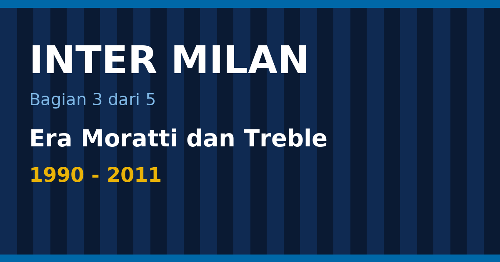

Antara Scudetto 1989 dan Scudetto 2006, Inter menjalani 17 tahun tanpa gelar liga, dan dalam rentang waktu itu klub ini juga menjadi salah satu yang paling sering disebut dalam kisah "hampir juara". Lalu semuanya berbalik. Dalam lima musim, 2006 sampai 2010, Inter memenangi liga lima kali berturut-turut, dan di akhir periode itu mengangkat tiga trofi sekaligus dalam satu musim bersama José Mourinho.

Bagian ketiga ini mengikuti jalan itu: tiga Piala UEFA di 1990-an, pembelian klub oleh Massimo Moratti pada 1995, Ronaldo, kekecewaan tahun 2002, Calciopoli, dan akhirnya treble 2010 plus Piala Dunia Antarklub. Bagian pertama membahas sejarah awal, bagian kedua Grande Inter, dan bagian keempat masa Suning sampai Oaktree.

<!--more-->

*Ilustrasi: dibuat untuk tulisan ini.*

> **Poin Penting**
>
> - Inter menjuarai Piala UEFA tiga kali: 1991, 1994, dan 1998, sementara gelar liga baru kembali pada 2006.
> - Massimo Moratti membeli klub dari Ernesto Pellegrini pada 1995, dan dua tahun kemudian merekrut Ronaldo dengan rekor transfer £19,5 juta.
> - Scudetto 2005–06 diberikan kepada Inter setelah skandal Calciopoli, lalu Inter menang lagi pada 2007, 2008, 2009, dan 2010.
> - Pada 2009–10, di bawah Mourinho, Inter memenangi Serie A, Coppa Italia, dan Liga Champions, yang terakhir lewat 2–0 atas Bayern Munich dengan dua gol Diego Milito.
> - Dari 2005 sampai 2011 Inter mengumpulkan 15 trofi, termasuk Piala Dunia Antarklub FIFA 2010.

Daftar isi bagian ini

* TOC
{:toc}

## Tiga Piala UEFA: 1991, 1994, 1998

Setelah Scudetto 1989, gelar liga tidak kunjung datang, tetapi Eropa menjadi hiburan. Inter memenangi Piala UEFA pada musim 1990–91, 1993–94, dan 1997–98 ([Wikipedia](https://en.wikipedia.org/wiki/FC_Internazionale_Milano)). Tiga gelar dalam delapan tahun itu menjaga reputasi klub di benua, meskipun di Italia Inter sering berada di bawah bayang-bayang Milan dan Juventus.

Final 1991 mempertemukan Inter dengan sesama klub Italia, AS Roma, dan Inter menang dengan agregat 2–1. Pada 1994 lawannya Casino Salzburg dari Austria, dan Inter menang 2–0 dalam dua laga. Final 1998 dimainkan satu pertandingan di Parc des Princes, Paris, pada 6 Mei 1998 melawan Lazio, dan Inter menang 3–0 lewat gol Iván Zamorano (menit 5), Javier Zanetti (60), dan Ronaldo (70) ([Wikipedia](https://en.wikipedia.org/wiki/1998_UEFA_Cup_final)).

<figure class="blog-chart">
<svg viewBox="0 0 420 78" width="420" height="78" role="img" aria-label="Tiga final Piala UEFA yang dimenangi Inter: 1991, Roma, agregat 2-1, Piala UEFA pertama; 1994, Casino Salzburg, 2-0, menang 1-0 dua kali; 1998, Lazio 0-3 Inter, Paris, 6 Mei 1998" style="max-width:100%;height:auto;font-family:sans-serif">
<rect x="0.0" y="0" width="132.0" height="78" rx="8" fill="none" stroke="#eab308" stroke-width="2"></rect>
<text x="66.0" y="24" text-anchor="middle" font-size="15" font-weight="bold" fill="currentColor">1991</text>
<text x="66.0" y="46" text-anchor="middle" font-size="13" font-weight="normal" fill="currentColor">Roma, agregat 2-1</text>
<text x="66.0" y="64" text-anchor="middle" font-size="12" font-weight="normal" fill="#9ca3af">Piala UEFA pertama</text>
<rect x="144.0" y="0" width="132.0" height="78" rx="8" fill="none" stroke="#eab308" stroke-width="2"></rect>
<text x="210.0" y="24" text-anchor="middle" font-size="15" font-weight="bold" fill="currentColor">1994</text>
<text x="210.0" y="46" text-anchor="middle" font-size="13" font-weight="normal" fill="currentColor">Casino Salzburg, 2-0</text>
<text x="210.0" y="64" text-anchor="middle" font-size="12" font-weight="normal" fill="#9ca3af">menang 1-0 dua kali</text>
<rect x="288.0" y="0" width="132.0" height="78" rx="8" fill="none" stroke="#eab308" stroke-width="2"></rect>
<text x="354.0" y="24" text-anchor="middle" font-size="15" font-weight="bold" fill="currentColor">1998</text>
<text x="354.0" y="46" text-anchor="middle" font-size="13" font-weight="normal" fill="currentColor">Lazio 0-3 Inter</text>
<text x="354.0" y="64" text-anchor="middle" font-size="12" font-weight="normal" fill="#9ca3af">Paris, 6 Mei 1998</text>
</svg>
<figcaption>Inter tiga kali juara Piala UEFA: 1991, 1994, dan 1998.</figcaption>
</figure>

Final terakhir itu ditutup oleh pemain yang baru setahun sebelumnya dibeli klub dengan harga yang mengguncang pasar: Ronaldo.

## 1995: Massimo Moratti membeli klub

Di tengah masa tanpa Scudetto, kepemilikan klub berganti. Pada 1995 Massimo Moratti menggantikan Ernesto Pellegrini sebagai pemilik Inter ([Wikipedia, sejarah Inter](https://en.wikipedia.org/wiki/History_of_Inter_Milan)). Moratti adalah putra Angelo Moratti, presiden era Grande Inter, sehingga pembelian itu sekaligus menjadi kembalinya nama keluarga ke klub yang pernah dibesarkan ayahnya.

Moratti dikenal berani mengeluarkan uang. Ia membeli pemain-pemain termahal di zamannya dan sering berganti pelatih dengan cepat. Pendekatan itu membuat Inter seru ditonton, tetapi belum mengubah hasil di liga. Pembelian terbesar datang pada 1997, ketika Inter menggaet Ronaldo dengan rekor transfer £19,5 juta. Dua tahun kemudian giliran Christian Vieri, yang pada saat itu menjadi pemain termahal di dunia ([Wikipedia, sejarah Inter](https://en.wikipedia.org/wiki/History_of_Inter_Milan)).

<figure class="blog-chart">
<svg viewBox="0 0 420 168" width="420" height="168" role="img" aria-label="Era Moratti dan transfer bintang: 1995, Moratti membeli klub, dari Ernesto Pellegrini; 1997, Ronaldo datang, rekor £19,5 juta; 1998, Piala UEFA, Ronaldo mencetak gol final; 1999, Vieri datang, pemain termahal dunia" style="max-width:100%;height:auto;font-family:sans-serif">
<rect x="0.0" y="0" width="204.0" height="78" rx="8" fill="none" stroke="#3b82f6" stroke-width="2"></rect>
<text x="102.0" y="24" text-anchor="middle" font-size="15" font-weight="bold" fill="currentColor">1995</text>
<text x="102.0" y="46" text-anchor="middle" font-size="13" font-weight="normal" fill="currentColor">Moratti membeli klub</text>
<text x="102.0" y="64" text-anchor="middle" font-size="12" font-weight="normal" fill="#9ca3af">dari Ernesto Pellegrini</text>
<rect x="216.0" y="0" width="204.0" height="78" rx="8" fill="none" stroke="#eab308" stroke-width="2"></rect>
<text x="318.0" y="24" text-anchor="middle" font-size="15" font-weight="bold" fill="currentColor">1997</text>
<text x="318.0" y="46" text-anchor="middle" font-size="13" font-weight="normal" fill="currentColor">Ronaldo datang</text>
<text x="318.0" y="64" text-anchor="middle" font-size="12" font-weight="normal" fill="#9ca3af">rekor £19,5 juta</text>
<rect x="0.0" y="90" width="204.0" height="78" rx="8" fill="none" stroke="#eab308" stroke-width="2"></rect>
<text x="102.0" y="114" text-anchor="middle" font-size="15" font-weight="bold" fill="currentColor">1998</text>
<text x="102.0" y="136" text-anchor="middle" font-size="13" font-weight="normal" fill="currentColor">Piala UEFA</text>
<text x="102.0" y="154" text-anchor="middle" font-size="12" font-weight="normal" fill="#9ca3af">Ronaldo mencetak gol final</text>
<rect x="216.0" y="90" width="204.0" height="78" rx="8" fill="none" stroke="#3b82f6" stroke-width="2"></rect>
<text x="318.0" y="114" text-anchor="middle" font-size="15" font-weight="bold" fill="currentColor">1999</text>
<text x="318.0" y="136" text-anchor="middle" font-size="13" font-weight="normal" fill="currentColor">Vieri datang</text>
<text x="318.0" y="154" text-anchor="middle" font-size="12" font-weight="normal" fill="#9ca3af">pemain termahal dunia</text>
</svg>
<figcaption>Empat tonggak pertama era Massimo Moratti.</figcaption>
</figure>

Sepak bola Italia di akhir 1990-an adalah liga yang sangat kuat, dan Ronaldo adalah bintang terbesarnya. Ia memenangi Ballon d'Or pada 1997, tahun pertamanya di Inter, lalu menjuarai Piala UEFA 1998 bersama klub itu. Namun cedera lutut berat memotong kariernya di Inter, dan gelar liga yang diharapkan dari kombinasi Ronaldo dan Vieri tidak pernah datang.

## Kekecewaan 2000 sampai 2003

Awal dekade 2000-an berjalan buruk. Pada musim 1999–2000 Inter kalah dari Lazio di final Coppa Italia, dan Marcello Lippi dipecat setelah hanya satu pertandingan di musim 2000–01 ([Wikipedia, sejarah Inter](https://en.wikipedia.org/wiki/History_of_Inter_Milan)).

Kekecewaan paling dikenang terjadi pada 5 Mei 2002. Inter memasuki hari terakhir musim Serie A sebagai pemuncak klasemen dan hanya perlu mengalahkan Lazio di Roma. Inter kalah 2–4 di kandang Lazio, dan Juventus merebut gelar dengan 71 poin. Roma menyusul dengan 70 poin, dan Inter jatuh ke peringkat ketiga dengan 69 poin ([Wikipedia, Serie A 2001–02](https://en.wikipedia.org/wiki/2001%E2%80%9302_Serie_A)). Di tahun yang sama Inter hanya sampai semifinal Piala UEFA ([Wikipedia, sejarah Inter](https://en.wikipedia.org/wiki/History_of_Inter_Milan)).

Musim 2002–03 berjalan lebih baik, tetapi tetap tanpa trofi. Inter finis kedua di Serie A, lalu kalah dari Milan di semifinal Liga Champions karena aturan gol tandang ([Wikipedia, sejarah Inter](https://en.wikipedia.org/wiki/History_of_Inter_Milan)). Semifinal derby itu melukai suporter, karena lawannya adalah tetangga satu stadion.

## Mancini dan fondasi baru

Pada 2004 Roberto Mancini ditunjuk sebagai pelatih. Perubahan hasilnya cepat. Pada 2005 Inter memenangi Coppa Italia dengan agregat 3–0 atas Roma dan Supercoppa Italiana dengan 1–0 atas Juventus setelah perpanjangan waktu. Pada 2006 mereka mempertahankan Coppa Italia, kali ini 4–1 secara agregat atas Roma ([Wikipedia, sejarah Inter](https://en.wikipedia.org/wiki/History_of_Inter_Milan)).

Gelar-gelar kecil itu penting karena mengakhiri kebiasaan kehilangan trofi di saat penentuan, dan memberi kepercayaan diri kepada skuad yang akan mendominasi liga lima tahun berikutnya. Di inti skuad itu berdiri Javier Zanetti, kapten dan pemain dengan penampilan terbanyak sepanjang sejarah klub: 858 laga, 618 di antaranya di Serie A ([Wikipedia](https://en.wikipedia.org/wiki/FC_Internazionale_Milano)).

## Calciopoli dan Scudetto 2006

Pada musim 2005–06, skandal Calciopoli mengguncang sepak bola Italia. Investigasi menemukan pengaturan wasit dan praktik pengaruh di tubuh beberapa klub besar, dan Scudetto 2005–06 akhirnya diberikan kepada Inter ([Wikipedia, sejarah Inter](https://en.wikipedia.org/wiki/History_of_Inter_Milan)). Itu gelar liga pertama Inter sejak 1989, tetapi diraih lewat keputusan administratif, bukan di lapangan, sehingga banyak yang memperdebatkannya.

Setahun kemudian, tidak ada yang bisa mempertanyakan hasil di lapangan.

## 2006–2008: dominasi yang tidak terbantahkan

Musim 2006–07 menghadirkan Inter yang berbeda. Klub mencetak rekor 17 kemenangan beruntun di Serie A, menyegel gelar pada 22 April 2007, dan menutup musim dengan 97 poin, unggul 22 poin dari Roma di peringkat kedua ([Wikipedia](https://en.wikipedia.org/wiki/FC_Internazionale_Milano)). Angka 97 poin sampai sekarang masih menjadi rekor poin klub dalam satu musim liga.

Gelar berikutnya menegangkan. Pada musim 2007–08 Inter menjuarai Serie A di hari terakhir, setelah Zlatan Ibrahimović mencetak dua gol ke gawang Parma ([Wikipedia, sejarah Inter](https://en.wikipedia.org/wiki/History_of_Inter_Milan)). Jarak yang di awal musim terlihat nyaman menyempit di akhir, sehingga kemenangan di Parma terasa jauh lebih berarti daripada gelar 2007.

<figure class="blog-chart">
<svg viewBox="0 0 420 220" width="420" height="220" role="img" aria-label="Jumlah trofi Inter per tahun 2005 sampai 2011: 2005 2; 2006 3; 2007 1; 2008 2; 2009 1; 2010 5; 2011 1" style="max-width:100%;height:auto;font-family:sans-serif">
<line x1="30" y1="186" x2="414" y2="186" stroke="#9ca3af"></line>
<rect x="39.8" y="121.2" width="34.7" height="64.8" rx="3" fill="#3b82f6"></rect>
<text x="57.14285714285714" y="116.2" text-anchor="middle" font-size="12" font-weight="bold" fill="currentColor">2</text>
<text x="57.14285714285714" y="202" text-anchor="middle" font-size="12" font-weight="normal" fill="currentColor">2005</text>
<rect x="94.1" y="88.8" width="34.7" height="97.2" rx="3" fill="#3b82f6"></rect>
<text x="111.42857142857142" y="83.8" text-anchor="middle" font-size="12" font-weight="bold" fill="currentColor">3</text>
<text x="111.42857142857142" y="202" text-anchor="middle" font-size="12" font-weight="normal" fill="currentColor">2006</text>
<rect x="148.3" y="153.6" width="34.7" height="32.4" rx="3" fill="#3b82f6"></rect>
<text x="165.7142857142857" y="148.6" text-anchor="middle" font-size="12" font-weight="bold" fill="currentColor">1</text>
<text x="165.7142857142857" y="202" text-anchor="middle" font-size="12" font-weight="normal" fill="currentColor">2007</text>
<rect x="202.6" y="121.2" width="34.7" height="64.8" rx="3" fill="#3b82f6"></rect>
<text x="220.0" y="116.2" text-anchor="middle" font-size="12" font-weight="bold" fill="currentColor">2</text>
<text x="220.0" y="202" text-anchor="middle" font-size="12" font-weight="normal" fill="currentColor">2008</text>
<rect x="256.9" y="153.6" width="34.7" height="32.4" rx="3" fill="#3b82f6"></rect>
<text x="274.2857142857143" y="148.6" text-anchor="middle" font-size="12" font-weight="bold" fill="currentColor">1</text>
<text x="274.2857142857143" y="202" text-anchor="middle" font-size="12" font-weight="normal" fill="currentColor">2009</text>
<rect x="311.2" y="24.0" width="34.7" height="162.0" rx="3" fill="#eab308"></rect>
<text x="328.57142857142856" y="19.0" text-anchor="middle" font-size="12" font-weight="bold" fill="currentColor">5</text>
<text x="328.57142857142856" y="202" text-anchor="middle" font-size="12" font-weight="normal" fill="currentColor">2010</text>
<rect x="365.5" y="153.6" width="34.7" height="32.4" rx="3" fill="#3b82f6"></rect>
<text x="382.85714285714283" y="148.6" text-anchor="middle" font-size="12" font-weight="bold" fill="currentColor">1</text>
<text x="382.85714285714283" y="202" text-anchor="middle" font-size="12" font-weight="normal" fill="currentColor">2011</text>
</svg>
<figcaption>Jumlah trofi Inter per tahun, 2005 sampai 2011: total 15 trofi, lima di antaranya jatuh pada 2010.</figcaption>
</figure>

## 2008: Mourinho tiba

Mancini meninggalkan Inter, dan pada 2008 José Mourinho ditunjuk sebagai pelatih. Musim pertamanya berakhir dengan Supercoppa Italiana 2008 dan Scudetto 2008–09, yang menjadi gelar liga keempat beruntun ([Wikipedia, sejarah Inter](https://en.wikipedia.org/wiki/History_of_Inter_Milan)). Namun Eropa masih menjadi obsesi. Lebih dari empat dekade Inter tidak menjuarai kompetisi tertinggi benua, dan Mourinho dibawa dengan harapan jelas: mengakhiri penantian itu.

## Musim panas 2009: tukar-tambah Ibrahimović

Treble tidak lahir dari satu malam. Setelah menjuarai liga empat kali beruntun, Inter menjual penyerang andalannya, Zlatan Ibrahimović, ke Barcelona dengan nilai 69,5 juta euro, terdiri dari 49,5 juta euro tunai ditambah Samuel Eto'o. Pada musim panas yang sama Inter membeli Diego Milito dan Thiago Motta dari Genoa, Wesley Sneijder dari Real Madrid, dan Lúcio dari Bayern Munich ([Wikipedia, musim 2009–10](https://en.wikipedia.org/wiki/2009%E2%80%9310_Inter_Milan_season)).

<figure class="blog-chart">
<svg viewBox="0 0 420 166" width="420" height="166" role="img" aria-label="Nilai transfer pemain yang tiba di Inter pada musim panas 2009: Milito 28; Eto&#x27;o 20; Sneijder 18; Thiago Motta 10.2; Lúcio 7.85" style="max-width:100%;height:auto;font-family:sans-serif">
<text x="102" y="24" text-anchor="end" font-size="13" font-weight="normal" fill="currentColor">Milito</text>
<rect x="110" y="10" width="227.5" height="20" rx="3" fill="#eab308"></rect>
<text x="343.5" y="25" text-anchor="start" font-size="13" font-weight="normal" fill="currentColor">28</text>
<text x="102" y="54" text-anchor="end" font-size="13" font-weight="normal" fill="currentColor">Eto&#x27;o</text>
<rect x="110" y="40" width="162.5" height="20" rx="3" fill="#3b82f6"></rect>
<text x="278.5" y="55" text-anchor="start" font-size="13" font-weight="normal" fill="currentColor">20</text>
<text x="102" y="84" text-anchor="end" font-size="13" font-weight="normal" fill="currentColor">Sneijder</text>
<rect x="110" y="70" width="146.2" height="20" rx="3" fill="#3b82f6"></rect>
<text x="262.25" y="85" text-anchor="start" font-size="13" font-weight="normal" fill="currentColor">18</text>
<text x="102" y="114" text-anchor="end" font-size="13" font-weight="normal" fill="currentColor">Thiago Motta</text>
<rect x="110" y="100" width="82.9" height="20" rx="3" fill="#3b82f6"></rect>
<text x="198.875" y="115" text-anchor="start" font-size="13" font-weight="normal" fill="currentColor">10.2</text>
<text x="102" y="144" text-anchor="end" font-size="13" font-weight="normal" fill="currentColor">Lúcio</text>
<rect x="110" y="130" width="63.8" height="20" rx="3" fill="#3b82f6"></rect>
<text x="179.78125" y="145" text-anchor="start" font-size="13" font-weight="normal" fill="currentColor">7.85</text>
</svg>
<figcaption>Nilai transfer (juta euro) lima pemain yang tiba pada musim panas 2009. Eto&#x27;o masuk dalam kesepakatan penjualan Ibrahimović ke Barcelona.</figcaption>
</figure>

Hasilnya terlihat di lapangan. Milito mencetak 22 gol di liga dan 30 gol di semua kompetisi, dan Eto'o menjadi bagian dari skuad yang sama yang akhirnya mengangkat Liga Champions.

Musim itu tidak dimulai dengan trofi: Inter kalah 1–2 dari Lazio di Supercoppa Italiana ([Wikipedia, musim 2009–10](https://en.wikipedia.org/wiki/2009%E2%80%9310_Inter_Milan_season)).

## 2009–10: treble

Wikipedia menyebut musim 2009–10 sebagai musim terbaik dalam sejarah klub. Klub memenangi tiga kompetisi sekaligus, sesuatu yang belum pernah dilakukan klub Italia lain.

**Serie A.** Inter menjuarai liga dengan keunggulan dua poin atas Roma ([Wikipedia, sejarah Inter](https://en.wikipedia.org/wiki/History_of_Inter_Milan)). Itu Scudetto kelima beruntun, mengukuhkan dekade paling sukses dalam sejarah klub.

**Coppa Italia.** Di final, Inter mengalahkan Roma 1–0, lawan yang sama yang baru saja dikalahkan di liga ([Wikipedia, sejarah Inter](https://en.wikipedia.org/wiki/History_of_Inter_Milan)). Kemenangan itu melengkapi trofi domestik.

**Liga Champions.** Perjalanan Eropa melewati Barcelona di semifinal, sebuah tim yang dianggap terbaik di dunia pada masa itu. Inter menang 3–1 di San Siro dan kalah 0–1 di Camp Nou, cukup untuk lolos dengan agregat 3–2 ([ESPN](https://www.espn.com/soccer/match/_/gameId/290736/internazionale-barcelona)). Di final, Inter menang 2–0 atas Bayern Munich dengan dua gol Diego Milito ([Wikipedia, sejarah Inter](https://en.wikipedia.org/wiki/History_of_Inter_Milan)). Gelar itu menjadi Piala Eropa ketiga klub, 45 tahun setelah yang kedua.

<figure class="blog-chart">
<svg viewBox="0 0 420 168" width="420" height="168" role="img" aria-label="Treble Inter musim 2009-10: Serie A, Unggul 2 poin atas Roma, Scudetto kelima beruntun; Coppa Italia, Inter 1-0 Roma, final, Mei 2010; Liga Champions, Inter 2-0 Bayern, Milito dua gol; Barcelona, Semifinal, agregat 3-2, 3-1 di rumah, 0-1 tandang" style="max-width:100%;height:auto;font-family:sans-serif">
<rect x="0.0" y="0" width="204.0" height="78" rx="8" fill="none" stroke="#eab308" stroke-width="2"></rect>
<text x="102.0" y="24" text-anchor="middle" font-size="15" font-weight="bold" fill="currentColor">Serie A</text>
<text x="102.0" y="46" text-anchor="middle" font-size="13" font-weight="normal" fill="currentColor">Unggul 2 poin atas Roma</text>
<text x="102.0" y="64" text-anchor="middle" font-size="12" font-weight="normal" fill="#9ca3af">Scudetto kelima beruntun</text>
<rect x="216.0" y="0" width="204.0" height="78" rx="8" fill="none" stroke="#eab308" stroke-width="2"></rect>
<text x="318.0" y="24" text-anchor="middle" font-size="15" font-weight="bold" fill="currentColor">Coppa Italia</text>
<text x="318.0" y="46" text-anchor="middle" font-size="13" font-weight="normal" fill="currentColor">Inter 1-0 Roma</text>
<text x="318.0" y="64" text-anchor="middle" font-size="12" font-weight="normal" fill="#9ca3af">final, Mei 2010</text>
<rect x="0.0" y="90" width="204.0" height="78" rx="8" fill="none" stroke="#eab308" stroke-width="2"></rect>
<text x="102.0" y="114" text-anchor="middle" font-size="15" font-weight="bold" fill="currentColor">Liga Champions</text>
<text x="102.0" y="136" text-anchor="middle" font-size="13" font-weight="normal" fill="currentColor">Inter 2-0 Bayern</text>
<text x="102.0" y="154" text-anchor="middle" font-size="12" font-weight="normal" fill="#9ca3af">Milito dua gol</text>
<rect x="216.0" y="90" width="204.0" height="78" rx="8" fill="none" stroke="#3b82f6" stroke-width="2"></rect>
<text x="318.0" y="114" text-anchor="middle" font-size="15" font-weight="bold" fill="currentColor">Barcelona</text>
<text x="318.0" y="136" text-anchor="middle" font-size="13" font-weight="normal" fill="currentColor">Semifinal, agregat 3-2</text>
<text x="318.0" y="154" text-anchor="middle" font-size="12" font-weight="normal" fill="#9ca3af">3-1 di rumah, 0-1 tandang</text>
</svg>
<figcaption>Tiga trofi dan jalan menuju final Madrid.</figcaption>
</figure>

### Jalan Liga Champions dalam angka

Undian fase grup menempatkan Inter di "grup neraka" bersama Barcelona, Dynamo Kyiv, dan Rubin Kazan. Inter finis kedua di bawah Barcelona. Di babak 16 besar mereka menyingkirkan Chelsea dengan agregat 3–1 (menang 2–1 di kandang dan 1–0 tandang), lalu mengalahkan CSKA Moscow 1–0 di kedua leg pada perempat final. Di semifinal, setelah menang 3–1 di San Siro, Inter kalah 0–1 di Camp Nou dengan sepuluh pemain, karena Thiago Motta diusir keluar lapangan ([Wikipedia, musim 2009–10](https://en.wikipedia.org/wiki/2009%E2%80%9310_Inter_Milan_season)). Final dimainkan pada 22 Mei 2010 di Santiago Bernabéu, Madrid, di depan 73.490 penonton, dengan wasit Howard Webb dari Inggris. Diego Milito mencetak dua gol, pada menit ke-35 dan ke-70, dan dinobatkan sebagai pemain terbaik pertandingan versi UEFA. Wesley Sneijder dipilih sebagai pemain terbaik oleh suporter ([Wikipedia, final 2010](https://en.wikipedia.org/wiki/2010_UEFA_Champions_League_final)).

Susunan Inter malam itu sudah menjadi cerita tersendiri: Júlio César; Maicon, Lúcio, Walter Samuel, Cristian Chivu; Javier Zanetti (kapten), Esteban Cambiasso; Sneijder, Samuel Eto'o, Goran Pandev, dan Milito. Tidak ada satu pun pemain Italia di susunan awal. Bayern, dilatih Louis van Gaal, tampil tanpa Franck Ribéry yang diskors. Inter sendiri tanpa Thiago Motta, yang absen setelah diusir di Camp Nou. Inter menjadi klub Italia pertama yang meraih treble, dan final itu menjadi final pertama yang mempertemukan dua tim yang sama-sama finis kedua di grup ([Wikipedia, final 2010](https://en.wikipedia.org/wiki/2010_UEFA_Champions_League_final)).

Gelar itu menjadi Piala Eropa pertama Inter sejak 1965. Jumlah penonton tertinggi di kandang pada musim itu, 80.018 (sama dengan kapasitas maksimum San Siro), terjadi pada derby melawan Milan pada 24 Januari 2010 ([Wikipedia, musim 2009–10](https://en.wikipedia.org/wiki/2009%E2%80%9310_Inter_Milan_season)).

Di skuad treble itu ada nama-nama yang masih akrab: Zanetti sebagai kapten, Milito, Wesley Sneijder, Samuel Eto'o, dan Cristian Chivu, yang kini menjadi pelatih Inter. Mourinho sendiri meninggalkan klub pada musim panas 2010 untuk menangani Real Madrid, tepat setelah kemenangan terbesar kariernya di Italia.

## Setelah treble: dua trofi lagi

Rafael Benítez ditunjuk sebagai pengganti Mourinho. Dalam beberapa bulan pertamanya Inter menambah dua trofi: Supercoppa Italiana Agustus 2010 dengan skor 3–1 atas Roma, dan Piala Dunia Antarklub FIFA Desember 2010 dengan kemenangan 3–0 atas TP Mazembe ([Wikipedia, sejarah Inter](https://en.wikipedia.org/wiki/History_of_Inter_Milan)). Piala Dunia Antarklub itu menjadi satu-satunya gelar FIFA di lemari klub sampai sekarang.

Hasil di liga justru merosot, dan Benítez digantikan Leonardo pada Desember 2010. Walau begitu Inter masih menutup musim 2010–11 dengan Coppa Italia, yang menjadi trofi terakhir dari rentetan panjang ini.

## Apa yang membuat era ini berbeda

Ada beberapa alasan kenapa periode 2005–2011 menonjol, bahkan dibanding era Grande Inter.

**Konsistensi.** Lima Scudetto beruntun adalah rangkaian terpanjang dalam sejarah klub.

**Ruang ganti internasional.** Skuad treble diisi pemain dari Argentina, Brasil, Belanda, Kamerun, Rumania, dan beberapa negara lain. Warisan nama Internazionale dari 1908 terlihat nyata di situ.

**Ketergantungan pada pemilik.** Klub bergantung pada dana pribadi Moratti. Model itu efektif ketika hasil bagus, dan kepemilikan Moratti baru berakhir pada 2013, seperti dibahas di bagian berikutnya.

## Ringkasan

- Inter memenangi Piala UEFA 1991, 1994, dan 1998, sambil menunggu Scudetto yang baru kembali pada 2006.
- Massimo Moratti membeli klub pada 1995 dan merekrut Ronaldo pada 1997 dengan rekor transfer £19,5 juta.
- Skandal Calciopoli memberi Inter Scudetto 2005–06, lalu klub menang lagi pada 2007, 2008, 2009, dan 2010.
- Musim 2006–07 mencatat 17 kemenangan beruntun dan rekor 97 poin.
- Musim 2009–10 memberi treble: Serie A, Coppa Italia, dan Liga Champions, disusul Piala Dunia Antarklub FIFA di akhir 2010.

Tulisan ini dibantu oleh AI.
