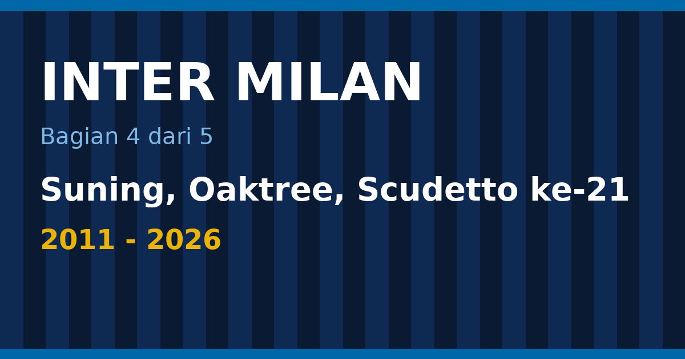

Setelah treble 2010, Inter butuh waktu sepuluh tahun untuk menjuarai sesuatu yang besar lagi. Trofi terakhir dari era pasca-treble (Benítez dan Leonardo), Coppa Italia 2010–11, dimenangi pada Mei 2011. Trofi berikutnya baru datang pada Mei 2021, ketika Scudetto 2020–21 memutus puasa gelar. Sejak itu Inter menambah Scudetto 2024, Scudetto ke-21 pada Mei 2026, dua final Liga Champions yang berakhir kalah, dan satu kepemilikan baru.

Bagian keempat ini mengikuti masa itu: pergantian pemilik dari Erick Thohir ke Suning lalu Oaktree, Antonio Conte dan Scudetto 2021, tahun-tahun Simone Inzaghi, final Istanbul dan Munich, bintang kedua, dan musim 2025–26 bersama Cristian Chivu. Bagian pertama sampai ketiga membahas sejarah sampai 2011.

<!--more-->

*Ilustrasi: dibuat untuk tulisan ini.*

> **Poin Penting**
>
> - Erick Thohir dan mitranya sepakat membeli 70% saham Inter pada 2013 seharga 501 juta dolar AS, lalu Suning mengambil alih mayoritas klub pada 2016.
> - Scudetto 2 Mei 2021 adalah yang pertama dalam sebelas tahun. Pada 22 April 2024 Inter meraih Scudetto ke-20 setelah menang 2–1 atas Milan di derby.
> - Dalam tiga final Liga Champions, hasil Inter berbeda jauh: menang 2–0 atas Bayern (2010), kalah 0–1 dari Manchester City (2023), dan kalah 0–5 dari PSG (2025).
> - Oaktree Capital mengambil alih klub pada 22 Mei 2024, setelah Suning gagal membayar utang 395 juta euro.
> - Musim 2025–26 berakhir dengan Scudetto ke-21 dan Coppa Italia ke-10, tetapi Inter tersingkir dari Liga Champions di babak play-off oleh Bodø/Glimt.

Daftar isi bagian ini

* TOC
{:toc}

## 2011–2013: setelah pesta

Daftar gelar Inter memperlihatkan jelas betapa tajam perubahan setelah 2011. Dari Coppa Italia pada Mei 2011 sampai Scudetto pada Mei 2021, tidak ada trofi baru yang masuk ke lemari klub ([Wikipedia](https://en.wikipedia.org/wiki/FC_Internazionale_Milano)). Sebagian besar dekade itu diwarnai pergantian pelatih, ketidakstabilan skuad, dan persoalan keuangan yang harus ditanggung klub setelah bertahun-tahun bergantung pada dana pribadi pemiliknya.

Pada 2013 kepemilikan mulai bergeser. Erick Thohir, pengusaha Indonesia, bersama mitranya menyepakati pembelian 70% saham Inter dengan nilai 501 juta dolar AS ([Wikipedia, sejarah Inter](https://en.wikipedia.org/wiki/History_of_Inter_Milan)). Era keluarga Moratti, yang dimulai oleh Angelo pada 1955 dan dilanjutkan Massimo sejak 1995, praktis berakhir di titik itu.

<figure class="blog-chart">
<svg viewBox="0 0 420 338" width="420" height="338" role="img" aria-label="Rantai kepemilikan Inter dari Pellegrini sampai Oaktree: Ernesto Pellegrini, sampai 1995; Massimo Moratti, 1995 sampai 2013; Erick Thohir dan mitra, 2013: 70% saham, 501 juta dolar AS; Suning Holdings Group, 2016: mayoritas saham; Oaktree Capital Management, 22 Mei 2024: 99,6% saham" style="max-width:100%;height:auto;font-family:sans-serif">
<rect x="20" y="0" width="380" height="50" rx="8" fill="none" stroke="#9ca3af" stroke-width="2"></rect>
<text x="210.0" y="22" text-anchor="middle" font-size="14" font-weight="bold" fill="currentColor">Ernesto Pellegrini</text>
<text x="210.0" y="40" text-anchor="middle" font-size="12" font-weight="normal" fill="#9ca3af">sampai 1995</text>
<line x1="210.0" y1="50" x2="210.0" y2="66" stroke="#9ca3af" stroke-width="2"></line>
<polygon points="210.0,72 205.0,64 215.0,64" fill="#9ca3af"></polygon>
<rect x="20" y="72" width="380" height="50" rx="8" fill="none" stroke="#3b82f6" stroke-width="2"></rect>
<text x="210.0" y="94" text-anchor="middle" font-size="14" font-weight="bold" fill="currentColor">Massimo Moratti</text>
<text x="210.0" y="112" text-anchor="middle" font-size="12" font-weight="normal" fill="#9ca3af">1995 sampai 2013</text>
<line x1="210.0" y1="122" x2="210.0" y2="138" stroke="#9ca3af" stroke-width="2"></line>
<polygon points="210.0,144 205.0,136 215.0,136" fill="#9ca3af"></polygon>
<rect x="20" y="144" width="380" height="50" rx="8" fill="none" stroke="#3b82f6" stroke-width="2"></rect>
<text x="210.0" y="166" text-anchor="middle" font-size="14" font-weight="bold" fill="currentColor">Erick Thohir dan mitra</text>
<text x="210.0" y="184" text-anchor="middle" font-size="12" font-weight="normal" fill="#9ca3af">2013: 70% saham, 501 juta dolar AS</text>
<line x1="210.0" y1="194" x2="210.0" y2="210" stroke="#9ca3af" stroke-width="2"></line>
<polygon points="210.0,216 205.0,208 215.0,208" fill="#9ca3af"></polygon>
<rect x="20" y="216" width="380" height="50" rx="8" fill="none" stroke="#3b82f6" stroke-width="2"></rect>
<text x="210.0" y="238" text-anchor="middle" font-size="14" font-weight="bold" fill="currentColor">Suning Holdings Group</text>
<text x="210.0" y="256" text-anchor="middle" font-size="12" font-weight="normal" fill="#9ca3af">2016: mayoritas saham</text>
<line x1="210.0" y1="266" x2="210.0" y2="282" stroke="#9ca3af" stroke-width="2"></line>
<polygon points="210.0,288 205.0,280 215.0,280" fill="#9ca3af"></polygon>
<rect x="20" y="288" width="380" height="50" rx="8" fill="none" stroke="#eab308" stroke-width="2"></rect>
<text x="210.0" y="310" text-anchor="middle" font-size="14" font-weight="bold" fill="currentColor">Oaktree Capital Management</text>
<text x="210.0" y="328" text-anchor="middle" font-size="12" font-weight="normal" fill="#9ca3af">22 Mei 2024: 99,6% saham</text>
</svg>
<figcaption>Pemilik Inter dari akhir 1980-an sampai sekarang.</figcaption>
</figure>

## 2016: Suning

Tiga tahun kemudian, pada 2016, grup asal Tiongkok Suning Holdings Group mengambil alih mayoritas saham klub ([Wikipedia, sejarah Inter](https://en.wikipedia.org/wiki/History_of_Inter_Milan)). Suning menyuntikkan dana, tetapi hasilnya awalnya datar. Pada 2017–18 Luciano Spalletti ditunjuk sebagai pelatih dan Inter kembali lolos ke Liga Champions, yang menandai pemulihan setelah bertahun-tahun di luar kompetisi itu.

Pergantian besar berikutnya datang pada 2019, ketika Antonio Conte ditunjuk sebagai pelatih. Conte dikenal sebagai pelatih yang menuntut disiplin tinggi, dan Inter di bawahnya langsung menjadi penantang.

## 2019–20: final Liga Europa

Musim pertama Conte berakhir tanpa trofi, tetapi dengan dua pencapaian: Inter finis kedua di Serie A, dan sampai ke final Liga Europa. Di final, Inter kalah 2–3 dari Sevilla ([Wikipedia, sejarah Inter](https://en.wikipedia.org/wiki/History_of_Inter_Milan)). Itu final Eropa pertama Inter sejak 2010, tetapi berakhir dengan kekecewaan, sebab Sevilla memang spesialis kompetisi itu.

## 2 Mei 2021: Scudetto setelah sebelas tahun

Satu musim kemudian, pada 2 Mei 2021, Inter memastikan Scudetto 2020–21 dengan empat pekan tersisa, setelah Atalanta gagal menang melawan Sassuolo. Itu gelar pertama sejak 2009–10 dan mengakhiri sembilan tahun dominasi Juventus ([Wikipedia, musim 2020–21](https://en.wikipedia.org/wiki/2020%E2%80%9321_Inter_Milan_season)). Romelu Lukaku mencetak 24 gol di liga dan 30 gol di semua kompetisi, sementara musim itu sekaligus menjadi Scudetto ke-19 bagi Inter.

Musim itu tidak sempurna. Di Liga Champions, Inter finis terakhir di grup dengan hanya satu kemenangan, kegagalan fase grup ketiga beruntun, dan di Coppa Italia Inter tersingkir di semifinal oleh Juventus dengan agregat 1–2 ([Wikipedia, musim 2020–21](https://en.wikipedia.org/wiki/2020%E2%80%9321_Inter_Milan_season)).

Namun kegembiraan itu tidak berlangsung lama. Conte meninggalkan klub atas kesepakatan bersama pada 26 Mei 2021, di tengah tekanan utang akibat pandemi dan pengeluaran sebelumnya, dan Simone Inzaghi ditunjuk sebagai penggantinya. Dua bulan kemudian, pada Agustus 2021, Inter menjual Romelu Lukaku, pencetak gol andalan musim juara, ke Chelsea dengan harga 115 juta euro ([Wikipedia, sejarah Inter](https://en.wikipedia.org/wiki/History_of_Inter_Milan)). Penjualan itu menandai bagaimana kondisi keuangan klub di bawah Suning menjadi masalah yang makin besar.

## Era Inzaghi: trofi domestik dan dua final Eropa

Setelah Conte dan Lukaku pergi, Inter tidak melemah. Di bawah Inzaghi, klub memenangi Supercoppa Italiana pada Januari 2022 dengan 2–1 atas Juventus, dan Coppa Italia 2021–22 dengan 4–2 atas Juventus. Pada Januari 2023 Inter menang 3–0 atas Milan di Supercoppa ([Wikipedia, sejarah Inter](https://en.wikipedia.org/wiki/History_of_Inter_Milan)), dan Coppa Italia 2022–23 menyusul. Dalam daftar trofi klub, Inzaghi menambah tiga Supercoppa, dua Coppa Italia, dan satu Scudetto, total enam trofi domestik ([Wikipedia](https://en.wikipedia.org/wiki/FC_Internazionale_Milano)). Daftar klub menulis Supercoppa menurut tahun edisinya, sehingga tiga kemenangan itu tercatat sebagai 2021, 2022, dan 2023, padahal dimainkan pada Januari tahun berikutnya.

Yang menonjol adalah lawannya, di samping jumlahnya: Juventus dua kali dan Milan sekali, dua rival terbesar klub.

<figure class="blog-chart">
<svg viewBox="0 0 420 168" width="420" height="168" role="img" aria-label="Capaian Inter era Simone Inzaghi: 3, Supercoppa Italiana, edisi 2021, 2022, dan 2023; 2, Coppa Italia, 2021-22 dan 2022-23; 1, Scudetto, 2023-24, ke-20; 2, Final Eropa, 2023 kalah; 2025 kalah" style="max-width:100%;height:auto;font-family:sans-serif">
<rect x="0.0" y="0" width="204.0" height="78" rx="8" fill="none" stroke="#eab308" stroke-width="2"></rect>
<text x="102.0" y="24" text-anchor="middle" font-size="15" font-weight="bold" fill="currentColor">3</text>
<text x="102.0" y="46" text-anchor="middle" font-size="13" font-weight="normal" fill="currentColor">Supercoppa Italiana</text>
<text x="102.0" y="64" text-anchor="middle" font-size="12" font-weight="normal" fill="#9ca3af">edisi 2021, 2022, dan 2023</text>
<rect x="216.0" y="0" width="204.0" height="78" rx="8" fill="none" stroke="#eab308" stroke-width="2"></rect>
<text x="318.0" y="24" text-anchor="middle" font-size="15" font-weight="bold" fill="currentColor">2</text>
<text x="318.0" y="46" text-anchor="middle" font-size="13" font-weight="normal" fill="currentColor">Coppa Italia</text>
<text x="318.0" y="64" text-anchor="middle" font-size="12" font-weight="normal" fill="#9ca3af">2021-22 dan 2022-23</text>
<rect x="0.0" y="90" width="204.0" height="78" rx="8" fill="none" stroke="#eab308" stroke-width="2"></rect>
<text x="102.0" y="114" text-anchor="middle" font-size="15" font-weight="bold" fill="currentColor">1</text>
<text x="102.0" y="136" text-anchor="middle" font-size="13" font-weight="normal" fill="currentColor">Scudetto</text>
<text x="102.0" y="154" text-anchor="middle" font-size="12" font-weight="normal" fill="#9ca3af">2023-24, ke-20</text>
<rect x="216.0" y="90" width="204.0" height="78" rx="8" fill="none" stroke="#ef4444" stroke-width="2"></rect>
<text x="318.0" y="114" text-anchor="middle" font-size="15" font-weight="bold" fill="currentColor">2</text>
<text x="318.0" y="136" text-anchor="middle" font-size="13" font-weight="normal" fill="currentColor">Final Eropa</text>
<text x="318.0" y="154" text-anchor="middle" font-size="12" font-weight="normal" fill="#9ca3af">2023 kalah; 2025 kalah</text>
</svg>
<figcaption>Enam trofi domestik dan dua final Liga Champions yang kalah.</figcaption>
</figure>

## 2022–23: ketiga di liga, finalis di Eropa

Musim 2022–23 menunjukkan sisi lain Inzaghi. Inter hanya finis ketiga di Serie A, tetapi memenangi Coppa Italia dan Supercoppa Italiana, serta mencapai final Liga Champions untuk pertama kalinya sejak 2010 ([Wikipedia, musim 2022–23](https://en.wikipedia.org/wiki/2022%E2%80%9323_Inter_Milan_season)). Lautaro Martínez mencetak 21 gol di liga dan 28 gol di semua kompetisi, dan kemenangan terbesar musim itu adalah 6–0 atas Hellas Verona pada 3 Mei 2023. Jumlah penonton tertinggi di kandang, 75.584, terjadi pada laga liga melawan Milan pada 5 Februari 2023.

## Istanbul 2023: final yang nyaris

Jalan Inter ke final Liga Champions 2023 dimulai dari posisi kedua di Grup C dengan 10 poin. Di babak gugur, Inter menyingkirkan Porto (agregat 1–0), Benfica (5–3), dan di semifinal Milan dengan agregat 3–0, derby Eropa antara dua klub satu stadion ([Wikipedia, final 2023](https://en.wikipedia.org/wiki/2023_UEFA_Champions_League_final)).

Final dimainkan pada 10 Juni 2023 di Stadion Olimpiade Atatürk, Istanbul, di depan 71.412 penonton, melawan Manchester City asuhan Pep Guardiola. Pada babak pertama André Onana menggagalkan dua peluang awal City, dan Kevin De Bruyne ditarik keluar karena cedera pada menit ke-36. Satu-satunya gol lahir pada menit ke-68, dicetak Rodri. Inter masih punya peluang: Federico Dimarco menyundul bola ke mistar gawang tak lama setelah gol itu, dan sundulan Romelu Lukaku dari jarak dekat pada menit ke-89 diblok Ederson. Inter kalah 0–1 ([Wikipedia, final 2023](https://en.wikipedia.org/wiki/2023_UEFA_Champions_League_final)).

Lawannya Manchester City, yang malam itu menuntaskan treble versi Inggris, dan Inter hanya kalah dengan satu gol. Kekalahan setipis itu terasa menyakitkan, tetapi Inter bertahan di level tertinggi sampai menit-menit akhir.

## 22 April 2024: derby, Scudetto ke-20, dan bintang kedua

Pencapaian puncak era Inzaghi datang pada musim 2023–24. Pada 22 April 2024, Inter mengalahkan Milan 2–1 di derby dan memastikan Scudetto ke-20 ([Wikipedia, sejarah Inter](https://en.wikipedia.org/wiki/History_of_Inter_Milan)). Kemenangan di derby membuat gelar itu terasa lebih manis. Dua puluh Scudetto juga berarti bintang kedua di jersey, setelah bintang pertama pada 1966.

### 2023–24 dalam angka

Gelar 2023–24 dipastikan dengan lima pertandingan tersisa. Gol kemenangan di derby datang dari Francesco Acerbi dan Marcus Thuram. Lautaro Martínez mencetak 24 gol di liga dan 27 gol di semua kompetisi, dan dinobatkan sebagai pemain terbaik Serie A ([Wikipedia, musim 2023–24](https://en.wikipedia.org/wiki/2023%E2%80%9324_Inter_Milan_season)).

Selain Scudetto, Inter memenangi Supercoppa Italiana dengan 3–0 atas Lazio di semifinal dan 1–0 atas Napoli di final, lewat gol Lautaro di masa tambahan waktu. Itu Supercoppa kedelapan klub dan ketiga beruntun.

Di kompetisi lain hasilnya kurang baik. Inter tersingkir dari Coppa Italia di babak 16 besar oleh Bologna, kalah 1–2 setelah perpanjangan waktu pada 20 Desember 2023. Di Liga Champions, Inter finis kedua di grup di bawah Real Sociedad, lalu bertemu Atlético Madrid di babak 16 besar: menang 1–0 di leg pertama lewat gol Marko Arnautović, kalah 1–2 di leg kedua pada 13 Maret 2024 (gol Federico Dimarco), dan tersingkir lewat adu penalti 2–3 setelah agregat 2–2.

Beberapa catatan lain menunjukkan betapa dominannya Inter di liga. Klub mencatat 13 kemenangan beruntun di semua kompetisi dan 10 kemenangan beruntun di liga. Rangkaian 28 laga Serie A tanpa kalah baru berakhir dengan kekalahan 0–1 di Sassuolo pada 4 Mei 2024. Kemenangan terbesar musim itu adalah 5–0 atas Frosinone pada 10 Mei 2024. Hakan Çalhanoğlu terpilih sebagai gelandang terbaik liga dan Alessandro Bastoni sebagai bek terbaik, sementara Inzaghi dinobatkan sebagai pelatih terbaik, dan Inter menjadi klub Italia pertama yang memastikan tempat di Liga Champions 2024–25 ([Wikipedia, musim 2023–24](https://en.wikipedia.org/wiki/2023%E2%80%9324_Inter_Milan_season)).

## Mei 2024: Oaktree mengambil alih

Sebulan setelah Scudetto, struktur kepemilikan klub berubah lagi. Pada 22 Mei 2024, Oaktree Capital Management mengambil alih Inter setelah Suning gagal membayar utang sebesar 395 juta euro ([Wikipedia, sejarah Inter](https://en.wikipedia.org/wiki/History_of_Inter_Milan)). Saat ini Oaktree memegang 99,6% saham klub, dengan Giuseppe Marotta sebagai presiden ([Wikipedia](https://en.wikipedia.org/wiki/FC_Internazionale_Milano)).

Pergantian itu tidak mengubah arah di lapangan secara langsung. Inzaghi tetap melatih, dan skuad juara dipertahankan dengan inti yang sama.

## 2024–25: dua kali nyaris, dua kali gagal

Musim 2024–25 adalah musim yang kejam. Di Serie A, Inter menyelesaikan 38 laga dengan 24 kemenangan, 9 seri, dan 5 kalah, 81 poin. Napoli menutup musim dengan 82 poin dan menjadi juara ([Wikipedia, Serie A 2024–25](https://en.wikipedia.org/wiki/2024%E2%80%9325_Serie_A)). Selisih satu poin memisahkan Inter dari Scudetto ke-21.

<figure class="blog-chart">
<svg viewBox="0 0 420 76" width="420" height="76" role="img" aria-label="Perbandingan poin Napoli dan Inter di Serie A 2024-25: Napoli (juara) 82; Inter 81" style="max-width:100%;height:auto;font-family:sans-serif">
<text x="102" y="24" text-anchor="end" font-size="13" font-weight="normal" fill="currentColor">Napoli (juara)</text>
<rect x="110" y="10" width="236.9" height="20" rx="3" fill="#eab308"></rect>
<text x="352.8888888888889" y="25" text-anchor="start" font-size="13" font-weight="normal" fill="currentColor">82</text>
<text x="102" y="54" text-anchor="end" font-size="13" font-weight="normal" fill="currentColor">Inter</text>
<rect x="110" y="40" width="234.0" height="20" rx="3" fill="#3b82f6"></rect>
<text x="350.0" y="55" text-anchor="start" font-size="13" font-weight="normal" fill="currentColor">81</text>
</svg>
<figcaption>Klasemen akhir Serie A 2024-25: selisih satu poin memisahkan Napoli dan Inter.</figcaption>
</figure>

Di Liga Champions, Inter kembali sampai ke final. Di Munich, mereka kalah 0–5 dari Paris Saint-Germain ([Wikipedia](https://en.wikipedia.org/wiki/FC_Internazionale_Milano)). Dalam satu musim yang sama, Inter kehilangan Scudetto dengan selisih satu poin dan kalah telak di final Eropa.

<figure class="blog-chart">
<svg viewBox="0 0 420 78" width="420" height="78" role="img" aria-label="Tiga final Liga Champions Inter sejak 2010: 2010, Inter 2-0 Bayern, juara; 2023, Inter 0-1 Man City, kalah, gol Rodri; 2025, Inter 0-5 PSG, kalah, Munich" style="max-width:100%;height:auto;font-family:sans-serif">
<rect x="0.0" y="0" width="132.0" height="78" rx="8" fill="none" stroke="#22c55e" stroke-width="2"></rect>
<text x="66.0" y="24" text-anchor="middle" font-size="15" font-weight="bold" fill="currentColor">2010</text>
<text x="66.0" y="46" text-anchor="middle" font-size="13" font-weight="normal" fill="currentColor">Inter 2-0 Bayern</text>
<text x="66.0" y="64" text-anchor="middle" font-size="12" font-weight="normal" fill="#9ca3af">juara</text>
<rect x="144.0" y="0" width="132.0" height="78" rx="8" fill="none" stroke="#ef4444" stroke-width="2"></rect>
<text x="210.0" y="24" text-anchor="middle" font-size="15" font-weight="bold" fill="currentColor">2023</text>
<text x="210.0" y="46" text-anchor="middle" font-size="13" font-weight="normal" fill="currentColor">Inter 0-1 Man City</text>
<text x="210.0" y="64" text-anchor="middle" font-size="12" font-weight="normal" fill="#9ca3af">kalah, gol Rodri</text>
<rect x="288.0" y="0" width="132.0" height="78" rx="8" fill="none" stroke="#ef4444" stroke-width="2"></rect>
<text x="354.0" y="24" text-anchor="middle" font-size="15" font-weight="bold" fill="currentColor">2025</text>
<text x="354.0" y="46" text-anchor="middle" font-size="13" font-weight="normal" fill="currentColor">Inter 0-5 PSG</text>
<text x="354.0" y="64" text-anchor="middle" font-size="12" font-weight="normal" fill="#9ca3af">kalah, Munich</text>
</svg>
<figcaption>Tiga final dalam lima belas tahun: satu juara, dua kalah.</figcaption>
</figure>

### Jalan ke Munich

Jalan Inter menuju final 2025 jauh lebih berliku daripada hasil akhirnya. Di fase liga, Inter finis keempat dan lolos langsung ke babak 16 besar. Hasilnya meliputi 0–0 di kandang Manchester City, 4–0 atas Red Star Belgrade, 1–0 atas Young Boys, 1–0 atas Arsenal, 1–0 atas RB Leipzig, kalah 0–1 dari Bayer Leverkusen pada 11 Desember, 1–0 di Sparta Praha, dan 3–0 atas Monaco pada 29 Januari. Di lima laga pertama, Inter tidak kebobolan sekali pun ([Wikipedia, musim 2024–25](https://en.wikipedia.org/wiki/2024%E2%80%9325_Inter_Milan_season)).

Di babak sistem gugur, Inter menyingkirkan Feyenoord dengan agregat 4–1 (menang 2–0 di Rotterdam dan 2–1 di Milan), lalu Bayern Munich dengan agregat 4–3, setelah menang 2–1 di Allianz Arena dan imbang 2–2 di San Siro. Semifinal melawan Barcelona menjadi salah satu pertandingan paling dramatis dalam sejarah klub: 3–3 di Barcelona dan kemenangan 4–3 setelah perpanjangan waktu di San Siro, dengan gol Davide Frattesi di babak tambahan, untuk agregat 7–6 ([Wikipedia, musim 2024–25](https://en.wikipedia.org/wiki/2024%E2%80%9325_Inter_Milan_season)).

Itulah yang membuat final 0–5 terasa begitu berat.

### Final: 31 Mei 2025, Munich

Final dimainkan di Allianz Arena, Munich, di depan 64.327 penonton, dengan wasit István Kovács dari Rumania. PSG, asuhan Luis Enrique, menekan sejak awal. Achraf Hakimi membuka skor pada menit ke-12, Désiré Doué menambah pada menit ke-20, dan PSG memimpin 2–0 saat jeda. Inter punya peluang, tetapi tidak ada yang masuk. Doué mencetak gol keduanya pada menit ke-63, Khvicha Kvaratskhelia menambah pada menit ke-73, dan Senny Mayulu menutup pada menit ke-86 ([Wikipedia, final 2025](https://en.wikipedia.org/wiki/2025_UEFA_Champions_League_final)).

Margin lima gol itu terbesar dalam final kompetisi klub utama Eropa mana pun. Bagi PSG, itu gelar Liga Champions pertama dan treble pertama bagi klub Prancis. Susunan Inter malam itu: Yann Sommer; Benjamin Pavard, Francesco Acerbi, Alessandro Bastoni; Denzel Dumfries, Nicolò Barella, Hakan Çalhanoğlu, Henrikh Mkhitaryan, Federico Dimarco; Marcus Thuram dan Lautaro Martínez (kapten). Simone Inzaghi meninggalkan Inter atas kesepakatan bersama tiga hari setelah final ([Wikipedia, final 2025](https://en.wikipedia.org/wiki/2025_UEFA_Champions_League_final)).

<figure class="blog-chart">
<svg viewBox="0 0 420 196" width="420" height="196" role="img" aria-label="Jalan Inter di Liga Champions 2024-25: Fase liga, Peringkat keempat, lolos langsung ke 16 besar; 16 besar, Feyenoord, agregat 4-1; Perempat final, Bayern Munich, agregat 4-3; Semifinal, Barcelona, agregat 7-6 (3-3 dan 4-3 setelah perpanjangan); Final, Paris Saint-Germain, kalah 0-5" style="max-width:100%;height:auto;font-family:sans-serif">
<line x1="86" y1="8" x2="86" y2="188" stroke="#9ca3af" stroke-width="2"></line>
<text x="76" y="22" text-anchor="end" font-size="13" font-weight="bold" fill="currentColor">Fase liga</text>
<circle cx="86" cy="18" r="5" fill="#3b82f6"></circle>
<text x="100" y="22" text-anchor="start" font-size="13" font-weight="normal" fill="currentColor">Peringkat keempat, lolos langsung ke 16</text>
<text x="100" y="38" text-anchor="start" font-size="13" font-weight="normal" fill="currentColor">besar</text>
<text x="76" y="66" text-anchor="end" font-size="13" font-weight="bold" fill="currentColor">16 besar</text>
<circle cx="86" cy="62" r="5" fill="#22c55e"></circle>
<text x="100" y="66" text-anchor="start" font-size="13" font-weight="normal" fill="currentColor">Feyenoord, agregat 4-1</text>
<text x="76" y="94" text-anchor="end" font-size="13" font-weight="bold" fill="currentColor">Perempat final</text>
<circle cx="86" cy="90" r="5" fill="#22c55e"></circle>
<text x="100" y="94" text-anchor="start" font-size="13" font-weight="normal" fill="currentColor">Bayern Munich, agregat 4-3</text>
<text x="76" y="122" text-anchor="end" font-size="13" font-weight="bold" fill="currentColor">Semifinal</text>
<circle cx="86" cy="118" r="5" fill="#22c55e"></circle>
<text x="100" y="122" text-anchor="start" font-size="13" font-weight="normal" fill="currentColor">Barcelona, agregat 7-6 (3-3 dan 4-3 setelah</text>
<text x="100" y="138" text-anchor="start" font-size="13" font-weight="normal" fill="currentColor">perpanjangan)</text>
<text x="76" y="166" text-anchor="end" font-size="13" font-weight="bold" fill="currentColor">Final</text>
<circle cx="86" cy="162" r="5" fill="#ef4444"></circle>
<text x="100" y="166" text-anchor="start" font-size="13" font-weight="normal" fill="currentColor">Paris Saint-Germain, kalah 0-5</text>
</svg>
<figcaption>Dari fase liga sampai final: tiga lawan disingkirkan, lalu kalah 0-5.</figcaption>
</figure>

### Kekalahan lain di musim yang sama

Final Eropa bukan satu-satunya kekecewaan 2024–25. Pada Januari 2025, Inter menyingkirkan Atalanta 2–0 di semifinal Supercoppa, lalu memimpin 2–0 atas Milan di final lewat gol Lautaro Martínez dan Mehdi Taremi, tetapi akhirnya kalah 2–3. Di Coppa Italia, Inter tersingkir di semifinal oleh Milan dengan agregat 1–4: imbang 1–1 di leg pertama dan kalah 0–3 di kandang pada 23 April 2025. Dalam urusan individu, Lautaro menjadi pencetak gol asing terbanyak sepanjang sejarah klub setelah mencetak gol ke-134 untuk Inter pada Oktober 2024, dan Marcus Thuram mencetak 14 gol di liga ([Wikipedia, musim 2024–25](https://en.wikipedia.org/wiki/2024%E2%80%9325_Inter_Milan_season)). Kemenangan terbesar musim itu adalah 6–0 atas Lazio pada 16 Desember 2024.

## 2025–26: Chivu dan Scudetto ke-21

Musim 2025–26 dimulai dengan pelatih baru. Cristian Chivu, mantan bek di skuad treble 2010, mengambil alih bangku cadangan ([Wikipedia](https://en.wikipedia.org/wiki/FC_Internazionale_Milano)). Awal musim sempat bergelombang: kemenangan 5–0 atas Torino pada 25 Agustus 2025 diikuti kekalahan 1–3 di kandang Napoli pada 25 Oktober 2025. Di Supercoppa Italiana, Inter tersingkir di semifinal oleh Bologna lewat adu penalti 2–3 setelah imbang 1–1 di perpanjangan waktu ([Wikipedia, musim 2025–26](https://en.wikipedia.org/wiki/2025%E2%80%9326_Inter_Milan_season)).

Setelah itu performa membaik. Pada akhir 2025, Inter memimpin klasemen Serie A dengan 36 poin, dan kemenangan 6–2 atas Pisa pada Januari membuat mereka unggul lima poin dari Milan ([Wikipedia, musim 2025–26](https://en.wikipedia.org/wiki/2025%E2%80%9326_Inter_Milan_season)). Lautaro Martínez, sang kapten, menjadi pencetak gol terbanyak tim.

**Scudetto.** Pada 3 Mei 2026, Inter menang 2–0 di kandang atas Parma dan memastikan gelar dengan tiga laga tersisa. Inter menutup musim dengan 87 poin, unggul 11 poin dari Napoli di peringkat kedua dengan 76 poin ([Wikipedia, Serie A 2025–26](https://en.wikipedia.org/wiki/2025%E2%80%9326_Serie_A)). Itu Scudetto ke-21 klub.

**Coppa Italia.** Di final yang dimainkan di Stadio Olimpico pada 13 Mei 2026, Inter mengalahkan Lazio 2–0 ([Wikipedia](https://en.wikipedia.org/wiki/2026_Coppa_Italia_final)). Itu Coppa Italia ke-10 klub dan melengkapi double domestik musim itu.

**Liga Champions.** Perjalanan Eropa berakhir lebih cepat. Setelah fase liga dengan kemenangan atas Ajax (2–0), Slavia Praha (3–0), Union Saint-Gilloise (4–0), dan Kairat (2–1), serta kekalahan dari Arsenal 1–3 pada 20 Januari 2026, Inter harus lewat babak play-off. Di sana mereka kalah dari Bodø/Glimt: 1–3 di Norwegia dan 1–2 di San Siro pada 24 Februari 2026, dengan agregat 2–5 ([Wikipedia, musim 2025–26](https://en.wikipedia.org/wiki/2025%E2%80%9326_Inter_Milan_season); [UEFA](https://www.uefa.com/uefachampionsleague/news/02a2-1ff8e93af562-ee8650d1048e-1000--champions-league-knockout-phase-play-off-second-leg-inter); [Gulf News](https://gulfnews.com/amp/story/sport%2Ffootball%2Fbod%C3%B8glimt-stun-inter-milan-to-reach-ucl-last-16-1.500455212)). Bodø/Glimt menjadi klub Norwegia pertama yang memenangi satu babak gugur di kompetisi itu.

<figure class="blog-chart">
<svg viewBox="0 0 420 168" width="420" height="168" role="img" aria-label="Hasil Inter di empat kompetisi musim 2025-26: Serie A, Scudetto ke-21, menang 2-0 atas Parma, 3 Mei; Coppa Italia, Inter 2-0 Lazio, final 13 Mei 2026; Supercoppa, Tersingkir di semifinal, kalah adu penalti dari Bologna; Liga Champions, Tersingkir di play-off, agregat 2-5 dari Bodø/Glimt" style="max-width:100%;height:auto;font-family:sans-serif">
<rect x="0.0" y="0" width="204.0" height="78" rx="8" fill="none" stroke="#22c55e" stroke-width="2"></rect>
<text x="102.0" y="24" text-anchor="middle" font-size="15" font-weight="bold" fill="currentColor">Serie A</text>
<text x="102.0" y="46" text-anchor="middle" font-size="13" font-weight="normal" fill="currentColor">Scudetto ke-21</text>
<text x="102.0" y="64" text-anchor="middle" font-size="12" font-weight="normal" fill="#9ca3af">menang 2-0 atas Parma, 3 Mei</text>
<rect x="216.0" y="0" width="204.0" height="78" rx="8" fill="none" stroke="#22c55e" stroke-width="2"></rect>
<text x="318.0" y="24" text-anchor="middle" font-size="15" font-weight="bold" fill="currentColor">Coppa Italia</text>
<text x="318.0" y="46" text-anchor="middle" font-size="13" font-weight="normal" fill="currentColor">Inter 2-0 Lazio</text>
<text x="318.0" y="64" text-anchor="middle" font-size="12" font-weight="normal" fill="#9ca3af">final 13 Mei 2026</text>
<rect x="0.0" y="90" width="204.0" height="78" rx="8" fill="none" stroke="#ef4444" stroke-width="2"></rect>
<text x="102.0" y="114" text-anchor="middle" font-size="15" font-weight="bold" fill="currentColor">Supercoppa</text>
<text x="102.0" y="136" text-anchor="middle" font-size="13" font-weight="normal" fill="currentColor">Tersingkir di semifinal</text>
<text x="102.0" y="154" text-anchor="middle" font-size="12" font-weight="normal" fill="#9ca3af">kalah adu penalti dari Bologna</text>
<rect x="216.0" y="90" width="204.0" height="78" rx="8" fill="none" stroke="#ef4444" stroke-width="2"></rect>
<text x="318.0" y="114" text-anchor="middle" font-size="15" font-weight="bold" fill="currentColor">Liga Champions</text>
<text x="318.0" y="136" text-anchor="middle" font-size="13" font-weight="normal" fill="currentColor">Tersingkir di play-off</text>
<text x="318.0" y="154" text-anchor="middle" font-size="12" font-weight="normal" fill="#9ca3af">agregat 2-5 dari Bodø/Glimt</text>
</svg>
<figcaption>Dua trofi domestik, dua tersingkir lebih awal.</figcaption>
</figure>

## Yang membedakan era ini

Dibanding tiga bagian sebelumnya, masa sejak 2011 punya tiga ciri yang jelas.

**Pemilik yang berganti-ganti.** Antara 2013 dan 2024 klub dimiliki kelompok Thohir, Suning, lalu Oaktree, tiga pemilik dalam sebelas tahun setelah hampir dua dekade di tangan Moratti.

**Juara di tengah perubahan.** Scudetto 2024 dan 2026 diraih dengan dua pelatih berbeda dan dua pemilik berbeda di belakangnya. Gelar itu menunjukkan bahwa inti tim bertahan walau struktur di atasnya berubah.

**Final-final Eropa yang menyakitkan.** Tiga final dalam lima belas tahun menghasilkan satu gelar, satu kekalahan tipis (0–1), dan satu kekalahan telak (0–5).

## Ringkasan

- Setelah Coppa Italia 2010–11, Inter menunggu sepuluh tahun untuk trofi berikutnya, yaitu Scudetto 2020–21.
- Kepemilikan berpindah dari Moratti ke Thohir (2013), Suning (2016), dan Oaktree (22 Mei 2024).
- Inzaghi mengumpulkan enam trofi domestik, tetapi dua final Liga Champions berakhir kalah: 0–1 dari City (2023) dan 0–5 dari PSG (2025).
- Scudetto ke-20 jatuh pada 22 April 2024 di derby, dan Scudetto ke-21 pada 3 Mei 2026.
- Musim 2025–26 membawa double domestik di bawah Chivu, tetapi Liga Champions berakhir di play-off.

Tulisan ini dibantu oleh AI.
