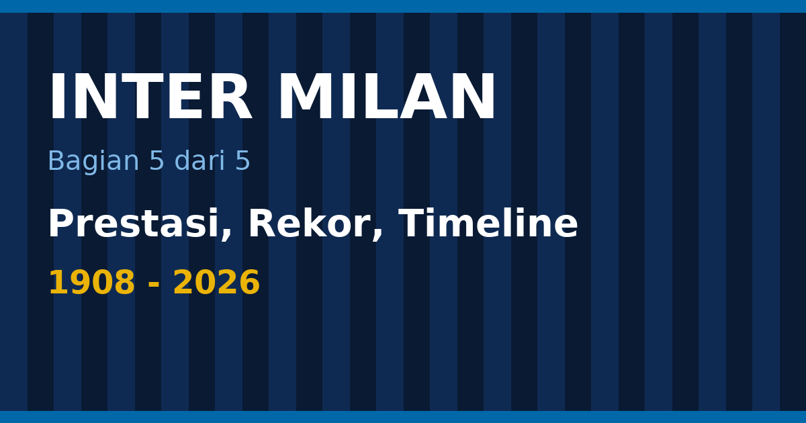

Inter Milan memegang 48 trofi resmi menurut daftar gelar yang tercatat per November 2026: 21 Scudetto, 10 Coppa Italia, 8 Supercoppa Italiana, 3 Piala Eropa/Liga Champions, 3 Piala UEFA, 2 Piala Interkontinental, dan 1 Piala Dunia Antarklub FIFA ([Wikipedia](https://en.wikipedia.org/wiki/FC_Internazionale_Milano)). Empat bagian sebelumnya menceritakan sejarahnya secara kronologis. Bagian terakhir ini merapikan semuanya: daftar trofi dengan tahun, gelar per dekade, rekor pemain dan klub, stadion, rivalitas, dan satu timeline tonggak utama dari 1908 sampai 2026.

<!--more-->

*Ilustrasi: dibuat untuk tulisan ini.*

> **Poin Penting**
>
> - Inter punya 21 Scudetto (terbaru 2025–26), 10 Coppa Italia, 8 Supercoppa, 3 Piala Eropa/Liga Champions (1964, 1965, 2010), 3 Piala UEFA, 2 Piala Interkontinental, dan 1 Piala Dunia Antarklub.
> - Puncak trofi ada di 1960-an (tujuh), 2000-an (sembilan), dan 2020-an (sembilan, masih berjalan).
> - Javier Zanetti memegang rekor penampilan (858 laga) dan Giuseppe Meazza rekor gol (284). Rekor poin satu musim adalah 97, pada 2006–07.
> - Stadion San Siro, dipakai bersama Milan sejak 1947, menampung 75.817 penonton untuk pertandingan reguler.
> - Inter tidak pernah terdegradasi sejak debut di kasta teratas pada 1909.

Daftar isi bagian ini

* TOC
{:toc}

## Daftar prestasi lengkap

Tabel berikut memuat semua gelar Inter dengan musim atau tahun kemenangannya. Daftar ini mengikuti catatan Wikipedia ([Wikipedia](https://en.wikipedia.org/wiki/FC_Internazionale_Milano)).

<figure class="blog-chart">
<svg viewBox="0 0 420 226" width="420" height="226" role="img" aria-label="Jumlah trofi Inter menurut kompetisi: Serie A 21; Coppa Italia 10; Supercoppa 8; Piala Eropa/UCL 3; Piala UEFA 3; Interkontinental 2; Dunia Antarklub 1" style="max-width:100%;height:auto;font-family:sans-serif">
<text x="122" y="24" text-anchor="end" font-size="13" font-weight="normal" fill="currentColor">Serie A</text>
<rect x="130" y="10" width="210.0" height="20" rx="3" fill="#eab308"></rect>
<text x="346.0" y="25" text-anchor="start" font-size="13" font-weight="normal" fill="currentColor">21</text>
<text x="122" y="54" text-anchor="end" font-size="13" font-weight="normal" fill="currentColor">Coppa Italia</text>
<rect x="130" y="40" width="100.0" height="20" rx="3" fill="#3b82f6"></rect>
<text x="236.0" y="55" text-anchor="start" font-size="13" font-weight="normal" fill="currentColor">10</text>
<text x="122" y="84" text-anchor="end" font-size="13" font-weight="normal" fill="currentColor">Supercoppa</text>
<rect x="130" y="70" width="80.0" height="20" rx="3" fill="#3b82f6"></rect>
<text x="216.0" y="85" text-anchor="start" font-size="13" font-weight="normal" fill="currentColor">8</text>
<text x="122" y="114" text-anchor="end" font-size="13" font-weight="normal" fill="currentColor">Piala Eropa/UCL</text>
<rect x="130" y="100" width="30.0" height="20" rx="3" fill="#eab308"></rect>
<text x="166.0" y="115" text-anchor="start" font-size="13" font-weight="normal" fill="currentColor">3</text>
<text x="122" y="144" text-anchor="end" font-size="13" font-weight="normal" fill="currentColor">Piala UEFA</text>
<rect x="130" y="130" width="30.0" height="20" rx="3" fill="#3b82f6"></rect>
<text x="166.0" y="145" text-anchor="start" font-size="13" font-weight="normal" fill="currentColor">3</text>
<text x="122" y="174" text-anchor="end" font-size="13" font-weight="normal" fill="currentColor">Interkontinental</text>
<rect x="130" y="160" width="20.0" height="20" rx="3" fill="#eab308"></rect>
<text x="156.0" y="175" text-anchor="start" font-size="13" font-weight="normal" fill="currentColor">2</text>
<text x="122" y="204" text-anchor="end" font-size="13" font-weight="normal" fill="currentColor">Dunia Antarklub</text>
<rect x="130" y="190" width="10.0" height="20" rx="3" fill="#eab308"></rect>
<text x="146.0" y="205" text-anchor="start" font-size="13" font-weight="normal" fill="currentColor">1</text>
</svg>
<figcaption>Total 48 trofi: 39 domestik, 6 Eropa, dan 3 dunia.</figcaption>
</figure>

### Serie A: 21 gelar

| No. | Musim | Keterangan |
|-----|-------|------------|
| 1 | 1909–10 | Gelar pertama, kapten dan pelatih Virgilio Fossati |
| 2 | 1919–20 | |
| 3 | 1929–30 | Musim pertama format liga satu tabel, Meazza 38 gol dalam 39 laga |
| 4 | 1937–38 | |
| 5 | 1939–40 | |
| 6 | 1952–53 | |
| 7 | 1953–54 | |
| 8 | 1962–63 | Era Herrera |
| 9 | 1964–65 | Era Herrera |
| 10 | 1965–66 | Era Herrera, bintang pertama |
| 11 | 1970–71 | |
| 12 | 1979–80 | |
| 13 | 1988–89 | Pelatih Trapattoni |
| 14 | 2005–06 | Diberikan setelah Calciopoli |
| 15 | 2006–07 | 97 poin |
| 16 | 2007–08 | Hari terakhir, dua gol Ibrahimović di Parma |
| 17 | 2008–09 | Mourinho |
| 18 | 2009–10 | Treble |
| 19 | 2020–21 | Pelatih Conte, yang pertama dalam sebelas tahun |
| 20 | 2023–24 | Menang 2–1 atas Milan di derby, bintang kedua |
| 21 | 2025–26 | Pelatih Chivu |

### Coppa Italia: 10 gelar

1938–39, 1977–78, 1981–82, 2004–05, 2005–06, 2009–10, 2010–11, 2021–22, 2022–23, dan 2025–26.

### Supercoppa Italiana: 8 gelar

1989, 2005, 2006, 2008, 2010, 2021, 2022, dan 2023.

### Eropa dan dunia

| Kompetisi | Jumlah | Tahun |
|-----------|--------|-------|
| Piala Eropa / Liga Champions | 3 | 1963–64, 1964–65, 2009–10 |
| Piala UEFA | 3 | 1990–91, 1993–94, 1997–98 |
| Piala Interkontinental | 2 | 1964, 1965 |
| Piala Dunia Antarklub FIFA | 1 | 2010 |

Daftar final Eropa yang kalah mencakup Piala Eropa 1967 (Celtic) dan 1972 (Ajax), Liga Europa 2020 (2–3 dari Sevilla), dan final Liga Champions 2023 (0–1 dari Manchester City) serta 2025 (0–5 dari PSG).

## Trofi per dekade

Kalau semua gelar dipetakan ke dekade kemenangannya, grafiknya tidak mulus. Tiga puncak yang jelas adalah 1960-an, 2000-an, dan 2020-an.

<figure class="blog-chart">
<svg viewBox="0 0 420 376" width="420" height="376" role="img" aria-label="Jumlah trofi Inter per dekade: 1910-an 1; 1920-an 1; 1930-an 3; 1940-an 1; 1950-an 2; 1960-an 7; 1970-an 2; 1980-an 4; 1990-an 3; 2000-an 9; 2010-an 6; 2020-an 9" style="max-width:100%;height:auto;font-family:sans-serif">
<text x="72" y="24" text-anchor="end" font-size="13" font-weight="normal" fill="currentColor">1910-an</text>
<rect x="80" y="10" width="29.0" height="20" rx="3" fill="#3b82f6"></rect>
<text x="115.0" y="25" text-anchor="start" font-size="13" font-weight="normal" fill="currentColor">1</text>
<text x="72" y="54" text-anchor="end" font-size="13" font-weight="normal" fill="currentColor">1920-an</text>
<rect x="80" y="40" width="29.0" height="20" rx="3" fill="#3b82f6"></rect>
<text x="115.0" y="55" text-anchor="start" font-size="13" font-weight="normal" fill="currentColor">1</text>
<text x="72" y="84" text-anchor="end" font-size="13" font-weight="normal" fill="currentColor">1930-an</text>
<rect x="80" y="70" width="87.0" height="20" rx="3" fill="#3b82f6"></rect>
<text x="173.0" y="85" text-anchor="start" font-size="13" font-weight="normal" fill="currentColor">3</text>
<text x="72" y="114" text-anchor="end" font-size="13" font-weight="normal" fill="currentColor">1940-an</text>
<rect x="80" y="100" width="29.0" height="20" rx="3" fill="#3b82f6"></rect>
<text x="115.0" y="115" text-anchor="start" font-size="13" font-weight="normal" fill="currentColor">1</text>
<text x="72" y="144" text-anchor="end" font-size="13" font-weight="normal" fill="currentColor">1950-an</text>
<rect x="80" y="130" width="58.0" height="20" rx="3" fill="#3b82f6"></rect>
<text x="144.0" y="145" text-anchor="start" font-size="13" font-weight="normal" fill="currentColor">2</text>
<text x="72" y="174" text-anchor="end" font-size="13" font-weight="normal" fill="currentColor">1960-an</text>
<rect x="80" y="160" width="203.0" height="20" rx="3" fill="#eab308"></rect>
<text x="289.0" y="175" text-anchor="start" font-size="13" font-weight="normal" fill="currentColor">7</text>
<text x="72" y="204" text-anchor="end" font-size="13" font-weight="normal" fill="currentColor">1970-an</text>
<rect x="80" y="190" width="58.0" height="20" rx="3" fill="#3b82f6"></rect>
<text x="144.0" y="205" text-anchor="start" font-size="13" font-weight="normal" fill="currentColor">2</text>
<text x="72" y="234" text-anchor="end" font-size="13" font-weight="normal" fill="currentColor">1980-an</text>
<rect x="80" y="220" width="116.0" height="20" rx="3" fill="#3b82f6"></rect>
<text x="202.0" y="235" text-anchor="start" font-size="13" font-weight="normal" fill="currentColor">4</text>
<text x="72" y="264" text-anchor="end" font-size="13" font-weight="normal" fill="currentColor">1990-an</text>
<rect x="80" y="250" width="87.0" height="20" rx="3" fill="#3b82f6"></rect>
<text x="173.0" y="265" text-anchor="start" font-size="13" font-weight="normal" fill="currentColor">3</text>
<text x="72" y="294" text-anchor="end" font-size="13" font-weight="normal" fill="currentColor">2000-an</text>
<rect x="80" y="280" width="261.0" height="20" rx="3" fill="#eab308"></rect>
<text x="347.0" y="295" text-anchor="start" font-size="13" font-weight="normal" fill="currentColor">9</text>
<text x="72" y="324" text-anchor="end" font-size="13" font-weight="normal" fill="currentColor">2010-an</text>
<rect x="80" y="310" width="174.0" height="20" rx="3" fill="#3b82f6"></rect>
<text x="260.0" y="325" text-anchor="start" font-size="13" font-weight="normal" fill="currentColor">6</text>
<text x="72" y="354" text-anchor="end" font-size="13" font-weight="normal" fill="currentColor">2020-an</text>
<rect x="80" y="340" width="261.0" height="20" rx="3" fill="#eab308"></rect>
<text x="347.0" y="355" text-anchor="start" font-size="13" font-weight="normal" fill="currentColor">9</text>
</svg>
<figcaption>Trofi per dekade, 1910-an sampai 2020-an (hingga November 2026).</figcaption>
</figure>

Dekade 1960-an menghasilkan tujuh trofi: tiga Scudetto (1963, 1965, 1966), dua Piala Eropa, dan dua Piala Interkontinental. Dekade 2000-an menghasilkan sembilan, dari dua Coppa Italia dan tiga Supercoppa hingga empat Scudetto, 2006 sampai 2009. Dekade 2010-an hanya enam, tetapi lima di antaranya jatuh pada 2010, tahun treble dan Piala Dunia Antarklub. Dekade 2020-an, dengan ketentuan penghitungan Supercoppa menurut tahun edisinya, sudah mengumpulkan sembilan trofi dan masih berjalan.

Di antara puncak-puncak itu, 1970-an dan 1980-an hanya berisi enam trofi dalam dua puluh tahun, dan 1990-an berisi tiga Piala UEFA tanpa satu pun gelar domestik.

## Sebelas final Eropa Inter

Kalau semua final Eropa dikumpulkan di satu tempat, hasilnya lebih berimbang daripada reputasi "klub yang sering kalah di final". Dari sebelas final yang dimainkan Inter di kompetisi UEFA, enam dimenangi dan lima dikalahkan. Final Piala UEFA 1991 dan 1994 dimainkan dalam dua leg, sedangkan sisanya satu pertandingan.

| Tahun | Kompetisi | Lawan | Skor | Hasil |
|-------|-----------|-------|------|-------|
| 1964 | Piala Eropa | Real Madrid | 3–1 | Menang |
| 1965 | Piala Eropa | Benfica | 1–0 | Menang |
| 1967 | Piala Eropa | Celtic | 1–2 | Kalah |
| 1972 | Piala Eropa | Ajax | 0–2 | Kalah |
| 1991 | Piala UEFA | Roma | 2–1 (agregat) | Menang |
| 1994 | Piala UEFA | Casino Salzburg | 2–0 (agregat) | Menang |
| 1998 | Piala UEFA | Lazio | 3–0 | Menang |
| 2010 | Liga Champions | Bayern Munich | 2–0 | Menang |
| 2020 | Liga Europa | Sevilla | 2–3 | Kalah |
| 2023 | Liga Champions | Manchester City | 0–1 | Kalah |
| 2025 | Liga Champions | Paris Saint-Germain | 0–5 | Kalah |

Dua hal menonjol dari tabel ini. Pertama, hanya dua dari lima kekalahan yang selisihnya dua gol atau lebih, yaitu 1972 dan 2025. Kedua, sejak final 2010 Inter tiga kali lagi sampai ke final Eropa, pada 2020, 2023, dan 2025, dan kalah di ketiganya.

## Tiga masa terbaik dibandingkan

Tiga periode dalam sejarah Inter paling sering dibandingkan, dan angka-angkanya menunjukkan karakter masing-masing.

| Periode | Pelatih utama | Hasil |
|---------|---------------|-------|
| 1963–1966 | Helenio Herrera | 3 Scudetto, 2 Piala Eropa, 2 Piala Interkontinental |
| 2005–2011 | Mancini, Mourinho, Benítez, Leonardo | 15 trofi: 5 Scudetto, 4 Coppa Italia, 4 Supercoppa, 1 Liga Champions, 1 Piala Dunia Antarklub |
| 2021–2026 | Conte, Inzaghi, Chivu | 9 trofi: 3 Scudetto, 3 Coppa Italia, 3 Supercoppa |

Periode pertama paling padat di Eropa. Periode kedua paling padat secara keseluruhan dan satu-satunya yang menghasilkan treble. Periode ketiga paling stabil secara domestik, dengan tiga Scudetto dalam enam musim, tetapi tanpa trofi Eropa. Periode itu juga mencakup perpindahan kepemilikan dari Suning ke Oaktree.

## Tokoh kunci tiap era

Tabel berikut merangkum nama yang paling sering muncul dalam seri ini, dengan peran yang tercatat dalam sumber yang dikutip.

| Era | Tokoh | Peran | Yang dikenang |
|-----|-------|-------|----------------|
| 1908 | Giorgio Muggiani | Pendiri dan perancang lambang | Menamai klub Internazionale |
| 1910 | Virgilio Fossati | Kapten dan pelatih | Scudetto pertama 1910 |
| 1929–40 | Giuseppe Meazza | Penyerang | 284 gol, stadion bernama Meazza |
| 1953–54 | Attilio Giovannini | Kapten | Dua Scudetto beruntun |
| 1955–68 | Angelo Moratti | Presiden | Membawa Herrera, Piala Eropa 1964 dan 1965 |
| 1960–68 | Helenio Herrera | Pelatih | Catenaccio, tiga Scudetto, dua Piala Eropa |
| 1960-an | Armando Picchi | Kapten dan libero | Kapten di final 1964 |
| 1960-an | Sandro Mazzola | Gelandang | Dua gol di final 1964 |
| 1960-an | Giacinto Facchetti | Bek kiri | Bek sayap yang ikut menyerang |
| 1988–89 | Giovanni Trapattoni | Pelatih | Scudetto ke-13 dengan 58 poin |
| 1988–89 | Aldo Serena | Penyerang | 22 gol liga |
| 1995–2013 | Massimo Moratti | Pemilik | Membeli Ronaldo dan Vieri |
| 1997–2002 | Ronaldo | Penyerang | Piala UEFA 1998 |
| 2004–08 | Roberto Mancini | Pelatih | Coppa Italia dan Scudetto |
| 2008–10 | José Mourinho | Pelatih | Treble 2010 |
| 2009–10 | Diego Milito | Penyerang | 30 gol, dua gol di final |
| 1995–2014 | Javier Zanetti | Kapten | 858 laga |
| 2019–21 | Antonio Conte | Pelatih | Scudetto ke-19 |
| 2021–25 | Simone Inzaghi | Pelatih | Scudetto ke-20, dua final Liga Champions |
| 2018– | Lautaro Martínez | Kapten | Pencetak gol asing terbanyak klub |
| 2025– | Cristian Chivu | Pelatih | Scudetto ke-21 dan Coppa Italia ke-10 |

Beberapa angka rentang tahun di tabel ini menyatakan masa jabatan yang disebut dalam sumber, bukan seluruh karier tiap orang.

## Rekor pemain dan klub

**Penampilan terbanyak: Javier Zanetti, 858 laga.** 618 di antaranya di Serie A. Zanetti adalah kapten skuad treble, dan namanya muncul di bagian ketiga, dari Piala UEFA 1998 sampai treble 2010.

**Pencetak gol terbanyak: Giuseppe Meazza, 284 gol dalam 408 laga.** Rekor satu musimnya, 38 gol dalam 39 laga pada 1929–30, juga milik Meazza.

**Poin terbanyak satu musim liga: 97 poin pada 2006–07,** unggul 22 poin dari Roma di peringkat kedua. Musim yang sama mencatat rekor 17 kemenangan beruntun.

**Pemain termuda yang debut: Giuseppe Bergomi, 16 tahun** ([Wikipedia](https://en.wikipedia.org/wiki/FC_Internazionale_Milano)).

**Kemenangan terbesar atas Juventus: 6–0 pada 1954.**

**Kemenangan terbesar musim 2025–26:** 5–0 atas Torino (25 Agustus 2025) dan 5–0 atas Sassuolo (8 Februari 2026), keduanya dalam catatan klub untuk musim itu ([Wikipedia, musim 2025–26](https://en.wikipedia.org/wiki/2025%E2%80%9326_Inter_Milan_season)).

<figure class="blog-chart">
<svg viewBox="0 0 420 168" width="420" height="168" role="img" aria-label="Rekor Inter: penampilan, gol, poin, dan kemenangan beruntun: 858, Penampilan terbanyak, Javier Zanetti; 284, Gol terbanyak, Giuseppe Meazza; 97, Poin satu musim, 2006-07; 17, Menang beruntun, 2006-07" style="max-width:100%;height:auto;font-family:sans-serif">
<rect x="0.0" y="0" width="204.0" height="78" rx="8" fill="none" stroke="#eab308" stroke-width="2"></rect>
<text x="102.0" y="24" text-anchor="middle" font-size="15" font-weight="bold" fill="currentColor">858</text>
<text x="102.0" y="46" text-anchor="middle" font-size="13" font-weight="normal" fill="currentColor">Penampilan terbanyak</text>
<text x="102.0" y="64" text-anchor="middle" font-size="12" font-weight="normal" fill="#9ca3af">Javier Zanetti</text>
<rect x="216.0" y="0" width="204.0" height="78" rx="8" fill="none" stroke="#eab308" stroke-width="2"></rect>
<text x="318.0" y="24" text-anchor="middle" font-size="15" font-weight="bold" fill="currentColor">284</text>
<text x="318.0" y="46" text-anchor="middle" font-size="13" font-weight="normal" fill="currentColor">Gol terbanyak</text>
<text x="318.0" y="64" text-anchor="middle" font-size="12" font-weight="normal" fill="#9ca3af">Giuseppe Meazza</text>
<rect x="0.0" y="90" width="204.0" height="78" rx="8" fill="none" stroke="#3b82f6" stroke-width="2"></rect>
<text x="102.0" y="114" text-anchor="middle" font-size="15" font-weight="bold" fill="currentColor">97</text>
<text x="102.0" y="136" text-anchor="middle" font-size="13" font-weight="normal" fill="currentColor">Poin satu musim</text>
<text x="102.0" y="154" text-anchor="middle" font-size="12" font-weight="normal" fill="#9ca3af">2006-07</text>
<rect x="216.0" y="90" width="204.0" height="78" rx="8" fill="none" stroke="#3b82f6" stroke-width="2"></rect>
<text x="318.0" y="114" text-anchor="middle" font-size="15" font-weight="bold" fill="currentColor">17</text>
<text x="318.0" y="136" text-anchor="middle" font-size="13" font-weight="normal" fill="currentColor">Menang beruntun</text>
<text x="318.0" y="154" text-anchor="middle" font-size="12" font-weight="normal" fill="#9ca3af">2006-07</text>
</svg>
<figcaption>Empat rekor klub yang masih bertahan.</figcaption>
</figure>

## San Siro

Inter bermain di Stadio Giuseppe Meazza, yang lebih dikenal sebagai San Siro. Stadion itu dipakai bersama Milan sejak 1947, dinamai Meazza pada 1980 setelah ia meninggal, dan merupakan stadion terbesar di Italia dengan kapasitas 75.817 untuk pertandingan reguler dan 80.018 untuk kapasitas maksimum ([Wikipedia](https://en.wikipedia.org/wiki/FC_Internazionale_Milano)).

Inter memiliki kehadiran penonton rumah tertinggi di Italia dan keempat tertinggi di Eropa. Pada musim 2025–26, rata-rata penonton liga kandang tercatat 73.305, dan angka tertinggi 75.562 terjadi pada derby melawan Milan pada 23 November 2025 ([Wikipedia, musim 2025–26](https://en.wikipedia.org/wiki/2025%E2%80%9326_Inter_Milan_season)).

## Dua derby yang menentukan

**Derby della Madonnina** adalah pertandingan melawan Milan, dinamai dari patung Madonnina di puncak Katedral Milan. Ini salah satu rivalitas paling diikuti di dunia sepak bola ([Wikipedia](https://en.wikipedia.org/wiki/FC_Internazionale_Milano)). Dua derby penting terjadi pada 2020-an: kemenangan 3–0 di Supercoppa Januari 2023 dan kemenangan 2–1 pada 22 April 2024 yang memastikan Scudetto ke-20.

**Derby d'Italia** adalah pertandingan melawan Juventus, dan kemenangan 6–0 pada 1954 masih menjadi hasil terbesar Inter di fixture itu.

## Identitas klub

Warna biru dan hitam, nama Internazionale, dan julukan *I Nerazzurri* sudah ada sejak pendirian pada 1908 ([Wikipedia, sejarah Inter](https://en.wikipedia.org/wiki/History_of_Inter_Milan)). Julukan lain yang sering dipakai adalah *La Beneamata*, "si tercinta", dan *Il Biscione*, "ular besar", yang berkaitan dengan lambang klub ([Wikipedia](https://en.wikipedia.org/wiki/FC_Internazionale_Milano)).

Satu fakta yang membedakan Inter dari klub-klub besar lain di Italia: sejak debut di kasta teratas pada 1909, klub ini tidak pernah turun kasta.

## Timeline lengkap 1908–2026

Satu daftar kronologis dari seluruh seri.

<figure class="blog-chart">
<svg viewBox="0 0 420 840" width="420" height="840" role="img" aria-label="Timeline Inter Milan 1908 sampai 2026: 1908, Inter berdiri, 9 Maret; 1910, Scudetto pertama; 1928, Menjadi Ambrosiana; 1930, Scudetto ketiga, Meazza 38 gol; 1939, Coppa Italia pertama; 1955, Angelo Moratti menjadi presiden; 1960, Helenio Herrera tiba; 1964, Piala Eropa pertama dan Piala Interkontinental; 1965, Piala Eropa kedua dan Piala Interkontinental; 1966, Scudetto ke-10, bintang pertama; 1967, Final Piala Eropa kalah dari Celtic; 1972, Final Piala Eropa kalah dari Ajax; 1980, Scudetto ke-12; San Siro dinamai Meazza; 1989, Scudetto ke-13 bersama Trapattoni; 1991, Piala UEFA pertama; 1995, Massimo Moratti membeli klub; 1997, Ronaldo datang; 1998, Piala UEFA ketiga; 2002, Kalah 2-4 dari Lazio di hari terakhir; 2006, Scudetto setelah Calciopoli; 2010, Treble dan Piala Dunia Antarklub; 2013, Thohir membeli 70% saham; 2016, Suning mengambil alih; 2021, Scudetto ke-19, yang pertama dalam sebelas tahun; 2023, Final Liga Champions kalah 0-1 dari City; 2024, Scudetto ke-20; Oaktree mengambil alih; 2025, Final Liga Champions kalah 0-5 dari PSG; 2026, Scudetto ke-21 dan Coppa Italia ke-10" style="max-width:100%;height:auto;font-family:sans-serif">
<line x1="86" y1="8" x2="86" y2="832" stroke="#9ca3af" stroke-width="2"></line>
<text x="76" y="22" text-anchor="end" font-size="13" font-weight="bold" fill="currentColor">1908</text>
<circle cx="86" cy="18" r="5" fill="#3b82f6"></circle>
<text x="100" y="22" text-anchor="start" font-size="13" font-weight="normal" fill="currentColor">Inter berdiri, 9 Maret</text>
<text x="76" y="50" text-anchor="end" font-size="13" font-weight="bold" fill="currentColor">1910</text>
<circle cx="86" cy="46" r="5" fill="#eab308"></circle>
<text x="100" y="50" text-anchor="start" font-size="13" font-weight="normal" fill="currentColor">Scudetto pertama</text>
<text x="76" y="78" text-anchor="end" font-size="13" font-weight="bold" fill="currentColor">1928</text>
<circle cx="86" cy="74" r="5" fill="#ef4444"></circle>
<text x="100" y="78" text-anchor="start" font-size="13" font-weight="normal" fill="currentColor">Menjadi Ambrosiana</text>
<text x="76" y="106" text-anchor="end" font-size="13" font-weight="bold" fill="currentColor">1930</text>
<circle cx="86" cy="102" r="5" fill="#eab308"></circle>
<text x="100" y="106" text-anchor="start" font-size="13" font-weight="normal" fill="currentColor">Scudetto ketiga, Meazza 38 gol</text>
<text x="76" y="134" text-anchor="end" font-size="13" font-weight="bold" fill="currentColor">1939</text>
<circle cx="86" cy="130" r="5" fill="#eab308"></circle>
<text x="100" y="134" text-anchor="start" font-size="13" font-weight="normal" fill="currentColor">Coppa Italia pertama</text>
<text x="76" y="162" text-anchor="end" font-size="13" font-weight="bold" fill="currentColor">1955</text>
<circle cx="86" cy="158" r="5" fill="#3b82f6"></circle>
<text x="100" y="162" text-anchor="start" font-size="13" font-weight="normal" fill="currentColor">Angelo Moratti menjadi presiden</text>
<text x="76" y="190" text-anchor="end" font-size="13" font-weight="bold" fill="currentColor">1960</text>
<circle cx="86" cy="186" r="5" fill="#3b82f6"></circle>
<text x="100" y="190" text-anchor="start" font-size="13" font-weight="normal" fill="currentColor">Helenio Herrera tiba</text>
<text x="76" y="218" text-anchor="end" font-size="13" font-weight="bold" fill="currentColor">1964</text>
<circle cx="86" cy="214" r="5" fill="#eab308"></circle>
<text x="100" y="218" text-anchor="start" font-size="13" font-weight="normal" fill="currentColor">Piala Eropa pertama dan Piala</text>
<text x="100" y="234" text-anchor="start" font-size="13" font-weight="normal" fill="currentColor">Interkontinental</text>
<text x="76" y="262" text-anchor="end" font-size="13" font-weight="bold" fill="currentColor">1965</text>
<circle cx="86" cy="258" r="5" fill="#eab308"></circle>
<text x="100" y="262" text-anchor="start" font-size="13" font-weight="normal" fill="currentColor">Piala Eropa kedua dan Piala Interkontinental</text>
<text x="76" y="290" text-anchor="end" font-size="13" font-weight="bold" fill="currentColor">1966</text>
<circle cx="86" cy="286" r="5" fill="#eab308"></circle>
<text x="100" y="290" text-anchor="start" font-size="13" font-weight="normal" fill="currentColor">Scudetto ke-10, bintang pertama</text>
<text x="76" y="318" text-anchor="end" font-size="13" font-weight="bold" fill="currentColor">1967</text>
<circle cx="86" cy="314" r="5" fill="#ef4444"></circle>
<text x="100" y="318" text-anchor="start" font-size="13" font-weight="normal" fill="currentColor">Final Piala Eropa kalah dari Celtic</text>
<text x="76" y="346" text-anchor="end" font-size="13" font-weight="bold" fill="currentColor">1972</text>
<circle cx="86" cy="342" r="5" fill="#ef4444"></circle>
<text x="100" y="346" text-anchor="start" font-size="13" font-weight="normal" fill="currentColor">Final Piala Eropa kalah dari Ajax</text>
<text x="76" y="374" text-anchor="end" font-size="13" font-weight="bold" fill="currentColor">1980</text>
<circle cx="86" cy="370" r="5" fill="#eab308"></circle>
<text x="100" y="374" text-anchor="start" font-size="13" font-weight="normal" fill="currentColor">Scudetto ke-12; San Siro dinamai Meazza</text>
<text x="76" y="402" text-anchor="end" font-size="13" font-weight="bold" fill="currentColor">1989</text>
<circle cx="86" cy="398" r="5" fill="#eab308"></circle>
<text x="100" y="402" text-anchor="start" font-size="13" font-weight="normal" fill="currentColor">Scudetto ke-13 bersama Trapattoni</text>
<text x="76" y="430" text-anchor="end" font-size="13" font-weight="bold" fill="currentColor">1991</text>
<circle cx="86" cy="426" r="5" fill="#eab308"></circle>
<text x="100" y="430" text-anchor="start" font-size="13" font-weight="normal" fill="currentColor">Piala UEFA pertama</text>
<text x="76" y="458" text-anchor="end" font-size="13" font-weight="bold" fill="currentColor">1995</text>
<circle cx="86" cy="454" r="5" fill="#3b82f6"></circle>
<text x="100" y="458" text-anchor="start" font-size="13" font-weight="normal" fill="currentColor">Massimo Moratti membeli klub</text>
<text x="76" y="486" text-anchor="end" font-size="13" font-weight="bold" fill="currentColor">1997</text>
<circle cx="86" cy="482" r="5" fill="#3b82f6"></circle>
<text x="100" y="486" text-anchor="start" font-size="13" font-weight="normal" fill="currentColor">Ronaldo datang</text>
<text x="76" y="514" text-anchor="end" font-size="13" font-weight="bold" fill="currentColor">1998</text>
<circle cx="86" cy="510" r="5" fill="#eab308"></circle>
<text x="100" y="514" text-anchor="start" font-size="13" font-weight="normal" fill="currentColor">Piala UEFA ketiga</text>
<text x="76" y="542" text-anchor="end" font-size="13" font-weight="bold" fill="currentColor">2002</text>
<circle cx="86" cy="538" r="5" fill="#ef4444"></circle>
<text x="100" y="542" text-anchor="start" font-size="13" font-weight="normal" fill="currentColor">Kalah 2-4 dari Lazio di hari terakhir</text>
<text x="76" y="570" text-anchor="end" font-size="13" font-weight="bold" fill="currentColor">2006</text>
<circle cx="86" cy="566" r="5" fill="#eab308"></circle>
<text x="100" y="570" text-anchor="start" font-size="13" font-weight="normal" fill="currentColor">Scudetto setelah Calciopoli</text>
<text x="76" y="598" text-anchor="end" font-size="13" font-weight="bold" fill="currentColor">2010</text>
<circle cx="86" cy="594" r="5" fill="#eab308"></circle>
<text x="100" y="598" text-anchor="start" font-size="13" font-weight="normal" fill="currentColor">Treble dan Piala Dunia Antarklub</text>
<text x="76" y="626" text-anchor="end" font-size="13" font-weight="bold" fill="currentColor">2013</text>
<circle cx="86" cy="622" r="5" fill="#3b82f6"></circle>
<text x="100" y="626" text-anchor="start" font-size="13" font-weight="normal" fill="currentColor">Thohir membeli 70% saham</text>
<text x="76" y="654" text-anchor="end" font-size="13" font-weight="bold" fill="currentColor">2016</text>
<circle cx="86" cy="650" r="5" fill="#3b82f6"></circle>
<text x="100" y="654" text-anchor="start" font-size="13" font-weight="normal" fill="currentColor">Suning mengambil alih</text>
<text x="76" y="682" text-anchor="end" font-size="13" font-weight="bold" fill="currentColor">2021</text>
<circle cx="86" cy="678" r="5" fill="#eab308"></circle>
<text x="100" y="682" text-anchor="start" font-size="13" font-weight="normal" fill="currentColor">Scudetto ke-19, yang pertama dalam sebelas</text>
<text x="100" y="698" text-anchor="start" font-size="13" font-weight="normal" fill="currentColor">tahun</text>
<text x="76" y="726" text-anchor="end" font-size="13" font-weight="bold" fill="currentColor">2023</text>
<circle cx="86" cy="722" r="5" fill="#ef4444"></circle>
<text x="100" y="726" text-anchor="start" font-size="13" font-weight="normal" fill="currentColor">Final Liga Champions kalah 0-1 dari City</text>
<text x="76" y="754" text-anchor="end" font-size="13" font-weight="bold" fill="currentColor">2024</text>
<circle cx="86" cy="750" r="5" fill="#eab308"></circle>
<text x="100" y="754" text-anchor="start" font-size="13" font-weight="normal" fill="currentColor">Scudetto ke-20; Oaktree mengambil alih</text>
<text x="76" y="782" text-anchor="end" font-size="13" font-weight="bold" fill="currentColor">2025</text>
<circle cx="86" cy="778" r="5" fill="#ef4444"></circle>
<text x="100" y="782" text-anchor="start" font-size="13" font-weight="normal" fill="currentColor">Final Liga Champions kalah 0-5 dari PSG</text>
<text x="76" y="810" text-anchor="end" font-size="13" font-weight="bold" fill="currentColor">2026</text>
<circle cx="86" cy="806" r="5" fill="#eab308"></circle>
<text x="100" y="810" text-anchor="start" font-size="13" font-weight="normal" fill="currentColor">Scudetto ke-21 dan Coppa Italia ke-10</text>
</svg>
<figcaption>Timeline lengkap Inter. Kuning trofi, biru kepemilikan atau pelatih, merah kekalahan atau paksaan.</figcaption>
</figure>

## Enam musim terakhir dalam satu tabel

Seperti terlihat di bagian keempat, 2020-an adalah dekade yang padat. Tabel ini memuat musim-musim yang terdokumentasi dalam seri.

| Musim | Trofi | Catatan |
|-------|-------|---------|
| 2020–21 | Scudetto ke-19 | Pelatih Conte, yang pertama dalam sebelas tahun |
| 2021–22 | Supercoppa, Coppa Italia | Pelatih Inzaghi; 2–1 dan 4–2 atas Juventus |
| 2022–23 | Supercoppa, Coppa Italia | Ketiga di liga; final Liga Champions kalah 0–1 |
| 2023–24 | Scudetto ke-20, Supercoppa | Derby 2–1; Supercoppa 1–0 atas Napoli |
| 2024–25 | Tidak ada | Kedua di liga (81 poin); final Liga Champions kalah 0–5 |
| 2025–26 | Scudetto ke-21, Coppa Italia | Pelatih Chivu; tersingkir di play-off Liga Champions |

Rujukan tiap baris ada di bagian keempat.

## Istilah yang sering muncul

**Scudetto.** Perisai kecil berwarna bendera Italia yang dijahit di jersey juara liga. Dalam percakapan sehari-hari, kata ini berarti gelar Serie A.

**Coppa Italia.** Piala domestik Italia dengan sistem gugur, di luar liga.

**Supercoppa Italiana.** Kompetisi singkat di awal atau tengah musim yang mempertemukan tim-tim terbaik musim sebelumnya. Inter memiliki delapan.

**Catenaccio.** Gaya bertahan dengan marking ketat dan libero, yang diadaptasi Herrera dari gagasan Karl Rappan.

**Libero.** Pemain bertahan bebas di belakang garis bek, tanpa tugas menjaga lawan tertentu.

**Calciopoli.** Skandal pengaturan wasit di sepak bola Italia pada 2006, yang berujung pemberian Scudetto 2005–06 kepada Inter.

**Nerazzurri.** Julukan Inter, "si biru-hitam", dari warna jersey.

**Derby della Madonnina.** Derby Milan antara Inter dan Milan.

## Pertanyaan yang sering muncul

**Berapa Scudetto yang dimiliki Inter?** 21 gelar, terbaru pada 2025–26. Scudetto ke-20 pada 2024 memberi klub bintang kedua di jersey.

**Berapa kali Inter menjuarai Piala Eropa atau Liga Champions?** Tiga kali: 1964, 1965, dan 2010. Empat final lainnya kalah: 1967, 1972, 2023, dan 2025.

**Apakah Inter pernah terdegradasi?** Tidak. Klub ini tetap di kasta teratas sejak debut liga pada 1909.

**Siapa pemilik Inter sekarang?** Oaktree Capital Management, yang mengambil alih pada 22 Mei 2024 dan memegang 99,6% saham klub.

**Siapa pelatih Inter sekarang?** Cristian Chivu, yang menjadi pelatih pada musim 2025–26.

## Menutup seri

Sejarah Inter berjalan dalam gelombang. Klub ini lahir dari perpecahan, dipaksa berganti nama, melahirkan Grande Inter, menjalani tujuh belas tahun tanpa Scudetto, memenangi treble, lalu menunggu sepuluh tahun untuk gelar besar berikutnya. Hasil akhirnya 21 Scudetto, 3 Piala Eropa atau Liga Champions, dan catatan tidak pernah terdegradasi.

Tulisan ini dibantu oleh AI.
