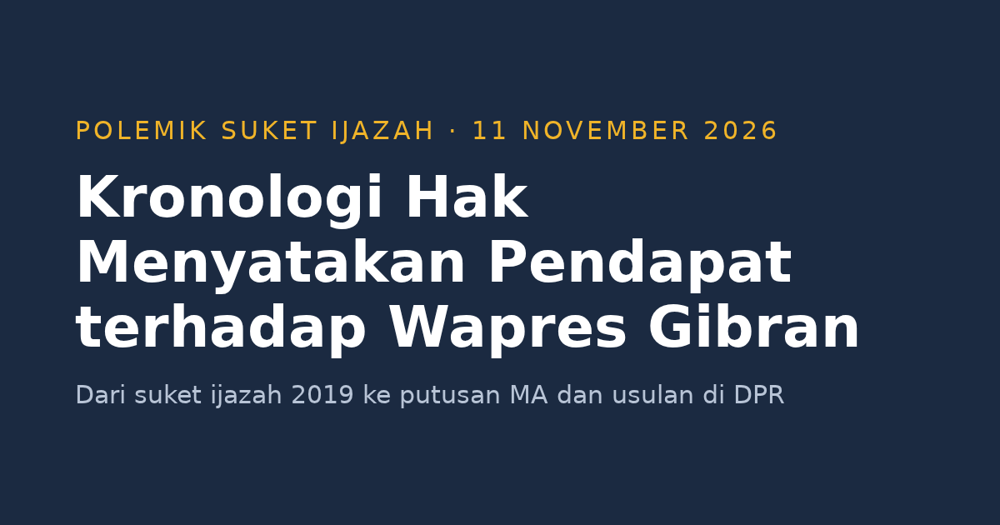

Per 10 November 2026, anggota DPR lintas fraksi mengumpulkan tanda tangan untuk mengusulkan hak menyatakan pendapat (HMP) terkait polemik Wakil Presiden Gibran Rakabuming Raka. Mardani Ali Sera dari PKS menyebut jumlahnya sudah lebih dari 25 orang, batas minimal yang disyaratkan undang-undang ([Suara.com](https://www.suara.com/news/2026/11/10/125530/dpr-sepakat-hak-menyatakan-pendapat-gibran-pilih-mundur-ksatria-atau-dimakzulkan)). Polemiknya bermula dari suket (surat keterangan) penyetaraan ijazah SMA Gibran yang dibatalkan MA. Tulisan ini merangkum urutan kejadiannya, dari surat keterangan ijazah tahun 2019 sampai usulan di DPR.

<!--more-->

*Ilustrasi: dibuat untuk tulisan ini.*

> **Poin Penting**
>
> - 30 Oktober 2026: Mahkamah Agung (MA) mengabulkan kasasi dan menyatakan surat keterangan penyetaraan ijazah SMA Gibran tidak sah dan batal demi hukum.
> - Kuasa hukum Gibran menyatakan putusan itu tidak memengaruhi posisinya sebagai wapres, sementara sejumlah politisi meminta DPR bersikap.
> - 10 November 2026: paripurna pembukaan masa sidang berlangsung singkat tanpa pengajuan HMP. Usulan menunggu tindak lanjut pimpinan DPR.

## Apa itu hak menyatakan pendapat?

HMP adalah salah satu hak DPR yang diatur dalam UU No. 17/2014 tentang MD3. Menurut [Pasal 79 ayat (4)](https://pasal.id/peraturan/uu/uu-no-17-tahun-2014/pasal-79), DPR bisa memakainya untuk:

- menyatakan pendapat atas kebijakan pemerintah atau kejadian luar biasa di dalam atau luar negeri;
- menindaklanjuti hak interpelasi atau hak angket;
- menyikapi dugaan pelanggaran hukum berat oleh Presiden atau Wakil Presiden, atau dugaan bahwa keduanya tidak lagi memenuhi syarat sebagai Presiden atau Wakil Presiden.

Teks lengkap UU MD3 ada di [BPK](https://peraturan.bpk.go.id/Details/38643/uu-no-17-tahun-2014). Menurut [Pasal 210](https://pasal.id/peraturan/uu/uu-no-17-tahun-2014/pasal-210), usulan HMP diajukan minimal 25 anggota. Putusannya diambil lewat rapat paripurna yang dihadiri dua pertiga anggota dan disetujui dua pertiga dari yang hadir. [Pasal 211](https://pasal.id/peraturan/uu/uu-no-17-tahun-2014/pasal-211) mengatur bahwa usulan disampaikan ke pimpinan DPR, diumumkan di paripurna, dan dibahas Badan Musyawarah. Usulan gugur kalau jumlah penandatangannya belum cukup sampai dua masa persidangan.

HMP bukan pemakzulan. Menurut [Pasal 7B UUD 1945](https://peraturan.bpk.go.id/Home/Download/92286/UUD45_perubahan3.pdf), jalurnya berjenjang:

1. DPR menyatakan pendapat bahwa Presiden atau Wakil Presiden melanggar hukum atau tidak lagi memenuhi syarat, lalu meminta Mahkamah Konstitusi (MK) memeriksanya. Permintaan itu butuh dukungan dua pertiga anggota DPR yang hadir dalam paripurna yang dihadiri dua pertiga anggota.
2. MK wajib memutus dalam 90 hari.
3. Pemberhentian baru bisa diputuskan MPR setelah MK memutus.

## Kronologi

**6 Agustus 2019.** Direktorat Jenderal Pendidikan Dasar dan Menengah menerbitkan Surat Keterangan (suket) No. 9149/D.D1/KS/2019 sebagai pengganti ijazah SMA Gibran. Suket ini menyetarakan pendidikan menengah yang ia tempuh di luar negeri ([Justisio](https://justisio.com/berita/2026-10-30-ma-kabulkan-kasasi-suket-penyetaraan-ijazah-sma-gibran-tidak-sah)).

**2024.** Suket tersebut dipakai sebagai salah satu syarat administratif ketika Gibran mendaftar sebagai calon wakil presiden, berpasangan dengan Prabowo Subianto ([Justisio](https://justisio.com/berita/2026-11-01-ma-kabulkan-kasasi-putuskan-suket-penyetaraan-sma-gibran-tidak-sah-par)).

**Gugatan Subhan Palal.** Subhan Palal menggugat soal keabsahan suket itu. Menurut [Katadata](https://katadata.co.id/berita/nasional/6ae49f6251b48/ma-kabulkan-kasasi-surat-penyetaraan-ijazah-sma-gibran-tak-sah), gugatan perdata awalnya masuk ke PN Jakarta Pusat pada Agustus 2025, lalu perkara tata usaha negara diputus PTUN Jakarta pada Mei 2026.

- Di PTUN Jakarta (Perkara No. 62/G/2026/PTUN.JKT), gugatan terhadap Kemendikdasmen selaku penerbit suket dinyatakan tidak dapat diterima (*niet ontvankelijk verklaard*).
- Pengadilan Tinggi TUN Jakarta menguatkan putusan itu (Putusan No. 130/B/2026/PT.TUN.JKT).
- Subhan mengajukan kasasi ke MA.

**30 Oktober 2026.** MA mengabulkan kasasi (Perkara No. 742 K/TUN/2026) dengan majelis Yulius sebagai ketua, serta Maftuh Effendi dan Hari Sugiharto sebagai anggota. Amarnya membatalkan putusan judex facti, mengadili sendiri, dan mengabulkan gugatan seluruhnya. Suket penyetaraan ijazah SMA Gibran dinyatakan tidak sah dan batal demi hukum ([Katadata](https://katadata.co.id/berita/nasional/6ae49f6251b48/ma-kabulkan-kasasi-surat-penyetaraan-ijazah-sma-gibran-tak-sah)). Pertimbangan hukum lengkapnya belum dipublikasikan.

**31 Oktober 2026.** Kuasa hukum Gibran, Muhammad Rullyandi, menyatakan putusan itu tidak memengaruhi jabatan Gibran sebagai wapres. Alasannya, putusan terbit setelah tahapan Pilpres 2024 selesai dan Gibran sudah dilantik, sehingga tidak berlaku surut. Ia juga menyebut putusan itu tidak bisa dieksekusi ([Justisio](https://justisio.com/berita/2026-10-31-kuasa-hukum-gibran-putusan-ma-soal-suket-sma-tak-pengaruhi-jabatan-wap)).

**31 Oktober–4 November 2026.** Partai dan lembaga mulai menyatakan sikap:

| Pihak | Pernyataan |
|---|---|
| PDIP | Sekjen Hasto Kristiyanto menyebut "tak ada kebohongan yang abadi" dan menyoroti syarat konstitusional wapres. Untuk hak angket, PDIP menilai perlu dukungan partai lain ([RCTI+](https://www.rctiplus.com/news/detail/nasional/5505665/putusan-ma-soal-suket-ijazah-gibran--hasto--tak-ada-kebohongan-yang-abadi)) |
| PKB | Anggota Komisi II DPR Muhammad Khozin menyebut putusan menguatkan landasan hukum dan urgensi DPR bersikap, dan fraksinya akan memakai putusan MK dan MA sebagai dasar langkah politik ([Justisio](https://justisio.com/berita/2026-11-01-ma-kabulkan-kasasi-putuskan-suket-penyetaraan-sma-gibran-tidak-sah-par)) |
| Gerindra | Juru bicara Sugiat Santoso menghormati putusan, meminta kementerian terkait dan lembaga berwenang menjelaskan, dan menyatakan jabatan wapres punya mekanisme konstitusionalnya sendiri ([PojokSatu](https://pojoksatu.id/nasional/gerindra-ingatkan-putusan-ma-soal-suket-pendidikan-gibran-tak-bisa-langsung-dimaknai-gugurnya-jabatan-wapres)) |
| PAN | Pada 4 November menghormati putusan dan masih mengkaji sikap bersama koalisi ([Justisio](https://justisio.com/berita/2026-11-04-pan-hormati-putusan-ma-soal-ijazah-gibran-masih-kaji-sikap-politik)) |
| Mahfud MD | Menurut Mahfud, pembuatan suket dan dugaan penyelundupan pasal dalam proses itu harus diproses pidana. Ia meminta KPU dan Direktorat Dikdasmen diperiksa ([Kompas](https://nasional.kompas.com/read/2026/11/01/16560261/kpu-singgung-pemilu-sudah-selesai-respons-mahfud-soal-putusan-ma-tentang)) |
| KPU | Komisioner Idham Holik menyatakan tahapan Pemilu 2024 selesai dengan pelantikan presiden dan wakil presiden terpilih ([Kompas](https://nasional.kompas.com/read/2026/11/01/16560261/kpu-singgung-pemilu-sudah-selesai-respons-mahfud-soal-putusan-ma-tentang)) |
| Wantimpres | Anggota Margarito Kamis menyatakan suket harus dianggap tidak ada sejak awal dan tidak bisa dipakai Gibran untuk mendaftar ([PojokSatu](https://pojoksatu.id/nasional/suket-gibran-harus-dianggap-tidak-ada-sejak-awal-usai-putusan-ma-harus-ikut-dimusnahkan)) |

**6 November 2026.** Wakil Ketua DPR Sufmi Dasco Ahmad menyatakan DPR masih reses dan menunggu putusan lengkap MA. Pembahasan baru dilakukan setelah masa sidang dimulai ([RMOL](https://rmol.id/read/2026/11/06/727459/soal-nasib-angket-pemakzulan-gibran-di-dpr-begini-respons-dasco)).

**8 November 2026.** Ketua Fraksi PAN di MPR, Sudding, mengatakan Gibran sebaiknya legowo mundur ([RMOL](https://rmol.id/read/2026/11/08/727576/ketua-fraksi-pan-mpr-gibran-sebaiknya-legowo-mundur)).

**10 November 2026.** Paripurna pembukaan masa sidang berlangsung singkat dan tidak membahas pengajuan HMP. Mardani Ali Sera menyebut tanda tangan dukungan dari anggota lintas fraksi sudah lebih dari 25. Tanda tangan itu bersifat perseorangan, bukan sikap fraksi, dan terus bertambah ([Suara.com](https://www.suara.com/news/2026/11/10/125530/dpr-sepakat-hak-menyatakan-pendapat-gibran-pilih-mundur-ksatria-atau-dimakzulkan)). Ketua DPR Puan Maharani mengaku menerima laporan dari anggota yang ingin mengajukan HMP dan berjanji menindaklanjutinya setelah pembukaan masa sidang. PDIP, lewat Andreas Hugo Pareira, tidak berencana mengajukan HMP di paripurna itu ([Kompas.id](https://www.kompas.id/artikel/paripurna-dpr-belum-bahas-pemakzulan-gibran-puan-janji-proses-usulan-hak-menyatakan-pendapat)).

**Status per 11 November 2026.** Belum ada keputusan DPR. Mensesneg Prasetyo Hadi menyatakan Istana tidak mau ikut campur soal HMP ([IDN Times](https://www.idntimes.com/news/indonesia/istana-tak-mau-ikut-campur-soal-hak-menyatakan-pendapat-dpr-kepada-gibran-00-rgfwk-kb57vr)).

## Pembanding: tiga pejabat Eropa yang mundur setelah gelar doktornya dicabut

Ketiga kasus di bawah ini bukan sampel yang mewakili semua pejabat, dan tidak sama dengan kasus Gibran. Yang dibatalkan MA adalah suket penyetaraan dari instansi pemerintah, bukan gelar dari perguruan tinggi. Ketiganya menyangkut disertasi doktoral yang terbukti plagiat:

- **Karl-Theodor zu Guttenberg**, Menteri Pertahanan Jerman, mundur pada 1 Maret 2011 setelah disertasinya tahun 2007 terbukti plagiat. Universitas Bayreuth mencabut gelarnya sebelum itu ([Al Jazeera](https://www.aljazeera.com/news/2011/3/1/key-merkel-ally-quits-cabinet)).
- **Annette Schavan**, Menteri Pendidikan Jerman, mundur pada 9 Februari 2013. Panel Universitas Düsseldorf menyatakan disertasi filsafatnya tahun 1980 plagiat, dan gelarnya dicabut ([Al Jazeera](https://www.aljazeera.com/news/2013/2/9/german-minister-quits-over-plagiarism-scandal)).
- **Pál Schmitt**, Presiden Hongaria, mundur pada 2 April 2012. Disertasinya tahun 1992 terbukti sebagian besar menjiplak karya peneliti olahraga, antara lain pakar Bulgaria Nikolay Georgiev dan sosiolog olahraga Jerman Klaus Heinemann. Universitas Semmelweis mencabut gelarnya pada 29 Maret 2012 ([Semmelweis](https://semmelweis.hu/hirek/2012/04/11/honest-work/)).

Tulisan ini dibantu oleh AI.
