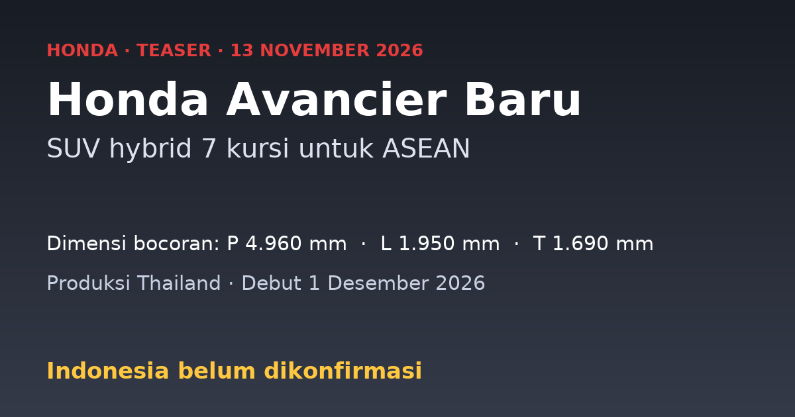

Honda merilis teaser Avancier generasi baru, dan namanya mudah dikira MPV hybrid pesaing Veloz atau Xpander. Avancier bukan MPV kompak. Menurut OtoDriver, ini SUV besar premium dengan tiga baris kursi yang posisinya di atas CR-V ([OtoDriver](https://otodriver.com/berita/2026/generasi-baru-honda-avancier-dipersiapkan-untuk-pasar-asean-dan-australia-genefhgflia)). Debutnya dijadwalkan 1 Desember 2026, dan Indonesia belum masuk daftar pasar yang dikonfirmasi.

<!--more-->

*Ilustrasi: dibuat untuk tulisan ini.*

> **Poin Penting**
>
> - Avancier baru dilaporkan SUV 7 kursi di atas CR-V, bukan MPV kompak, jadi Veloz dan Xpander bukan pembandingnya.
> - Dimensi bocoran: panjang 4.960 mm, lebar 1.950 mm, tinggi 1.690 mm. Rival yang disebut hanya Mazda CX-80.
> - Dilaporkan dibuat di Thailand untuk Asia Tenggara dan Australia. Indonesia belum dikonfirmasi.

## Dari mana nama Avancier

Nama Avancier sudah ada sejak 1999, dipakai untuk wagon berbasis Accord yang dijual di Jepang saja ([Motor1](https://www.motor1.com/news/814667/honda-avancier-teaser-revives-accord/)). Menurut OtoDriver, generasi sebelumnya adalah SUV lima kursi yang hanya dijual di China. Generasi baru dilaporkan berganti ukuran dan arah: tujuh kursi, dan pasar di luar China ([OtoDriver](https://otodriver.com/berita/2026/generasi-baru-honda-avancier-dipersiapkan-untuk-pasar-asean-dan-australia-genefhgflia)).

## Ukuran dan posisinya

Angka di bawah dikutip OtoDriver dari media Jepang, dan Honda belum merilis spesifikasi resmi.

| Dimensi | Avancier baru | Dibanding Mazda CX-80 |
|---|---|---|
| Panjang | 4.960 mm | 30 mm lebih pendek |
| Lebar | 1.950 mm | 60 mm lebih lebar |
| Tinggi | 1.690 mm | 20 mm lebih rendah |

Dengan panjang hampir lima meter dan tiga baris kursi, Avancier jelas satu kelas di atas SUV kompak. Pembandingan dengan Veloz Hybrid atau Xpander Cross jadi tidak masuk akal.

## Mesin dan platform

Avancier dilaporkan memakai sistem Honda Hybrid generasi baru yang menggantikan label e:HEV. Honda berencana meluncurkan 15 model hybrid generasi berikutnya dengan sistem ini secara global dari 2027 sampai Maret 2030 ([Motor1](https://www.motor1.com/news/814667/honda-avancier-teaser-revives-accord/)).

Soal mesin, OtoDriver menyebut kemungkinan bensin injeksi langsung 2.0 liter dengan motor listrik yang lebih kecil tapi lebih bertenaga. Fitur S+ Shift, simulasi perpindahan gigi seperti di Honda Prelude, juga diperkirakan ada. Dua hal ini belum dikonfirmasi Honda. Avancier juga disebut menjadi Honda produksi pertama dengan logo H baru ([OtoDriver](https://otodriver.com/berita/2026/generasi-baru-honda-avancier-dipersiapkan-untuk-pasar-asean-dan-australia-genefhgflia)).

Platformnya diperkirakan sama dengan basis Civic dan CR-V generasi berikutnya. Menurut OtoDriver, platform ini menjanjikan bobot lebih ringan, kabin lebih senyap, dan handling lebih baik dengan biaya produksi lebih rendah.

Untuk dasar perbedaan hybrid dan mobil listrik murni, lihat [pengertian, jenis, dan cara kerja mobil listrik](https://www.udienz.web.id/2026/11/04/mobil-listrik-pengertian-jenis-cara-kerja).

## Pasar: Indonesia belum dikonfirmasi

Menurut OtoDriver, Avancier baru diproduksi di Thailand dan dibidik ke Asia Tenggara serta Australia ([OtoDriver](https://otodriver.com/berita/2026/generasi-baru-honda-avancier-dipersiapkan-untuk-pasar-asean-dan-australia-genefhgflia)). Motor1 mengabarkan peluncuran di Australia dijadwalkan 2027 ([Motor1](https://www.motor1.com/news/814667/honda-avancier-teaser-revives-accord/)). Kedua sumber tidak menyebut rencana penjualan di Indonesia.

Peluangnya tetap bisa ditimbang. Basis produksi di Thailand dan target ASEAN membuat Indonesia calon pasar yang wajar, dan setahu saya di lini Honda Indonesia saat ini belum ada SUV tujuh kursi premium di atas CR-V. Itu analisis, bukan kabar dari Honda. Harga dan jadwal belum ada, dan debut 1 Desember hanya soal tampil perdana, bukan jaminan dijual di sini.

## Lawan sepadannya

Satu-satunya rival yang disebut sumber adalah Mazda CX-80. Kalau Avancier masuk, kelas yang dimasukinya adalah SUV hybrid tiga baris yang besar dan premium, bukan pasar MPV keluarga. Hyundai Santa Fe Hybrid mungkin ikut jadi pembanding, tapi itu perkiraan saya, bukan pernyataan Honda.

## Yang masih ditunggu

- Spesifikasi resmi: mesin, tenaga, dan jumlah kursi dari Honda sendiri.
- Daftar pasar, termasuk apakah Indonesia ikut.
- Harga, yang belum ada sama sekali.

Tulisan ini dibantu oleh AI.
