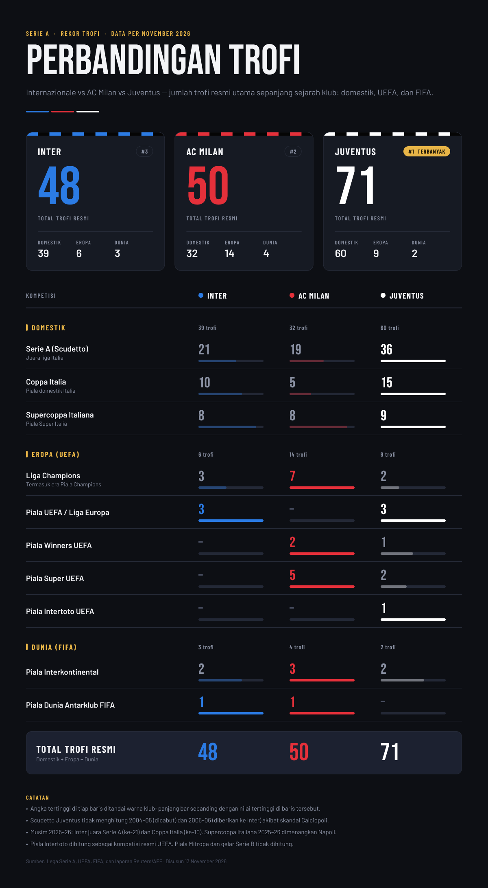

Juventus memimpin daftar trofi resmi tiga raksasa Italia dengan 71 gelar, disusul AC Milan 50 dan Inter 48 per November 2026. Angka itu belum menceritakan semuanya, karena Juventus unggul jauh di dalam negeri, sedangkan Milan unggul di Eropa. Inter menutup musim 2025–26 dengan Scudetto ke-21 dan Coppa Italia ke-10 di bawah pelatih Cristian Chivu, dan itu double domestik pertama mereka sejak 2010.

<!--more-->

*Infografis: perbandingan trofi resmi Inter, AC Milan, dan Juventus, data per November 2026.*

> **Poin Penting**
>
> - Total trofi resmi: Juventus 71, AC Milan 50, Inter 48.
> - Di antara ketiga klub, Juventus memegang rekor Scudetto (36), Coppa Italia (15), dan Supercoppa Italiana (9).
> - Milan unggul di Eropa dengan 14 trofi, termasuk 7 Liga Champions atau Piala Champions.
> - Inter juara Serie A dan Coppa Italia 2025–26, yaitu double domestik pertama sejak 2010.

## Tabel perbandingan lengkap

Tabel ini memuat semua kompetisi yang dihitung, dengan subtotal per kategori dan total akhir. Cara menghitungnya ada di bagian catatan metodologi di bawah.

| Kompetisi | Inter | AC Milan | Juventus |
|---|---|---|---|
| Serie A (Scudetto) | 21 | 19 | 36 |
| Coppa Italia | 10 | 5 | 15 |
| Supercoppa Italiana | 8 | 8 | 9 |
| Liga Champions / Piala Champions | 3 | 7 | 2 |
| Piala UEFA / Liga Europa | 3 | 0 | 3 |
| Piala Winners UEFA | 0 | 2 | 1 |
| Piala Super UEFA | 0 | 5 | 2 |
| Piala Intertoto UEFA | 0 | 0 | 1 |
| Piala Interkontinental | 2 | 3 | 2 |
| Piala Dunia Antarklub FIFA | 1 | 1 | 0 |
| **Subtotal domestik** | 39 | 32 | 60 |
| **Subtotal Eropa** | 6 | 14 | 9 |
| **Subtotal dunia** | 3 | 4 | 2 |
| **Total** | **48** | **50** | **71** |

## Juventus: raja domestik

Dari 71 trofi Juventus, 60 datang dari kompetisi dalam negeri. Mereka memegang rekor di ketiganya: 36 Scudetto, 15 Coppa Italia, dan 9 Supercoppa Italiana. Selisihnya paling lebar di Scudetto, 15 gelar di atas Inter (21) dan 17 di atas Milan (19). Di Coppa Italia, Juventus punya 15 trofi, Inter 10, dan Milan 5.

Supercoppa adalah satu-satunya kompetisi domestik yang ketat. Juventus mengoleksi 9, sementara Inter dan Milan sama-sama 8. Edisi 2025–26 di Riyadh pada Desember 2025 tidak menambah koleksi ketiganya. Napoli menang 2-0 atas Bologna di final, setelah Milan kalah dari Napoli dan Inter kalah adu penalti dari Bologna di semifinal. Milan terakhir juara Supercoppa pada Januari 2025, ketika mereka menang 3-2 atas Inter.

## Milan: raja Eropa

Di luar Italia, urutannya terbalik. Milan punya 14 trofi UEFA, Juventus 9, dan Inter 6. Penopang utamanya adalah 7 Liga Champions atau Piala Champions, dibanding 3 milik Inter dan 2 milik Juventus.

Milan juga memimpin dua kompetisi UEFA lain: 2 Piala Winners (Juventus 1, Inter 0) dan 5 Piala Super UEFA (Juventus 2, Inter 0). Dua kategori Eropa yang belum mereka menangi adalah Piala UEFA atau Liga Europa, yang menjadi milik Inter dan Juventus dengan 3 trofi masing-masing, dan Piala Intertoto UEFA. Intertoto hanya dimenangi Juventus, satu kali, di antara ketiga klub ini.

Milan juga unggul di level dunia. Mereka mencatat 4 trofi, dengan rincian 3 Piala Interkontinental dan 1 Piala Dunia Antarklub FIFA. Inter punya 3 (2 Interkontinental dan 1 Antarklub), Juventus 2 (keduanya Interkontinental). Jika trofi Eropa dan dunia dijumlahkan, Milan mengumpulkan 18, Juventus 11, dan Inter 9.

## Inter: unggul atas Milan di dalam negeri

Inter di posisi ketiga dengan 48 trofi, hanya dua di bawah Milan. Di dalam negeri mereka sudah mengungguli Milan, 39 banding 32, dan 21 Scudetto mereka dua lebih banyak dari 19 milik Milan.

Gelar terbaru datang di musim 2025–26. Inter memastikan Scudetto ke-21 pada 3 Mei 2026 lewat kemenangan 2-0 atas Parma, lalu menambah Coppa Italia ke-10 setelah menang 2-0 atas Lazio di final pada 13 Mei 2026. Kombinasi itu menjadi double domestik pertama mereka sejak 2010.

Daftar trofi Inter lengkap dengan tahun kemenangannya ada di [bagian kelima seri sejarah Inter Milan](https://www.udienz.web.id/2026/11/11/inter-milan-5-prestasi-timeline), cerita treble 2010 ada di [era Moratti dan treble](https://www.udienz.web.id/2026/11/11/inter-milan-3-era-moratti-treble), dan masa kepemilikan terbaru klub dibahas di [bagian keempat, Suning dan Oaktree](https://www.udienz.web.id/2026/11/11/inter-milan-4-suning-oaktree).

Pekerjaan rumahnya ada di Eropa. Inter punya 6 trofi UEFA, delapan lebih sedikit dari Milan, dan belum pernah memenangi Piala Winners maupun Piala Super UEFA.

## Catatan metodologi

Angka di atas mengikuti aturan berikut:

- Scudetto Juventus tidak menghitung musim 2004–05 (dicabut) dan 2005–06 (diberikan ke Inter) akibat Calciopoli.
- Piala Intertoto dihitung sebagai kompetisi resmi UEFA. Tanpa Intertoto, total Juventus menjadi 70.
- Piala Mitropa dan gelar Serie B tidak dihitung.
- Data per 13 November 2026. Angka ini akan berubah begitu salah satu klub menambah gelar baru.

## Menurut Anda, siapa yang paling sukses?

Juventus menang dengan jumlah, Milan menang dengan prestise Eropa, dan Inter punya momentum paling segar. Mana yang Anda pakai untuk menilai kesuksesan sebuah klub: total trofi, jumlah Liga Champions, atau tren terbaru? Tulis jawabannya di kolom komentar.

## Sumber

- [Lega Serie A](https://www.legaseriea.it/en)
- [UEFA](https://www.uefa.com/)
- [FIFA](https://www.fifa.com/)
- Laporan Reuters dan AFP

Tulisan ini dibantu oleh AI.
