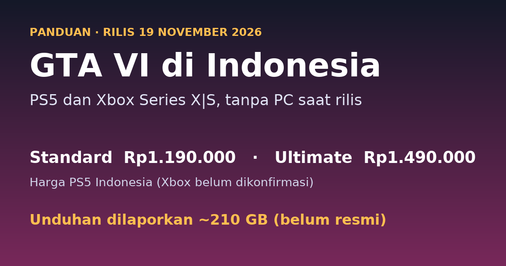

GTA VI rilis 19 November 2026 untuk PS5 dan Xbox Series X|S, dan tidak ada versi PC saat peluncuran ([Engadget](https://www.engadget.com/gaming/grand-theft-auto-vi-is-delayed-to-november-19-2026-211848530.html)). Di Indonesia, edisi Standard untuk PS5 berharga Rp1.190.000 dan edisi Ultimate Rp1.490.000. Tulisan ini merangkum empat hal yang perlu diputuskan pembeli: edisi mana yang layak, biayanya, berapa GB yang harus diunduh, dan apa artinya bagi pemain PC dan Linux.

<!--more-->

*Ilustrasi: dibuat untuk tulisan ini.*

*Data per 17 November 2026. Harga, jadwal, dan ukuran unduhan bisa berubah.*

> **Poin Penting**
>
> - Harga PS5 di Indonesia: Standard Rp1.190.000, Ultimate Rp1.490.000. Selisihnya Rp300.000. Harga Xbox di Indonesia tidak tercantum di sumber harga yang dirujuk.
> - Pembelian digital sebelum 20 November mendapat Vintage Vice City Pack.
> - Ukuran unduhan yang dilaporkan sekitar 210 GB. Angka ini belum dikonfirmasi Rockstar.
> - Rockstar menyebut versi PC direncanakan untuk waktu yang lebih akhir, tanpa tanggal.

## Standard atau Ultimate?

Kedua edisi memuat game yang sama. Edisi Ultimate menambah konten di atasnya, dan pemilik Standard bisa membeli Ultimate Edition Upgrade belakangan. Rincian di bawah mengikuti pemberitaan [Hypebeast](https://hypebeast.com/2026/6/everything-you-need-to-know-grand-theft-auto-gta-6-vi-pre-order-information-announcement) tentang pengumuman Rockstar pada Juni 2026.

| | Standard | Ultimate |
|---|---|---|
| Harga PS5 di Indonesia | Rp1.190.000 | Rp1.490.000 |
| Harga global | US$79,99 | US$99,99 |
| Kendaraan | Tidak ada | Lima kendaraan, ditambah mod Vapid Ganado |
| Koleksi mobil klasik | Tidak ada | Empat kendaraan eksklusif |
| Toko mod | Tidak ada | Rideout Customs dan One-Eyed Willie's |
| Senjata | Tidak ada | Revolver Hawk & Little Morgan, pistol Girardi ES9 dan Klose K17 |
| Kosmetik | Tidak ada | Toko Stock 305, Vice City Styles, Goodtime Gear, gaya Sara's Unisex Salon, lebih dari 50 tato FAILE |
| Misi tambahan | Tidak ada | Penyerbuan toko barang ilegal PTT Youngin$ |

Harga Indonesia berasal dari [detikInet](https://inet.detik.com/games-news/d-8546246/rockstar-resmi-ungkap-harga-gta-6-di-indonesia-edisi-standar-rp-1-1-juta), yang memantau PlayStation Store. Harga itu hanya untuk PS5. Pemain Xbox perlu mengecek Microsoft Store Indonesia sebelum membeli, karena harga Xbox tidak tercantum di sumber tersebut.

Selisih Rp300.000 setara 25% dari harga Standard. Hitung nilainya dari apa yang Anda pakai: kalau yang menarik hanya kendaraan dan kosmetik, Ultimate mahal. Kalau Anda ingin misi tambahan PTT Youngin$ dan toko mod sejak hari pertama, selisih itu masuk akal. Upgrade Standard ke Ultimate tersedia di toko konsol, tetapi harganya belum tercantum di sumber yang dirujuk, jadi belum tentu sama dengan selisih Rp300.000.

### Bonus pre-order dan batas waktunya

Semua pembelian digital sebelum 20 November mendapat Vintage Vice City Pack: mobil '55 Vapid Stanier, dua pakaian dan gaya rambut (untuk Jason dan Lucia), serta pola senjata palem tropis. Pre-order fisik mendapat bonus yang sama selama stok ada. Kotak fisiknya hanya berisi kode unduhan, tanpa cakram ([Hypebeast](https://hypebeast.com/2026/6/everything-you-need-to-know-grand-theft-auto-gta-6-vi-pre-order-information-announcement)).

Pre-order lewat PlayStation Store atau Microsoft Store juga memberi satu bulan GTA+ gratis, dan keanggotaan itu diperpanjang otomatis dengan harga normal sampai dibatalkan ([Hypebeast](https://hypebeast.com/2026/6/everything-you-need-to-know-grand-theft-auto-gta-6-vi-pre-order-information-announcement)). Pasang pengingat untuk membatalkannya.

## Berapa biaya sebenarnya?

Harga game hanya sebagian. Ruang penyimpanan dan kuota unduhan ikut menentukan.

- **Game:** Rp1.190.000 (Standard) atau Rp1.490.000 (Ultimate) di PS5.
- **Penyimpanan:** ukuran unduhan yang dilaporkan sekitar 210 GB (lihat bagian berikut). Cek sisa ruang di konsol Anda sebelum mengunduh. Kalau tidak cukup, tambahan penyimpanan menjadi biaya ekstra yang harga dan kompatibilitasnya perlu dicek di toko.
- **Kuota:** kalau paket internet Anda berkuota, bandingkan 210 GB dengan sisa kuota bulan ini sebelum mulai mengunduh.
- **GTA+:** gratis sebulan, lalu berbayar kalau tidak dibatalkan.

## Ukuran unduhan

Pelacak PlayStation Size melaporkan sekitar 210 GB di PS5. [LevelUp](https://www.levelup.com/en/news/gta-vi-ps5-file-size-revealed-and-its-massive-one-of-the-largest-console-downloads-in-video-game-history/) menulis bahwa Rockstar dan Take-Two belum mengonfirmasi angka itu, dan ukuran akhir bisa lebih tinggi atau lebih rendah, termasuk karena patch hari pertama. Ukuran di Xbox Series X|S juga belum terkonfirmasi.

Dengan 210 GB sebagai patokan, lama unduhan teoretis pada kecepatan stabil adalah sebagai berikut. Angka nyata biasanya lebih lama karena beban jaringan dan batas server.

| Kecepatan | Lama unduhan teoretis |
|---|---|
| 10 Mbps | sekitar 46,7 jam |
| 20 Mbps | sekitar 23,3 jam |
| 50 Mbps | sekitar 9,3 jam |
| 100 Mbps | sekitar 4,7 jam |
| 300 Mbps | sekitar 1,6 jam |
| 1 Gbps | sekitar 28 menit |

Artinya, unduhan penuh pada 50 Mbps pun memakan sekitar sembilan jam. Hitungan di atas memakai GB desimal dan tanpa overhead. Untuk konteks kecepatan, baca [target 100 Mbps untuk fixed broadband di Indonesia](https://www.udienz.web.id/2026/11/03/target-100-mbps-fixed-broadband-indonesia) dan [penjelasan GPON](https://www.udienz.web.id/2026/11/03/mengenal-gpon-fungsi-manfaat-arsitektur).

## Pemain PC dan Linux

Rockstar mengatakan, "Most of our player base is on consoles, so we are prioritising those platforms for launch." Versi PC direncanakan untuk waktu yang lebih akhir, tanpa tanggal ([Business Today](https://www.businesstoday.in/latest/trends/story/ps5xbox-owners-get-gta-6-first-will-pc-finally-arrive-in-2028-542785-2026-07-14)). Business Today menulis bahwa pengamat memperkirakan PC baru datang pada 2028, berdasarkan pola GTA V yang tiba di PC sekitar 18 bulan setelah konsol. Itu spekulasi, bukan pengumuman resmi.

Untuk pengguna Linux dan Steam Deck, rekam jejak GTA V adalah rujukan terdekat. Pada September 2024 Rockstar menambahkan BattlEye ke GTA V dan GTA Online tanpa mengaktifkannya untuk Linux atau Steam Deck. Pemain online langsung terputus, sedangkan mode cerita tetap jalan. FAQ Rockstar menyatakan Steam Deck tidak mendukung BattlEye untuk GTA Online ([GamingOnLinux](https://www.gamingonlinux.com/2024/09/grand-theft-auto-v-gets-battleye-anti-cheat-breaks-online-play-on-steam-deck-linux/)). BattlEye sendiri mendukung Linux, jadi pembatasan itu tampak sebagai pilihan, bukan batas teknis.

Dari sini belum bisa disimpulkan apa pun soal GTA VI di Linux, karena versi PC-nya belum ada. Yang bisa dicatat: anti-cheat dan keputusan penerbit menentukan, bukan semata kompatibilitas Proton. Sampai versi PC ada, jalur resminya hanya konsol.

## Menurut Anda, Standard atau Ultimate?

Mana yang Anda pilih? Tulis jawabannya di kolom komentar, termasuk kecepatan internet Anda dan berapa lama unduhannya.

## Sumber

- [Engadget: jadwal rilis GTA VI](https://www.engadget.com/gaming/grand-theft-auto-vi-is-delayed-to-november-19-2026-211848530.html)
- [Hypebeast: edisi, bonus, dan GTA+](https://hypebeast.com/2026/6/everything-you-need-to-know-grand-theft-auto-gta-6-vi-pre-order-information-announcement)
- [detikInet: harga resmi di Indonesia](https://inet.detik.com/games-news/d-8546246/rockstar-resmi-ungkap-harga-gta-6-di-indonesia-edisi-standar-rp-1-1-juta)
- [LevelUp: ukuran unduhan PS5](https://www.levelup.com/en/news/gta-vi-ps5-file-size-revealed-and-its-massive-one-of-the-largest-console-downloads-in-video-game-history/)
- [Business Today: versi PC](https://www.businesstoday.in/latest/trends/story/ps5xbox-owners-get-gta-6-first-will-pc-finally-arrive-in-2028-542785-2026-07-14)
- [GamingOnLinux: BattlEye di GTA V](https://www.gamingonlinux.com/2024/09/grand-theft-auto-v-gets-battleye-anti-cheat-breaks-online-play-on-steam-deck-linux/)

Tulisan ini dibantu oleh AI.
