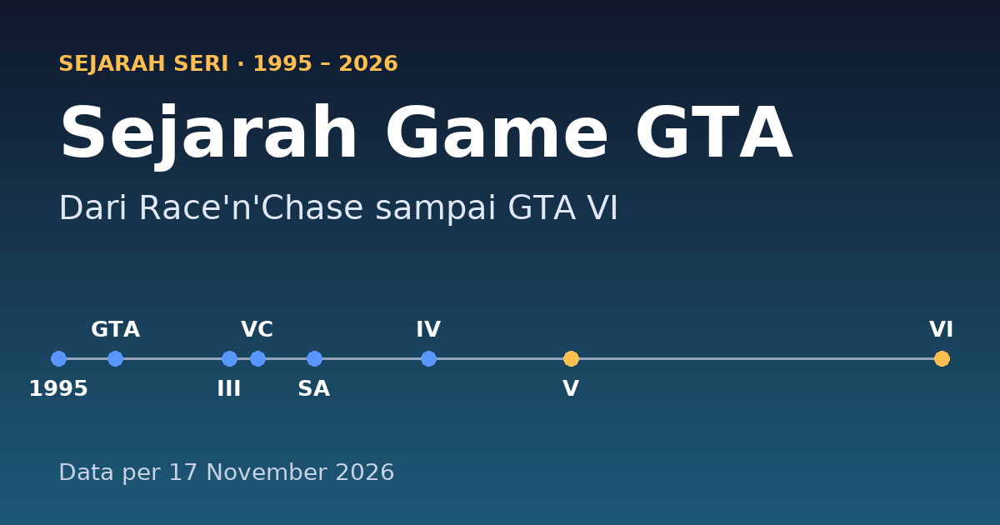

Seri Grand Theft Auto dimulai sebagai game polisi mengejar penjahat bernama Race'n'Chase. Pengembangannya mulai 4 April 1995 di studio DMA Design di Dundee, Skotlandia, dan game pertamanya terbit pada November 1997 ([Wikipedia](https://en.wikipedia.org/wiki/Grand_Theft_Auto_(video_game))). Lebih dari 30 tahun kemudian seri ini sudah terjual hampir 475 juta unit, dan seri keenamnya dijadwalkan rilis pada 19 November 2026. Tulisan ini menelusuri perjalanannya, dari ide awal sampai GTA VI.

<!--more-->

*Ilustrasi: dibuat untuk tulisan ini.*

*Data per 17 November 2026. Jadwal dan angka penjualan bisa berubah.*

> **Poin Penting**
>
> - Pengembangan game pertama mulai 4 April 1995. Judul awalnya Race'n'Chase, dan pemain awalnya berperan sebagai polisi.
> - GTA III (2001) memindahkan seri ke 3D, dengan kamera orang ketiga dan dunia terbuka. Vice City (2002) dan San Andreas (2004) memperbesar formulanya.
> - GTA V (2013) menembus US$1 miliar dalam tiga hari dan terjual lebih dari 230 juta unit.
> - GTA VI ditunda dua kali dan dijadwalkan rilis 19 November 2026.

## Garis waktu singkat

Sebelum masuk ke cerita tiap game, ini gambaran besarnya. Titik kuning menandai dua judul terbaru.

<figure class="blog-chart">
<svg viewBox="0 0 480 290" width="480" height="290" role="img" aria-label="Garis waktu seri GTA: pengembangan dimulai 1995, GTA 1997, GTA 2 1999, GTA III 2001, Vice City 2002, San Andreas 2004, GTA IV 2008, GTA V 2013, GTA VI 2026" style="max-width:100%;height:auto;font-family:sans-serif">
<line x1="70" y1="14" x2="70" y2="276" stroke="#94a3b8" stroke-width="2"></line>
<text x="58" y="25" text-anchor="end" font-size="14" font-weight="bold" fill="currentColor">1995</text>
<circle cx="70" cy="20" r="6" fill="#3b82f6"></circle>
<text x="86" y="25" font-size="14" fill="currentColor">Pengembangan dimulai (Race&#x27;n&#x27;Chase)</text>
<text x="58" y="55" text-anchor="end" font-size="14" font-weight="bold" fill="currentColor">1997</text>
<circle cx="70" cy="50" r="6" fill="#3b82f6"></circle>
<text x="86" y="55" font-size="14" fill="currentColor">Grand Theft Auto</text>
<text x="58" y="85" text-anchor="end" font-size="14" font-weight="bold" fill="currentColor">1999</text>
<circle cx="70" cy="80" r="6" fill="#3b82f6"></circle>
<text x="86" y="85" font-size="14" fill="currentColor">GTA 2</text>
<text x="58" y="115" text-anchor="end" font-size="14" font-weight="bold" fill="currentColor">2001</text>
<circle cx="70" cy="110" r="6" fill="#3b82f6"></circle>
<text x="86" y="115" font-size="14" fill="currentColor">GTA III (3D)</text>
<text x="58" y="145" text-anchor="end" font-size="14" font-weight="bold" fill="currentColor">2002</text>
<circle cx="70" cy="140" r="6" fill="#3b82f6"></circle>
<text x="86" y="145" font-size="14" fill="currentColor">Vice City</text>
<text x="58" y="175" text-anchor="end" font-size="14" font-weight="bold" fill="currentColor">2004</text>
<circle cx="70" cy="170" r="6" fill="#3b82f6"></circle>
<text x="86" y="175" font-size="14" fill="currentColor">San Andreas</text>
<text x="58" y="205" text-anchor="end" font-size="14" font-weight="bold" fill="currentColor">2008</text>
<circle cx="70" cy="200" r="6" fill="#3b82f6"></circle>
<text x="86" y="205" font-size="14" fill="currentColor">GTA IV</text>
<text x="58" y="235" text-anchor="end" font-size="14" font-weight="bold" fill="currentColor">2013</text>
<circle cx="70" cy="230" r="6" fill="#eab308"></circle>
<text x="86" y="235" font-size="14" fill="currentColor">GTA V dan GTA Online</text>
<text x="58" y="265" text-anchor="end" font-size="14" font-weight="bold" fill="currentColor">2026</text>
<circle cx="70" cy="260" r="6" fill="#eab308"></circle>
<text x="86" y="265" font-size="14" fill="currentColor">GTA VI (dijadwalkan 19 November)</text>
</svg>
<figcaption>Garis waktu seri Grand Theft Auto, dari awal pengembangan pada 1995 sampai GTA VI. Jarak antarbaris tidak berskala.</figcaption>
</figure>

## 1995 sampai 1997: dari Race'n'Chase menjadi GTA

DMA Design memulai proyek ini pada 4 April 1995, dengan dokumen desain bertanggal 22 Maret 1995. Konsep awalnya Race'n'Chase, dengan pemain sebagai polisi yang mengejar penjahat. Tim menilai itu membosankan dan beralih ke ide bermain sebagai penjahat ([Wikipedia](https://en.wikipedia.org/wiki/Grand_Theft_Auto_(video_game))).

Proyeknya berjalan tidak mulus ([Wikipedia](https://en.wikipedia.org/wiki/Grand_Theft_Auto_(video_game))). Wikipedia mengutip The Guardian bahwa tidak satu pun tenggat produksi terpenuhi, termasuk target selesai 1 Juli 1996. Sang desainer dan pemimpin proyek, Keith R. Hamilton, mengatakan pada awal 1997 bahwa "GTA was harder than we thought". Game ini akhirnya terbit di Eropa pada 28 November 1997 untuk PC dan 12 Desember 1997 untuk PlayStation. Versi Amerika Utara menyusul pada Maret dan Juni 1998.

Peluncurannya diwarnai kontroversi kekerasan ([Wikipedia](https://en.wikipedia.org/wiki/Grand_Theft_Auto_(video_game))), dan Kementerian Kehakiman Brasil melarang penjualannya. Pemberitaan itu ikut mendorong penjualan: game ini terjual 3,5 juta unit pada Oktober 1999 dan 6 juta pada Maret 2001.

<figure class="blog-chart">
<svg viewBox="0 0 480 152" width="480" height="152" role="img" aria-label="Perkiraan lama pengembangan: GTA 32 bulan, Vice City 18 bulan, San Andreas 24 bulan, GTA IV 41 bulan" style="max-width:100%;height:auto;font-family:sans-serif">
<text x="142" y="29" text-anchor="end" font-size="13" fill="currentColor">GTA (1995–1997)</text>
<rect x="150" y="14" width="148" height="22" rx="3" fill="#3b82f6"></rect>
<text x="306" y="29" font-size="13" fill="currentColor">sekitar 32 bulan</text>
<text x="142" y="63" text-anchor="end" font-size="13" fill="currentColor">Vice City</text>
<rect x="150" y="48" width="83" height="22" rx="3" fill="#3b82f6"></rect>
<text x="241" y="63" font-size="13" fill="currentColor">sekitar 18 bulan</text>
<text x="142" y="97" text-anchor="end" font-size="13" fill="currentColor">San Andreas</text>
<rect x="150" y="82" width="111" height="22" rx="3" fill="#3b82f6"></rect>
<text x="269" y="97" font-size="13" fill="currentColor">sekitar 24 bulan</text>
<text x="142" y="131" text-anchor="end" font-size="13" fill="currentColor">GTA IV (2004–2008)</text>
<rect x="150" y="116" width="190" height="22" rx="3" fill="#3b82f6"></rect>
<text x="348" y="131" font-size="13" fill="currentColor">sekitar 41 bulan</text>
</svg>
<figcaption>Perkiraan lama pengembangan, dihitung dari tanggal atau perkiraan yang disebut dalam sumber. Angka tiap judul tidak diukur dengan cara yang persis sama.</figcaption>
</figure>

Dari grafik di atas, GTA IV menjadi yang terlama dikerjakan dan Vice City yang tersingkat.

## 1999: GTA 2 dan Anywhere City

GTA 2 terbit untuk Windows dan PlayStation pada 22 Oktober 1999. Ceritanya berlatar Anywhere City, kota fiksi bergaya "retrofuturistik" yang terbagi menjadi tiga distrik: Downtown, Residential, dan Industrial ([Wikipedia](https://en.wikipedia.org/wiki/Grand_Theft_Auto_2)). Versi Dreamcast menyusul pada Mei 2000.

Penjualannya jauh di bawah game berikutnya ([Wikipedia](https://en.wikipedia.org/wiki/Grand_Theft_Auto_2)). Wikipedia mengutip siaran pers Take-Two bahwa lebih dari 1,2 juta kopian dikirim ke toko saat rilis, dan artikel Wired pada 2007 yang menyebut total penjualannya sekitar 2 juta kopian.

## 2001: GTA III dan lompatan ke 3D

Prototipe GTA III awalnya berjalan di Dreamcast sekitar akhir pengembangan GTA 2 pada 1999. Setelah sekitar empat bulan, proyek dipindah ke PlayStation 2, karena Dreamcast dinilai tidak layak secara komersial. Rockstar sempat menawarkan game ini ke Microsoft sebagai game eksklusif Xbox, tetapi Microsoft menolak. Tim intinya sekitar 23 orang ([Wikipedia](https://en.wikipedia.org/wiki/Grand_Theft_Auto_III)).

GTA III adalah game pertama seri ini yang memakai kamera orang ketiga dan dunia 3D. Liberty City, yang sudah muncul di game pertama, dirancang ulang secara longgar berdasarkan New York City. Direktur artistik Aaron Garbut ingin game ini terasa seperti "tempat yang Anda tinggali". Wikipedia mencatat game ini dikreditkan mempopulerkan konsep dunia terbuka.

Pada 19 September 2001, Rockstar menunda rilisnya tiga minggu setelah serangan 11 September. Mobil polisi dicat ulang dari biru-putih yang menyerupai NYPD menjadi hitam-putih, satu misi yang menyinggung teroris dihapus, dan sebagian dialog diubah. Rockstar menyebut game itu "sekitar 1% berbeda" setelah perubahan ([Wikipedia](https://en.wikipedia.org/wiki/Grand_Theft_Auto_III)). Versi PlayStation 2 terbit 23 Oktober 2001 di Amerika Utara, dan total penjualannya mencapai 14,5 juta kopian pada Maret 2008.

<figure class="blog-chart">
<svg viewBox="0 0 480 300" width="480" height="300" role="img" aria-label="Kota fiksi dalam GTA III, Vice City, San Andreas, dan GTA IV beserta kota nyata yang menjadi dasarnya" style="max-width:100%;height:auto;font-family:sans-serif">
<rect x="10" y="10" width="224" height="134" rx="8" fill="none" stroke="#94a3b8" stroke-width="1.5"></rect>
<rect x="10" y="10" width="224" height="8" rx="4" fill="#3b82f6"></rect>
<text x="24" y="46" font-size="18" font-weight="bold" fill="currentColor">GTA III</text>
<text x="24" y="68" font-size="14" font-weight="bold" fill="#a16207">Liberty City</text>
<text x="24" y="94" font-size="14" fill="currentColor">Kota rekaan, dirancang</text>
<text x="24" y="112" font-size="14" fill="currentColor">longgar dari New York</text>
<text x="24" y="130" font-size="14" fill="currentColor">City</text>
<rect x="246" y="10" width="224" height="134" rx="8" fill="none" stroke="#94a3b8" stroke-width="1.5"></rect>
<rect x="246" y="10" width="224" height="8" rx="4" fill="#3b82f6"></rect>
<text x="260" y="46" font-size="18" font-weight="bold" fill="currentColor">Vice City</text>
<text x="260" y="68" font-size="14" font-weight="bold" fill="#a16207">Tahun 1986</text>
<text x="260" y="94" font-size="14" fill="currentColor">Kota rekaan yang</text>
<text x="260" y="112" font-size="14" fill="currentColor">berbasis Miami,</text>
<text x="260" y="130" font-size="14" fill="currentColor">Florida</text>
<rect x="10" y="156" width="224" height="134" rx="8" fill="none" stroke="#94a3b8" stroke-width="1.5"></rect>
<rect x="10" y="156" width="224" height="8" rx="4" fill="#3b82f6"></rect>
<text x="24" y="192" font-size="18" font-weight="bold" fill="currentColor">San Andreas</text>
<text x="24" y="214" font-size="14" font-weight="bold" fill="#a16207">Tahun 1992</text>
<text x="24" y="240" font-size="14" fill="currentColor">Negara bagian rekaan:</text>
<text x="24" y="258" font-size="14" fill="currentColor">California dan Nevada</text>
<text x="24" y="276" font-size="14" fill="currentColor">(LA, SF, Las Vegas)</text>
<rect x="246" y="156" width="224" height="134" rx="8" fill="none" stroke="#94a3b8" stroke-width="1.5"></rect>
<rect x="246" y="156" width="224" height="8" rx="4" fill="#3b82f6"></rect>
<text x="260" y="192" font-size="18" font-weight="bold" fill="currentColor">GTA IV</text>
<text x="260" y="214" font-size="14" font-weight="bold" fill="#a16207">Liberty City baru</text>
<text x="260" y="240" font-size="14" fill="currentColor">Berbasis New York,</text>
<text x="260" y="258" font-size="14" fill="currentColor">plus Alderney yang</text>
<text x="260" y="276" font-size="14" fill="currentColor">berbasis New Jersey</text>
</svg>
<figcaption>Kota fiksi di GTA 3D era PS2 dan generasi berikutnya, dan kota nyata yang menjadi acuannya.</figcaption>
</figure>

## 2002 dan 2004: Vice City dan San Andreas

Vice City terbit 29 Oktober 2002 untuk PlayStation 2. Latarnya tahun 1986 di Vice City yang berbasis Miami, dan Ray Liotta mengisi suara protagonis Tommy Vercetti. Produksi penuhnya dimulai akhir 2001, dan game ini terjual lebih dari 500.000 kopian dalam 24 jam serta 1,4 juta kopian dalam dua hari, yang saat itu menjadikannya game dengan penjualan tercepat. Pengembangan keseluruhan berlangsung sekitar 18 bulan, dan total penjualannya 17,5 juta kopian di semua platform pada Maret 2008 ([Wikipedia](https://en.wikipedia.org/wiki/Grand_Theft_Auto:_Vice_City)).

San Andreas terbit 26 Oktober 2004. Latarnya tahun 1992 di negara bagian fiksi San Andreas yang berbasis California dan Nevada, dengan tiga kota yang meniru Los Angeles, San Francisco, dan Las Vegas. Pengembangannya memakan sekitar dua tahun dan anggarannya dilaporkan di bawah US$10 juta. Game ini terjual 4,5 juta kopian dalam minggu pertama dan 27,5 juta pada September 2011 ([Wikipedia](https://en.wikipedia.org/wiki/Grand_Theft_Auto:_San_Andreas)).

San Andreas juga membawa kontroversi "Hot Coffee" ([Wikipedia](https://en.wikipedia.org/wiki/Grand_Theft_Auto:_San_Andreas)). Konten seksual yang direncanakan dihapus demi peringkat ESRB "Mature", tetapi kodenya masih ada di dalam game dan ditemukan modder. Akibatnya game ini sempat diberi peringkat ulang "Adults Only".

## 2008: GTA IV dan RAGE

Pekerjaan awal GTA IV dimulai pada November 2004, sekitar sebulan setelah San Andreas rilis. Produser Leslie Benzies memperkirakan anggarannya melebihi US$100 juta. Game ini memakai mesin milik Rockstar, RAGE, dan perangkat lunak animasi Euphoria dari NaturalMotion. Latarnya Liberty City versi baru yang berbasis New York, dengan empat borough dan negara bagian Alderney yang berbasis New Jersey ([Wikipedia](https://en.wikipedia.org/wiki/Grand_Theft_Auto_IV)).

GTA IV terbit 29 April 2008 untuk PlayStation 3 dan Xbox 360, dan versi Windows menyusul 2 Desember 2008 ([Wikipedia](https://en.wikipedia.org/wiki/Grand_Theft_Auto_IV)). Dalam 24 jam game ini terjual lebih dari 3,6 juta kopian dengan pendapatan sekitar US$310 juta. Pada minggu pertama pendapatannya melampaui US$500 juta, dengan sekitar 6 juta kopian. Pada 2013 total penjualannya lebih dari 25 juta kopian.

## 2013: GTA V dan GTA Online

GTA V terbit 17 September 2013 untuk PlayStation 3 dan Xbox 360. Perkiraan analis menyebut anggaran pengembangan dan pemasarannya lebih dari US$265 juta, yang disebut akan menjadikannya game termahal saat itu. Game ini meraup US$800 juta pada hari pertama dan US$1 miliar dalam tiga hari, yang menjadikannya produk hiburan dengan penjualan tercepat dalam sejarah ([Wikipedia](https://en.wikipedia.org/wiki/Grand_Theft_Auto_V)).

<figure class="blog-chart">
<svg viewBox="0 0 480 152" width="480" height="152" role="img" aria-label="Pendapatan awal: GTA IV hari pertama sekitar 310 juta dolar, minggu pertama lebih dari 500 juta; GTA V hari pertama 800 juta, tiga hari pertama 1 miliar dolar" style="max-width:100%;height:auto;font-family:sans-serif">
<text x="142" y="29" text-anchor="end" font-size="13" fill="currentColor">GTA IV, hari 1</text>
<rect x="150" y="14" width="59" height="22" rx="3" fill="#3b82f6"></rect>
<text x="217" y="29" font-size="13" fill="currentColor">~US$310 juta</text>
<text x="142" y="63" text-anchor="end" font-size="13" fill="currentColor">GTA IV, minggu 1</text>
<rect x="150" y="48" width="95" height="22" rx="3" fill="#3b82f6"></rect>
<text x="253" y="63" font-size="13" fill="currentColor">&gt;US$500 juta</text>
<text x="142" y="97" text-anchor="end" font-size="13" fill="currentColor">GTA V, hari 1</text>
<rect x="150" y="82" width="152" height="22" rx="3" fill="#eab308"></rect>
<text x="310" y="97" font-size="13" fill="currentColor">US$800 juta</text>
<text x="142" y="131" text-anchor="end" font-size="13" fill="currentColor">GTA V, 3 hari</text>
<rect x="150" y="116" width="190" height="22" rx="3" fill="#eab308"></rect>
<text x="348" y="131" font-size="13" fill="currentColor">US$1 miliar</text>
</svg>
<figcaption>Pendapatan awal GTA IV dan GTA V dalam juta dolar AS (hari 1 = hari pertama, minggu 1 = minggu pertama, 3 hari = tiga hari pertama).</figcaption>
</figure>

GTA Online meluncur 1 Oktober 2013, dua minggu setelah game utamanya ([Wikipedia](https://en.wikipedia.org/wiki/Grand_Theft_Auto_V)). Versi PlayStation 4 dan Xbox One terbit 18 November 2014, versi PC menyusul 14 April 2015, dan versi PlayStation 5 serta Xbox Series X/S terbit 15 Maret 2022. Seiring rilis ulang itu, penjualannya terus bertambah: Take-Two melaporkan lebih dari 230 juta unit pada kuartal pertama tahun fiskal 2027, dan seluruh seri hampir 475 juta unit ([Outlook Respawn](https://respawn.outlookindia.com/gaming/gaming-news/gta-v-crosses-230m-sales-as-gta-vi-nears-release)).

<figure class="blog-chart">
<svg viewBox="0 0 480 254" width="480" height="254" role="img" aria-label="Penjualan judul utama GTA dalam juta kopian: GTA (1997) 6 juta, GTA 2 sekitar 2 juta, GTA III 14,5 juta, Vice City 17,5 juta, San Andreas 27,5 juta, GTA IV lebih dari 25 juta, GTA V lebih dari 230 juta" style="max-width:100%;height:auto;font-family:sans-serif">
<text x="142" y="29" text-anchor="end" font-size="13" fill="currentColor">GTA (1997)</text>
<rect x="150" y="14" width="5" height="22" rx="3" fill="#3b82f6"></rect>
<text x="163" y="29" font-size="13" fill="currentColor">6 jt (2001)</text>
<text x="142" y="63" text-anchor="end" font-size="13" fill="currentColor">GTA 2 (1999)</text>
<rect x="150" y="48" width="2" height="22" rx="3" fill="#3b82f6"></rect>
<text x="160" y="63" font-size="13" fill="currentColor">~2 jt (2007)</text>
<text x="142" y="97" text-anchor="end" font-size="13" fill="currentColor">GTA III (2001)</text>
<rect x="150" y="82" width="12" height="22" rx="3" fill="#3b82f6"></rect>
<text x="170" y="97" font-size="13" fill="currentColor">14,5 jt (2008)</text>
<text x="142" y="131" text-anchor="end" font-size="13" fill="currentColor">Vice City (2002)</text>
<rect x="150" y="116" width="14" height="22" rx="3" fill="#3b82f6"></rect>
<text x="172" y="131" font-size="13" fill="currentColor">17,5 jt (2008)</text>
<text x="142" y="165" text-anchor="end" font-size="13" fill="currentColor">San Andreas (2004)</text>
<rect x="150" y="150" width="23" height="22" rx="3" fill="#3b82f6"></rect>
<text x="181" y="165" font-size="13" fill="currentColor">27,5 jt (2011)</text>
<text x="142" y="199" text-anchor="end" font-size="13" fill="currentColor">GTA IV (2008)</text>
<rect x="150" y="184" width="21" height="22" rx="3" fill="#3b82f6"></rect>
<text x="179" y="199" font-size="13" fill="currentColor">&gt;25 jt (2013)</text>
<text x="142" y="233" text-anchor="end" font-size="13" fill="currentColor">GTA V (2013)</text>
<rect x="150" y="218" width="190" height="22" rx="3" fill="#eab308"></rect>
<text x="348" y="233" font-size="13" fill="currentColor">&gt;230 jt (2026)</text>
</svg>
<figcaption>Penjualan judul utama dalam juta kopian. Tahun dalam kurung di samping angka adalah saat angka itu dilaporkan, jadi ini bukan perbandingan pada titik waktu yang sama.</figcaption>
</figure>

| Game | Rilis pertama | Penjualan yang dilaporkan |
|---|---|---|
| Grand Theft Auto | November 1997 (Eropa) | 6 juta (Maret 2001) |
| Grand Theft Auto 2 | 22 Oktober 1999 | sekitar 2 juta (2007) |
| Grand Theft Auto III | 23 Oktober 2001 | 14,5 juta (Maret 2008) |
| Vice City | 29 Oktober 2002 | 17,5 juta (Maret 2008) |
| San Andreas | 26 Oktober 2004 | 27,5 juta (September 2011) |
| Grand Theft Auto IV | 29 April 2008 | lebih dari 25 juta (2013) |
| Grand Theft Auto V | 17 September 2013 | lebih dari 230 juta (2026) |

Grafik dan tabel di atas memperlihatkan seberapa jauh GTA V melampaui pendahulunya. Angka tiap judul diambil pada tanggal berbeda. Angka judul lama seperti San Andreas dan GTA IV dilaporkan lebih awal, sehingga selisih sebenarnya bisa lebih kecil dari yang terlihat.

## 2026: GTA VI

GTA VI diumumkan dengan trailer pada Desember 2023 ([Wikipedia](https://en.wikipedia.org/wiki/Grand_Theft_Auto)). Rockstar mengumumkan penundaan pada 6 November 2025, dari 26 Mei 2026 ke 19 November 2026, setelah sebelumnya menggeser jadwal dari jendela rilis 2025. Rockstar menyebut waktu tambahan itu untuk "menyelesaikan game dengan tingkat kehalusan yang Anda harapkan dan layak Anda dapatkan" (terjemahan dari pernyataan Rockstar; [Engadget](https://www.engadget.com/gaming/grand-theft-auto-vi-is-delayed-to-november-19-2026-211848530.html)).

Jarak antara GTA V (2013) dan GTA VI (2026) adalah 13 tahun, yang terpanjang di antara dua judul utama seri ini. Detail edisi, harga di Indonesia, ukuran unduhan, dan status PC ada di [panduan GTA VI untuk pemain Indonesia](https://www.udienz.web.id/2026/11/17/gta-vi-di-indonesia-biaya-edisi-ukuran-unduhan-pc-linux).

## Catatan

- Tulisan ini hanya membahas judul utama. Spin-off, remaster, dan versi mobile tidak dicakup.
- Angka penjualan diambil pada tanggal yang berbeda dan memakai istilah berbeda (kopian terjual, kopian dikirim, sold-in). Gunakan sebagai gambaran besar, bukan perbandingan eksak.
- Lama pengembangan di grafik adalah perkiraan dari tanggal atau durasi yang disebut dalam sumber.
- Anggaran GTA V adalah perkiraan analis, bukan angka resmi Rockstar.

## Game GTA mana yang paling berkesan buat Anda?

Dari GTA III sampai V, mana yang paling Anda ingat, dan apa alasannya? Tulis jawabannya di kolom komentar.

## Sumber

- [Wikipedia: seri Grand Theft Auto](https://en.wikipedia.org/wiki/Grand_Theft_Auto)
- [Wikipedia: Grand Theft Auto (video game)](https://en.wikipedia.org/wiki/Grand_Theft_Auto_(video_game))
- [Wikipedia: Grand Theft Auto 2](https://en.wikipedia.org/wiki/Grand_Theft_Auto_2)
- [Wikipedia: Grand Theft Auto III](https://en.wikipedia.org/wiki/Grand_Theft_Auto_III)
- [Wikipedia: Grand Theft Auto: Vice City](https://en.wikipedia.org/wiki/Grand_Theft_Auto:_Vice_City)
- [Wikipedia: Grand Theft Auto: San Andreas](https://en.wikipedia.org/wiki/Grand_Theft_Auto:_San_Andreas)
- [Wikipedia: Grand Theft Auto IV](https://en.wikipedia.org/wiki/Grand_Theft_Auto_IV)
- [Wikipedia: Grand Theft Auto V](https://en.wikipedia.org/wiki/Grand_Theft_Auto_V)
- [Outlook Respawn: GTA V melewati 230 juta](https://respawn.outlookindia.com/gaming/gaming-news/gta-v-crosses-230m-sales-as-gta-vi-nears-release)
- [Engadget: GTA VI ditunda ke 19 November 2026](https://www.engadget.com/gaming/grand-theft-auto-vi-is-delayed-to-november-19-2026-211848530.html)

Tulisan ini dibantu oleh AI.
