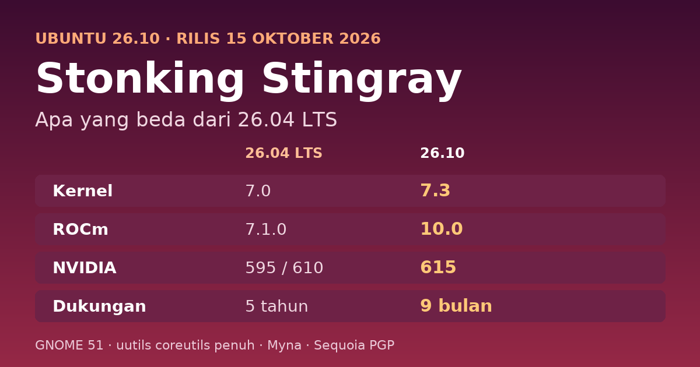

Ubuntu 26.10 "Stonking Stingray" rilis 15 Oktober 2026 sebagai rilis interim yang didukung sembilan bulan, sampai Juli 2027 ([catatan rilis resmi](https://documentation.ubuntu.com/release-notes/26.10/)). Dibanding 26.04 LTS yang rilis 23 April 2026, perubahan utamanya ada di kernel 7.3, GNOME 51, coreutils berbasis Rust yang kini dipakai penuh, dan fitur dikte suara lokal bernama Myna. Tulisan ini merangkum apa yang berubah, apa yang belum ada, dan siapa yang sebaiknya pindah.

<!--more-->

*Ilustrasi: dibuat untuk tulisan ini dari data catatan rilis Ubuntu.*

*Versi paket dan masalah yang diketahui mengikuti catatan rilis 15 Oktober 2026 dan bisa berubah lewat pembaruan.*

> **Poin Penting**
>
> - Ubuntu 26.10 rilis 15 Oktober 2026 dan didukung sampai Juli 2027. Ubuntu 26.04 LTS didukung sampai April 2031.
> - Kernel naik dari 7.0 ke 7.3. Image rilis memakai build pra-rilis 7.3 (7.3.0-9.9, berbasis 7.3-rc6), karena 7.3 final baru keluar setelah rilis perdana (GA).
> - Coreutils berbasis Rust (`uutils`) kini dipakai penuh, termasuk `cp`, `mv`, dan `rm` yang tertahan di 26.04, menurut catatan rilis.
> - Installer baru dan alur onboarding setelah boot belum ada di rilis ini. Keduanya diarahkan ke Ubuntu 28.04 LTS.
> - Sistem dengan TPM-backed full-disk encryption belum bisa upgrade dari 26.04 LTS saat rilis.

## Apa bedanya dengan Ubuntu 26.04 LTS?

Lima hal yang bisa dibandingkan langsung dari catatan rilis dan pengumuman Canonical ada di tabel ini.

| | 26.04 LTS | 26.10 |
|---|---|---|
| Tanggal rilis | 23 April 2026 | 15 Oktober 2026 |
| Dukungan | Lima tahun, sampai April 2031 | Sembilan bulan, sampai Juli 2027 |
| Kernel | 7.0 | 7.3 |
| ROCm | 7.1.0 | 10.0 |
| Driver NVIDIA | Seri 595 dan 610 | Seri 615 (menggantikan 595 dan 610) |

Sumber: [catatan rilis 26.10](https://documentation.ubuntu.com/release-notes/26.10/), [catatan rilis 26.04](https://documentation.ubuntu.com/release-notes/26.04/), [pengumuman Canonical untuk 26.04 LTS](https://canonical.com/blog/canonical-releases-ubuntu-26-04-lts-resolute-raccoon).

Selisih dukungan adalah pembeda yang paling mudah dibandingkan di tabel. Pengguna 26.10 harus pindah ke rilis berikutnya sebelum Juli 2027, sedangkan 26.04 tidak menuntut itu sampai 2031. Canonical juga mencatat bahwa pengguna 26.04 hanya ditawari upgrade otomatis ke 26.10 kalau mereka memilih diberi tahu untuk semua rilis, tidak terbatas pada rilis LTS ([pengumuman rilis](https://lists.ubuntu.com/archives/ubuntu-announce/2026-October/000330.html)).

## Desktop: GNOME 51, dbus-broker, dan Myna

Edisi utama memakai GNOME 51. Canonical menyebut perbaikan responsivitas, ketahanan di bawah tekanan memori, dan layar yang mengingat tingkat kecerahan antar sesi ([Canonical](https://canonical.com/blog/canonical-releases-ubuntu-26-10-stonking-stingray)). Di Settings ada rotasi layar otomatis untuk perangkat dengan akselerometer, pematian touchpad otomatis saat mouse terhubung, dan dukungan DNS search domain. Remote Desktop mendapat dukungan smartcard dan Kerberos, dan Papers bisa menambahkan tanda tangan visual yang berupa anotasi, bukan verifikasi kriptografis ([GamingOnLinux](https://www.gamingonlinux.com/2026/10/ubuntu-26-10-stonking-stingray-released/)). Dukungan Wi-Fi WEP dihapus dari Settings GNOME 51 ([catatan rilis](https://documentation.ubuntu.com/release-notes/26.10/)).

Perubahan lain yang berdampak ke desktop adalah **dbus-broker**. Ia menggantikan `dbus-daemon` sebagai implementasi D-Bus bawaan, dengan penghitungan pesan per aplikasi supaya satu aplikasi tidak bisa membuat desktop macet ([Canonical](https://canonical.com/blog/canonical-releases-ubuntu-26-10-stonking-stingray)). Penyesuaian skor OOM (perlindungan saat memori habis) untuk desktop juga masuk di rilis ini ([Canonical](https://canonical.com/blog/canonical-releases-ubuntu-26-10-stonking-stingray)).

**Myna** adalah dikte suara yang opt-in dan diproses di perangkat lewat model lokal ([Canonical](https://canonical.com/blog/canonical-releases-ubuntu-26-10-stonking-stingray)). Menurut [liputan It's FOSS](https://itsfoss.com/news/ubuntu-26-10-features/), cara pakainya push-to-talk: tahan tombol pintas, bicara, dan teks muncul di posisi kursor. Pengenalan suaranya berjalan di komponen tersandbox bernama Canonical Inference Snap dengan beberapa ukuran model. Canonical menyebut Myna sebagai tonggak pertama roadmap AI menuju desktop yang digerakkan niat pengguna, dan menyatakan Myna akan dibundel bawaan menjelang Ubuntu 28.04 LTS ([Canonical](https://canonical.com/blog/canonical-releases-ubuntu-26-10-stonking-stingray)).

Di sisi aksesibilitas, pembaca layar seperti Orca kini bisa membaca konten aplikasi Flutter dengan lebih baik. App Center menampilkan halaman Drivers baru untuk meninjau driver grafis ([catatan rilis](https://documentation.ubuntu.com/release-notes/26.10/)).

## Keamanan: Rust, Sequoia, dan Entra ID

Perubahan keamanan di rilis ini mencakup yang berikut.

- **Coreutils Rust.** Perangkat inti bawaan kini berjalan sepenuhnya di atas `uutils`. `cp`, `mv`, dan `rm` adalah yang terakhir dipindahkan setelah ditahan dari 26.04 ([catatan rilis](https://documentation.ubuntu.com/release-notes/26.10/)).
- **Sequoia PGP masuk archive utama.** Perintah `sq` dan `sqv` hadir sebagai padanan `gpg` dan `gpgv`, dan `gpg` serta `gpgv` tetap tersedia. Canonical mengaitkannya dengan penandatanganan paket yang siap pasca-kuantum ([catatan rilis](https://documentation.ubuntu.com/release-notes/26.10/), [Canonical](https://canonical.com/blog/canonical-releases-ubuntu-26-10-stonking-stingray)).
- **Microsoft Entra ID.** Integrasi lebih rapat, termasuk kata sandi dengan MFA dan login tanpa kata sandi ([Canonical](https://canonical.com/blog/canonical-releases-ubuntu-26-10-stonking-stingray)).
- **TPM-backed full-disk encryption (FDE)** yang diperkenalkan di 26.04 LTS diperluas ke perangkat tanpa Hardware Root of Trust, dengan opsi mewajibkan PIN atau passphrase ([Canonical](https://canonical.com/blog/canonical-releases-ubuntu-26-10-stonking-stingray)).
- **OpenSSH 10.5 dipecah** menjadi `openssh` tanpa GSSAPI dan `openssh-gssapi`. Instalasi baru memakai versi tanpa GSSAPI secara default ([catatan rilis](https://documentation.ubuntu.com/release-notes/26.10/)).
- **SBOM SPDX** disertakan untuk kernel amd64 dan arm64 ([catatan rilis](https://documentation.ubuntu.com/release-notes/26.10/)).

Menurut It's FOSS, ntpd-rs tersedia di archive pengujian, dengan rencana menjadikannya default di Ubuntu 27.04 ([It's FOSS](https://itsfoss.com/news/ubuntu-26-10-features/)).

## Kernel 7.3 dan perangkat keras

Canonical menyebut Linux 7.3 membawa enablement untuk Intel Xe3P (Nova Lake) dan AMD Zen 6. Rilis ini juga menambah image desktop RISC-V (sebelumnya hanya server) dengan dukungan SpacemiT K3, yang disebut Canonical sebagai perangkat keras RVA23 pertama, serta installer khusus amd64v3 untuk perangkat keras modern ([Canonical](https://canonical.com/blog/canonical-releases-ubuntu-26-10-stonking-stingray)).

Kernel yang dikirim di image rilis adalah 7.3.0-9.9, berbasis 7.3-rc6, karena rilis final upstream 7.3 baru keluar setelah GA ([catatan rilis](https://documentation.ubuntu.com/release-notes/26.10/)). Artinya, kernel 7.3 final diterima lewat pembaruan setelah instalasi.

Dua catatan dari bagian masalah yang diketahui di catatan rilis perlu dibaca sebelum memasang di perangkat baru:

1. Beberapa laptop Snapdragon X2 Elite bisa punya keyboard yang tidak berfungsi karena regresi di Linux 7.3 ([catatan rilis](https://documentation.ubuntu.com/release-notes/26.10/)).
2. SpacemiT K3 belum punya sejumlah fitur: slot PCIe kedua, audio HDMI/DP, dan akselerasi GPU/VPU ([catatan rilis](https://documentation.ubuntu.com/release-notes/26.10/)).

Di sisi driver, seri NVIDIA 615 hanya mengirim modul kernel open, yang mendukung GPU Turing ke atas. Seri 580 masih menyediakan modul proprietary dan open ([catatan rilis](https://documentation.ubuntu.com/release-notes/26.10/)). Untuk AMD, ROCm naik dari 7.1.0 ke 10.0 dengan target `gfx950` dan build generik untuk RDNA 2 dan RDNA 3. Canonical menambahkan bahwa versi baru ini mendukung kerangka serving seperti vLLM dan SGLang ([Canonical](https://canonical.com/blog/canonical-releases-ubuntu-26-10-stonking-stingray)).

## Toolchain dan server

Lompatan terbesar ada di OpenSSL (3.5.5 ke 4.0.3) dan systemd (259.5 ke 261.3). Tabel ini membandingkan versi paket saat rilis, dari arsip Ubuntu di Launchpad (pocket Release, dibaca 17 November 2026); pembaruan setelah rilis tidak tercermin.

| Komponen | 26.04 LTS | 26.10 |
|---|---|---|
| Kernel | 7.0.0-14.14 | 7.3.0-9.9 |
| GNOME Shell | 50.1 | 51.0 |
| systemd | 259.5 | 261.3 |
| OpenSSH | 10.2p1 | 10.5p1 |
| OpenSSL | 3.5.5 | 4.0.3 |
| Python | 3.14.3 | 3.14.7 |
| Go | 1.26 | 1.27 |
| Rust | 1.93.1 | 1.97.1 |

Sumber: halaman paket di Launchpad, yang memuat versi per seri (resolute untuk 26.04, stonking untuk 26.10): [linux](https://launchpad.net/ubuntu/+source/linux), [gnome-shell](https://launchpad.net/ubuntu/+source/gnome-shell), [systemd](https://launchpad.net/ubuntu/+source/systemd), [openssh](https://launchpad.net/ubuntu/+source/openssh), [openssl](https://launchpad.net/ubuntu/+source/openssl), [python3-defaults](https://launchpad.net/ubuntu/+source/python3-defaults), [golang-defaults](https://launchpad.net/ubuntu/+source/golang-defaults), dan [rust-defaults](https://launchpad.net/ubuntu/+source/rust-defaults). Kolom 26.10 untuk kernel, systemd, OpenSSH, OpenSSL, Python, Go, dan Rust juga tertulis di [catatan rilis 26.10](https://documentation.ubuntu.com/release-notes/26.10/); GNOME Shell 51.0 hanya bersumber dari Launchpad dan GNOME 51 disebut di catatan rilis.

[Catatan rilis 26.10](https://documentation.ubuntu.com/release-notes/26.10/) juga mencantumkan GCC 15.2.0, Zig 0.16, .NET 10.0.112, cloud-init 26.2, dan OpenJDK 25.0.4 (OpenJDK 27 tersedia sebagai `openjdk-27`).

Canonical merilis Rust devpack bersamaan dengan 26.10 untuk manajemen versi dan dukungan IDE, dan Spring AI tersedia di desktop untuk pertama kali lewat snap Spring devpack ([Canonical](https://canonical.com/blog/canonical-releases-ubuntu-26-10-stonking-stingray)).

Untuk server, [catatan rilis](https://documentation.ubuntu.com/release-notes/26.10/) mencatat beberapa hal yang dihapus atau ditinggalkan, dan beberapa di antaranya bisa memutus konfigurasi lama:

- `systemd-sysv-generator` dihapus, jadi skrip init System V lama tidak lagi dimuat.
- `mysql_native_password` dihapus di MySQL 9.7.2 LTS (dari 8.4 LTS). Upgrader memblokir upgrade sampai akun dimigrasikan.
- OpenSSL ENGINE dihapus. Konfigurasi harus pindah ke provider PKCS#11.
- Bagian `program` di HAProxy 3.4.2 dihapus.
- Build QEMU 32-bit dihapus, dan libvirt (12.6.0) mengganti akses socket berbasis grup dengan polkit.

Kalau Anda menjalankan Ubuntu Server dan bimbang antara edisi minimal dan reguler, tulisan [Ubuntu Server minimized vs reguler](https://www.udienz.web.id/2026/11/10/ubuntu-server-minimal-vs-reguler) membahas perbedaan keduanya di installer.

## Yang belum ada di rilis ini

Installer yang didesain ulang dan alur onboarding saat pertama boot belum ada. Menurut [It's FOSS](https://itsfoss.com/news/ubuntu-26-10-features/), pekerjaan desainnya berjalan selama siklus 26.10 tetapi pengalaman jadinya ditargetkan untuk Ubuntu 28.04 LTS. Penerapan nyata di installer 26.10 lebih kecil: Subiquity 26.10 menambah dukungan resize Btrfs dan persiapan kebutuhan `/boot` untuk GRUB bertanda tangan, plus TPM/FDE eksperimental ([catatan rilis](https://documentation.ubuntu.com/release-notes/26.10/)).

## Masalah yang diketahui sebelum upgrade

Dari daftar masalah di [catatan rilis](https://documentation.ubuntu.com/release-notes/26.10/):

- Sistem TPM-backed FDE belum bisa upgrade dari 26.04 LTS saat rilis. Dukungan upgrade diharapkan datang kemudian di siklus ini.
- Upgrade bisa berhenti karena symlink `/lib32` yang menggantung.
- Rilis mendatang mungkin menghentikan dukungan sebagian konfigurasi `/boot`, seperti `/boot` terenkripsi dan RAID-5/6.
- Menghapus (`purge`) paket openssh yang sudah berstatus `rc` bisa memutus akses jarak jauh.

## Jadi, perlu pindah dari 26.04 LTS?

Untuk server produksi dan mesin yang ingin dibiarkan bertahun-tahun, 26.04 LTS tetap pilihan yang masuk akal: dukungannya sampai 2031 dan Anda tidak dipaksa migrasi tiap sembilan bulan. Daftar penghapusan di sisi server di atas juga alasan menguji dulu sebelum menaikkan versi.

26.10 lebih cocok untuk pemilik perangkat keras baru seperti Nova Lake dan Zen 6 (perlu diingat, kernel rilisnya masih build 7.3-rc6), pengembang yang butuh Python 3.14.7, Go 1.27, atau Rust 1.97.1 dari repositori resmi, dan yang ingin mencoba Myna lebih awal. Untuk laptop Snapdragon X2 Elite dan board SpacemiT K3, baca dulu masalah yang diketahui di atas. Kalau Anda memakai disk terenkripsi TPM, tunggu dukungan upgrade dari 26.04, yang belum tersedia saat rilis.

Komunitas Ubuntu Indonesia mengumpulkan tulisan anggotanya di Planet Ubuntu-ID, yang [dihidupkan kembali](https://www.udienz.web.id/2026/11/06/menghidupkan-planet-ubuntu-id) awal bulan ini, kalau Anda ingin membaca pengalaman pemakai lain setelah mencoba rilis ini.

## Sumber

- [Catatan rilis Ubuntu 26.10](https://documentation.ubuntu.com/release-notes/26.10/)
- [Catatan rilis Ubuntu 26.04](https://documentation.ubuntu.com/release-notes/26.04/)
- [Canonical: Ubuntu 26.10 Stonking Stingray](https://canonical.com/blog/canonical-releases-ubuntu-26-10-stonking-stingray)
- [Canonical: Ubuntu 26.04 LTS Resolute Raccoon](https://canonical.com/blog/canonical-releases-ubuntu-26-04-lts-resolute-raccoon)
- [Pengumuman rilis di ubuntu-announce](https://lists.ubuntu.com/archives/ubuntu-announce/2026-October/000330.html)
- [It's FOSS: fitur Ubuntu 26.10](https://itsfoss.com/news/ubuntu-26-10-features/)
- [GamingOnLinux: Ubuntu 26.10 dirilis](https://www.gamingonlinux.com/2026/10/ubuntu-26-10-stonking-stingray-released/)

Tulisan ini dibantu oleh AI.
