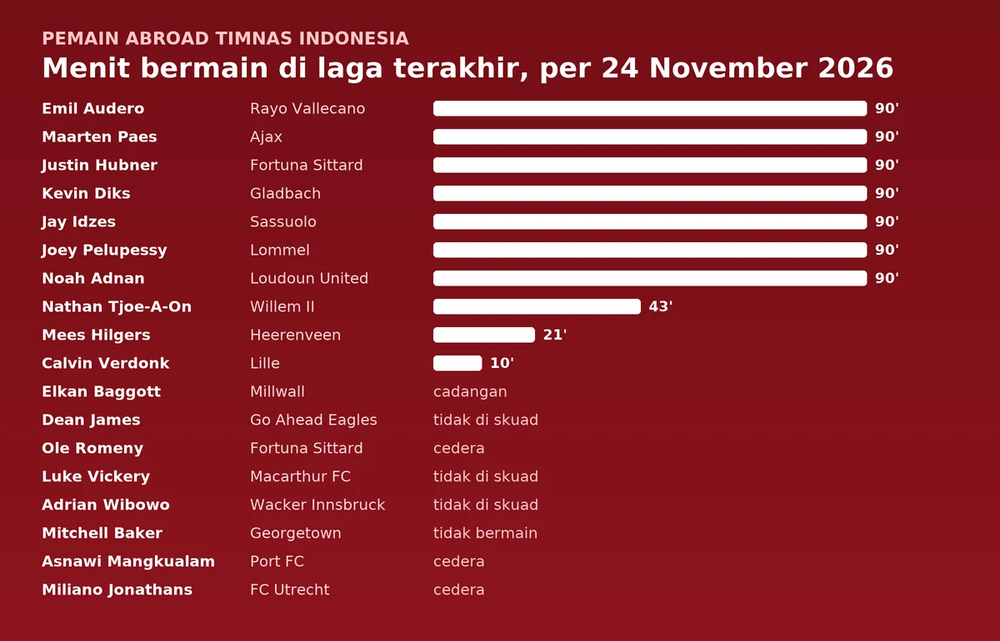
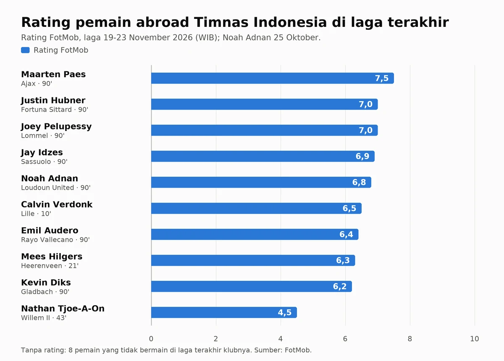

Liga-liga Eropa kembali bergulir setelah jeda internasional November, dan sebagian besar laga terakhir 18 pemain abroad Timnas Indonesia dimainkan antara 19 dan 23 November 2026 waktu Indonesia. Ini pembaruan dari [edisi 9 November](). Maarten Paes, yang delapan laga beruntun hanya duduk di bangku cadangan, tampil penuh dan mencatat clean sheet saat Ajax menang 3-0 atas ADO Den Haag; rating FotMob-nya 7,5, tertinggi di antara pemain yang dipantau. Nathan Tjoe-A-On justru diusir wasit menit ke-43 di kandang FC Twente setelah dua kartu kuning. Tujuh pemain bermain penuh 90 menit, tetapi tidak satu pun mencetak gol atau assist. Delapan pemain tidak bermain di laga terakhir klubnya, dua di antaranya karena cedera lutut.

<!--more-->

> **Poin Penting**
>
> - Maarten Paes main penuh dan clean sheet di laga Eredivisie Ajax kontra ADO Den Haag (3-0), dengan rating FotMob 7,5, tertinggi di edisi ini.
> - Nathan Tjoe-A-On menerima kartu kuning menit ke-33 dan ke-43, lalu Willem II kalah 1-2 di kandang FC Twente.
> - Justin Hubner main penuh saat Fortuna Sittard menang 1-0 di markas Go Ahead Eagles. Dean James, bek Go Ahead Eagles, tidak masuk skuad di laga itu.
> - Dari sepuluh pemain yang turun ke lapangan, hanya empat yang menang: Paes, Hubner, Mees Hilgers (Heerenveen menang 3-1 di Groningen), dan Noah Adnan, yang laga terakhirnya dimainkan 25 Oktober.

Pantauan ini mencakup dua kelompok. Pertama, pemain abroad di pemanggilan resmi terakhir: 22 pemain yang dipanggil John Herdman untuk pemusatan latihan di Bali pada jeda internasional November, setelah uji coba melawan Yordania batal. Empat di antaranya bermain di luar negeri: Mees Hilgers, Noah Adnan, Adrian Wibowo, dan Luke Vickery ([Okezone via RCTI+](https://www.rctiplus.com/news/detail/okezone/5513639/4-pemain-abroad-yang-dipanggil-john-herdman-untuk-tc-di-bali--ada-nama-baru-), [Gebrak](https://www.gebrak.id/?p=62358)). Kedua, pemain abroad lain yang tetap dipantau walau tidak dipanggil ke TC Bali, termasuk skuad juara FIFA ASEAN Cup 2026. Kelompok kedua diberi tanda bintang (\*).

## Ringkasan laga terakhir

Hasil ditulis dari sudut pandang klub si pemain: M (menang), S (seri), K (kalah). Tanda (K) atau (T) setelah nama lawan berarti kandang atau tandang. Tanggal ditulis dalam WIB.

| Pemain | Klub (Liga) | Laga terakhir | Hasil | Menit | Kontribusi |
|---|---|---|:---:|:---:|---|
| Emil Audero\* | Rayo Vallecano (La Liga) | vs Valencia (K), 21 Nov | K 0-1 | 90' | |
| Maarten Paes\* | Ajax (Eredivisie) | vs ADO Den Haag (K), 22 Nov | M 3-0 | 90' | clean sheet |
| Elkan Baggott\* | Millwall (Championship) | vs Queens Park Rangers (K), 21 Nov | K 0-1 | – | cadangan, tidak dimainkan |
| Justin Hubner\* | Fortuna Sittard (Eredivisie) | vs Go Ahead Eagles (T), 22 Nov | M 1-0 | 90' | clean sheet |
| Kevin Diks\* | Borussia Mönchengladbach (Bundesliga) | vs Borussia Dortmund (K), 21 Nov | K 0-1 | 90' | 🟨 71' |
| Nathan Tjoe-A-On\* | Willem II (Eredivisie) | vs FC Twente (T), 22 Nov | K 1-2 | 43' | 🟥 43' (kuning kedua) |
| Dean James\* | Go Ahead Eagles (Eredivisie) | vs Fortuna Sittard (K), 22 Nov | K 0-1 | – | tidak masuk skuad |
| Calvin Verdonk\* | Lille (Ligue 1) | vs Lyon (K), 22 Nov | K 0-1 | 10' | masuk menit ke-80 |
| Jay Idzes\* | Sassuolo (Serie A) | vs Genoa (K), 22 Nov | K 0-2 | 90' | |
| Mees Hilgers | SC Heerenveen (Eredivisie) | vs FC Groningen (T), 22 Nov | M 3-1 | 21' | masuk menit ke-69 |
| Noah Adnan | Loudoun United (USL Championship) | vs Brooklyn (K), 25 Okt | M 4-3 | 90' | |
| Asnawi Mangkualam\* | Port FC (Thai League 1) | vs Svay Rieng (T), 19 Nov | K 1-4 | – | cedera lutut (ACL) |
| Joey Pelupessy\* | Lommel SK (Pro League) | vs Standard Liège (K), 23 Nov | K 1-2 | 90' | |
| Ole Romeny\* | Fortuna Sittard (Eredivisie) | vs Go Ahead Eagles (T), 22 Nov | M 1-0 | – | cedera engkel |
| Luke Vickery | Macarthur FC (A-League) | vs Wellington Phoenix (T), 22 Nov | M 2-1 | – | tidak masuk skuad |
| Adrian Wibowo | FC Wacker Innsbruck (2. Liga Austria) | vs FC Liefering (T), 21 Nov | M 3-0 | – | tidak masuk skuad |
| Mitchell Baker\* | Georgetown (liga kampus NCAA, AS) | vs Syracuse (K), 23 Nov | M 3-1 | – | tidak bermain |
| Miliano Jonathans\* | FC Utrecht (Eredivisie) | vs Cambuur (K), 22 Nov | K 2-3 | – | cedera lutut (ACL) |

## Rating pemain

Maarten Paes teratas di FotMob dengan 7,5, disusul Justin Hubner dan Joey Pelupessy yang sama-sama 7,0. Nathan Tjoe-A-On paling bawah dengan 4,5 setelah kartu merahnya, terpaut 1,7 poin dari Kevin Diks di urutan kesembilan (6,2). Rating Sofascore tidak dicantumkan untuk laga-laga di edisi ini.

## Detail per pemain

Jam ditulis dalam WIB dengan waktu setempat di dalam kurung. Menit, rating FotMob, pencetak gol, stadion, dan laga berikutnya diambil dari halaman pemain, laga, dan tim di FotMob; angka rating ditautkan ke halaman pemainnya. Skor dan pencetak gol laga liga utama Eropa, Championship, dan A-League dicocokkan dengan ESPN. Tanda – di kolom rating berarti tidak tersedia.

### Kiper

#### Emil Audero\* (kiper) · Rayo Vallecano

**Rayo Vallecano 0-1 Valencia** · La Liga · Sabtu, 21 November 2026, 22:15 WIB (16:15 CET) · Estadio de Vallecas, Madrid

| Menit | Kontribusi | Rating FotMob | Rating Sofascore |
|---|---|---|---|
| 90' (starter) | – | [6,4](https://www.fotmob.com/players/602845/emil-audero) | – |

José Copete mencetak satu-satunya gol lewat sundulan menit ke-41 ([ESPN](https://www.espn.com/soccer/scoreboard/_/date/20261121/league/esp.1)). Ini kekalahan 0-1 kedua beruntun Rayo, setelah di kandang Real Sociedad.

**Laga berikutnya**: vs Real Betis (T), La Liga, Sabtu, 28 November 2026, 20:00 WIB.

#### Maarten Paes\* (kiper) · Ajax

**Ajax 3-0 ADO Den Haag** · Eredivisie · Minggu, 22 November 2026, 20:30 WIB (14:30 CET) · Johan Cruijff ArenA, Amsterdam

| Menit | Kontribusi | Rating FotMob | Rating Sofascore |
|---|---|---|---|
| 90' (starter) | clean sheet | [7,5](https://www.fotmob.com/players/805463/maarten-paes) | – |

Di [edisi sebelumnya](), Paes tercatat duduk di bangku cadangan dalam delapan laga beruntun Ajax sejak 11 Oktober tanpa dimainkan. Davy Klaassen mencetak dua gol (menit 3 dan 43) dan Jorthy Mokio satu (15), sementara ADO bermain dengan sepuluh orang sejak Matteo Waem dikartu merah menit ke-37 ([ESPN](https://www.espn.com/soccer/scoreboard/_/date/20261122/league/ned.1)).

**Laga berikutnya**: vs Thun (K), Conference League, Jumat, 27 November 2026, 00:45 WIB.

### Bek

#### Elkan Baggott\* (bek) · Millwall

**Millwall 0-1 Queens Park Rangers** · Championship · Sabtu, 21 November 2026, 19:30 WIB (12:30 GMT) · The Den, London

Cadangan, tidak dimainkan. Baggott, pinjaman dari Ipswich Town, sudah duduk di bangku cadangan dalam tujuh laga liga beruntun tanpa dimainkan ([FotMob](https://www.fotmob.com/players/1193997/elkan-baggott)). Millwall bermain dengan sepuluh orang sejak Zak Sturge dikartu merah menit ke-15, dan Nicolas Madsen mencetak gol QPR di menit 45+1 ([ESPN](https://www.espn.com/soccer/scoreboard/_/date/20261121/league/eng.2)).

**Laga berikutnya**: vs Stoke City (T), Championship, Kamis, 26 November 2026, 03:00 WIB.

#### Justin Hubner\* (bek) · Fortuna Sittard

**Go Ahead Eagles 0-1 Fortuna Sittard** · Eredivisie · Minggu, 22 November 2026, 22:45 WIB (16:45 CET) · De Adelaarshorst, Deventer

| Menit | Kontribusi | Rating FotMob | Rating Sofascore |
|---|---|---|---|
| 90' (starter) | clean sheet | [7,0](https://www.fotmob.com/players/1213683/justin-hubner) | – |

Anthony Descotte mencetak gol kemenangan menit ke-50 ([ESPN](https://www.espn.com/soccer/scoreboard/_/date/20261122/league/ned.1)). Hubner bermain penuh di ketiga laga liga terakhir Fortuna ([FotMob](https://www.fotmob.com/players/1213683/justin-hubner)).

**Laga berikutnya**: vs SC Heerenveen (K), Eredivisie, Minggu, 29 November 2026, 20:30 WIB.

#### Kevin Diks\* (bek) · Borussia Mönchengladbach

**Borussia Mönchengladbach 0-1 Borussia Dortmund** · Bundesliga · Sabtu, 21 November 2026, 21:30 WIB (15:30 CET) · Borussia-Park, Mönchengladbach

| Menit | Kontribusi | Rating FotMob | Rating Sofascore |
|---|---|---|---|
| 90' (starter) | 🟨 71' | [6,2](https://www.fotmob.com/players/566158/kevin-diks) | – |

Setelah masuk dari bangku cadangan di laga sebelumnya, Diks kembali menjadi starter dan bermain penuh. Felix Nmecha mencetak satu-satunya gol menit ke-80 ([ESPN](https://www.espn.com/soccer/scoreboard/_/date/20261121/league/ger.1)).

**Laga berikutnya**: vs Werder Bremen (T), Bundesliga, Sabtu, 28 November 2026, 02:30 WIB.

#### Nathan Tjoe-A-On\* (bek kiri) · Willem II

**FC Twente 2-1 Willem II** · Eredivisie · Minggu, 22 November 2026, 18:15 WIB (12:15 CET) · De Grolsch Veste, Enschede

| Menit | Kontribusi | Rating FotMob | Rating Sofascore |
|---|---|---|---|
| 43' (starter) | 🟨 33', 🟥 43' (kuning kedua) | [4,5](https://www.fotmob.com/players/1075242/nathan-tjoe) | – |

Dengan sepuluh orang, Willem II sempat unggul lewat Devin Haen menit ke-53, tetapi Twente membalas lewat Ramiz Zerrouki (59) dan sundulan Marko Pjaca (82) ([ESPN](https://www.espn.com/soccer/scoreboard/_/date/20261122/league/ned.1)). Dua pekan sebelumnya Tjoe-A-On mencatat rating 7,8, tertinggi di edisi itu.

**Laga berikutnya**: vs FC Groningen (T), Eredivisie, Sabtu, 28 November 2026, 02:00 WIB.

#### Dean James\* (bek kiri) · Go Ahead Eagles

**Go Ahead Eagles 0-1 Fortuna Sittard** · Eredivisie · Minggu, 22 November 2026, 22:45 WIB (16:45 CET) · De Adelaarshorst, Deventer

Tidak masuk skuad. Penampilan terakhir James tercatat pada 1 November, saat ia ditarik pada jeda di laga kontra Cambuur; setelah itu ia duduk di bangku cadangan di Rotterdam melawan Excelsior ([FotMob](https://www.fotmob.com/players/1180694/dean-james)).

**Laga berikutnya**: vs PSV Eindhoven (T), Eredivisie, Minggu, 29 November 2026, 00:45 WIB.

#### Calvin Verdonk\* (bek kiri) · Lille

**Lille 0-1 Lyon** · Ligue 1 · Minggu, 22 November 2026, 02:45 WIB (Sabtu, 20:45 CET) · Stade Pierre-Mauroy, Villeneuve-d'Ascq

| Menit | Kontribusi | Rating FotMob | Rating Sofascore |
|---|---|---|---|
| 10' (masuk menit ke-80, menggantikan Romain Perraud) | – | [6,5](https://www.fotmob.com/players/622137/calvin-verdonk) | – |

Verdonk mulai dari bangku cadangan, setelah menjadi starter di Rennes dua pekan sebelumnya. Mads Bidstrup mencetak gol Lyon menit ke-40 ([ESPN](https://www.espn.com/soccer/scoreboard/_/date/20261121/league/fra.1)).

**Laga berikutnya**: vs Bayern München (K), Liga Champions, Kamis, 26 November 2026, 03:00 WIB.

#### Jay Idzes\* (bek) · Sassuolo

**Sassuolo 0-2 Genoa** · Serie A · Minggu, 22 November 2026, 21:00 WIB (15:00 CET) · MAPEI Stadium, Reggio Emilia

| Menit | Kontribusi | Rating FotMob | Rating Sofascore |
|---|---|---|---|
| 90' (starter) | – | [6,9](https://www.fotmob.com/players/937412/jay-idzes) | – |

Milutin Osmajić mencetak kedua gol Genoa, menit ke-26 dan ke-38 ([ESPN](https://www.espn.com/soccer/scoreboard/_/date/20261122/league/ita.1)). Sassuolo kalah di tiga laga Serie A beruntun, dan Idzes bermain penuh di ketiganya ([FotMob](https://www.fotmob.com/players/937412/jay-idzes)).

**Laga berikutnya**: vs Napoli (K), Serie A, Minggu, 29 November 2026, 21:00 WIB.

#### Mees Hilgers (bek) · SC Heerenveen

**FC Groningen 1-3 SC Heerenveen** · Eredivisie · Minggu, 22 November 2026, 03:00 WIB (Sabtu, 21:00 CET) · Euroborg, Groningen

| Menit | Kontribusi | Rating FotMob | Rating Sofascore |
|---|---|---|---|
| 21' (masuk menit ke-69, menggantikan Sam Kersten) | – | [6,3](https://www.fotmob.com/players/1192130/mees-hilgers) | – |

Hilgers masuk saat skor 1-1. Heerenveen lalu menambah dua gol lewat sundulan Dylan Vente (73) dan Dirk Proper (80); Vente juga mencetak gol pertama menit ke-41 ([ESPN](https://www.espn.com/soccer/scoreboard/_/date/20261121/league/ned.1)).

**Laga berikutnya**: vs Fortuna Sittard (T), Eredivisie, Minggu, 29 November 2026, 20:30 WIB.

#### Noah Adnan (bek) · Loudoun United

**Loudoun United 4-3 Brooklyn** · USL Championship · Minggu, 25 Oktober 2026, 04:00 WIB (Sabtu, 17:00 EDT) · Segra Field, Leesburg, Virginia

| Menit | Kontribusi | Rating FotMob | Rating Sofascore |
|---|---|---|---|
| 90' (starter) | – | [6,8](https://www.fotmob.com/players/1719157/noah-adnan) | – |

Bek tengah ini baru pertama kali dipanggil Timnas lewat TC Bali ([Okezone via RCTI+](https://www.rctiplus.com/news/detail/okezone/5513639/4-pemain-abroad-yang-dipanggil-john-herdman-untuk-tc-di-bali--ada-nama-baru-)) dan bermain untuk klub divisi kedua Amerika Serikat. Loudoun tertinggal 1-3 saat jeda, lalu membalik skor lewat Abdellatif Aboukoura (47), James Murphy (65), dan Liam Butts (88).

**Laga berikutnya**: belum ada jadwal.

#### Asnawi Mangkualam\* (bek kanan) · Port FC

**Svay Rieng 4-1 Port FC** · ASEAN Club Championship · Kamis, 19 November 2026, 19:00 WIB (19:00 waktu setempat) · Stadion Nasional Morodok Techo, Phnom Penh ([FotMob](https://www.fotmob.com/match/1000014460))

Tidak masuk skuad: masih dalam pemulihan cedera ACL. Asnawi menjalani operasi pada 28 Januari 2026 ([detikHealth](https://health.detik.com/kebugaran/d-8333320/menyoal-cedera-acl-dialami-asnawi-sampai-harus-naik-meja-operasi/amp)) dan pada Oktober tidak didaftarkan di skuad Thai League 2026/27 ([Chatnews](https://chatnews.id/port-fc-kalah-dari-persib-dan-kashiwa-reysol-tanpa-asnawi)). Penampilan terakhirnya tercatat pada 18 Januari ([FotMob](https://www.fotmob.com/players/799669/asnawi-bahar)).

**Laga berikutnya**: vs Gamba Osaka (T), AFC Champions League Elite, Rabu, 25 November 2026, 17:00 WIB.

### Gelandang

#### Joey Pelupessy\* (gelandang) · Lommel SK

**Lommel SK 1-2 Standard Liège** · Pro League Belgia · Senin, 23 November 2026, 01:15 WIB (Minggu, 19:15 CET) · Soeverein Stadion, Lommel

| Menit | Kontribusi | Rating FotMob | Rating Sofascore |
|---|---|---|---|
| 90' (starter) | – | [7,0](https://www.fotmob.com/players/248151/joey-pelupessy) | – |

Standard unggul 2-0 lewat gol cepat menit ke-5 dan gol Adnane Abid (55). Penalti Don-Angelo Konadu di menit 90+3 hanya memperkecil kekalahan ([ESPN](https://www.espn.com/soccer/scoreboard/_/date/20261122/league/bel.1)).

**Laga berikutnya**: vs Zulte Waregem (K), Pro League Belgia, Minggu, 29 November 2026, 02:45 WIB.

### Penyerang

#### Ole Romeny\* (penyerang) · Fortuna Sittard

**Go Ahead Eagles 0-1 Fortuna Sittard** · Eredivisie · Minggu, 22 November 2026, 22:45 WIB (16:45 CET) · De Adelaarshorst, Deventer

Tidak masuk skuad. Ini laga ketiga beruntun Romeny tanpa masuk skuad Fortuna; penampilan terakhirnya 45 menit melawan Excelsior pada 25 Oktober ([FotMob](https://www.fotmob.com/players/915365/ole-romeny)), setelah itu cedera engkelnya kambuh ([Bola.com](https://www.bola.com/dunia/read/8323621/cedera-engkel-ole-romeny-menepi-lagi-dari-skuad-fortuna-sittard)).

**Laga berikutnya**: vs SC Heerenveen (K), Eredivisie, Minggu, 29 November 2026, 20:30 WIB.

#### Luke Vickery (sayap) · Macarthur FC

**Wellington Phoenix 1-2 Macarthur FC** · A-League · Minggu, 22 November 2026, 09:00 WIB (15:00 NZDT) · Hnry Stadium, Wellington

Tidak masuk skuad. Penampilan terakhir Vickery adalah 57 menit melawan Brisbane Roar pada 8 November ([FotMob](https://www.fotmob.com/players/1612270/luke-vickery)), sebelum ia bergabung dengan TC Timnas di Bali. Apostolos Stamatelopoulos (menit 6) dan Dean Bosnjak (19) mencetak gol Macarthur ([ESPN](https://www.espn.com/soccer/scoreboard/_/date/20261121/league/aus.1)).

**Laga berikutnya**: vs Melbourne City (K), A-League, Jumat, 27 November 2026, 15:40 WIB.

#### Adrian Wibowo (sayap) · FC Wacker Innsbruck

**FC Liefering 0-3 FC Wacker Innsbruck** · 2. Liga Austria · Sabtu, 21 November 2026, 21:30 WIB (15:30 CET) · Red Bull Arena, Wals-Siezenheim ([FotMob](https://www.fotmob.com/match/5875025))

Tidak masuk skuad. Wibowo dipinjamkan Los Angeles FC ke Wacker Innsbruck sejak Juni 2026 ([Bola.com](https://www.bola.com/indonesia/read/7891736/resmi-disekolahkan-lafc-winger-timnas-indonesia-adrian-wibowo-gabung-klub-kasta-kedua-liga-austria)). Penampilan terakhirnya adalah 22 menit sebagai pemain pengganti saat Innsbruck kalah 1-2 dari Austria Wien II pada 31 Oktober ([FotMob](https://www.fotmob.com/players/1512636/adrian-wibowo)).

**Laga berikutnya**: vs First Vienna (K), 2. Liga Austria, Sabtu, 28 November 2026, 02:30 WIB.

#### Mitchell Baker\* (penyerang) · Georgetown

**Georgetown 3-1 Syracuse** · NCAA Divisi I, turnamen nasional · Senin, 23 November 2026, 05:00 WIB (Minggu, 17:00 EST) · Shaw Field, Washington, D.C.

Tidak bermain: namanya tidak ada di box score laga ini, dan juga tidak ada di semifinal dan final turnamen Big East, 13 dan 16 November WIB ([Georgetown Athletics](https://guhoyas.com/sports/mens-soccer/stats/2026/syracuse/boxscore/22309)). Penampilan terakhirnya tercatat pada laga 2-2 di kandang UConn, 7 November WIB. Top skor FIFA ASEAN Cup 2026 ini ([Databoks](https://databoks.katadata.co.id/en/sport/statistics/6ac447d1336cb/indonesia-wins-2026-fifa-asean-cup-mitchell-baker-named-top-scorer)) masih terdaftar di skuad Georgetown musim 2026 ([Georgetown Athletics](https://guhoyas.com/sports/mens-soccer/roster)).

**Laga berikutnya**: vs UCLA (K), turnamen NCAA, Minggu, 29 November 2026, 05:00 WIB.

#### Miliano Jonathans\* (sayap) · FC Utrecht

**FC Utrecht 2-3 Cambuur** · Eredivisie · Minggu, 22 November 2026, 00:45 WIB (Sabtu, 18:45 CET) · Stadion Galgenwaard, Utrecht

Tidak masuk skuad: pemulihan cedera ligamen lutut (ACL) yang dialaminya pada Maret 2026 ([Bola.com](https://www.bola.com/dunia/read/6295372/miliano-jonathans-kena-cedera-acl-lagi-musim-berakhir-dan-gagal-tampil-di-fifa-series-bersama-timnas-indonesia)). FotMob masih mencatatnya cedera lutut, dengan penampilan terakhir pada 7 Maret 2026 ([FotMob](https://www.fotmob.com/players/1359577/miliano-jonathans)).

**Laga berikutnya**: vs ADO Den Haag (T), Eredivisie, Minggu, 29 November 2026, 18:15 WIB.

## Jadwal laga berikutnya

Laga berikutnya semua pemain, diurutkan menurut waktu WIB. Pemain yang sedang cedera tetap dicantumkan. Noah Adnan belum punya jadwal.

| Waktu (WIB) | Laga | Kompetisi | Pemain |
|---|---|---|---|
| Rabu, 25 Nov, 17:00 | Gamba Osaka vs Port FC | AFC Champions League Elite | Asnawi (cedera) |
| Kamis, 26 Nov, 03:00 | Lille vs Bayern München | Liga Champions | Verdonk |
| Kamis, 26 Nov, 03:00 | Stoke City vs Millwall | Championship | Baggott |
| Jumat, 27 Nov, 00:45 | Ajax vs Thun | Conference League | Paes |
| Jumat, 27 Nov, 15:40 | Macarthur FC vs Melbourne City | A-League | Vickery |
| Sabtu, 28 Nov, 02:00 | FC Groningen vs Willem II | Eredivisie | Tjoe-A-On |
| Sabtu, 28 Nov, 02:30 | Werder Bremen vs Borussia Mönchengladbach | Bundesliga | Diks |
| Sabtu, 28 Nov, 02:30 | FC Wacker Innsbruck vs First Vienna | 2. Liga Austria | Wibowo |
| Sabtu, 28 Nov, 20:00 | Real Betis vs Rayo Vallecano | La Liga | Audero |
| Minggu, 29 Nov, 00:45 | PSV Eindhoven vs Go Ahead Eagles | Eredivisie | James |
| Minggu, 29 Nov, 02:45 | Lommel SK vs Zulte Waregem | Pro League Belgia | Pelupessy |
| Minggu, 29 Nov, 05:00 | Georgetown vs UCLA | Turnamen NCAA | Baker |
| Minggu, 29 Nov, 18:15 | ADO Den Haag vs FC Utrecht | Eredivisie | Jonathans (cedera) |
| Minggu, 29 Nov, 20:30 | Fortuna Sittard vs SC Heerenveen | Eredivisie | Hubner, Romeny (cedera), Hilgers |
| Minggu, 29 Nov, 21:00 | Sassuolo vs Napoli | Serie A | Idzes |

Hubner dan Hilgers akan saling berhadapan di Sittard pada 29 November.

## Sumber

- FotMob, halaman pemain (menit, rating, laga terakhir), halaman laga (pencetak gol, stadion, pergantian pemain, susunan pemain), dan halaman tim (laga berikutnya), diakses 24 November 2026. Tautan per pemain ada di kolom rating dan catatan.
- ESPN, papan skor Eredivisie [21 November](https://www.espn.com/soccer/scoreboard/_/date/20261121/league/ned.1) dan [22 November 2026](https://www.espn.com/soccer/scoreboard/_/date/20261122/league/ned.1), La Liga [21 November](https://www.espn.com/soccer/scoreboard/_/date/20261121/league/esp.1), Bundesliga [21 November](https://www.espn.com/soccer/scoreboard/_/date/20261121/league/ger.1), Ligue 1 [21 November](https://www.espn.com/soccer/scoreboard/_/date/20261121/league/fra.1), Serie A [22 November](https://www.espn.com/soccer/scoreboard/_/date/20261122/league/ita.1), Pro League Belgia [22 November](https://www.espn.com/soccer/scoreboard/_/date/20261122/league/bel.1), Championship [21 November](https://www.espn.com/soccer/scoreboard/_/date/20261121/league/eng.2), dan A-League [21 November](https://www.espn.com/soccer/scoreboard/_/date/20261121/league/aus.1).
- Georgetown Athletics, [box score Georgetown vs Syracuse](https://guhoyas.com/sports/mens-soccer/stats/2026/syracuse/boxscore/22309), [jadwal](https://guhoyas.com/sports/mens-soccer/schedule), dan [skuad](https://guhoyas.com/sports/mens-soccer/roster), November 2026.
- Okezone via RCTI+, [4 Pemain Abroad yang Dipanggil John Herdman untuk TC di Bali](https://www.rctiplus.com/news/detail/okezone/5513639/4-pemain-abroad-yang-dipanggil-john-herdman-untuk-tc-di-bali--ada-nama-baru-), 10 November 2026.
- Gebrak, [Herdman Panggil 22 Pemain Timnas Indonesia ke TC Bali](https://www.gebrak.id/?p=62358), 10 November 2026.
- Bola.com, [Resmi Disekolahkan LAFC, Adrian Wibowo Gabung Klub Kasta Kedua Liga Austria](https://www.bola.com/indonesia/read/7891736/resmi-disekolahkan-lafc-winger-timnas-indonesia-adrian-wibowo-gabung-klub-kasta-kedua-liga-austria), Juni 2026.
- Bola.com, [Cedera Engkel, Ole Romeny Menepi Lagi dari Skuad Fortuna Sittard](https://www.bola.com/dunia/read/8323621/cedera-engkel-ole-romeny-menepi-lagi-dari-skuad-fortuna-sittard), November 2026.
- Bola.com, [Miliano Jonathans Kena Cedera ACL Lagi](https://www.bola.com/dunia/read/6295372/miliano-jonathans-kena-cedera-acl-lagi-musim-berakhir-dan-gagal-tampil-di-fifa-series-bersama-timnas-indonesia), Maret 2026.
- detikHealth, [Menyoal Cedera ACL, Dialami Asnawi Sampai Harus Naik Meja Operasi](https://health.detik.com/kebugaran/d-8333320/menyoal-cedera-acl-dialami-asnawi-sampai-harus-naik-meja-operasi/amp), Januari 2026.
- Chatnews, [Port FC Kalah dari Persib dan Kashiwa Reysol Tanpa Asnawi](https://chatnews.id/port-fc-kalah-dari-persib-dan-kashiwa-reysol-tanpa-asnawi), Oktober 2026.

---

*Data per 24 November 2026, mencakup laga yang selesai hingga Senin pagi, 23 November (WIB). Penulis: Mahyuddin Susanto ([tentang penulis](https://www.udienz.web.id/about/), [kontak](https://www.udienz.web.id/contact.html)). Tulisan ini dibantu oleh AI.*
