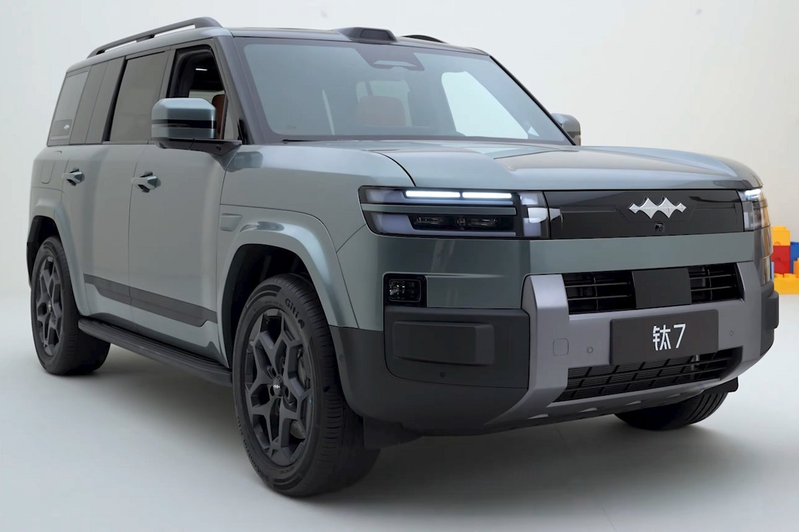
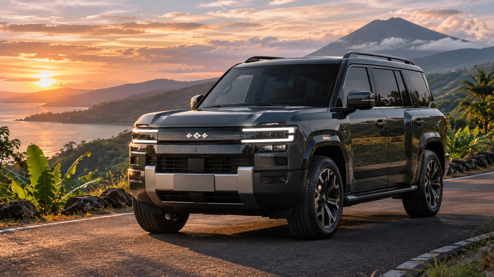

BYD Motor Indonesia meluncurkan Titan 7 DM di Gaikindo Auto Week (GAW) 2026, ICE BSD City, pada Jumat, 20 November 2026 ([oto.com](https://www.oto.com/berita-mobil/byd-titan-7-suv-7-seater-phev-penantang-pajero-cs-harga-mulai-rp639-juta)). Ini SUV plug-in hybrid tujuh kursi dengan dua varian: Premium Rp639 juta dan Performance Rp739 juta, keduanya OTR (on the road, harga siap jalan) Jakarta.

<!--more-->

*Fangchengbao Ti7 (Tai 7), basis Titan 7 di China. Di Indonesia dijual sebagai BYD Titan 7, jadi lencana dan detail depannya bisa berbeda. Foto: AutoLab, [CC BY 3.0](https://creativecommons.org/licenses/by/3.0), via [Wikimedia Commons](https://commons.wikimedia.org/wiki/File:Fangchengbao_Ti7_front_view_01.png).*

> **Poin Penting**
>
> - Titan 7 DM dijual dalam dua varian: Premium (DM-i, penggerak roda depan) Rp639 juta dan Performance (DM-p, AWD) Rp739 juta, OTR Jakarta.
> - Brosur resmi BYD Indonesia mencatat jarak tempuh listrik 110 km untuk Premium dan 155 km untuk Performance, menurut siklus uji NEDC. Motor listrik Performance menghasilkan total 360 kW dan torsi 630 Nm, 0-100 km/jam dalam 4,8 detik.
> - Selisih Rp100 juta membeli AWD, baterai lebih besar, dan sejumlah fitur yang tidak ada di Premium, antara lain Leopard U-Turn dan Creep Mode.

## Nama dan posisi Titan 7

Titan 7 adalah nama Indonesia untuk SUV yang di pasar global bernama Ti7. Di China, model yang sama dikenal sebagai Fangchengbao Tai 7. Paultan menulis bahwa BYD memasarkannya di luar China dengan merek utama BYD, bukan sebagai Denza ([Paultan](https://paultan.org/2026/05/25/byd-ti7-for-global-markets-rebadged-fangchengbao-tai-7-is-a-7-seat-1-5t-phev-suv-with-127-km-ev-range/)).

BYD membingkai peluncuran ini dengan biaya bahan bakar. Saat peluncuran, Luther Panjaitan, Head of Public and Government Relations BYD Indonesia, mengatakan konsumen masih mempertimbangkan biaya bahan bakar, khususnya diesel ([Okezone](https://ototekno.okezone.com/read/2026/11/20/15/3255254/byd-titan-7-dm-meluncur-dibanderol-mulai-rp639-juta)).

## Dua varian dan harganya

DM adalah singkatan Dual Mode, label BYD untuk sistem plug-in hybrid ([oto.com](https://www.oto.com/berita-mobil/byd-titan-7-suv-7-seater-phev-penantang-pajero-cs-harga-mulai-rp639-juta)). Varian Performance memakai DM-p, yang disebut Okezone sebagai Dual Mode Powerful ([Okezone](https://ototekno.okezone.com/read/2026/11/20/15/3255254/byd-titan-7-dm-meluncur-dibanderol-mulai-rp639-juta)), dan Premium memakai DM-i.

| | Premium | Performance |
|---|---|---|
| Sistem | DM-i | DM-p |
| Penggerak | Roda depan | AWD |
| Mesin | 1.5T, 110 kW, 220 Nm | 1.5T, 110 kW, 220 Nm |
| Motor listrik | 200 kW, 315 Nm (depan) | 360 kW, 630 Nm (total) |
| 0-100 km/jam | 8,4 detik atau kurang | 4,8 detik atau kurang |
| Baterai (Blade Battery LFP) | 26,6 kWh | 35,6 kWh |
| Jarak tempuh listrik (NEDC) | 110 km | 155 km |
| Pengisian DC / AC | 54 kW / 6,6 kW | 73 kW / 6,6 kW |
| Harga OTR Jakarta | Rp639 juta | Rp739 juta |
| Harga OTR Kalimantan | Rp679 juta | Rp779 juta |

Sumber: spesifikasi dari [brosur resmi BYD Indonesia](https://www.byd.com/material/__APAC/byd-site/id/titan-7/brochure/byd-titan7-brochure-idn.pdf) (versi November 2026) dan [laman resmi Titan 7 DM](https://www.byd.com/id/car/titan7dm), harga Jakarta dari [oto.com](https://www.oto.com/berita-mobil/byd-titan-7-suv-7-seater-phev-penantang-pajero-cs-harga-mulai-rp639-juta), harga Kalimantan dari [CNN Indonesia](https://www.cnnindonesia.com/otomotif/20261124191747-603-1430999/usai-meluncur-di-gaw-2026-byd-titan-7-dm-muncul-di-balikpapan).

Selisih harga Jakarta dan Kalimantan sama di kedua varian, Rp40 juta. CNN Indonesia menulis bahwa selisih itu dipahami terkait sistem perpajakan tiap wilayah dan faktor lain. Harga Kalimantan itu diumumkan saat Titan 7 tampil di BYD Tech Culture Fest Balikpapan, 18 sampai 22 November 2026.

Daya total motor listrik Performance 360 kW setara sekitar 490 PS. Brosur mencantumkan mesin bensin 110 kW secara terpisah. Kecepatan puncak kedua varian disebut minimal 190 km/jam, dan bobot kosong Premium 2.325 kg, Performance 2.510 kg. Tangki bensin 60 liter.

## Selisih Rp100 juta antara Premium dan Performance

Dari brosur, uang itu membeli lebih dari penggerak AWD dan baterai 9 kWh lebih besar:

- Tenaga dan percepatan: 0-100 km/jam turun dari 8,4 detik ke 4,8 detik.
- Suspensi peredam cerdas DiSus-C, rem depan dengan kaliper tetap (fixed caliper), dan cakram belakang berventilasi hanya ada di Performance. Ukuran ban juga naik dari 255/60 R19 ke 255/55 R20.
- Fitur medan dan manuver: Leopard U-Turn, Creep Mode, serta mode Mud, Sand, dan Mountain hanya di Performance. Kedua varian punya mode Eco, Normal, Sport, Racing, dan Snow.
- Kabin: kulit premium (Premium memakai kulit sintetis), jok pengemudi 8 arah dengan memori, pijat, dan penyangga pinggang, head-up display, pengisi daya nirkabel ganda, audio 18 speaker (Premium 14), lemari pendingin di depan, dan lampu ambient multiwarna.
- Keselamatan: High-Speed Tire Burst Assist, yang di brosur hanya tercatat untuk Performance.

Kalau Anda tidak butuh akselerasi atau fitur off-road, Premium sudah mencakup 20 fungsi ADAS dan fungsi V2L yang sama dengan Performance. Perbandingan "layak atau tidak" tetap bergantung pada pemakaian Anda, dan itu penilaian saya, bukan klaim BYD.

## Jarak tempuh listrik

Angka 110 dan 155 km jauh di atas gambaran umum plug-in hybrid. Departemen Energi AS menyebut sebagian besar PHEV hanya menempuh 20 sampai 40 mil, kira-kira 32 sampai 64 km, dengan listrik saja ([U.S. DOE](https://afdc.energy.gov/vehicles/electric)). Perbandingannya tidak sebanding persis, karena angka BYD memakai siklus uji NEDC, sedangkan angka AS berasal dari sumber dan metode lain. Dasar perbedaan PHEV dan mobil listrik murni ada di [tulisan tentang pengertian dan jenis mobil listrik](https://www.udienz.web.id/2026/11/04/mobil-listrik-pengertian-jenis-cara-kerja).

Brosur BYD sendiri mencantumkan catatan bahwa jarak sebenarnya dipengaruhi gaya berkendara, beban, dan lalu lintas, dan angka NEDC (New European Driving Cycle) hanya perkiraan sebagai acuan. Sebagai contoh hitungan saya sendiri: kalau angka Premium dipotong separuh jadi sekitar 55 km, perjalanan pulang-pergi kantor 40 km masih bisa ditempuh dengan listrik saja, dengan bensin sebagai cadangan untuk luar kota. Pengguna dengan rute harian jauh di atas angka itu perlu menghitung ulang.

## Ukuran dan kemampuan di medan berat

*Ilustrasi: dibuat dengan AI untuk menggambarkan suasana. Detail bodi dan lencananya tidak mewakili unit resmi Titan 7.*

| Dimensi | Ukuran |
|---|---|
| Panjang | 5.146 mm |
| Lebar | 1.995 mm |
| Tinggi | 1.863 mm |
| Jarak sumbu roda | 2.920 mm |
| Ground clearance | 180 mm (bermuatan penuh), 205 mm (kosong) |
| Kedalaman air maksimum | 600 mm |
| Sudut pendekatan / sudut keluar | 24° / 25° |
| Radius putar minimum | 5,7 m |
| Bagasi (semua baris terpasang / baris ketiga dilipat / baris kedua dilipat) | 127 / 970 / 1.830 liter |

Sumber: brosur resmi BYD Indonesia. Panjang di atas lima meter menaruh Titan 7 di kelas SUV besar, dan bagasi 127 liter dengan tiga baris terpasang kecil, jadi barang bawaan perjalanan jauh sebaiknya dihitung dengan baris ketiga dilipat.

## Fitur kabin dan keselamatan

Fitur berikut ada di kedua varian menurut brosur:

- Layar sentuh 15,6 inci dengan DiLink, GPS, 4G, Apple CarPlay, dan Android Auto, serta kontrol suara empat zona.
- Panel instrumen LCD penuh, atap panoramik dengan tirai listrik, dan AC otomatis tiga zona.
- Jok depan berventilasi, rak atap, dan ban cadangan ukuran penuh.
- 20 fungsi ADAS, antara lain adaptive cruise control, pengereman darurat otomatis (AEB), pemantau titik buta, dan peringatan lalu lintas silang.
- Airbag depan, samping, dan tirai, ISOFIX, sentry mode, dan fungsi Vehicle-to-Load (V2L) untuk menyuplai listrik ke perangkat lain dari baterai mobil.

Warna eksteriornya Ti Grey, Cosmos Black, dan Nebula Silver, dengan interior biru-hitam.

## Konteks pasar

CNN Indonesia mengutip data BYD dan Gaikindo: penjualan mobil listrik nasional sampai Oktober 2026 mencapai 134 ribu unit, naik 94 persen dari 69 ribu unit pada periode yang sama 2025. Menurut data itu, pangsa EV nasional tumbuh dari 5 persen pada 2024 menjadi 26 persen pada Oktober 2026. Periodenya tidak sama (2024 dan Oktober 2026), jadi baca angkanya sebagai arah, bukan perbandingan sebanding. Artikel yang sama mencatat jaringan layanan BYD sudah menjangkau lebih dari 120 dealer.

Daftar mobil listrik murni terlaris dan cara memilihnya ada di [tulisan tentang 10 model terlaris](https://www.udienz.web.id/2026/11/04/mobil-listrik-10-model-terlaris-cara-memilih).

Titan 7 sendiri plug-in hybrid, jadi belum tentu masuk kategori mobil listrik murni dalam data di atas. Karena itu angka pangsa 26 persen tidak bisa langsung dibaca sebagai peluang Titan 7.

## Yang perlu dicek sebelum membeli

- Garansi kendaraan dan baterai, ke dealer BYD terdekat atau [laman garansi BYD Indonesia](https://www.byd.com/id/aftersales/warranty).
- Status unit: tanyakan ke dealer apakah dirakit lokal atau diimpor utuh.
- Waktu pengiriman dan ketersediaan titik pengisian DC di rute Anda. Gambaran pengisian di Indonesia ada di [tulisan tentang cara kerja dan pengisian mobil listrik](https://www.udienz.web.id/2026/11/04/mobil-listrik-cara-kerja-pengisian-harga).
- Hasil uji jalan independen untuk konsumsi bensin dan jarak tempuh listrik di kondisi nyata.

Tulisan ini dibantu oleh AI.
